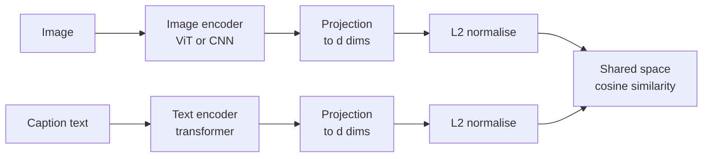

In [RAG Fundamentals](/learn/rag-fundamentals/embedding-generation) you embedded text so that similar meanings land close together and a query can find relevant passages. **Multimodal embeddings** extend the same idea across modalities: an image of a red bicycle and the sentence "a red bicycle leaning on a wall" map to nearby vectors in one **shared embedding space**. That single property unlocks text-to-image search, image-to-text search, zero-shot classification, deduplication of product photos, and the retrieval half of multimodal RAG. This lesson explains how such spaces are trained with a contrastive loss, implements that loss in PyTorch, and shows how to build one index that holds both images and text.

## Shared embedding spaces

A text embedding model maps text to vectors; an image classifier's penultimate layer maps images to vectors. But those two spaces are unrelated: dimension 17 means one thing in the first and something else in the second, so comparing them is meaningless. A shared space is built by training **two encoders together** so that their outputs are comparable.



This is the **dual encoder** design from the [Vision-Language Models](/learn/multimodal-ai/vision-language-models) lesson. CLIP (Contrastive Language-Image Pre-training) popularised it by training on a very large collection of image-caption pairs gathered from the web. Variants extend the idea to audio-text pairs, video-text pairs, and models that bind several modalities to a common space. Because each input is encoded independently, you can embed millions of images once, offline, and compare any new text query against them with a single vector search.

## Contrastive learning with InfoNCE

How do you train two encoders to agree without labels like "cat" or "dog"? The training data is just pairs: each image comes with the caption it was published with. The trick is to use the *other* pairs in the batch as negatives.

Take a batch of $N$ pairs. Encode all images to normalised vectors $u_1, \dots, u_N$ and all captions to normalised vectors $v_1, \dots, v_N$. Compute every image-caption similarity, $s_{ij} = u_i^\top v_j$, giving an $N \times N$ matrix. The diagonal entries $s_{ii}$ are the true pairs; everything off the diagonal is a mismatch. The model should make each row's diagonal entry the largest, which is a classification problem: "which of the $N$ captions belongs to image $i$?"

The **InfoNCE** loss for the image-to-text direction is the cross-entropy of that classification:

$$
\mathcal{L}_{\text{img}\to\text{txt}} = -\frac{1}{N}\sum_{i=1}^{N} \log \frac{\exp(s_{ii}/\tau)}{\sum_{j=1}^{N} \exp(s_{ij}/\tau)}
$$

where $\tau > 0$ is a **temperature** that sharpens or softens the softmax (CLIP learns it during training). The text-to-image loss $\mathcal{L}_{\text{txt}\to\text{img}}$ is the same with the roles swapped (sum over $j$ in the columns instead of rows). CLIP's loss is the average of the two:

$$
\mathcal{L} = \tfrac{1}{2}\left(\mathcal{L}_{\text{img}\to\text{txt}} + \mathcal{L}_{\text{txt}\to\text{img}}\right)
$$

Minimising it pulls matching pairs together and pushes non-matching ones apart. With $N$ pairs you get $N$ positives and $N^2 - N$ negatives from one batch, which is why contrastive models benefit from very large batches.

In PyTorch the whole loss is a few lines, because "cross-entropy where the correct class for row $i$ is column $i$" is just `F.cross_entropy` with targets `0, 1, ..., N-1`:

```python
import torch
import torch.nn.functional as F
from torch import nn

torch.manual_seed(0)

def clip_loss(img_emb, txt_emb, temperature=0.07):
    img = F.normalize(img_emb, dim=-1)
    txt = F.normalize(txt_emb, dim=-1)
    logits = img @ txt.T / temperature             # (N, N) similarity matrix
    targets = torch.arange(len(img))               # the match for row i is column i
    loss_i2t = F.cross_entropy(logits, targets)    # each image picks its caption
    loss_t2i = F.cross_entropy(logits.T, targets)  # each caption picks its image
    return (loss_i2t + loss_t2i) / 2

N = 4
img = torch.randn(N, 8)
txt = img + 0.3 * torch.randn(N, 8)                # captions close to their own images
print("aligned pairs:    ", round(clip_loss(img, txt).item(), 4))
shuffled = txt[torch.tensor([1, 2, 3, 0])]         # every caption paired with the wrong image
print("mismatched pairs: ", round(clip_loss(img, shuffled).item(), 4))
print("uniform baseline: ", round(torch.log(torch.tensor(float(N))).item(), 4))
```

```output
aligned pairs:     0.1548
mismatched pairs:  11.5389
uniform baseline:  1.3863
```

When pairs are aligned, the loss is small. When every caption is attached to the wrong image, it is large. If the model could not tell captions apart at all (all similarities equal), each row's softmax would be uniform and the loss would be $\ln N$, the "uniform baseline".

### Training a toy dual encoder

Now train two projection heads on synthetic data. Each "image feature" and "text feature" is a different random view of the same hidden concept, standing in for the outputs of a frozen image backbone and text backbone; the heads must learn to map both into one space.

```python
n, d_img, d_txt, d_shared = 256, 32, 24, 16
concepts = torch.randn(n, 10)                                     # hidden meaning of each pair
img_feats = concepts @ torch.randn(10, d_img) + 0.1 * torch.randn(n, d_img)
txt_feats = concepts @ torch.randn(10, d_txt) + 0.1 * torch.randn(n, d_txt)

img_head, txt_head = nn.Linear(d_img, d_shared), nn.Linear(d_txt, d_shared)
optimiser = torch.optim.Adam([*img_head.parameters(), *txt_head.parameters()], lr=1e-2)

def retrieval_accuracy():
    """Fraction of images whose most similar caption (of all 256) is the correct one."""
    with torch.no_grad():
        sims = F.normalize(img_head(img_feats), dim=-1) @ F.normalize(txt_head(txt_feats), dim=-1).T
        return (sims.argmax(dim=1) == torch.arange(n)).float().mean().item()

for step in range(101):
    batch = torch.randint(0, n, (32,))
    loss = clip_loss(img_head(img_feats[batch]), txt_head(txt_feats[batch]))
    optimiser.zero_grad()
    loss.backward()
    optimiser.step()
    if step % 25 == 0:
        print(f"step {step:3d}  loss {loss.item():.3f}  image-to-text top-1 {retrieval_accuracy():.3f}")
```

```output
step   0  loss 8.120  image-to-text top-1 0.012
step  25  loss 0.197  image-to-text top-1 0.973
step  50  loss 0.108  image-to-text top-1 0.996
step  75  loss 0.076  image-to-text top-1 1.000
step 100  loss 0.120  image-to-text top-1 1.000
```

Before training, an image almost never finds its own caption among 256 candidates. After a few dozen steps, the two heads agree. Real CLIP training is the same loop with large pretrained encoders, enormous batches and hundreds of millions of pairs. (Occasional duplicates within a random batch create false negatives, a real issue at scale too, but the loss tolerates them.)

> [!KEY]
> Contrastive training never tells the model what anything *is*. It only says "this image goes with this text, not with those". Semantic structure emerges because the cheapest way to match millions of pairs is to encode what images and captions have in common: their meaning.

## Cross-modal retrieval and zero-shot classification

Once both encoders exist, retrieval in any direction is a nearest-neighbour search:

| Query | Search over | Example |
| --- | --- | --- |
| Text | Image embeddings | "photos of cracked windscreens" over an insurance photo archive |
| Image | Text embeddings | Find product descriptions matching a customer's photo |
| Image | Image embeddings | Near-duplicate detection, visual similarity |
| Text | Text embeddings | Works, but a dedicated text embedding model is usually better |

**Zero-shot classification** is retrieval with class names as the "documents": embed one prompt per class, such as "a photo of a dog", and pick the class whose prompt is most similar to the image. No training on those classes is needed, and you can change the label set at any time.

With Hugging Face `transformers`, embedding images and text with a CLIP checkpoint looks like this (it downloads a model, so no output is shown):

```python
import torch
from PIL import Image
from transformers import CLIPModel, CLIPProcessor

model = CLIPModel.from_pretrained("openai/clip-vit-base-patch32")
processor = CLIPProcessor.from_pretrained("openai/clip-vit-base-patch32")

images = [Image.open(p) for p in ["dog.jpg", "invoice.png"]]
texts = ["a photo of a dog", "a scanned invoice", "a bar chart"]

with torch.no_grad():
    img_emb = model.get_image_features(**processor(images=images, return_tensors="pt"))
    txt_emb = model.get_text_features(**processor(text=texts, return_tensors="pt", padding=True))

img_emb = img_emb / img_emb.norm(dim=-1, keepdim=True)
txt_emb = txt_emb / txt_emb.norm(dim=-1, keepdim=True)
print(img_emb @ txt_emb.T)        # rows: images, columns: texts
```

## One index for images and text

Because image and text vectors live in the same space, they can share a single vector index. Store each item with metadata recording its modality and source, as you did with [metadata filtering](/learn/vector-databases/metadata-filtering):

```python
import numpy as np

rng = np.random.default_rng(1)
dim = 6

def unit(v):
    return v / np.linalg.norm(v)

# Pretend these came from a multimodal encoder: a "concept" direction plus noise.
concepts = {name: unit(rng.normal(size=dim)) for name in ["refund", "chart", "router"]}
items = [
    ("img", "refund_form_scan.png", "refund"),
    ("txt", "Refunds are issued within 14 days.", "refund"),
    ("img", "q3_revenue_chart.png", "chart"),
    ("txt", "Revenue grew in every region in Q3.", "chart"),
    ("img", "router_back_panel.jpg", "router"),
    ("txt", "Hold the reset button for ten seconds.", "router"),
]
vectors = np.stack([unit(concepts[c] + 0.25 * rng.normal(size=dim)) for _, _, c in items])

def search(query_vec, k=3, modality=None):
    scores = vectors @ unit(query_vec)
    order = [i for i in np.argsort(-scores) if modality is None or items[i][0] == modality]
    return [(items[i][0], items[i][1], round(float(scores[i]), 3)) for i in order[:k]]

query = concepts["router"] + 0.2 * rng.normal(size=dim)   # stands in for embedding "how do I reset my router"
for hit in search(query, k=3):
    print(hit)
print(search(query, k=1, modality="img"))
```

```output
('img', 'router_back_panel.jpg', 0.947)
('txt', 'Hold the reset button for ten seconds.', 0.726)
('txt', 'Revenue grew in every region in Q3.', 0.32)
[('img', 'router_back_panel.jpg', 0.947)]
```

The query finds both the router photo and the router instructions, and a metadata filter restricts results to one modality when the application needs it.

> [!WARNING]
> **The modality gap.** In CLIP-style spaces, text vectors and image vectors tend to occupy separate regions, so a text query is often more similar to an unrelated *text* than to the perfectly matching *image*. In a mixed index, results can be dominated by one modality. Common fixes: search each modality separately and merge the lists (for example with reciprocal rank fusion, as in [hybrid retrieval](/learn/advanced-rag/hybrid-retrieval)), or calibrate scores per modality.

Other practical points: embeddings from different models (or even different versions of one model) are not compatible, so re-embed everything when you switch; generic CLIP-style models are weak at reading dense text in images, so documents and screenshots often need the approaches in [Multimodal RAG](/learn/multimodal-ai/multimodal-rag); and domain-specific images (medical scans, circuit diagrams) may need a fine-tuned or domain-trained encoder.

## Exercises

**1.** Compute `clip_loss` for the aligned `img` and `txt` pairs with temperatures 1.0 and 0.01. Explain the difference.

<details>
<summary>Show solution</summary>

```python
for t in [1.0, 0.07, 0.01]:
    print(t, round(clip_loss(img, txt, temperature=t).item(), 4))
```

```output
1.0 0.9059
0.07 0.1548
0.01 0.0171
```

Cosine similarities lie in the range -1 to 1, so with $\tau = 1$ the logits differ by at most 2 and the softmax cannot become confident: the loss stays high even for well-aligned pairs. Small temperatures stretch the logits so correct pairs dominate the softmax. Too small a temperature makes training unstable, which is why CLIP learns $\tau$ and clamps it.

</details>

**2.** Implement zero-shot classification with the toy index: given a query vector, return the concept name whose `concepts` vector is most similar.

<details>
<summary>Show solution</summary>

```python
def zero_shot(vec):
    names = list(concepts)
    sims = [float(unit(vec) @ concepts[name]) for name in names]
    return names[int(np.argmax(sims))]

print(zero_shot(vectors[2]))   # the chart image
```

```output
chart
```

</details>

**3.** Your mixed index returns only text passages for most queries, even when a matching diagram exists. Give two fixes.

<details>
<summary>Show solution</summary>

This is the modality gap. Query the image subset and the text subset separately and fuse the two ranked lists with reciprocal rank fusion, or reserve a fixed number of result slots per modality. Alternatively, caption the images and index the captions as text (alongside the image vectors), so diagrams can also be matched in the text space.

</details>

```quiz
[
  {
    "q": "In a CLIP batch of N image-caption pairs, how many negatives does each image have?",
    "options": [
      "None",
      "1",
      "N - 1",
      "N squared"
    ],
    "answer": 2,
    "why": "Each image's own caption is the positive; the other N - 1 captions in the batch act as negatives."
  },
  {
    "q": "What are the targets passed to `F.cross_entropy` in the CLIP loss?",
    "options": [
      "`torch.arange(N)`: row i's correct column is i",
      "Class labels such as cat or dog",
      "All zeros",
      "The similarity values themselves"
    ],
    "answer": 0,
    "why": "The matched pairs sit on the diagonal of the similarity matrix, so the correct class for row i is i."
  },
  {
    "q": "How does zero-shot classification with a dual encoder work?",
    "options": [
      "Fine-tune the image encoder on the new classes",
      "Embed a text prompt per class and pick the class most similar to the image embedding",
      "Ask the image encoder to generate the class name",
      "Cluster the images and name the clusters"
    ],
    "answer": 1,
    "why": "Class names become text queries in the shared space; no training on the classes is required."
  },
  {
    "q": "Why might a mixed image and text index return mostly text results for a text query?",
    "options": [
      "Images cannot be stored in vector indexes",
      "Text embeddings have more dimensions",
      "The temperature is too high at query time",
      "The modality gap: text vectors tend to be closer to other text vectors than to matching images"
    ],
    "answer": 3,
    "why": "Embeddings from each modality occupy different regions of the shared space, biasing raw similarity scores."
  }
]
```
