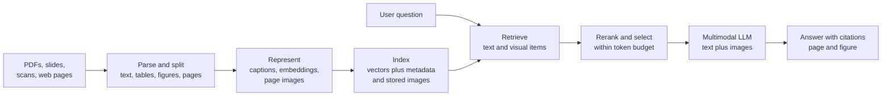
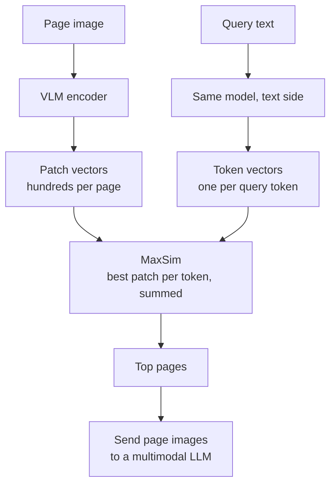

Real enterprise documents are not plain text. Annual reports carry their key numbers in charts, technical manuals explain procedures with diagrams, research papers put results in tables, and slide decks are mostly pictures with a few words. A text-only RAG pipeline extracts the words, drops the rest, and then cannot answer "Which region's revenue fell in Q3?" because the answer was a bar in a chart. The [Multimodal RAG](/learn/advanced-rag/multimodal-rag) lesson in Advanced RAG introduced the idea of retrieving across modalities. This lesson goes deeper: the end-to-end architecture, the three main ingestion strategies and their trade-offs, how late-interaction retrievers search page images directly, and how to evaluate the whole system.

## The end-to-end architecture

A multimodal RAG system has the same two phases as any [RAG system](/learn/rag-fundamentals/what-is-rag), indexing and querying, but each stage must handle visual content.



Three decisions shape everything else:

1. **What is the unit of retrieval?** A text chunk, a table, a figure with its caption, or a whole page.
2. **How is visual content represented in the index?** As generated text, as a native multimodal embedding, or as a page image searched with a visual retriever.
3. **What does the generator see?** Only text (captions and extracted tables), or the original images too.

Keep the original image of every figure, table and page in storage (object storage with a stable ID), whatever you index. Even if retrieval works on text, sending the real image to the generator at answer time lets a vision-language model read details the caption missed.

## Ingestion strategy 1: convert everything to text

Parse the document ([Document Parsing](/learn/rag-fundamentals/document-parsing) covered the tools), keep the text, convert tables to Markdown or HTML, and send each figure to a VLM with a prompt such as "Describe this chart: its title, axes, series, and the key values and trends. Transcribe any text." Then chunk and embed everything with your normal text embedding model.

Strengths: you reuse your entire text stack (embedding model, [hybrid search](/learn/advanced-rag/hybrid-retrieval), [rerankers](/learn/advanced-rag/reranking-models)); captions are human-readable, so you can inspect and fix them; keyword search works on numbers and names in charts.

Weaknesses: a caption is a lossy summary decided at ingestion time, before you know the questions. If the caption says "revenue rose in most regions" and the user asks about the one region that fell, the information is gone. Captioning every figure also costs one VLM call per image at ingestion, and parse errors (a table split across pages, a figure detached from its caption) propagate silently.

> [!TIP]
> Write captioning prompts for retrieval, not for readers: ask for every label, legend entry, axis title and number visible, plus the surrounding section heading. Store the caption and the image together, so the caption finds the figure and the image answers the question.

## Ingestion strategy 2: native multimodal embeddings

Embed images directly with a multimodal embedding model, the shared-space approach from [Multimodal Embeddings](/learn/multimodal-ai/multimodal-embeddings), and embed text chunks with the same model so a text query can retrieve either.

Strengths: no captioning step, and nothing is lost to a summary at ingestion; works well for photographs and natural images (product photos, site inspection pictures, medical images with a domain model).

Weaknesses: general CLIP-style models are trained on photos with short captions, so they are weak at the dense text, small numbers and fine structure of charts, tables and document pages. Mixed indexes suffer from the modality gap, so you often need separate searches per modality and a fusion step. And a single vector per image must summarise everything in it, which fails when the relevant detail is a small part of a busy page.

## Ingestion strategy 3: page screenshots with late-interaction retrieval

The third approach skips parsing altogether. Render every page as an image and index the **pages themselves** with a retriever designed for document images. The most influential design is **late interaction**, introduced for text by ColBERT and applied to page images by ColPali-style models: a VLM encodes the page into **many vectors, one per image patch**, rather than one vector per page. The query is also encoded as one vector per token. The relevance score is **MaxSim**:

$$
\text{score}(q, d) = \sum_{i=1}^{|q|} \max_{1 \le j \le |d|} \; \mathbf{q}_i^\top \mathbf{d}_j
$$

where $\mathbf{q}_i$ is the embedding of query token $i$, $\mathbf{d}_j$ is the embedding of page patch $j$, $|q|$ is the number of query tokens and $|d|$ the number of patches. Each query token finds its best-matching patch anywhere on the page, and the matches are summed. A small chart in the corner of a page full of boilerplate can therefore still match strongly, because the boilerplate patches simply never win a max.

The toy below compares MaxSim with a single-vector approach (average all vectors, then cosine similarity) on three synthetic pages. The vectors stand in for real model outputs:

```python
import numpy as np

rng = np.random.default_rng(7)
dim = 64

def unit(v):
    return v / np.linalg.norm(v, axis=-1, keepdims=True)

# Directions standing in for concepts: revenue, chart, 2023, page boilerplate, general finance prose
revenue, chart, year, boilerplate, finance = unit(rng.normal(size=(5, dim)))

def noisy(base, n, noise=0.15):
    return unit(base + noise * rng.normal(size=(n, dim)))

pages = {   # each page is a set of patch vectors (40 patches)
    "annual report p.14 (small revenue chart)": np.vstack([
        noisy(boilerplate, 34), noisy(revenue, 2), noisy(chart, 2), noisy(year, 2)]),
    "finance overview p.3 (general prose)": noisy(finance + 0.6 * (revenue + year), 40),
    "legal terms p.40": noisy(boilerplate, 40),
}
query = noisy(np.stack([revenue, chart, year]), 3, noise=0.1)   # tokens: "revenue", "chart", "2023"

def single_vector_score(q, d):
    return float(unit(q.mean(axis=0)) @ unit(d.mean(axis=0)))

def maxsim_score(q, d):
    return float((q @ d.T).max(axis=1).sum())

for name, page in pages.items():
    print(f"{name:42s} single-vector {single_vector_score(query, page):6.3f}   "
          f"MaxSim {maxsim_score(query, page):5.3f}")
```

```output
annual report p.14 (small revenue chart)   single-vector -0.115   MaxSim 1.744
finance overview p.3 (general prose)       single-vector  0.411   MaxSim 1.000
legal terms p.40                           single-vector -0.187   MaxSim 0.487
```

The single-vector score prefers the page of general prose that is vaguely about the same topics, because averaging dilutes the small chart into the boilerplate around it. MaxSim ranks the page with the actual chart first.



Strengths: no parsing, OCR or captioning pipeline to maintain; layout, charts, tables and text are all searched in their original visual form; retrieval and generation see the same page image.

Weaknesses: storage grows from one vector per page to hundreds, so indexes are much larger (compression, pooling of patch vectors and a cheap first-stage retriever followed by MaxSim reranking are the usual remedies); vector databases need multi-vector support; whole pages are coarse units and cost many tokens when sent to the generator; exact keyword matching on IDs and part numbers is weaker than BM25 on extracted text.

## Choosing a strategy

| | Caption to text | Native multimodal embeddings | Page images + late interaction |
| --- | --- | --- | --- |
| Best for | Mixed documents where you want one text stack | Photos and natural images | Visually rich PDFs, slides, scans |
| Ingestion cost | High (VLM call per figure) | Low to moderate | Moderate (encode each page) |
| Index size | Small | Small | Large (many vectors per page) |
| Information loss at ingestion | Highest (caption is a summary) | Moderate (one vector per image) | Lowest (page kept intact) |
| Exact keyword match | Good, with hybrid search | Poor | Moderate |
| Debuggability | High: read the captions | Low | Moderate: inspect which patches matched |

These are not exclusive. A common robust design runs a text pipeline (extracted text, tables, captions with BM25 and dense search) alongside a page-image retriever, fuses the two result lists, and sends the generator the top pages as images plus the matching text chunks. Start with the simplest strategy that your evaluation says is good enough, and add another only where it measurably fails.

> [!KEY]
> Separate the retrieval representation from the generation input. You can retrieve with captions, embeddings or patch vectors, and still give the generator the original image of the page or figure. Most of the accuracy gained from multimodal RAG comes from the generator seeing the real visual, not a description of it.

## Generation: assembling the context

At answer time, the selected items become a multimodal prompt: text chunks as text, and figures or pages as image content parts (the message shape from [Image Understanding](/learn/multimodal-ai/image-understanding)). Practical rules:

- **Budget tokens.** Each page image can cost as much as several text chunks. Send fewer, better-ranked images, and crop to the figure when you know its bounding box.
- **Label every item** with its source ("Image 2: annual-report.pdf, page 14, Figure 3") and ask the model to cite these labels, so answers can be traced back.
- **Ask for grounding.** Instruct the model to answer only from the provided material and to say when a chart is unreadable or the answer is not present. VLMs hallucinate chart values readily.
- **Prefer structured data when you have it.** If a table was extracted reliably, its Markdown text is more precise than a picture of it; send both if unsure.

## Evaluating multimodal RAG

Evaluate retrieval and generation separately, as in [RAG Evaluation](/learn/advanced-rag/rag-evaluation), but slice every metric by **where the answer lives**: body text, table, chart, diagram, or scanned page. Averages hide the failure that matters: a system can score well overall while failing almost every chart question.

Build a test set of questions, each labelled with the page (or figure) that contains the answer and its content type. Then compute recall@k per type:

```python
from collections import defaultdict

# (question id, where the answer lives, gold page, top-3 retrieved pages)
results = [
    ("q1", "text",  "r14", ["r14", "r02", "r31"]),
    ("q2", "text",  "r07", ["r07", "r08", "r03"]),
    ("q3", "table", "r22", ["r21", "r22", "r09"]),
    ("q4", "table", "r40", ["r12", "r41", "r39"]),
    ("q5", "chart", "r14", ["r03", "r02", "r15"]),
    ("q6", "chart", "r18", ["r18", "r19", "r01"]),
    ("q7", "chart", "r25", ["r26", "r11", "r04"]),
    ("q8", "text",  "r33", ["r30", "r33", "r34"]),
]

def recall_at_k(rows, k):
    return sum(gold in retrieved[:k] for _, _, gold, retrieved in rows) / len(rows)

by_type = defaultdict(list)
for row in results:
    by_type[row[1]].append(row)

print(f"{'type':6s} {'n':>2s} {'R@1':>5s} {'R@3':>5s}")
for kind, rows in by_type.items():
    print(f"{kind:6s} {len(rows):2d} {recall_at_k(rows, 1):5.2f} {recall_at_k(rows, 3):5.2f}")
print(f"{'all':6s} {len(results):2d} {recall_at_k(results, 1):5.2f} {recall_at_k(results, 3):5.2f}")
```

```output
type    n   R@1   R@3
text    3  0.67  1.00
table   2  0.00  0.50
chart   3  0.33  0.33
all     8  0.38  0.62
```

Overall recall@3 looks tolerable, but chart questions are found only a third of the time, which tells you exactly where to invest (better captions for charts, or a page-image retriever).

For generation, measure:

| Metric | Question it answers |
| --- | --- |
| Answer correctness | Does the answer match the reference? For numeric chart questions, allow a stated tolerance |
| Faithfulness | Is every claim supported by the retrieved text or images? |
| Citation accuracy | Do the cited pages and figures actually contain the supporting evidence? |
| Abstention | When the answer is not in the documents, or the chart is illegible, does the system say so? |
| Cost and latency | Tokens per answer (images dominate) and time to answer |

LLM-as-judge works for multimodal answers too, but the judge must see the same images as the generator, and you should check a sample of its verdicts by hand, particularly for chart values where judges are easily convinced by confident numbers.

## Exercises

**1.** Modify `maxsim_score` to return, for each query token, the index of the best-matching patch. Run it on the annual report page. Which patches match "revenue", "chart" and "2023"?

<details>
<summary>Show solution</summary>

```python
def maxsim_explain(q, d):
    sims = q @ d.T
    return sims.argmax(axis=1), sims.max(axis=1).round(3)

print(maxsim_explain(query, pages["annual report p.14 (small revenue chart)"]))
```

```output
(array([34, 36, 39]), array([0.626, 0.547, 0.571]))
```

Patches 34-35 are the revenue patches, 36-37 the chart patches and 38-39 the year patches, so each query token found one of its own concept's patches. This kind of patch-level explanation can be rendered as a heatmap over the page to show users why it was retrieved.

</details>

**2.** A company's knowledge base is 2,000 slide decks, mostly diagrams and short bullet points. Users ask questions such as "Which slide shows the data flow between billing and CRM?" Which ingestion strategy would you start with, and why?

<details>
<summary>Show solution</summary>

Page images with a late-interaction retriever: slides are visual, text extraction loses the diagram structure, and the natural retrieval unit is the slide. Keep a text index of the extracted slide text alongside it for exact names and acronyms, fuse the results, and send the top slide images to a multimodal LLM. Validate the choice with a labelled question set sliced by content type.

</details>

**3.** Your captioning-based system answers chart questions with plausible but wrong numbers. List three changes, in the order you would try them.

<details>
<summary>Show solution</summary>

First, send the original chart image to the generator along with the caption, so it reads values from the chart rather than from a summary. Second, improve the captioning prompt to transcribe every label and value, and re-ingest. Third, add explicit grounding instructions and allow abstention when values cannot be read. Measure chart-sliced answer correctness after each change.

</details>

```quiz
[
  {
    "q": "What is the main weakness of converting figures to text captions at ingestion time?",
    "options": [
      "The caption is a lossy summary written before the questions are known",
      "Captions cannot be embedded",
      "Captions make the index larger than storing page images",
      "Captions prevent keyword search"
    ],
    "answer": 0,
    "why": "Any detail the caption omits cannot be retrieved later, unless the original image is also used at answer time."
  },
  {
    "q": "In late-interaction (MaxSim) retrieval over page images, how is a page's score computed?",
    "options": [
      "Cosine similarity between the mean query vector and the mean page vector",
      "Count the query words that appear in the page's OCR text",
      "Take the single highest patch similarity on the page",
      "For each query token, take its best-matching page patch similarity, then sum over tokens"
    ],
    "answer": 3,
    "why": "MaxSim sums, over query tokens, the maximum similarity to any patch, so small relevant regions are not diluted."
  },
  {
    "q": "What is a key cost of page-image late-interaction retrieval?",
    "options": [
      "It requires OCR on every page",
      "Each page is stored as many vectors, making the index much larger",
      "It cannot retrieve pages with charts",
      "It only works for photographs"
    ],
    "answer": 1,
    "why": "One vector per patch means hundreds of vectors per page; compression and two-stage retrieval mitigate this."
  },
  {
    "q": "Why slice multimodal RAG metrics by content type (text, table, chart)?",
    "options": [
      "It reduces evaluation cost",
      "Judges cannot score text answers",
      "Overall averages can hide a system that fails almost every chart or table question",
      "Recall@k is undefined for images"
    ],
    "answer": 2,
    "why": "Text questions often dominate test sets; per-type results show where retrieval or generation is actually failing."
  }
]
```
