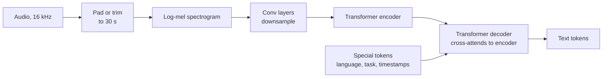
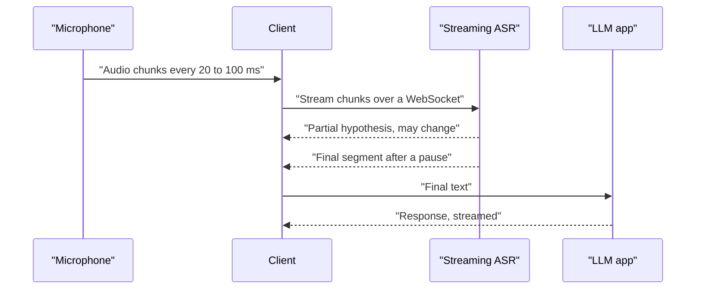

**Automatic speech recognition (ASR)**, or speech-to-text, turns spoken audio into written text. It is the entry point for voice assistants, meeting transcription, call-centre analytics, subtitles and every "talk to the AI" interface. Once speech is text, everything you have learned about LLMs, RAG and agents applies to it. This lesson explains how modern ASR models work, how to run an open-source one, how to measure its accuracy properly, and the engineering concerns of diarisation, streaming and latency.

## From waveform to features

A microphone produces a **waveform**: a sequence of amplitude samples, typically 16,000 per second for speech models. Raw samples are long and hard to learn from directly, so most ASR systems first convert audio into a **log-mel spectrogram**: the signal is cut into short overlapping frames (commonly 25 ms windows every 10 ms), the frequency content of each frame is measured, the frequencies are grouped into bands spaced the way human hearing perceives pitch (the **mel scale**), and the energies are log-compressed. The result is an image-like matrix of shape (mel bands by frames). [Audio Processing](/learn/multimodal-ai/audio-processing) builds one from scratch; here it is enough to know that the model's input is a sequence of feature vectors, about 100 per second of audio.

| Representation | Shape for 30 s of 16 kHz audio | Notes |
| --- | --- | --- |
| Raw waveform | 480,000 samples | Some models learn directly from this with a convolutional front end |
| Log-mel spectrogram | 80 (or 128) bands by 3,000 frames | Standard input for encoder-decoder ASR |
| Encoder output | 1,500 vectors (after downsampling by 2) | What the decoder attends to (Whisper-style) |

## Encoder-decoder ASR

Speech recognition is a sequence-to-sequence problem: a long sequence of audio frames maps to a much shorter sequence of text tokens, with no fixed alignment between them. The [encoder-decoder architecture](/learn/advanced-nlp/encoder-decoder-architecture) handles this naturally, and it is the design used by Whisper, OpenAI's open-source ASR model family.



The **encoder** reads the whole spectrogram with self-attention and produces a contextual representation of every audio frame. The **decoder** generates text tokens one at a time, like a GPT model, but each layer also **cross-attends** to the encoder output so it can "listen" while writing. Whisper adds special tokens at the start of the decoder sequence that select the language and the task (transcribe in the same language, or translate to English) and whether to predict timestamps. Because it was trained on a very large and varied set of audio, it is fairly robust to accents and background noise without fine-tuning.

An older and still widely used alternative is **CTC (connectionist temporal classification)**: an encoder predicts a character or token distribution for every frame, including a special *blank*, and repeated symbols and blanks are collapsed afterwards. CTC models are non-autoregressive, so they are fast and naturally suited to streaming, but without a language model they make more spelling and grammar errors than encoder-decoder models.

### Running Whisper

The open-source `openai-whisper` package wraps model download, feature extraction and decoding:

```python
import whisper

model = whisper.load_model("small")          # sizes range from "tiny" to "large"
result = model.transcribe("meeting.wav")     # long files are processed in 30 s windows
print(result["text"])
for seg in result["segments"]:
    print(f'{seg["start"]:6.1f}s - {seg["end"]:6.1f}s  {seg["text"]}')
```

The same models are available through Hugging Face `transformers` with the [pipeline](/learn/hugging-face-ecosystem/pipelines) API:

```python
from transformers import pipeline

asr = pipeline("automatic-speech-recognition", model="openai/whisper-small")
out = asr("meeting.wav", return_timestamps=True)
print(out["text"])
```

Both need a model download (and ideally a GPU for the larger sizes), so no output is shown. Smaller models are faster and less accurate; choose by measuring on your own audio, as the next section shows.

## Measuring accuracy: word error rate

The standard ASR metric is **word error rate (WER)**. Align the model's output (the *hypothesis*) with a human transcript (the *reference*) using the minimum number of word edits, then count:

- $S$: substitutions (a reference word replaced by a different word),
- $D$: deletions (a reference word missing from the hypothesis),
- $I$: insertions (an extra word in the hypothesis),
- $N$: the number of words in the reference.

$$
\text{WER} = \frac{S + D + I}{N}
$$

WER can exceed 1 (100%) when the hypothesis has many insertions. The minimum $S + D + I$ is the **Levenshtein edit distance** between the two word sequences, computed with dynamic programming: `d[i][j]` is the cost of turning the first `i` reference words into the first `j` hypothesis words. Step through it on a tiny example:

```trace
{
  "title": "word-level edit distance",
  "code": [
    "ref = ['the', 'cat', 'sat']",
    "hyp = ['the', 'bat', 'sat']",
    "d = [[0, 1, 2, 3], [1, 0, 0, 0], [2, 0, 0, 0], [3, 0, 0, 0]]",
    "for i in range(1, 4):",
    "    for j in range(1, 4):",
    "        cost = 0 if ref[i-1] == hyp[j-1] else 1",
    "        d[i][j] = min(d[i-1][j] + 1, d[i][j-1] + 1, d[i-1][j-1] + cost)",
    "print(d[3][3])"
  ],
  "steps": [
    { "line": 3, "vars": { "d": "row0 [0,1,2,3], col0 [0,1,2,3]" }, "note": "First row and column: turning i words into nothing costs i deletions; building j words from nothing costs j insertions." },
    { "line": 7, "vars": { "i": "1", "j": "1", "cost": "0", "d[1][1]": "0" }, "note": "'the' matches 'the', so the diagonal move is free." },
    { "line": 7, "vars": { "i": "1", "j": "3", "d[1]": "[1, 0, 1, 2]" }, "note": "Row 1 done. Reaching j=2 or 3 from 'the' alone needs insertions." },
    { "line": 7, "vars": { "i": "2", "j": "2", "cost": "1", "d[2][2]": "1" }, "note": "'cat' versus 'bat' differ: best is the diagonal from d[1][1]=0 plus a substitution." },
    { "line": 7, "vars": { "i": "2", "j": "3", "d[2]": "[2, 1, 1, 2]" }, "note": "Row 2 done." },
    { "line": 7, "vars": { "i": "3", "j": "3", "cost": "0", "d[3]": "[3, 2, 2, 1]" }, "note": "'sat' matches 'sat', so d[3][3] = d[2][2] + 0 = 1." },
    { "line": 8, "vars": { "d[3][3]": "1" }, "out": ["1"], "note": "One edit over three reference words: WER = 1/3." }
  ]
}
```

Here is a complete implementation that also backtracks through the table to count each error type:

```python
import re

def normalise(text):
    """Lowercase and strip punctuation so formatting differences are not counted as errors."""
    text = re.sub(r"[^\w\s']", " ", text.lower())
    return text.split()

def wer_details(reference, hypothesis):
    ref, hyp = normalise(reference), normalise(hypothesis)
    n, m = len(ref), len(hyp)
    d = [[0] * (m + 1) for _ in range(n + 1)]
    for i in range(n + 1):
        d[i][0] = i
    for j in range(m + 1):
        d[0][j] = j
    for i in range(1, n + 1):
        for j in range(1, m + 1):
            cost = 0 if ref[i - 1] == hyp[j - 1] else 1
            d[i][j] = min(d[i - 1][j] + 1,         # deletion
                          d[i][j - 1] + 1,         # insertion
                          d[i - 1][j - 1] + cost)  # match or substitution
    # Backtrack to classify the edits
    i, j, S, D, I = n, m, 0, 0, 0
    while i > 0 or j > 0:
        if i > 0 and j > 0 and d[i][j] == d[i - 1][j - 1] + (ref[i - 1] != hyp[j - 1]):
            S += ref[i - 1] != hyp[j - 1]
            i, j = i - 1, j - 1
        elif i > 0 and d[i][j] == d[i - 1][j] + 1:
            D += 1
            i -= 1
        else:
            I += 1
            j -= 1
    return {"S": S, "D": D, "I": I, "N": n, "WER": round((S + D + I) / n, 3)}

reference = "Please send the quarterly report to Maria before Friday."
hypothesis = "please send a quarterly report to maria before friday afternoon"
print(wer_details(reference, hypothesis))
print(wer_details("the cat sat", "the bat sat"))
```

```output
{'S': 1, 'D': 0, 'I': 1, 'N': 9, 'WER': 0.222}
{'S': 1, 'D': 0, 'I': 0, 'N': 3, 'WER': 0.333}
```

"the" became "a" (one substitution) and "afternoon" was added (one insertion): 2 errors over 9 reference words. The casing and the full stop did not count, because of the normalisation step.

> [!WARNING]
> WER numbers are only comparable if the text normalisation is identical. Whether "10" equals "ten", whether "don't" equals "do not", and whether punctuation counts can change WER more than switching models. Fix one normalisation function and use it for every system you compare. For languages without spaces between words, such as Chinese or Japanese, use **character error rate (CER)** instead.

WER also treats every word equally. Misrecognising a drug name in a medical note is far worse than dropping "um". For high-stakes domains, add a targeted metric such as the recall of key entities.

## Diarisation: who spoke when

A meeting transcript is much less useful without speaker labels. **Speaker diarisation** splits the audio into segments and assigns each to a speaker ("Speaker 1", "Speaker 2"), answering *who spoke when* without knowing who the speakers are. A typical pipeline:

1. **Voice activity detection** finds the regions that contain speech.
2. **Segmentation** splits speech into short pieces, ideally at speaker changes.
3. **Speaker embeddings**: a model maps each segment to a vector that characterises the voice.
4. **Clustering** groups the embeddings; each cluster is a speaker.
5. **Alignment** with the ASR word timestamps assigns each word to a speaker.

Diarisation is a separate model from ASR (open-source toolkits such as `pyannote.audio` provide pipelines), and it is error-prone with overlapping speech, short interjections and similar voices. Mapping "Speaker 2" to a real name requires enrolment (a known voice sample) or context from the conversation, and it raises consent questions because voiceprints are biometric data.

## Streaming ASR and latency

Batch transcription processes a complete file. Voice interfaces need **streaming**: partial transcripts while the user is still speaking.



Key ideas:

- **Partial versus final results.** Partial hypotheses update as more audio arrives and may be revised; final results are fixed. Show partials in the UI, but act only on finals.
- **Endpointing.** The system decides the user has finished speaking after a silence threshold. Too short and it cuts people off mid-thought; too long and the assistant feels slow.
- **Architecture.** CTC and transducer models stream naturally. Whisper-style models process 30-second windows, so streaming with them means re-running on a growing buffer or on sliding chunks, which costs extra compute and can make words flicker.
- **Latency budget.** For a voice assistant, the delay the user feels is the endpointing pause plus the time to the final transcript plus the LLM's time to first token plus text-to-speech start-up. Each stage must be streamed, as in [streaming responses](/learn/working-with-llms/streaming-responses), to keep the total low.

> [!TIP]
> Measure **real-time factor (RTF)**: processing time divided by audio duration. An RTF of 0.1 means one minute of audio takes six seconds. RTF tells you throughput for batch jobs; for streaming, also measure the delay from the end of speech to the final transcript.

## Exercises

**1.** Compute the WER of the hypothesis "turn of the lights in the kitchen" against the reference "turn off the lights in the kitchen please" using `wer_details`. Which errors does it find?

<details>
<summary>Show solution</summary>

```python
print(wer_details("turn off the lights in the kitchen please",
                  "turn of the lights in the kitchen"))
```

```output
{'S': 1, 'D': 1, 'I': 0, 'N': 8, 'WER': 0.25}
```

"off" was substituted by "of" and "please" was deleted: 2 errors over 8 words.

</details>

**2.** Two vendors report WERs of 6% and 9% on "conversational English". Why can you not conclude that the first is better for your call-centre audio?

<details>
<summary>Show solution</summary>

The test sets, audio conditions and text normalisation differ. Your audio (telephone bandwidth, accents, domain vocabulary, crosstalk) may differ from theirs. Collect an hour or two of your own audio, transcribe it by hand, and compute WER for both with the same normalisation.

</details>

**3.** A voice assistant waits 1.2 seconds of silence before treating the user's turn as finished. Users complain it feels slow; reducing the wait to 0.3 seconds makes it interrupt them. Suggest an approach.

<details>
<summary>Show solution</summary>

Use a moderate silence threshold combined with semantic endpointing: if the partial transcript looks like a complete sentence or question, end the turn sooner; if it ends mid-phrase ("and then I want to"), wait longer. You can also start the LLM speculatively on the partial transcript and discard the result if the user keeps talking.

</details>

```quiz
[
  {
    "q": "In a Whisper-style encoder-decoder ASR model, how does the decoder use the audio?",
    "options": [
      "It reads the raw waveform directly",
      "It receives one audio token per output word",
      "It does not; the encoder generates the text",
      "It cross-attends to the encoder's representation of the spectrogram"
    ],
    "answer": 3,
    "why": "The decoder generates text autoregressively and cross-attends to the encoder outputs at every layer."
  },
  {
    "q": "Reference: 'book a table for two' (5 words). Hypothesis: 'book table for two people'. What is the WER?",
    "options": [
      "0.2",
      "0.4",
      "0.6",
      "0.25"
    ],
    "answer": 1,
    "why": "One deletion ('a') and one insertion ('people'): 2 / 5 = 0.4."
  },
  {
    "q": "What does speaker diarisation produce?",
    "options": [
      "The names of the speakers",
      "A translation of the transcript",
      "Segments labelled with anonymous speaker identities: who spoke when",
      "A noise-free version of the audio"
    ],
    "answer": 2,
    "why": "Diarisation clusters speech by voice; mapping clusters to real names needs extra information."
  },
  {
    "q": "Why should a voice app act only on final, not partial, streaming ASR results?",
    "options": [
      "Partial hypotheses can still be revised as more audio arrives",
      "Partial results are in a different language",
      "Final results are always shorter",
      "Partial results have no timestamps"
    ],
    "answer": 0,
    "why": "Partials are provisional. Acting on them risks executing a command the user did not actually say."
  }
]
```
