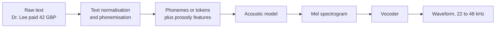
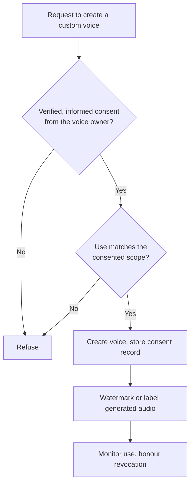

**Text-to-speech (TTS)**, or speech synthesis, is the reverse of speech recognition: it turns text into audio of a voice speaking it. Combined with ASR and an LLM it completes the voice loop (listen, think, speak), and on its own it powers accessibility tools, audiobooks, navigation and phone systems. Modern neural TTS can sound remarkably human, which makes the engineering questions (latency, pronunciation, control) and the ethical ones (whose voice, with what consent) both matter. This lesson covers how a TTS system is built, how to control it, and how to use voice cloning responsibly.

## The classic TTS pipeline

Synthesising speech from text is a one-to-many problem: the same sentence can be spoken with countless rhythms, pitches and emphases. TTS systems traditionally break it into three stages.



1. **Text normalisation and phonemisation (the front end).** Convert the text into something pronounceable: expand numbers, dates, currencies and abbreviations into words, then usually convert words into **phonemes**, the units of sound (the word "read" is pronounced differently in "I read yesterday" and "I will read").
2. **Acoustic model.** Map the phoneme sequence to a **mel spectrogram**, an image of how much energy the speech has at each frequency band over time. This is where rhythm (how long each sound lasts), pitch and emphasis, collectively called **prosody**, are decided.
3. **Vocoder.** Turn the mel spectrogram into an actual waveform. A spectrogram discards phase information, so the vocoder must invent plausible fine detail. Neural vocoders (GAN-based ones are common) do this with high quality and speed.

The mel spectrogram is the same representation that ASR uses as input, which you will compute yourself in [Audio Processing](/learn/multimodal-ai/audio-processing). ASR goes from spectrogram to text; TTS goes from text to spectrogram and then on to audio.

## Text normalisation in practice

Normalisation is unglamorous and causes a large share of the errors users notice. "St." can be "Street" or "Saint"; "1/2" can be "a half" or "January the second"; "2025" is "twenty twenty-five" as a year and "two thousand and twenty-five" as a quantity. A small rule-based normaliser shows the idea:

```python
import re

ONES = ["zero", "one", "two", "three", "four", "five", "six", "seven", "eight", "nine",
        "ten", "eleven", "twelve", "thirteen", "fourteen", "fifteen", "sixteen",
        "seventeen", "eighteen", "nineteen"]
TENS = ["", "", "twenty", "thirty", "forty", "fifty", "sixty", "seventy", "eighty", "ninety"]

def number_to_words(n):
    if n < 20:
        return ONES[n]
    if n < 100:
        return TENS[n // 10] + ("" if n % 10 == 0 else "-" + ONES[n % 10])
    if n < 1000:
        rest = n % 100
        return ONES[n // 100] + " hundred" + ("" if rest == 0 else " and " + number_to_words(rest))
    raise ValueError("numbers of 1000 or more are not handled in this sketch")

ABBREVIATIONS = {"Dr.": "Doctor", "approx.": "approximately", "e.g.": "for example"}

def normalise_for_tts(text):
    for abbr, full in ABBREVIATIONS.items():
        text = text.replace(abbr, full)
    text = re.sub(r"(\d+)%", lambda m: number_to_words(int(m.group(1))) + " percent", text)
    text = re.sub(r"\d+", lambda m: number_to_words(int(m.group())), text)
    return text

print(normalise_for_tts("Dr. Okafor saw 42 patients, approx. 15% more than last week."))
print(normalise_for_tts("Room 305 is on floor 3."))
```

```output
Doctor Okafor saw forty-two patients, approximately fifteen percent more than last week.
Room three hundred and five is on floor three.
```

The second line shows a limitation: a room number is often read digit by digit ("three oh five"), not as a quantity. Real normalisers use many more rules or a trained model, and production systems let you override pronunciations for names, product terms and acronyms. When an LLM generates the text, you can also instruct it to write numbers and abbreviations the way they should be spoken.

## Neural TTS

Early systems glued together recorded fragments of speech (**concatenative synthesis**) or used statistical models that sounded buzzy. Neural TTS replaced each stage with learned models, and many current systems merge stages:

| Approach | How it works | Trade-offs |
| --- | --- | --- |
| Two-stage (acoustic model + vocoder) | An autoregressive or parallel model predicts mel frames; a separate vocoder renders audio | Modular, well understood; stages can be swapped |
| End-to-end | One model maps text (or phonemes) directly to a waveform | Fewer moving parts; harder to inspect and control |
| Audio-token language models | A neural codec compresses audio into discrete tokens; a transformer predicts those tokens from text, like an LLM predicting words, and the codec decoder turns them back into audio | Very natural prosody and strong voice cloning from short samples; can occasionally skip or repeat words |

**Parallel (non-autoregressive)** acoustic models predict a duration for each phoneme, expand the sequence accordingly, and generate all frames at once, which is fast and avoids skipped words. **Autoregressive** models, including token-based ones, generate step by step, which tends to give more expressive speech but makes latency depend on output length.

> [!KEY]
> For conversational applications, the important number is **time to first audio**, not total synthesis time. Choose a TTS system that streams audio in chunks, feed it sentence by sentence as the LLM streams text, and start playback as soon as the first chunk arrives.

A typical hosted API call looks like this (OpenAI-style, using streaming to write the audio file; the model name is a placeholder and no output is shown because it needs an API key):

```python
from openai import OpenAI

client = OpenAI()
with client.audio.speech.with_streaming_response.create(
    model="your-tts-model",
    voice="alloy",
    input="Your table for two is booked for seven thirty this evening.",
) as response:
    response.stream_to_file("confirmation.mp3")
```

## Controlling speech with SSML

**SSML (Speech Synthesis Markup Language)** is a W3C standard XML format for telling a TTS engine *how* to say something. Support varies between engines (check which tags yours accepts), but the core elements are widely implemented:

```text
<speak>
  Your verification code is
  <say-as interpret-as="characters">4B7Q</say-as>.
  <break time="500ms"/>
  Please read it back <emphasis level="strong">slowly</emphasis>.
  <prosody rate="slow" pitch="-2st">This call may be recorded.</prosody>
  The word <phoneme alphabet="ipa" ph="ˈtoʊmeɪtoʊ">tomato</phoneme> is pronounced the American way.
  Meet me on <say-as interpret-as="date" format="dmy">03/04/2026</say-as>.
</speak>
```

| Element | Purpose |
| --- | --- |
| `speak` | Root element wrapping the whole utterance |
| `break` | Insert a pause of a given duration or strength |
| `emphasis` | Stress a word or phrase |
| `prosody` | Change rate, pitch or volume |
| `say-as` | Say a token as characters, a date, a number, a telephone number and so on |
| `phoneme` | Give an exact pronunciation in a phonetic alphabet such as IPA |
| `sub` | Speak an alias, e.g. `sub alias="World Health Organisation"` around "WHO" |

Many newer neural TTS APIs accept plain text plus a natural-language style instruction ("speak warmly and a little slower") instead of, or as well as, SSML. Either way, the principle is the same: separate *what* is said from *how* it is said, and keep pronunciation fixes in a reusable lexicon rather than scattered through prompts.

## Voice cloning: capability, consent and safeguards

Modern systems can imitate a specific person's voice from a short recording. This has legitimate uses: restoring a voice to someone who is losing theirs to illness, dubbing an actor's performance into other languages with their agreement, keeping a consistent brand voice performed by a paid voice actor. It also enables fraud (a cloned voice of a relative or an executive asking for money), harassment, and political disinformation.



Responsible practice for any product that offers custom voices:

- **Explicit, informed, recorded consent** from the person whose voice it is, covering what the voice will be used for and for how long. A common technique is to have the speaker read a consent statement aloud, so the consent recording itself is verified against the voice being cloned.
- **Scope and revocation.** Consent for an audiobook is not consent for advertising. Let people withdraw consent and delete their voice model.
- **Disclosure.** Tell listeners when they are hearing a synthetic voice. Several jurisdictions have or are introducing rules on disclosing AI-generated content; check the ones that apply to you.
- **Provenance.** Where your provider supports it, use audio watermarking or content-provenance metadata so generated audio can be identified later.
- **Abuse controls.** Block cloning of public figures without authorisation, rate-limit, and log usage so misuse can be investigated.

> [!WARNING]
> Voice is biometric data. Recordings used to build a voice model, and the model itself, need the same protection as other sensitive personal data: access control, retention limits and a lawful basis for processing.

## Exercises

**1.** Extend `normalise_for_tts` so that "GBP 25" (a currency code followed by a number) is read as "twenty-five pounds". Test it on "The ticket costs GBP 25."

<details>
<summary>Show solution</summary>

Handle the currency pattern before the general number rule:

```python
def normalise_for_tts_v2(text):
    text = re.sub(r"GBP (\d+)", lambda m: number_to_words(int(m.group(1))) + " pounds", text)
    return normalise_for_tts(text)

print(normalise_for_tts_v2("The ticket costs GBP 25."))
```

```output
The ticket costs twenty-five pounds.
```

</details>

**2.** Write SSML that reads the phone number "02079460000" digit by digit, pauses for one second, then says "Thank you" more slowly than normal.

<details>
<summary>Show solution</summary>

```text
<speak>
  Call <say-as interpret-as="telephone">02079460000</say-as>.
  <break time="1s"/>
  <prosody rate="slow">Thank you.</prosody>
</speak>
```

If the engine does not support `telephone`, `interpret-as="characters"` reads the digits individually.

</details>

**3.** A marketing team wants to clone the voice of a well-known actor from interview clips for an advert. List the questions you would raise before any work starts.

<details>
<summary>Show solution</summary>

Has the actor given explicit written consent for this specific use, and on what terms (payment, duration, territories)? Do interview clips come with rights to use the audio for training? Will listeners be told the voice is synthetic? Does the provider's policy allow cloning a public figure? How will the voice model be stored, and deleted when the agreement ends? Without consent the answer is simply no.

</details>

```quiz
[
  {
    "q": "In a two-stage neural TTS system, what does the vocoder do?",
    "options": [
      "Converts text into phonemes",
      "Detects which language the text is in",
      "Transcribes audio into text",
      "Converts a mel spectrogram into a waveform"
    ],
    "answer": 3,
    "why": "The acoustic model produces a mel spectrogram; the vocoder renders it as audio samples, inventing the phase detail the spectrogram lacks."
  },
  {
    "q": "Why is text normalisation needed before synthesis?",
    "options": [
      "To make the text shorter",
      "Because numbers, abbreviations and symbols have context-dependent spoken forms",
      "To translate the text into English",
      "To remove all punctuation"
    ],
    "answer": 1,
    "why": "'St.', '1/2' and '2025' can each be spoken several ways; the front end must choose the right one."
  },
  {
    "q": "For a voice assistant, which latency measure matters most to the user?",
    "options": [
      "Time to first audio chunk",
      "Total time to synthesise the whole response",
      "Vocoder sampling rate",
      "Number of SSML tags"
    ],
    "answer": 0,
    "why": "Playback can begin as soon as the first chunk arrives; streaming synthesis hides the rest of the generation time."
  },
  {
    "q": "Which SSML element would you use to force a specific pronunciation of a brand name?",
    "options": [
      "`break`",
      "`emphasis`",
      "`phoneme`",
      "`speak`"
    ],
    "answer": 2,
    "why": "`phoneme` gives the exact pronunciation in a phonetic alphabet such as IPA."
  }
]
```
