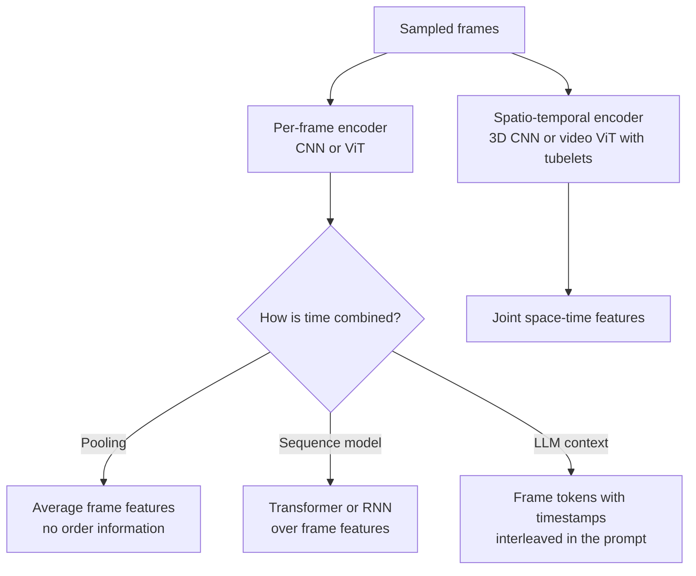

A video is a sequence of images plus, usually, an audio track. That simple description hides the main engineering problem: volume. One minute of 30 frames-per-second video is 1,800 images. If each image costs a few hundred tokens in a vision-language model, a single minute would overflow most context windows and cost a fortune. Video understanding is therefore mostly the art of deciding *which* visual information to keep: which frames, at what resolution, and how to represent motion and time. This lesson covers frames and sampling, temporal models, token budgets for video in LLMs, and scene detection.

## Frames, frame rates and what changes over time

A video file stores a stream of **frames** at a **frame rate** (frames per second, fps), commonly 24, 25, 30 or 60. Compressed formats such as H.264 do not store every frame in full: **keyframes** (I-frames) are complete images, and the frames between them store only changes. This is why seeking to an arbitrary frame can be slow (the decoder must start from the previous keyframe) and why decoding, not the model, is often the bottleneck in video pipelines.

What a video adds over a single image is **time**: motion, order of events, cause and effect, and duration. A question about a single frame ("what colour is the car?") needs one good frame. A question about events ("did the person pick up the package before or after the van arrived?") needs frames from the right moments, in order, with timestamps.

| Question type | Visual information needed |
| --- | --- |
| Static content ("What brand is on the sign?") | One clear, high-resolution frame |
| Summary ("What happens in this video?") | Frames spread across the whole video, low resolution is fine |
| Event localisation ("When does the goal happen?") | Dense frames around candidate moments, with timestamps |
| Fine motion ("Is the worker lifting correctly?") | Several consecutive frames at a higher frame rate |
| Speech content ("What did the presenter say?") | The audio track via ASR, not frames at all |

> [!KEY]
> Much of what people ask about videos is answered by the audio. For lectures, meetings, interviews and tutorials, transcribe the soundtrack with [speech recognition](/learn/multimodal-ai/speech-recognition) first and add frames only for what the transcript cannot tell you, such as slides, diagrams and on-screen text.

## Frame sampling strategies

You almost never process every frame. The common strategies:

- **Uniform by count**: take a fixed number $K$ of frames evenly spaced across the video. The cost is constant regardless of length, but long videos get sparse coverage.
- **Fixed rate**: take one frame every $s$ seconds (for example 1 fps). Coverage is consistent, but cost grows with length.
- **Segment-based random**: split the video into $K$ equal segments and take one random frame from each. Used in training so the model sees different frames each epoch.
- **Content-aware**: take a frame at each scene change, or when the picture changes by more than a threshold. Efficient for videos with long static stretches (slides, surveillance).

```python
import numpy as np

def uniform_indices(n_frames, k):
    """k frames evenly spaced, each taken from the middle of its segment."""
    edges = np.linspace(0, n_frames, k + 1)
    return ((edges[:-1] + edges[1:]) / 2).astype(int)

def fixed_rate_indices(n_frames, fps, every_seconds):
    step = int(round(fps * every_seconds))
    return np.arange(0, n_frames, step)

def segment_random_indices(n_frames, k, rng):
    edges = np.linspace(0, n_frames, k + 1).astype(int)
    return np.array([rng.integers(lo, hi) for lo, hi in zip(edges[:-1], edges[1:])])

fps, seconds = 30, 120
n = fps * seconds                                   # a 2-minute video: 3600 frames
print("uniform, k=8:     ", uniform_indices(n, 8))
print("1 frame per 10 s: ", fixed_rate_indices(n, fps, 10))
print("segment random:   ", segment_random_indices(n, 8, np.random.default_rng(0)))
print("as timestamps (s):", uniform_indices(n, 8) / fps)
```

```output
uniform, k=8:      [ 225  675 1125 1575 2025 2475 2925 3375]
1 frame per 10 s:  [   0  300  600  900 1200 1500 1800 2100 2400 2700 3000 3300]
segment random:    [ 382  736 1130 1471 1938 2268 2733 3157]
as timestamps (s): [  7.5  22.5  37.5  52.5  67.5  82.5  97.5 112.5]
```

Always keep the **timestamp** of each sampled frame. Passing timestamps to the model (as text next to each frame) is what lets it answer "when" questions and cite moments in the video.

To actually decode frames, OpenCV is the usual tool. This needs a real video file, so no output is shown:

```python
import cv2

def read_frames(path, indices):
    cap = cv2.VideoCapture(path)
    fps = cap.get(cv2.CAP_PROP_FPS)
    frames = []
    for idx in indices:
        cap.set(cv2.CAP_PROP_POS_FRAMES, int(idx))   # seek; slow for long gaps in compressed video
        ok, frame_bgr = cap.read()
        if not ok:
            break
        frames.append((idx / fps, cv2.cvtColor(frame_bgr, cv2.COLOR_BGR2RGB)))
    cap.release()
    return frames                                    # list of (timestamp_seconds, RGB array)
```

OpenCV returns frames in BGR channel order; converting to RGB before sending them to a model is a classic source of subtle errors when forgotten. For large-scale pipelines, decoding with FFmpeg directly at the target rate and resolution is usually faster than seeking frame by frame.

## Temporal models

How does a model reason across frames? Four families, roughly in order of how much they model time explicitly:



1. **Per-frame encoding plus pooling.** Encode each frame with an image model and average the features. Cheap and surprisingly strong for "what is this video about" classification, but blind to order: a video played backwards gives the same result.
2. **Per-frame encoding plus a sequence model.** Feed the frame features, with temporal position embeddings, to a transformer (or, historically, an [LSTM](/learn/sequence-models/lstm)). This captures order and longer-range events.
3. **Spatio-temporal encoders.** 3D convolutions extend CNN kernels across time; video transformers split the clip into **tubelets** (patches that span several frames, such as 16 by 16 pixels by 2 frames) so a single token already contains short-range motion. These see fine motion that per-frame models miss, at higher cost.
4. **Video in an LLM.** A video-capable VLM encodes sampled frames (sometimes with tubelets or temporal pooling) and places the resulting tokens in the LLM's context, often interleaved with timestamps and the transcript. The LLM then reasons over time in language.

## Token budgets for video in LLMs

When you send video to a multimodal LLM, either as a native video input or as a list of frames you sampled yourself, cost is driven by frames times tokens per frame. You control both.

$$
\text{video tokens} \approx K \times t_{\text{frame}} + t_{\text{audio}}
$$

where $K$ is the number of frames sent, $t_{\text{frame}}$ the tokens per frame (set by resolution and the provider's image tokenisation) and $t_{\text{audio}}$ the tokens for the transcript or audio, if included. A simple planner fits a video into a budget:

```python
def plan_frames(duration_s, budget_tokens, tokens_per_frame, transcript_tokens=0,
                max_fps=1.0):
    available = budget_tokens - transcript_tokens
    k = min(available // tokens_per_frame, int(duration_s * max_fps))
    return max(k, 0), (duration_s / k if k else None)

for duration in [60, 600, 3600]:                     # 1 minute, 10 minutes, 1 hour
    for tpf in [85, 260]:                            # illustrative low- and high-detail costs
        k, gap = plan_frames(duration, budget_tokens=32_000, tokens_per_frame=tpf,
                             transcript_tokens=duration * 3)
        print(f"{duration:5d}s video, {tpf:3d} tok/frame -> {k:3d} frames, one every {gap:5.1f}s")
```

```output
   60s video,  85 tok/frame ->  60 frames, one every   1.0s
   60s video, 260 tok/frame ->  60 frames, one every   1.0s
  600s video,  85 tok/frame -> 355 frames, one every   1.7s
  600s video, 260 tok/frame -> 116 frames, one every   5.2s
 3600s video,  85 tok/frame -> 249 frames, one every  14.5s
 3600s video, 260 tok/frame ->  81 frames, one every  44.4s
```

The illustrative numbers (a 32,000-token budget, roughly 3 transcript tokens per second of speech) show the shape of the problem. A one-minute clip can be covered densely. An hour-long video gets one frame every few tens of seconds, which is fine for a summary but useless for "what happened at 41:20". Hence the standard techniques for long video:

- **Lower the resolution** of frames for overview questions, and re-query specific moments at high resolution.
- **Two-pass retrieval**: first find the relevant moments with cheap signals (transcript search, embeddings of frames, scene boundaries), then send dense frames from those windows only. This is RAG applied to time.
- **Deduplicate** near-identical consecutive frames, which are common in screen recordings and static shots.
- **Hierarchical summarisation**: summarise each scene or chunk separately, then summarise the summaries.

> [!WARNING]
> A model that receives eight frames from a two-minute video has not "watched" the video. It saw eight photographs. If it confidently describes an action that happened between them, it is guessing. Make the sampling rate match the question, and tell users when an answer is based on sparse frames.

## Scene detection

A **shot** is a continuous run of frames from one camera take; a **scene** is a group of related shots. **Shot boundary detection** finds the cuts. The simplest effective method compares colour histograms of consecutive frames: within a shot the histogram changes slowly, at a hard cut it jumps. Here is a synthetic "video" of three shots with slight noise:

```python
rng = np.random.default_rng(42)

def make_shot(base_rgb, n_frames, size=32):
    base = np.array(base_rgb, dtype=float)
    return [np.clip(base + rng.normal(0, 8, (size, size, 3)), 0, 255) for _ in range(n_frames)]

frames = (make_shot([200, 60, 40], 10)       # reddish shot
          + make_shot([40, 160, 70], 8)      # greenish shot
          + make_shot([50, 70, 190], 12))    # bluish shot

def colour_hist(frame, bins=8):
    h = [np.histogram(frame[..., c], bins=bins, range=(0, 256))[0] for c in range(3)]
    h = np.concatenate(h).astype(float)
    return h / h.sum()

hists = [colour_hist(f) for f in frames]
diffs = np.array([0.5 * np.abs(hists[i] - hists[i - 1]).sum() for i in range(1, len(hists))])
cuts = np.flatnonzero(diffs > 0.5) + 1
print("largest within-shot difference:", round(float(np.delete(diffs, cuts - 1).max()), 3))
print("differences at cuts:", np.round(diffs[cuts - 1], 3))
print("detected cuts at frames:", cuts)
```

```output
largest within-shot difference: 0.024
differences at cuts: [0.927 0.714]
detected cuts at frames: [10 18]
```

The histogram distance (which ranges from 0 for identical histograms to 1 for completely disjoint ones) stays below 0.03 inside each shot and jumps above 0.7 at the two cuts. Real footage is harder: gradual transitions (fades and dissolves) spread the change over many frames, and camera flashes or fast motion create false cuts. Production tools such as PySceneDetect combine adaptive thresholds with content and fade detectors, and learned models handle the difficult cases. Scene boundaries are valuable beyond editing: they give natural chunks for indexing, summarising and retrieving video, exactly like paragraphs in text.

## Exercises

**1.** Using `plan_frames`, how many frames can you send for a 20-minute video with a 64,000-token budget, 260 tokens per frame and a transcript of about 3 tokens per second?

<details>
<summary>Show solution</summary>

```python
print(plan_frames(1200, 64_000, 260, transcript_tokens=1200 * 3))
```

```output
(232, 5.172413793103448)
```

About 232 frames, one every 5 seconds or so.

</details>

**2.** A user asks "At what time does the speaker first show the architecture diagram?" about a one-hour recorded talk. Describe an efficient pipeline.

<details>
<summary>Show solution</summary>

Transcribe the audio with timestamps and search it for mentions of "architecture" or "diagram". Run cheap scene or slide-change detection to find when the visuals change. Embed one frame per detected scene and retrieve frames similar to the text "architecture diagram". Send a VLM dense, high-resolution frames only from the top candidate windows, with timestamps, and ask it to confirm the earliest one.

</details>

**3.** Why would average-pooled frame features fail to distinguish "a person sitting down" from "a person standing up"?

<details>
<summary>Show solution</summary>

Both clips contain roughly the same set of frames (a standing person, a seated person, the poses in between) in opposite orders. Averaging discards order, so the pooled features are nearly identical. A model with temporal position information, or a spatio-temporal encoder, is needed.

</details>

```quiz
[
  {
    "q": "Which sampling strategy keeps the cost constant no matter how long the video is?",
    "options": [
      "One frame per second",
      "Every frame",
      "A fixed number of frames spaced uniformly",
      "One frame per scene"
    ],
    "answer": 2,
    "why": "Uniform sampling by count always sends K frames; the other strategies scale with length or content."
  },
  {
    "q": "Why should sampled frames be sent to an LLM together with their timestamps?",
    "options": [
      "Timestamps reduce token usage",
      "Providers reject frames without timestamps",
      "Timestamps improve image resolution",
      "So the model can answer when-questions and refer to moments in the video"
    ],
    "answer": 3,
    "why": "Without timestamps the model sees unordered or unlabelled images and cannot place events in time."
  },
  {
    "q": "What does a tubelet in a video transformer contain?",
    "options": [
      "One full frame",
      "A patch region spanning several consecutive frames",
      "The audio of one second",
      "A single pixel over the whole video"
    ],
    "answer": 1,
    "why": "Tubelets extend image patches through time, so each token captures short-range motion."
  },
  {
    "q": "In histogram-based shot detection, what usually causes false positives?",
    "options": [
      "Camera flashes and very fast motion",
      "Hard cuts",
      "Static scenes",
      "Videos shorter than one minute"
    ],
    "answer": 0,
    "why": "Sudden lighting or content changes inside a shot make the histogram jump like a cut."
  }
]
```
