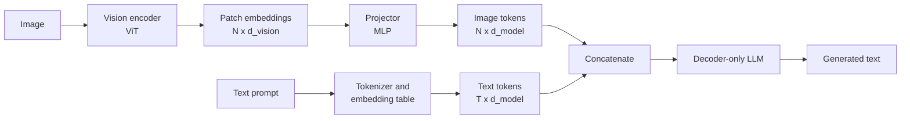
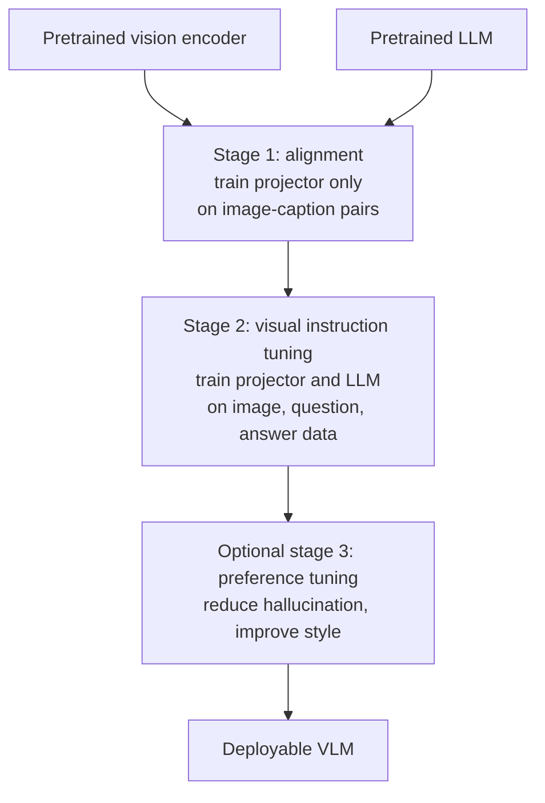

A **vision-language model (VLM)** takes images and text as input and produces text (or, for some designs, an embedding). It is the engine behind every "send an image to the chat API" feature from the previous lesson. You do not need to train one to use it, but you do need to know how it works inside: the architecture explains why images cost so many tokens, why VLMs are good at describing scenes but bad at counting, and why they sometimes read text that is not there.

## Two families of architecture

There are two main ways to connect vision and language, and they serve different purposes.

**Dual encoders** (CLIP is the best-known example) have two separate networks: an image encoder and a text encoder. Each maps its input to a single vector in a shared embedding space, and the model is trained so that an image and its matching caption end up close together. Dual encoders do not generate text. They are used for retrieval, zero-shot classification and similarity search, and they are the subject of [Multimodal Embeddings](/learn/multimodal-ai/multimodal-embeddings).

**Generative VLMs** feed visual information *into* a language model so it can generate text about it. The most common open design, popularised by LLaVA-style models, has three parts:

1. A **vision encoder**, usually a pretrained ViT (often the image half of a CLIP-like model), turns the image into a grid of patch embeddings.
2. A **projector**, a small linear layer or MLP, maps each patch embedding into the LLM's token embedding space.
3. A **decoder-only LLM** receives the projected patches as if they were ordinary token embeddings, followed by the text prompt, and generates the answer.



Other designs exist. Some insert **cross-attention layers** into the LLM so text tokens attend to image features without putting them in the sequence; some use a small set of learned **query tokens** that attend to the image and compress it to a fixed number of outputs; some natively tokenise images and text together from the start of pretraining. The projector design is worth understanding first because it is simple and widely used.

| Design | How images enter | Image cost in the LLM sequence | Generates text |
| --- | --- | --- | --- |
| Dual encoder (CLIP-style) | Separate encoder, one vector per image | None (no LLM) | No |
| Encoder + projector + LLM | Projected patches placed in the token sequence | One token per patch (or per merged patch group) | Yes |
| Cross-attention | LLM layers attend to image features | Not in the sequence, extra compute per layer | Yes |
| Learned query compressor | Fixed number of query outputs | Fixed, small number of tokens | Yes |

## Image tokens and their context cost

A ViT splits an image of height $H$ and width $W$ into square patches of side $P$ pixels. The number of patches is

$$
N = \frac{H}{P} \times \frac{W}{P}
$$

and in a projector-based VLM each patch becomes one token in the LLM's input (some models merge neighbouring patches first, for example 2 by 2, which divides $N$ by four). The [Vision Transformers](/learn/computer-vision/vision-transformers) lesson showed the patching step; here the consequence that matters is cost.

```python
def image_tokens(height, width, patch=14, merge=1):
    """Tokens a projector-based VLM spends on one image (merge = patches merged per side)."""
    per_side_h = height // patch // merge
    per_side_w = width // patch // merge
    return per_side_h * per_side_w

for size in [224, 336, 448, 672]:
    print(f"{size}x{size}: {image_tokens(size, size):5d} tokens, "
          f"{image_tokens(size, size, merge=2):4d} with 2x2 merging")
```

```output
224x224:   256 tokens,   64 with 2x2 merging
336x336:   576 tokens,  144 with 2x2 merging
448x448:  1024 tokens,  256 with 2x2 merging
672x672:  2304 tokens,  576 with 2x2 merging
```

The token count grows with the *square* of the resolution. Doubling the side length quadruples the tokens, and attention cost grows faster still. This is the central trade-off of VLM design: high resolution is needed to read small text, but it is expensive. Many models handle large images by **tiling**: they cut the image into fixed-size tiles, encode each tile separately, and add a low-resolution thumbnail of the whole image for global context. Hosted APIs expose this as a detail or resolution setting, and their pricing pages describe how they count image tokens. The numbers above are illustrative for a patch size of 14; real models differ.

The projector itself is tiny compared with the encoder and LLM. In PyTorch it is just an MLP applied to each patch independently:

```python
import torch
from torch import nn

torch.manual_seed(0)
d_vision, d_model = 64, 128        # toy sizes; real models are far larger

projector = nn.Sequential(
    nn.Linear(d_vision, d_model),
    nn.GELU(),
    nn.Linear(d_model, d_model),
)

patches = torch.randn(1, 576, d_vision)       # batch of 1 image, 576 patch embeddings
text = torch.randn(1, 20, d_model)            # 20 already-embedded text tokens

image_tokens_emb = projector(patches)
sequence = torch.cat([image_tokens_emb, text], dim=1)
print("image tokens:", tuple(image_tokens_emb.shape))
print("LLM input:   ", tuple(sequence.shape))
print("projector parameters:", sum(p.numel() for p in projector.parameters()))
```

```output
image tokens: (1, 576, 128)
LLM input:    (1, 596, 128)
projector parameters: 24832
```

From the LLM's point of view, the image is just 576 extra positions in the sequence. Everything you know about [context windows](/learn/generative-ai-fundamentals/context-windows) applies: images compete with text for space, and they increase latency and cost.

## Training stages

Generative VLMs are usually built from a pretrained vision encoder and a pretrained LLM, then trained in stages.



1. **Alignment (pretraining the projector).** The encoder and LLM are frozen; only the projector learns, on large numbers of image-caption pairs. The goal is to make projected patches "speak the LLM's language" so it can describe what it sees.
2. **Visual instruction tuning.** The projector and the LLM (fully, or with [LoRA](/learn/advanced-llm-engineering/lora-and-qlora)) are trained on conversations about images: questions, detailed descriptions, reasoning over charts and documents. This is the multimodal equivalent of [supervised fine-tuning](/learn/advanced-llm-engineering/supervised-fine-tuning-sft). The vision encoder is often unfrozen too, at a low learning rate.
3. **Preference tuning.** As with text models, methods such as [DPO](/learn/advanced-llm-engineering/dpo) can be used to prefer grounded answers over ones that mention objects not in the image.

> [!NOTE]
> Training data quality dominates. Many instruction datasets were generated by prompting a text model with captions and object lists, which is cheap but inherits the errors of those captions. When a VLM confidently describes something that is not in the image, the habit was often learned from training answers that did the same.

## Limitations you must design around

VLMs are impressive at describing scenes and reading clean documents, and weak in predictable ways. The architecture explains most of them.

| Limitation | What you see | Why it happens |
| --- | --- | --- |
| Counting | "There are 7 apples" when there are 9 | No explicit object detection; patches are summarised, not enumerated |
| Spatial reasoning | Left and right swapped, wrong "above/below" relations | Position information is weak after projection, and training captions rarely state precise geometry |
| Hallucinated details | Mentions a dog or a logo that is not there | The LLM's language prior fills in what is typical for the scene |
| Small text | Misread digits, invented words | Downscaling to a fixed resolution destroys fine detail |
| Fine localisation | Vague or wrong coordinates | Most VLMs are not trained to output precise boxes |

Practical responses:

- **Combine with classic models.** If you need counts or boxes, run a detector and give the VLM its output as text.
- **Crop and tile.** Send the region that matters at a higher effective resolution.
- **Ask for grounding.** Request quotes of the exact text the answer is based on, and verify that text with OCR.
- **Allow abstention.** Tell the model it may say "not visible". Without that permission it tends to guess.
- **Evaluate on your own images.** Public benchmark scores tell you little about your screenshots, scans or factory photos. Build a small labelled set, as in [LLM model evaluation](/learn/working-with-llms/model-evaluation).

> [!KEY]
> A generative VLM is an LLM that has been taught to read projected image patches. It inherits the LLM's strengths (fluent reasoning, instruction following) and its weaknesses (confident invention), and adds a resolution bottleneck that the text-only model never had.

## Exercises

**1.** Using `image_tokens`, compute the tokens for a 1344 by 896 screenshot with patch size 14, with and without 2 by 2 merging. Then compute the tokens if the image is cut into 448 by 448 tiles plus one 448 by 448 thumbnail, without merging.

<details>
<summary>Show solution</summary>

```python
print(image_tokens(896, 1344), image_tokens(896, 1344, merge=2))
tiles = (1344 // 448) * (896 // 448)          # 3 x 2 = 6 tiles
print(tiles * image_tokens(448, 448) + image_tokens(448, 448))
```

```output
6144 1536
7168
```

Tiling preserves detail but costs more than the single image, because the thumbnail is added on top.

</details>

**2.** In stage 1 training only the projector is updated. Explain why freezing the encoder and LLM makes sense at that stage.

<details>
<summary>Show solution</summary>

Both components are already well trained. At the start the projector outputs are random, so the gradients flowing into the LLM and encoder would be large and noisy and could damage their existing abilities. Training only the small projector first is cheap and aligns the two spaces; later stages can then fine-tune the larger parts gently.

</details>

**3.** A warehouse app asks a VLM "How many boxes are on this pallet?" and is often wrong. Propose a more reliable design.

<details>
<summary>Show solution</summary>

Use an object detector trained (or fine-tuned) on boxes to count them, and use the VLM only for the open-ended parts, such as reading labels or describing damage. If you must use the VLM, ask it to list each box with a position before giving a total, and validate the count on a labelled sample of your own images.

</details>

```quiz
[
  {
    "q": "In a LLaVA-style VLM, what does the projector do?",
    "options": [
      "Maps vision encoder patch embeddings into the LLM's token embedding space",
      "Projects text tokens into image space",
      "Generates the final answer",
      "Resizes the input image"
    ],
    "answer": 0,
    "why": "The projector is a small MLP that turns each patch embedding into a vector the LLM can treat like a token embedding."
  },
  {
    "q": "A projector-based VLM uses 14-pixel patches. Roughly how does the image token count change when the input side length doubles?",
    "options": [
      "It stays the same",
      "It doubles",
      "It quadruples",
      "It halves"
    ],
    "answer": 2,
    "why": "Tokens = (H/P) x (W/P), so doubling both H and W multiplies the count by four."
  },
  {
    "q": "Which task is a CLIP-style dual encoder suited to?",
    "options": [
      "Writing a detailed description of an image",
      "Retrieving the images that best match a text query",
      "Answering multi-step questions about a chart",
      "Translating text in an image"
    ],
    "answer": 1,
    "why": "Dual encoders produce one embedding per input for similarity comparison; they do not generate text."
  },
  {
    "q": "Why do VLMs often misread small text in full-page screenshots?",
    "options": [
      "The LLM cannot read numbers",
      "Screenshots contain no text tokens",
      "Text in images is always encrypted",
      "The image is downscaled to the encoder's resolution, losing fine detail"
    ],
    "answer": 3,
    "why": "Encoders work at a fixed resolution or tile size; aggressive downscaling makes small characters illegible, and the LLM then guesses."
  }
]
```
