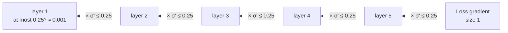
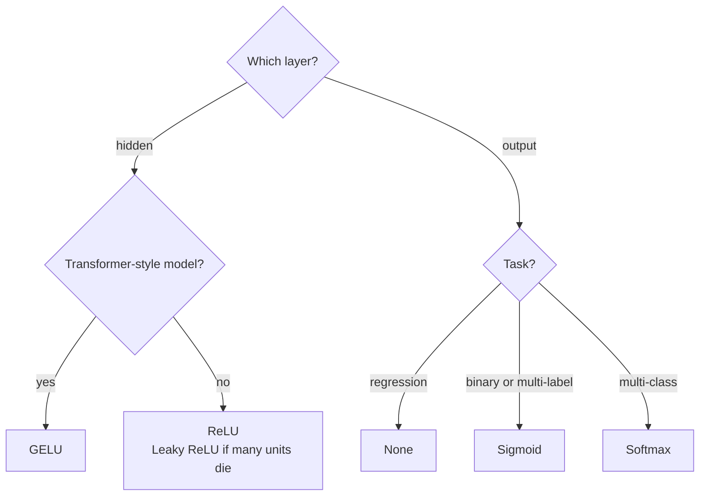

The activation function is the small nonlinear function each neuron applies after its weighted sum. It looks like a detail, but without it a network of any depth collapses into a single linear model, and a poor choice can stop a deep network from learning at all. This lesson shows why nonlinearity is essential, walks through the activations you will meet in practice (sigmoid, tanh, ReLU, GELU and softmax) with their derivatives, and explains the vanishing gradient problem that shaped which ones are used today.

## Why networks need nonlinearity

Suppose a network has two layers and no activation function. Then

$$
\hat{\mathbf{y}} = (\mathbf{x}W_1 + \mathbf{b}_1)W_2 + \mathbf{b}_2 = \mathbf{x}\,(W_1W_2) + (\mathbf{b}_1W_2 + \mathbf{b}_2) = \mathbf{x}W' + \mathbf{b}'
$$

where $\mathbf{x}$ is an input row vector, $W_1, W_2$ weight matrices and $\mathbf{b}_1, \mathbf{b}_2$ biases. The product of linear maps is just another linear map, so the "deep" network is exactly a single layer with weights $W'$ and bias $\mathbf{b}'$. However many layers you stack, it can only draw straight boundaries, and XOR stays unsolvable.

```python
import numpy as np

rng = np.random.default_rng(1)
x = rng.normal(size=(5, 3))                         # 5 examples, 3 features
W1, b1 = rng.normal(size=(3, 4)), rng.normal(size=4)
W2, b2 = rng.normal(size=(4, 2)), rng.normal(size=2)

two_layers = (x @ W1 + b1) @ W2 + b2
one_layer = x @ (W1 @ W2) + (b1 @ W2 + b2)
print(np.allclose(two_layers, one_layer))
```

```output
True
```

A nonlinear $f$ between the layers breaks this collapse, and with it the network gains the ability to bend and fold its input space.

## Sigmoid and tanh

The **sigmoid** (logistic) function squashes any real number into $(0, 1)$:

$$
\sigma(z) = \frac{1}{1 + e^{-z}}, \qquad \sigma'(z) = \sigma(z)\,\big(1 - \sigma(z)\big)
$$

It was the classic hidden-layer activation and remains the right choice for an *output* that must be a probability. Its derivative peaks at $0.25$ when $z = 0$ and goes to zero for large $|z|$: the function **saturates**, flattening out at both ends.

The **hyperbolic tangent** is a stretched, shifted sigmoid, $\tanh(z) = 2\sigma(2z) - 1$, with range $(-1, 1)$:

$$
\tanh'(z) = 1 - \tanh^2(z)
$$

Its derivative peaks at $1$, four times larger than sigmoid's, and its outputs are **zero-centred**, which makes the next layer's optimisation better conditioned. For hidden layers tanh is nearly always preferable to sigmoid, and it is still used inside recurrent cells such as the [LSTM](/learn/sequence-models/lstm). Both saturate, however.

## ReLU and its variants

The **rectified linear unit** is almost embarrassingly simple:

$$
\text{relu}(z) = \max(0, z), \qquad \text{relu}'(z) = \begin{cases} 1 & z > 0 \\ 0 & z < 0 \end{cases}
$$

(The derivative at exactly 0 is undefined; libraries use 0.) ReLU became the default hidden activation in the early 2010s for three reasons: it is cheap, its gradient is exactly 1 for every active unit so it does not shrink signals passing backwards, and it produces sparse activations, with many units outputting exactly zero.

Its weakness is the **dying ReLU**: a unit whose pre-activation is negative for every input outputs 0 and receives zero gradient, so it can never recover. A learning rate that is too high can kill a large fraction of units this way. **Leaky ReLU**, $\max(\alpha z, z)$ with a small slope such as $\alpha = 0.01$, keeps a small gradient for negative inputs.

## GELU

The **Gaussian error linear unit** weights its input by the probability that a standard normal variable is below it:

$$
\text{gelu}(z) = z\,\Phi(z), \qquad \text{gelu}'(z) = \Phi(z) + z\,\phi(z)
$$

where $\Phi$ is the standard normal cumulative distribution function and $\phi$ its density, from the [normal distribution](/learn/probability-and-statistics/normal-distribution) lesson. For large positive $z$ it behaves like $z$, for large negative $z$ it goes to 0, and in between it is smooth, dipping slightly below zero (to about $-0.17$). GELU is the activation in the MLP blocks of BERT, the GPT family and many other transformers. Implementations often use the tanh approximation $0.5z\big(1 + \tanh\big(\sqrt{2/\pi}\,(z + 0.044715z^3)\big)\big)$.

## Softmax

**Softmax** is different from the others: it acts on a whole vector of logits $\mathbf{z} = (z_1, \dots, z_k)$ at once and turns it into a probability distribution:

$$
\text{softmax}(\mathbf{z})_i = \frac{e^{z_i}}{\sum_{j=1}^{k} e^{z_j}}
$$

It is used on the output layer for multi-class classification (and inside attention), almost never in hidden layers. Its derivative is a matrix, $\partial p_i / \partial z_j = p_i(\delta_{ij} - p_j)$, where $p = \text{softmax}(\mathbf{z})$ and $\delta_{ij}$ is 1 if $i = j$ and 0 otherwise. In practice you rarely need it, because combined with cross-entropy loss the gradient simplifies to $\mathbf{p} - \mathbf{y}$, as the [loss functions](/learn/neural-network-fundamentals/loss-functions) lesson shows.

Computing $e^{z}$ directly overflows for logits around 710 or more. Since softmax is unchanged when you subtract the same constant from every logit, implementations subtract the maximum first:

```python
def softmax(z):
    e = np.exp(z - z.max(axis=-1, keepdims=True))
    return e / e.sum(axis=-1, keepdims=True)

big = np.array([1000.0, 1001.0, 1002.0])
with np.errstate(over="ignore", invalid="ignore"):
    print("naive: ", np.exp(big) / np.exp(big).sum())
print("stable:", softmax(big).round(4))
```

```output
naive:  [nan nan nan]
stable: [0.09   0.2447 0.6652]
```

## All of them in code, with checked derivatives

Here are the element-wise activations and their derivatives. A derivative formula is easy to get wrong, so check each against a **central difference**, $\big(f(z + h) - f(z - h)\big)/2h$, the same technique you will use to verify [backpropagation](/learn/neural-network-fundamentals/backpropagation).

```python
from scipy.special import erf

Phi = lambda z: 0.5 * (1 + erf(z / np.sqrt(2)))           # normal CDF
phi = lambda z: np.exp(-z**2 / 2) / np.sqrt(2 * np.pi)    # normal density
sig = lambda z: 1 / (1 + np.exp(-z))

acts = {
    "sigmoid": (sig,                             lambda z: sig(z) * (1 - sig(z))),
    "tanh":    (np.tanh,                         lambda z: 1 - np.tanh(z)**2),
    "relu":    (lambda z: np.maximum(0, z),      lambda z: (z > 0).astype(float)),
    "leaky":   (lambda z: np.where(z > 0, z, 0.01 * z),
                lambda z: np.where(z > 0, 1.0, 0.01)),
    "gelu":    (lambda z: z * Phi(z),            lambda z: Phi(z) + z * phi(z)),
}

z = np.array([-3.0, -1.0, -0.1, 0.5, 2.0])   # avoid z = 0, where relu has a kink
h = 1e-5
print(f"{'':8s} {'f(-3)':>8s} {'f(2)':>8s} {'max |grad error|':>17s}")
for name, (f, df) in acts.items():
    numeric = (f(z + h) - f(z - h)) / (2 * h)
    err = np.abs(numeric - df(z)).max()
    print(f"{name:8s} {f(z)[0]:8.4f} {f(z)[-1]:8.4f} {err:17.1e}")
```

```output
            f(-3)     f(2)  max |grad error|
sigmoid    0.0474   0.8808           2.7e-12
tanh      -0.9951   0.9640           3.2e-11
relu       0.0000   2.0000           6.6e-12
leaky     -0.0300   2.0000           6.6e-12
gelu      -0.0040   1.9545           1.3e-11
```

All analytic derivatives agree with the numerical ones to about ten decimal places.

| Activation | Range | Derivative | Max derivative | Typical use |
| --- | --- | --- | --- | --- |
| Sigmoid | $(0, 1)$ | $\sigma(1 - \sigma)$ | 0.25 | Binary and multi-label outputs, gates |
| Tanh | $(-1, 1)$ | $1 - \tanh^2$ | 1 | Recurrent networks, some hidden layers |
| ReLU | $[0, \infty)$ | 0 or 1 | 1 | Default hidden layer for MLPs and CNNs |
| Leaky ReLU | $(-\infty, \infty)$ | $\alpha$ or 1 | 1 | When dying ReLUs are a problem |
| GELU | about $[-0.17, \infty)$ | $\Phi(z) + z\phi(z)$ | about 1.13 | Transformers |
| Softmax | each in $(0, 1)$, sum 1 | Jacobian $p_i(\delta_{ij} - p_j)$ | n/a | Multi-class output |

## The vanishing gradient problem

Backpropagation computes a weight's gradient by the [chain rule](/learn/calculus/chain-rule): a product containing one activation derivative per layer between that weight and the loss. With sigmoid, each of those factors is at most $0.25$.



Ignoring the weights, ten sigmoid layers scale the gradient by at most $0.25^{10} \approx 10^{-6}$, and saturated units make it far smaller. The early layers, which should learn the basic features, barely move. This **vanishing gradient** problem is the main reason deep networks were so hard to train before around 2010. The weights in the product matter too: if they are consistently too large, the product grows instead and gradients **explode**.

```python
for name, (f, df) in acts.items():
    if name == "leaky":
        continue
    best = df(np.linspace(-5, 5, 10_001)).max()      # best case per layer
    print(f"{name:8s} best per-layer factor {best:.3f}  -> after 10 layers {best**10:.2e}")
```

```output
sigmoid  best per-layer factor 0.250  -> after 10 layers 9.54e-07
tanh     best per-layer factor 1.000  -> after 10 layers 1.00e+00
relu     best per-layer factor 1.000  -> after 10 layers 1.00e+00
gelu     best per-layer factor 1.129  -> after 10 layers 3.36e+00
```

These are best cases. Tanh reaches 1 only at exactly $z = 0$; any unit away from zero contributes less, and a saturated one almost nothing. ReLU's factor is exactly 1 for *every* active unit, whatever its input, so the activation itself never shrinks the gradient. Combined with [He initialisation](/learn/neural-network-fundamentals/neural-network-architecture), and later with [batch normalisation](/learn/neural-network-fundamentals/batch-normalization) and residual connections, that is what made very deep networks trainable.

> [!KEY]
> Use ReLU (or GELU in transformer-style models) in hidden layers, and choose the output activation by task: none for regression, sigmoid for binary or multi-label, softmax for multi-class. Avoid sigmoid in hidden layers of deep networks: its derivative of at most 0.25 makes gradients vanish.



## Exercises

**1.** Show that $\sigma'(z) = \sigma(z)(1 - \sigma(z))$ by differentiating $\sigma(z) = (1 + e^{-z})^{-1}$.

<details>
<summary>Show solution</summary>

By the chain rule, $\sigma'(z) = -(1 + e^{-z})^{-2} \cdot (-e^{-z}) = \dfrac{e^{-z}}{(1 + e^{-z})^2}$. Split it as $\dfrac{1}{1 + e^{-z}} \cdot \dfrac{e^{-z}}{1 + e^{-z}}$. The first factor is $\sigma(z)$, and the second is $1 - \dfrac{1}{1 + e^{-z}} = 1 - \sigma(z)$.

</details>

**2.** A layer of ReLU units receives pre-activations `np.array([[-2.0, 0.5, 3.0], [-1.0, -0.3, 1.0]])` for two examples. Which units are "dead" for this batch, and what are the gradients of the ReLU outputs with respect to the pre-activations?

<details>
<summary>Show solution</summary>

```python
Z = np.array([[-2.0, 0.5, 3.0], [-1.0, -0.3, 1.0]])
print((Z > 0).astype(float))   # [[0. 1. 1.] [0. 0. 1.]]
```

Unit 0 is negative for both examples, so it outputs zero and gets no gradient from this batch. If that holds for every input in the dataset, it is permanently dead. Unit 1 is active only for the first example.

</details>

**3.** Verify numerically that softmax is unchanged when you add 5 to every logit, but changes when you multiply every logit by 2. What does multiplying by 2 do to the distribution?

<details>
<summary>Show solution</summary>

```python
z = np.array([2.0, 1.0, -1.0])
print(softmax(z).round(3), softmax(z + 5).round(3), softmax(2 * z).round(3))
```

Adding a constant cancels between numerator and denominator. Multiplying by 2 makes the distribution sharper: the largest probability grows (from about 0.705 to about 0.879) and the others shrink. Dividing logits by a constant, called the **temperature**, is how language models make sampling more or less random.

</details>

```quiz
[
  {
    "q": "What happens if you stack several dense layers with no activation functions between them?",
    "options": [
      "The network becomes more expressive with each layer",
      "The network is equivalent to a single linear layer",
      "Training fails with an error",
      "The gradients explode"
    ],
    "answer": 1,
    "why": "A composition of linear maps is linear: $(xW_1 + b_1)W_2 + b_2 = x(W_1W_2) + (b_1W_2 + b_2)$."
  },
  {
    "q": "What is the maximum value of the sigmoid's derivative?",
    "options": ["1", "0.5", "0.25", "It is unbounded"],
    "answer": 2,
    "why": "$\\sigma'(z) = \\sigma(z)(1 - \\sigma(z))$ is largest at $z = 0$, where $\\sigma = 0.5$, giving $0.25$."
  },
  {
    "q": "Why do implementations subtract the maximum logit before computing softmax?",
    "options": [
      "To make the outputs sum to 1",
      "To avoid overflow in the exponential without changing the result",
      "To make the largest probability exactly 1",
      "To speed up the gradient computation"
    ],
    "answer": 1,
    "why": "Softmax is invariant to adding a constant to all logits, and subtracting the maximum keeps every exponent at or below zero."
  },
  {
    "q": "A ReLU unit outputs zero for every training example. What happens to its incoming weights during training?",
    "options": [
      "They receive zero gradient and stop changing",
      "They grow until the unit activates",
      "They are reset to random values",
      "They receive the same gradient as the other units"
    ],
    "answer": 0,
    "why": "ReLU's derivative is 0 for negative inputs, so no gradient flows to the unit's weights. This is the dying ReLU problem."
  }
]
```
