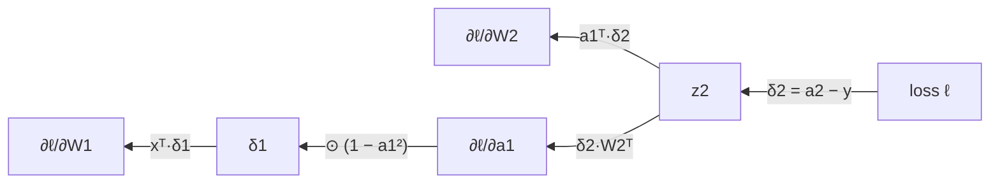

Training a network means adjusting every weight to reduce the loss, and for that you need the gradient: how much the loss changes when each weight changes. A modern network has millions or billions of weights. **Backpropagation** computes all of those partial derivatives in a single backward sweep that costs about as much as the forward pass, by applying the [chain rule](/learn/calculus/chain-rule) layer by layer from the loss back to the input. It is the algorithm that makes deep learning possible. This lesson derives it for a two-layer network, steps through it with real numbers, implements it in NumPy, and proves the implementation correct with a gradient check.

## Why not just measure each derivative?

You could estimate $\partial \ell / \partial w$ for one weight by nudging it: $\big(\ell(w + h) - \ell(w - h)\big)/2h$. That needs two forward passes *per weight*. For a network with a million weights, that is two million forward passes for a single training step. Backpropagation gets every derivative exactly, with one forward and one backward pass.

The trick is to reuse work. Every weight's gradient passes through the same downstream layers, so backpropagation computes the gradient with respect to each layer's output once, then hands it back to the layer before.

## Deriving the gradients

Use the network from [forward propagation](/learn/neural-network-fundamentals/forward-propagation): input $\mathbf{x}$, tanh hidden layer, sigmoid output, binary cross-entropy loss.

$$
\mathbf{z}_1 = \mathbf{x}W_1 + \mathbf{b}_1,\quad \mathbf{a}_1 = \tanh(\mathbf{z}_1),\quad z_2 = \mathbf{a}_1W_2 + b_2,\quad a_2 = \sigma(z_2),\quad \ell = -\big[y\ln a_2 + (1-y)\ln(1-a_2)\big]
$$

Write $\delta$ for "the gradient of the loss with respect to a pre-activation". Work backwards.

**Output layer.** By the chain rule, $\delta_2 = \dfrac{\partial \ell}{\partial z_2} = \dfrac{\partial \ell}{\partial a_2}\dfrac{\partial a_2}{\partial z_2}$. The two factors are

$$
\frac{\partial \ell}{\partial a_2} = -\frac{y}{a_2} + \frac{1-y}{1-a_2} = \frac{a_2 - y}{a_2(1-a_2)}, \qquad \frac{\partial a_2}{\partial z_2} = a_2(1-a_2)
$$

and they cancel beautifully:

$$
\delta_2 = a_2 - y
$$

The error signal is simply prediction minus target. (The same simplification happens for softmax with cross-entropy, which is why those pairs are always used together.)

**Output weights.** Since $z_2 = \sum_j a_{1,j} W_{2,j} + b_2$, each weight's derivative is the input it multiplies:

$$
\frac{\partial \ell}{\partial W_2} = \mathbf{a}_1^\top \delta_2, \qquad \frac{\partial \ell}{\partial b_2} = \delta_2
$$

**Back into the hidden layer.** Each hidden activation $a_{1,j}$ affects the loss through $z_2$ with weight $W_{2,j}$:

$$
\frac{\partial \ell}{\partial \mathbf{a}_1} = \delta_2\, W_2^\top, \qquad \boldsymbol{\delta}_1 = \frac{\partial \ell}{\partial \mathbf{a}_1} \odot \big(1 - \mathbf{a}_1^2\big)
$$

where $\odot$ means element-wise multiplication and $1 - \tanh^2$ is tanh's derivative.

**Hidden weights.** Exactly the same pattern as the output layer:

$$
\frac{\partial \ell}{\partial W_1} = \mathbf{x}^\top \boldsymbol{\delta}_1, \qquad \frac{\partial \ell}{\partial \mathbf{b}_1} = \boldsymbol{\delta}_1
$$

Every layer follows the same three-step recipe, so it generalises to any depth:

| Step | Formula | In words |
| --- | --- | --- |
| Weight gradient | $\partial \ell / \partial W^{[l]} = A^{[l-1]\top}\,\delta^{[l]}$ | Layer input times error signal |
| Bias gradient | $\partial \ell / \partial \mathbf{b}^{[l]} = \sum_{\text{rows}} \delta^{[l]}$ | Error signal summed over the batch |
| Pass back | $\delta^{[l-1]} = \big(\delta^{[l]}\,W^{[l]\top}\big) \odot f'\big(Z^{[l-1]}\big)$ | Send the error through the weights, then through the activation |

For a batch of $n$ examples with a *mean* loss, the output signal becomes $\delta^{[L]} = (A^{[L]} - Y)/n$ and the rest is unchanged: the matrix products sum over the batch automatically.



## A backward pass with real numbers

Continue the forward pass from the previous lesson, where $\mathbf{x} = (1, 2)$, $y = 1$, $\mathbf{a}_1 = (0.7163, 0.5370)$, $a_2 = 0.6066$ and the loss was $0.4999$. Then take one gradient descent step with learning rate $0.5$.

```trace
{
  "title": "backward pass and one update",
  "code": [
    "dz2 = a2 - y",
    "dW2 = a1.T @ dz2",
    "db2 = dz2.sum(axis=0)",
    "da1 = dz2 @ W2.T",
    "dz1 = da1 * (1 - a1**2)",
    "dW1 = x.T @ dz1",
    "db1 = dz1.sum(axis=0)",
    "W1, b1, W2, b2 = W1 - lr*dW1, b1 - lr*db1, W2 - lr*dW2, b2 - lr*db2"
  ],
  "steps": [
    { "line": 1, "vars": { "a2": "0.6066", "y": "1", "dz2": "-0.3934" }, "note": "The output error: predicted 0.61, wanted 1. Negative means the logit should go up." },
    { "line": 2, "vars": { "a1": "[0.7163, 0.5370]", "dz2": "-0.3934", "dW2": "[-0.2818, -0.2113]" }, "note": "Each output weight's gradient is its input times the error: 0.7163 × -0.3934 = -0.2818. Both are negative, so both weights will increase." },
    { "line": 3, "vars": { "db2": "-0.3934" }, "note": "The bias's input is always 1, so its gradient is the error itself." },
    { "line": 4, "vars": { "W2": "[0.7, -0.5]", "da1": "[-0.2754, 0.1967]" }, "note": "Send the error back through the weights: -0.3934 × 0.7 and -0.3934 × -0.5. Unit 1 should increase, unit 2 decrease." },
    { "line": 5, "vars": { "1 - a1**2": "[0.4869, 0.7116]", "dz1": "[-0.1341, 0.1400]" }, "note": "Multiply by tanh's local slope. Unit 1 is closer to saturation, so less of its signal gets through." },
    { "line": 6, "vars": { "x": "[1.0, 2.0]", "dW1": "[[-0.1341, 0.1400], [-0.2682, 0.2800]]" }, "note": "Row i of dW1 is input x_i times dz1. The second input is twice as large, so its weights get twice the gradient." },
    { "line": 7, "vars": { "db1": "[-0.1341, 0.1400]" }, "note": "Hidden biases: the hidden error signals themselves." },
    { "line": 8, "vars": { "W1": "[[0.5671, -0.37], [0.3341, 0.26]]", "W2": "[0.8409, -0.3944]", "new a2": "0.7411", "new loss": "0.2996" }, "note": "Step against the gradient with lr = 0.5. Running the forward pass again gives a prediction of 0.74 and the loss falls from 0.4999 to 0.2996." }
  ]
}
```

The same numbers in NumPy:

```python
import numpy as np
np.set_printoptions(precision=4, suppress=True)
sigmoid = lambda z: 1 / (1 + np.exp(-z))

x, y = np.array([[1.0, 2.0]]), np.array([[1.0]])
W1 = np.array([[0.5, -0.3], [0.2, 0.4]]); b1 = np.array([0.0, 0.1])
W2 = np.array([[0.7], [-0.5]]);           b2 = np.array([0.2])

a1 = np.tanh(x @ W1 + b1); a2 = sigmoid(a1 @ W2 + b2)       # forward

dz2 = a2 - y                                                  # backward
dW2, db2 = a1.T @ dz2, dz2.sum(axis=0)
dz1 = (dz2 @ W2.T) * (1 - a1**2)
dW1, db1 = x.T @ dz1, dz1.sum(axis=0)
print("dW2:", dW2.ravel(), " dW1:", dW1.ravel())

lr = 0.5
W1, b1, W2, b2 = W1 - lr*dW1, b1 - lr*db1, W2 - lr*dW2, b2 - lr*db2
a2_new = sigmoid(np.tanh(x @ W1 + b1) @ W2 + b2)
print("new prediction:", a2_new.ravel(), " new loss:", -np.log(a2_new).ravel())
```

```output
dW2: [-0.2818 -0.2113]  dW1: [-0.1341  0.14   -0.2682  0.28  ]
new prediction: [0.7411]  new loss: [0.2996]
```

## A general implementation

Now for any number of layers and any batch size. The forward pass caches each layer's input and pre-activation; the backward pass walks the cache in reverse.

```python
def init_params(sizes, rng):
    return [(rng.normal(0, np.sqrt(1 / m), size=(m, n)), np.zeros(n))
            for m, n in zip(sizes[:-1], sizes[1:])]

def forward(X, params):
    cache, A = [], X
    for i, (W, b) in enumerate(params):
        Z = A @ W + b
        cache.append((A, Z))
        A = sigmoid(Z) if i == len(params) - 1 else np.tanh(Z)
    return A, cache

def bce(y_hat, y):
    return -np.mean(y * np.log(y_hat) + (1 - y) * np.log(1 - y_hat))

def backward(y_hat, y, cache, params):
    grads = [None] * len(params)
    delta = (y_hat - y) / len(y)                  # output layer, mean loss
    for l in reversed(range(len(params))):
        A_in, _ = cache[l]
        W, _ = params[l]
        grads[l] = (A_in.T @ delta, delta.sum(axis=0))
        if l > 0:
            Z_prev = cache[l - 1][1]              # pre-activation of the layer below
            delta = (delta @ W.T) * (1 - np.tanh(Z_prev) ** 2)
    return grads
```

## Gradient checking

Backpropagation code is easy to get subtly wrong: a missing transpose, a forgotten $1/n$, the derivative evaluated at $\mathbf{a}$ instead of $\mathbf{z}$. Many such bugs do not crash; the network just trains badly. The cure is a **gradient check**: compare the analytic gradients with central-difference estimates on a small random network, using the **relative error**

$$
\text{rel} = \frac{\lVert g_{\text{backprop}} - g_{\text{numeric}} \rVert}{\lVert g_{\text{backprop}} \rVert + \lVert g_{\text{numeric}} \rVert}
$$

```python
rng = np.random.default_rng(0)
params = init_params([3, 5, 4, 1], rng)
X = rng.normal(size=(6, 3))
y = rng.integers(0, 2, size=(6, 1)).astype(float)

y_hat, cache = forward(X, params)
grads = backward(y_hat, y, cache, params)

eps = 1e-6
for l, (W, b) in enumerate(params):
    numeric = np.zeros_like(W)
    for idx in np.ndindex(W.shape):
        old = W[idx]
        W[idx] = old + eps; loss_plus = bce(forward(X, params)[0], y)
        W[idx] = old - eps; loss_minus = bce(forward(X, params)[0], y)
        W[idx] = old
        numeric[idx] = (loss_plus - loss_minus) / (2 * eps)
    analytic = grads[l][0]
    rel = np.linalg.norm(analytic - numeric) / (np.linalg.norm(analytic) + np.linalg.norm(numeric))
    print(f"layer {l + 1} W{W.shape}: relative error {rel:.1e}")
```

```output
layer 1 W(3, 5): relative error 1.6e-09
layer 2 W(5, 4): relative error 1.0e-09
layer 3 W(4, 1): relative error 4.5e-10
```

Relative errors around $10^{-7}$ or smaller mean the gradients are right; around $10^{-3}$ or larger means a bug. Run checks in float64 on a tiny network, and with ReLU avoid inputs that sit exactly on the kink at zero.

> [!TIP]
> Frameworks such as [PyTorch](/learn/pytorch/autograd) compute these gradients for you with automatic differentiation, so you will rarely write a backward pass by hand. But the gradient check stays useful whenever you write a custom layer or loss, and knowing what the backward pass computes is what lets you debug vanishing gradients, `nan` losses and memory use.

## Training XOR

With forward, backward and a gradient descent update, you have a complete training loop. Train a network with 4 tanh hidden units on XOR, the problem a perceptron could not solve:

```python
X = np.array([[0, 0], [0, 1], [1, 0], [1, 1]], dtype=float)
y = np.array([[0], [1], [1], [0]], dtype=float)

rng = np.random.default_rng(0)
params = init_params([2, 4, 1], rng)
lr = 1.0
for step in range(2001):
    y_hat, cache = forward(X, params)
    grads = backward(y_hat, y, cache, params)
    params = [(W - lr * dW, b - lr * db) for (W, b), (dW, db) in zip(params, grads)]
    if step in (0, 100, 500, 1000, 2000):
        print(f"step {step:4d}  loss {bce(y_hat, y):.4f}")

print("predictions:", forward(X, params)[0].ravel())
```

```output
step    0  loss 0.7081
step  100  loss 0.1047
step  500  loss 0.0055
step 1000  loss 0.0022
step 2000  loss 0.0009
predictions: [0.0002 0.9989 0.9989 0.0014]
```

The hidden layer has *learned* a representation that makes XOR separable, which is what you built by hand in the [perceptrons](/learn/neural-network-fundamentals/perceptrons) lesson. Nobody told the hidden units what to compute; the gradients did.

> [!KEY]
> Backpropagation is the chain rule applied in reverse order with reuse. Each layer receives $\delta$ (the loss gradient with respect to its output pre-activation), computes its weight gradients as input-transpose times $\delta$, and passes $\delta W^\top \odot f'(Z)$ to the layer below. The cost is roughly two to three forward passes, whatever the number of weights.

## Common backpropagation mistakes

| Mistake | Effect |
| --- | --- |
| Forgetting the $1/n$ for a mean loss | Gradients scale with batch size; the learning rate behaves differently per batch size |
| Using $f'(\mathbf{a})$ where $f'(\mathbf{z})$ is needed (or vice versa) | Wrong gradients that still "sort of" train |
| Overwriting a cached value in place | The backward pass uses modified activations |
| Updating weights before all gradients are computed | Earlier layers' gradients use already-updated weights |
| Applying sigmoid's derivative again after using $\delta = a - y$ | Double-counting the output derivative, slow training |

## Exercises

**1.** For a regression network with a *linear* output $\hat{y} = z_2$ and squared-error loss $\ell = \tfrac{1}{2}(\hat{y} - y)^2$, what is $\delta_2$? Does the rest of the backward pass change?

<details>
<summary>Show solution</summary>

$\delta_2 = \partial \ell / \partial z_2 = \hat{y} - y$, because the identity output has derivative 1. It is the same "prediction minus target" form as sigmoid with cross-entropy. The rest of the backward pass is unchanged: only the output layer's $\delta$ depends on the loss and output activation.

</details>

**2.** Break the implementation deliberately: in `backward`, replace `(1 - np.tanh(Z_prev) ** 2)` with `(1 - Z_prev ** 2)` and re-run the gradient check. Which layers fail?

<details>
<summary>Show solution</summary>

Layers 1 and 2 show large relative errors (about 0.8 and 0.02, millions of times above $10^{-7}$), because their $\delta$ passes through the wrong derivative. Layer 3, the output layer, still passes: its gradient uses only $\delta_2 = (a_2 - y)/n$ and the cached input, which the bug does not touch. A gradient check localises bugs to a layer like this.

</details>

**3.** Train the XOR network with only 1 hidden unit. What happens, and why?

<details>
<summary>Show solution</summary>

```python
rng = np.random.default_rng(0)
params = init_params([2, 1, 1], rng)
for step in range(5000):
    y_hat, cache = forward(X, params)
    grads = backward(y_hat, y, cache, params)
    params = [(W - 1.0 * dW, b - 1.0 * db) for (W, b), (dW, db) in zip(params, grads)]
print(bce(forward(X, params)[0], y), forward(X, params)[0].ravel())
```

With this seed the loss sits at $\ln 2 \approx 0.693$ and every prediction is 0.5: the network has given up and predicts a coin flip for everything. One tanh unit is a monotonic function of a single linear combination of the inputs, so the output is still determined by one straight-line projection, and no projection of the XOR points onto a line separates the classes with one threshold.

</details>

```quiz
[
  {
    "q": "For a sigmoid output with binary cross-entropy, what is the gradient of the loss with respect to the output logit $z$?",
    "options": ["$a(1 - a)$", "$a - y$", "$-y/a$", "$(a - y)\\,a(1 - a)$"],
    "answer": 1,
    "why": "The sigmoid's derivative $a(1 - a)$ cancels the denominator of the cross-entropy derivative, leaving prediction minus target."
  },
  {
    "q": "A layer's input `A_in` has shape `(32, 64)` and its error signal `delta` has shape `(32, 10)`. Which expression gives the weight gradient of shape `(64, 10)`?",
    "options": ["`delta @ A_in`", "`A_in @ delta.T`", "`A_in.T @ delta`", "`delta.T @ A_in`"],
    "answer": 2,
    "why": "`(64, 32) @ (32, 10)` gives `(64, 10)`, and the product sums the per-example gradients over the batch."
  },
  {
    "q": "A gradient check reports a relative error of 0.02 for one layer. What should you conclude?",
    "options": [
      "The gradients are correct",
      "The epsilon is too small",
      "There is almost certainly a bug in that layer's backward computation",
      "The network needs more training"
    ],
    "answer": 2,
    "why": "Correct gradients in float64 give relative errors around 1e-7 or smaller. 0.02 means the analytic and numerical gradients genuinely disagree."
  },
  {
    "q": "Why is backpropagation far cheaper than estimating each gradient with finite differences?",
    "options": [
      "It uses lower precision arithmetic",
      "It reuses the gradient with respect to each layer's output for all the weights below it, giving every gradient in one backward pass",
      "It only updates the output layer",
      "It skips the forward pass"
    ],
    "answer": 1,
    "why": "Finite differences need two forward passes per weight. Backpropagation shares the downstream chain-rule products, so all gradients cost about as much as a couple of forward passes."
  }
]
```
