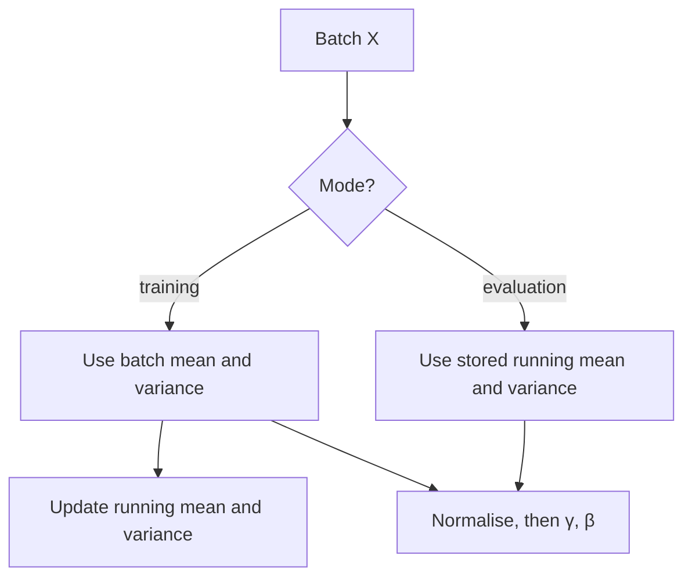

You standardise a network's *inputs* so that the first layer sees well-scaled numbers. **Batch normalisation** (Ioffe and Szegedy, 2015) applies the same idea *inside* the network: it standardises each hidden feature using the mean and variance of the current mini-batch, then lets the network rescale it with two learned parameters. Adding it to deep networks typically makes training faster and more stable, tolerates higher learning rates and makes the network far less sensitive to initialisation. It also introduces the most important train-versus-eval difference in deep learning after dropout, and understanding it explains why its cousin, **layer normalisation**, is what transformers use instead.

## The computation

Take a mini-batch of pre-activations $X$ with shape $(B, d)$: $B$ examples, $d$ features. For each feature $j$ separately, batch norm computes the mean and variance **over the batch** and standardises:

$$
\mu_j = \frac{1}{B}\sum_{i=1}^{B} x_{ij}, \qquad \sigma_j^2 = \frac{1}{B}\sum_{i=1}^{B} (x_{ij} - \mu_j)^2, \qquad \hat{x}_{ij} = \frac{x_{ij} - \mu_j}{\sqrt{\sigma_j^2 + \epsilon}}
$$

then applies a learned scale $\gamma_j$ and shift $\beta_j$:

$$
y_{ij} = \gamma_j\,\hat{x}_{ij} + \beta_j
$$

Here $\epsilon$ is a small constant such as $10^{-5}$ that prevents division by zero. Without $\gamma$ and $\beta$, every feature would be forced to mean 0 and variance 1, which might not be what the next layer needs (a sigmoid fed only values near 0 would be stuck in its linear region). The learnable pair lets the network choose any mean and scale, including undoing the normalisation entirely if that is best.

```python
import numpy as np
np.set_printoptions(precision=3, suppress=True)

def batchnorm_train(X, gamma, beta, eps=1e-5):
    mu = X.mean(axis=0)                    # per feature, over the batch
    var = X.var(axis=0)
    X_hat = (X - mu) / np.sqrt(var + eps)
    return gamma * X_hat + beta, mu, var

rng = np.random.default_rng(0)
X = rng.normal(loc=[5.0, -2.0, 0.0], scale=[3.0, 0.5, 10.0], size=(64, 3))   # badly scaled features
Y, mu, var = batchnorm_train(X, gamma=np.ones(3), beta=np.zeros(3))

print("before: mean", X.mean(axis=0), " std", X.std(axis=0))
print("after:  mean", Y.mean(axis=0), " std", Y.std(axis=0))
```

```output
before: mean [ 4.465 -1.98   1.766]  std [3.188 0.431 9.217]
after:  mean [ 0. -0. -0.]  std [1. 1. 1.]
```

Three wildly different feature scales become identical. In a network, batch norm usually goes between the linear layer and the activation:


The linear layer's bias becomes redundant, because the mean subtraction removes it and $\beta$ plays its role, so it is usually switched off.

## Why it helps

The original paper argued that batch norm reduces *internal covariate shift*: as earlier layers' weights change, the distribution of inputs to later layers keeps shifting, and each layer has to chase a moving target. Later research questioned whether that is the main mechanism and found evidence that batch norm makes the loss surface smoother, so gradients are more predictable and larger steps are safe. Whatever the full explanation, the practical effects are well established:

- **Higher learning rates** train stably, so training converges in fewer steps.
- **Less sensitivity to initialisation**, since each layer's output scale is reset regardless of the weights' scale.
- **A mild regularising effect**: each example's output depends on the other examples in its random batch, which adds noise, somewhat like dropout.

## Training mode versus evaluation mode

Batch statistics create a problem at inference. A prediction for one input should not depend on which other inputs happen to share its batch, and in production there may be only one input. So batch norm keeps **running averages** of the mean and variance during training, and uses those fixed values at evaluation:

$$
\mu_{\text{run}} \leftarrow (1 - m)\,\mu_{\text{run}} + m\,\mu_{\text{batch}}, \qquad \sigma^2_{\text{run}} \leftarrow (1 - m)\,\sigma^2_{\text{run}} + m\,\sigma^2_{\text{batch}}
$$

where $m$ is the momentum (PyTorch's default is 0.1 under this convention; some libraries define momentum the other way round, as the weight on the old value).



Here is a small batch norm layer with both modes:

```python
class BatchNorm:
    def __init__(self, d, momentum=0.1, eps=1e-5):
        self.gamma, self.beta = np.ones(d), np.zeros(d)
        self.run_mean, self.run_var = np.zeros(d), np.ones(d)
        self.m, self.eps = momentum, eps
        self.training = True

    def __call__(self, X):
        if self.training:
            mu, var = X.mean(axis=0), X.var(axis=0)
            self.run_mean = (1 - self.m) * self.run_mean + self.m * mu
            self.run_var = (1 - self.m) * self.run_var + self.m * var
        else:
            mu, var = self.run_mean, self.run_var
        return self.gamma * (X - mu) / np.sqrt(var + self.eps) + self.beta

bn = BatchNorm(3)
for step in range(200):                                  # "training": see many batches
    bn(rng.normal(loc=[5.0, -2.0, 0.0], scale=[3.0, 0.5, 10.0], size=(64, 3)))
print("running mean:", bn.run_mean, " running std:", np.sqrt(bn.run_var))

x = np.array([[8.0, -2.5, 4.0]])                         # one particular example
batch_a = np.vstack([x, rng.normal([5, -2, 0], [3, 0.5, 10], size=(7, 3))])
batch_b = np.vstack([x, rng.normal([5, -2, 0], [3, 0.5, 10], size=(7, 3))])

print("train mode, batch A:", bn(batch_a)[0])
print("train mode, batch B:", bn(batch_b)[0])
bn.training = False
print("eval mode,  batch A:", bn(batch_a)[0])
print("eval mode,  batch B:", bn(batch_b)[0])
```

```output
running mean: [ 4.893 -1.989  0.044]  running std: [ 2.961  0.518 10.117]
train mode, batch A: [ 1.116 -1.364  0.65 ]
train mode, batch B: [ 0.201 -0.283  1.217]
eval mode,  batch A: [ 0.953 -0.947  0.497]
eval mode,  batch B: [ 0.953 -0.947  0.497]
```

In training mode the same example gets different outputs depending on its batch-mates. In evaluation mode it gets the same output every time, computed with the running statistics, which have converged close to the true means $(5, -2, 0)$ and standard deviations $(3, 0.5, 10)$.

> [!WARNING]
> Forgetting to switch to evaluation mode (`model.eval()` in PyTorch) makes predictions depend on the batch, and a batch of one gives garbage: with $B = 1$, every feature equals its own batch mean, so $\hat{x} = 0$ and the output is just $\beta$. The reverse bug, training in evaluation mode, freezes the running statistics and disables the normalisation's benefits.

```python
bn.training = True
print("train mode, batch of one:", bn(x))                # every feature collapses to beta = 0
```

```output
train mode, batch of one: [[0. 0. 0.]]
```

## The backward pass

Because $\mu$ and $\sigma^2$ depend on every example in the batch, the gradient of each output flows to *every* input in the batch, not just its own. Working through the chain rule gives a compact formula for the gradient with respect to the inputs, given the upstream gradient $\partial \ell / \partial y$:

$$
\frac{\partial \ell}{\partial x_{ij}} = \frac{\gamma_j}{B\sqrt{\sigma_j^2 + \epsilon}}\left(B\,\frac{\partial \ell}{\partial y_{ij}} - \sum_{k}\frac{\partial \ell}{\partial y_{kj}} - \hat{x}_{ij}\sum_{k}\frac{\partial \ell}{\partial y_{kj}}\,\hat{x}_{kj}\right)
$$

with sums over the batch. As always with a hand-derived gradient, check it numerically:

```python
def bn_backward(dY, X, gamma, eps=1e-5):
    B = X.shape[0]
    mu, var = X.mean(axis=0), X.var(axis=0)
    X_hat = (X - mu) / np.sqrt(var + eps)
    return gamma / (B * np.sqrt(var + eps)) * (B * dY - dY.sum(axis=0) - X_hat * (dY * X_hat).sum(axis=0))

Xs = rng.normal(size=(5, 3))
gamma, beta = np.array([1.5, 0.5, 2.0]), np.array([0.1, 0.0, -0.3])
W_up = rng.normal(size=(5, 3))                              # loss = sum(W_up * BN(X))
loss = lambda X: np.sum(W_up * batchnorm_train(X, gamma, beta)[0])

analytic = bn_backward(W_up, Xs, gamma)
numeric = np.zeros_like(Xs)
h = 1e-6
for idx in np.ndindex(Xs.shape):
    E = np.zeros_like(Xs); E[idx] = h
    numeric[idx] = (loss(Xs + E) - loss(Xs - E)) / (2 * h)
rel = np.linalg.norm(analytic - numeric) / (np.linalg.norm(analytic) + np.linalg.norm(numeric))
print(f"relative error {rel:.1e}")
```

```output
relative error 3.0e-10
```

Frameworks implement exactly this, so you will not write it by hand in practice; but it explains why batch norm couples the examples in a batch.

## Layer normalisation

Batch norm's dependence on the batch causes trouble when batches are small (noisy statistics), vary in composition, or contain sequences of different lengths, as in language models. **Layer normalisation** (Ba, Kiros and Hinton, 2016) normalises over the *features of each example* instead:

$$
\mu_i = \frac{1}{d}\sum_{j=1}^{d} x_{ij}, \qquad \sigma_i^2 = \frac{1}{d}\sum_{j=1}^{d}(x_{ij} - \mu_i)^2, \qquad y_{ij} = \gamma_j\frac{x_{ij} - \mu_i}{\sqrt{\sigma_i^2 + \epsilon}} + \beta_j
$$

The only change in code is the axis:

```python
def layernorm(X, gamma, beta, eps=1e-5):
    mu = X.mean(axis=1, keepdims=True)                    # per example, over features
    var = X.var(axis=1, keepdims=True)
    return gamma * (X - mu) / np.sqrt(var + eps) + beta

ln_a = layernorm(batch_a, np.ones(3), np.zeros(3))[0]
ln_b = layernorm(batch_b, np.ones(3), np.zeros(3))[0]
ln_1 = layernorm(x, np.ones(3), np.zeros(3))[0]
print("layer norm of x in batch A, batch B, alone:", ln_a, ln_b, ln_1)
```

```output
layer norm of x in batch A, batch B, alone: [ 1.117 -1.31   0.193] [ 1.117 -1.31   0.193] [ 1.117 -1.31   0.193]
```

Each example is normalised using only its own values, so the output is identical whatever the batch, there are no running statistics, and training and evaluation behave the same. That is why layer norm (or its simplification, RMSNorm, which skips the mean subtraction) is the standard in [transformers](/learn/generative-ai-fundamentals/transformer-architecture) and recurrent networks, while batch norm remains common in [convolutional networks](/learn/computer-vision/convolutional-neural-networks-cnns), where it normalises each channel over the batch and all spatial positions.

| | Batch norm | Layer norm |
| --- | --- | --- |
| Statistics computed over | The batch, per feature | The features, per example |
| Depends on other examples | Yes, during training | No |
| Running statistics | Yes, used at evaluation | None |
| Train and eval behaviour | Different | Identical |
| Small batches | Noisy, can break | Unaffected |
| Typical home | CNNs | Transformers, RNNs |

> [!KEY]
> Batch norm standardises each feature over the mini-batch and uses running averages at evaluation, so it must be switched between modes and suffers with small batches. Layer norm standardises each example over its features, behaves identically in training and evaluation, and is what transformers use.

## Exercises

**1.** In `BatchNorm`, set `gamma = np.array([2.0, 2.0, 2.0])` and `beta = np.array([1.0, 1.0, 1.0])` and run a training-mode batch through it. What mean and standard deviation should each output feature have?

<details>
<summary>Show solution</summary>

$\hat{x}$ has mean 0 and standard deviation (almost exactly) 1 per feature, so $y = 2\hat{x} + 1$ has mean 1 and standard deviation 2.

```python
bn2 = BatchNorm(3); bn2.gamma[:] = 2.0; bn2.beta[:] = 1.0
out = bn2(rng.normal(size=(64, 3)) * 7 + 3)
print(out.mean(axis=0), out.std(axis=0))   # about [1, 1, 1] and [2, 2, 2]
```

</details>

**2.** Why is the bias in a linear layer that is immediately followed by batch norm redundant?

<details>
<summary>Show solution</summary>

Adding a constant $b_j$ to feature $j$ for every example also adds $b_j$ to the batch mean, so subtracting the mean removes it exactly. The bias has no effect on the output, and $\beta_j$ already provides a learnable shift after normalisation.

</details>

**3.** You train a CNN with batch norm on 4 GPUs, each processing 2 images. Training is unstable. Name two remedies.

<details>
<summary>Show solution</summary>

Each GPU computes batch statistics from only 2 examples, which are extremely noisy. Remedies: synchronise batch norm statistics across GPUs (so the effective batch is 8), replace batch norm with group normalisation or layer normalisation, which do not depend on the batch, or increase the per-GPU batch size if memory allows.

</details>

```quiz
[
  {
    "q": "Over which axis does batch normalisation compute its mean and variance for an input of shape `(batch, features)`?",
    "options": ["Over the features, separately for each example", "Over the batch, separately for each feature", "Over all values at once", "Over the weights of the previous layer"],
    "answer": 1,
    "why": "Batch norm uses `axis=0`: each feature is standardised with statistics from the examples in the batch."
  },
  {
    "q": "What statistics does batch norm use in evaluation mode?",
    "options": [
      "The current batch's mean and variance",
      "Mean 0 and variance 1",
      "Running averages of the mean and variance collected during training",
      "The statistics of the test set"
    ],
    "answer": 2,
    "why": "Running averages make each prediction independent of its batch-mates and work with a batch of one."
  },
  {
    "q": "Why do batch norm layers have learnable parameters γ and β?",
    "options": [
      "To make the layer slower to train",
      "So the network can choose the scale and mean of each feature, including undoing the normalisation",
      "To store the running statistics",
      "To replace the activation function"
    ],
    "answer": 1,
    "why": "Forcing mean 0 and variance 1 could limit what the next layer can do. γ and β restore that freedom."
  },
  {
    "q": "Why do transformers typically use layer normalisation rather than batch normalisation?",
    "options": [
      "Layer norm has more parameters",
      "Layer norm normalises each example independently, so it is unaffected by batch size or composition and behaves the same in training and evaluation",
      "Batch norm cannot be differentiated",
      "Layer norm removes the need for an optimiser"
    ],
    "answer": 1,
    "why": "Per-example statistics avoid the noisy, batch-dependent behaviour and the train/eval split that batch norm has, which suits variable-length sequences."
  }
]
```
