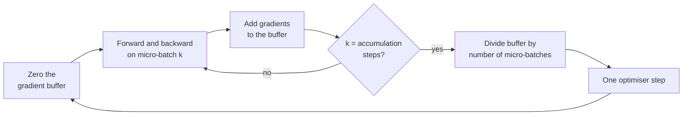

The **batch size** is how many training examples the network processes before taking one optimiser step. It looks like a technical detail, but it controls four things at once: how noisy each gradient is, how many updates you get per pass over the data, how well the hardware is used, and how much memory training needs. It also interacts tightly with the learning rate. This lesson explains each effect, measures the noise directly, and shows gradient accumulation, the standard trick for training with a batch larger than fits in memory.

## Three regimes

Every training step computes the gradient of the *mean* loss over a batch of $B$ examples and updates the weights once.

| Name | Batch size | Gradient | Character |
| --- | --- | --- | --- |
| Batch (full-batch) gradient descent | All $N$ examples | Exact | Smooth but slow; one update per pass over the data |
| Stochastic gradient descent | 1 | Very noisy | Many cheap updates; poor hardware use |
| Mini-batch gradient descent | Typically 16 to a few thousand | Moderately noisy | The standard; usually just called "SGD" |

In practice "batch size" always means the mini-batch size, and deep learning frameworks are built around it.

## Iterations and epochs

An **epoch** is one full pass over the training set. An **iteration** (or **step**) is one mini-batch and one update. With $N$ examples and batch size $B$:

$$
\text{iterations per epoch} = \left\lceil \frac{N}{B} \right\rceil
$$

The last batch is smaller when $B$ does not divide $N$; frameworks either keep it or drop it (`drop_last` in PyTorch's data loader).

```python
import math

N = 50_000
for B in [1, 32, 256, 4096, N]:
    print(f"batch {B:>6}: {math.ceil(N / B):>6} updates per epoch")
```

```output
batch      1:  50000 updates per epoch
batch     32:   1563 updates per epoch
batch    256:    196 updates per epoch
batch   4096:     13 updates per epoch
batch  50000:      1 updates per epoch
```

So for a fixed number of epochs, a larger batch means fewer updates. This is the first thing to remember when comparing batch sizes: the same "20 epochs" is a very different amount of optimisation at batch 32 and at batch 4096.

## Gradient noise shrinks like $1/\sqrt{B}$

A mini-batch gradient is an average of $B$ per-example gradients, so it is an estimate of the full-data gradient. By the usual [sampling](/learn/probability-and-statistics/sampling) argument, its standard error falls like $1/\sqrt{B}$: four times the batch gives half the noise. You can measure this on a real network. Here is the two-moons network from the [optimisers](/learn/neural-network-fundamentals/optimizers) lesson again:

```python
import numpy as np
from sklearn.datasets import make_moons

X, y = make_moons(n_samples=1000, noise=0.2, random_state=0)
X = (X - X.mean(axis=0)) / X.std(axis=0)
y = y.reshape(-1, 1).astype(float)

def init(sizes, seed):
    rng = np.random.default_rng(seed)
    return [p for m, n in zip(sizes[:-1], sizes[1:])
            for p in (rng.normal(0, np.sqrt(2 / m), (m, n)), np.zeros(n))]

def loss_and_grads(params, X, y):
    Ws, bs = params[0::2], params[1::2]
    acts, A = [X], X
    for i, (W, b) in enumerate(zip(Ws, bs)):
        Z = A @ W + b
        A = Z if i == len(Ws) - 1 else np.maximum(0, Z)
        acts.append(A)
    z = acts[-1]
    loss = np.mean(np.maximum(z, 0) - z * y + np.log1p(np.exp(-np.abs(z))))
    delta = (1 / (1 + np.exp(-z)) - y) / len(y)
    grads = []
    for i in reversed(range(len(Ws))):
        grads = [acts[i].T @ delta, delta.sum(axis=0)] + grads
        if i > 0:
            delta = (delta @ Ws[i].T) * (acts[i] > 0)
    return loss, grads
```

Compute the exact full-data gradient once, then draw 200 random mini-batches of each size and measure how far their gradients are from it:

```python
params = init([2, 32, 32, 1], seed=0)
flat = lambda grads: np.concatenate([g.ravel() for g in grads])
g_full = flat(loss_and_grads(params, X, y)[1])

rng = np.random.default_rng(1)
for B in [1, 8, 32, 128, 512]:
    errors = []
    for _ in range(200):
        idx = rng.choice(len(X), B, replace=False)
        g_batch = flat(loss_and_grads(params, X[idx], y[idx])[1])
        errors.append(np.linalg.norm(g_batch - g_full) / np.linalg.norm(g_full))
    err = np.mean(errors)
    print(f"B = {B:4d}: relative error {err:.3f}   error × sqrt(B) = {err * np.sqrt(B):.2f}")
```

```output
B =    1: relative error 1.627   error × sqrt(B) = 1.63
B =    8: relative error 0.525   error × sqrt(B) = 1.49
B =   32: relative error 0.282   error × sqrt(B) = 1.60
B =  128: relative error 0.130   error × sqrt(B) = 1.47
B =  512: relative error 0.050   error × sqrt(B) = 1.14
```

A single example's gradient is off by more than 100% of the true gradient's size: its direction is barely related to the full gradient. The error × $\sqrt{B}$ column stays roughly constant, confirming the $1/\sqrt{B}$ law. (It dips at 512 because that batch is half the dataset, and sampling without replacement from a small population is less noisy than the law assumes.)

Noise is not purely bad. It is what lets SGD wander out of narrow regions of the loss surface, and many practitioners believe this contributes to good generalisation. But too much noise wastes updates, and too little wastes compute.

## Batch size, learning rate and the number of updates

Train the same network for 20 epochs at different batch sizes. First keep the learning rate fixed at 0.1; then scale it in proportion to the batch size, relative to batch 32 (the **linear scaling rule**):

```python
def train(batch, lr, epochs=20, seed=0):
    params = init([2, 32, 32, 1], seed)
    rng = np.random.default_rng(seed)
    steps = 0
    for epoch in range(epochs):
        order = rng.permutation(len(X))
        for start in range(0, len(X), batch):
            idx = order[start:start + batch]
            _, grads = loss_and_grads(params, X[idx], y[idx])
            for p, g in zip(params, grads):
                p -= lr * g
            steps += 1
    return steps, loss_and_grads(params, X, y)[0]

for B in [8, 32, 128, 512]:
    steps, fixed = train(B, 0.1)
    _, scaled = train(B, 0.1 * B / 32)
    print(f"B = {B:3d}: {steps:4d} updates   lr 0.1 -> loss {fixed:.3f}   lr {0.1 * B / 32:.3f} -> loss {scaled:.3f}")
```

```output
B =   8: 2500 updates   lr 0.1 -> loss 0.083   lr 0.025 -> loss 0.116
B =  32:  640 updates   lr 0.1 -> loss 0.119   lr 0.100 -> loss 0.119
B = 128:  160 updates   lr 0.1 -> loss 0.253   lr 0.400 -> loss 0.129
B = 512:   40 updates   lr 0.1 -> loss 0.285   lr 1.600 -> loss 0.138
```

With a fixed learning rate, bigger batches do clearly worse: batch 512 gets only 40 updates in 20 epochs. Scaling the learning rate with the batch recovers most of the gap, because each less noisy step can safely be larger. But not all of it, and the rule breaks down eventually: there is a **critical batch size** beyond which doubling the batch no longer halves the number of steps needed, and the learning rate cannot keep growing without instability. Note also that at batch 8 the rule *lowers* the learning rate to 0.025, and that did worse than keeping 0.1: the rule is a heuristic to start from, not a law.

> [!KEY]
> Batch size and learning rate must be tuned together. When you change the batch size, change the learning rate too: roughly proportionally for SGD (with warm-up), often more gently for Adam. Compare runs by number of updates and wall-clock time, not just epochs.

## Hardware and memory

On a GPU, a batch of 256 often takes barely longer per step than a batch of 32, because the matrix multiplications run in parallel and small batches leave most of the chip idle. So larger batches usually mean faster epochs, up to the point where the hardware is saturated.

The ceiling is memory. Training must keep every layer's activations for the backward pass, and those scale linearly with $B$, while the weights, gradients and optimiser state do not depend on it:

$$
\text{memory} \approx \underbrace{\text{weights} + \text{gradients} + \text{optimiser state}}_{\text{fixed}} + \underbrace{B \times \text{activations per example}}_{\text{grows with } B}
$$

For image and language models, activations usually dominate, so "out of memory" errors are fixed first by reducing the batch size.

## Gradient accumulation

What if you want the optimisation behaviour of batch 256 but only batch 32 fits? Run 8 micro-batches of 32, **accumulate** (sum) their gradients without updating, divide by 8, then take one optimiser step. Because the loss is a mean, the average of the micro-batch gradients equals the gradient of the full batch:



```python
idx = np.arange(32)
_, g_big = loss_and_grads(params, X[idx], y[idx])            # one batch of 32

accum = [np.zeros_like(g) for g in g_big]
for k in range(4):                                            # four micro-batches of 8
    micro = idx[k * 8:(k + 1) * 8]
    _, g_micro = loss_and_grads(params, X[micro], y[micro])
    for a, g in zip(accum, g_micro):
        a += g
accum = [a / 4 for a in accum]

print(all(np.allclose(a, g) for a, g in zip(accum, g_big)))
```

```output
True
```

The result is identical, at the cost of running the micro-batches one after another instead of in parallel. One caveat: layers that compute statistics over the batch, such as [batch normalisation](/learn/neural-network-fundamentals/batch-normalization), still see only the micro-batch, so accumulation is not exactly equivalent for them.

## Choosing a batch size

> [!TIP]
> Start with 32 to 256 for most problems. Use the largest batch that fits comfortably in memory if training speed matters, scale the learning rate with it, and use gradient accumulation when the batch you want does not fit. Powers of two are a convention that sometimes aligns well with hardware, not a requirement.

| Effect of a larger batch | Direction |
| --- | --- |
| Gradient noise per step | Lower, about $1/\sqrt{B}$ |
| Updates per epoch | Fewer, $\lceil N/B \rceil$ |
| Time per epoch on a GPU | Usually lower, until the hardware is saturated |
| Activation memory | Higher, linear in $B$ |
| Usable learning rate | Higher, up to a limit |
| Generalisation at a fixed recipe | Often somewhat worse unless the learning rate and schedule are retuned |

## Exercises

**1.** A dataset has 1,281,167 training images. How many iterations is one epoch at batch size 256 with the last partial batch kept, and with it dropped?

<details>
<summary>Show solution</summary>

$1{,}281{,}167 / 256 = 5004.56\ldots$, so 5005 iterations when the partial batch is kept and 5004 when it is dropped.

```python
print(math.ceil(1_281_167 / 256), 1_281_167 // 256)   # 5005 5004
```

</details>

**2.** Using the noise measurements above, roughly what batch size would you need to bring the relative gradient error down to 0.1?

<details>
<summary>Show solution</summary>

The constant is about 1.5, so $1.5/\sqrt{B} = 0.1$ gives $\sqrt{B} = 15$, $B \approx 225$. The measured error at 128 is about 0.13, consistent with this.

</details>

**3.** You train with batch 64 and AdamW at 3e-4, and want to move to 4 GPUs each processing 64 (an effective batch of 256). What would you change?

<details>
<summary>Show solution</summary>

The effective batch is 4 times larger, so you get a quarter of the updates per epoch with less noisy gradients. Raise the learning rate (for Adam, something between square-root scaling, 6e-4, and linear scaling, 1.2e-3, is a reasonable range to try), keep or lengthen the warm-up, and check whether you need more epochs to match the number of updates. Then verify on validation data rather than trusting the rule.

</details>

```quiz
[
  {
    "q": "A dataset has 10,000 examples and the batch size is 64. How many iterations are in one epoch, keeping the partial batch?",
    "options": ["64", "156", "157", "10,000"],
    "answer": 2,
    "why": "10,000 / 64 = 156.25, so there are 156 full batches and one partial batch: 157 iterations."
  },
  {
    "q": "If you quadruple the batch size, how does the standard error of the mini-batch gradient change?",
    "options": ["It quarters", "It halves", "It stays the same", "It doubles"],
    "answer": 1,
    "why": "The error falls like 1/sqrt(B), and sqrt(4) = 2."
  },
  {
    "q": "Training runs out of GPU memory. Which change reduces memory most directly without changing the effective batch size?",
    "options": [
      "Increase the learning rate",
      "Use gradient accumulation over several smaller micro-batches",
      "Train for fewer epochs",
      "Switch from SGD to Adam"
    ],
    "answer": 1,
    "why": "Activation memory scales with the micro-batch size; accumulating gradients keeps the effective batch the same."
  },
  {
    "q": "You increase the batch size from 32 to 512 but keep the learning rate and number of epochs the same. What is the most likely result?",
    "options": [
      "Better results, because the gradient is more accurate",
      "Identical results, because epochs are the same",
      "Worse results, mainly because there are 16 times fewer updates",
      "The training diverges"
    ],
    "answer": 2,
    "why": "Each epoch now contains 16 times fewer optimiser steps, and the learning rate was not raised to compensate."
  }
]
```
