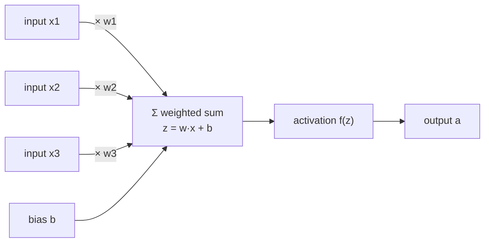

Every deep learning model you will meet in the rest of this curriculum, from an image classifier to a large language model, is built from one tiny repeated unit: the **artificial neuron**. It takes some numbers in, multiplies each by a weight, adds them up, and passes the total through a simple function. That is all. The name comes from a loose analogy with the nerve cells in your brain, and the analogy is useful for building intuition, but it is also misleading in important ways. This lesson shows you what a biological neuron does, what an artificial one computes, and exactly where the comparison stops being helpful.

## The biological neuron

A neuron is a cell specialised for passing signals. Its main parts are:

- **Dendrites**: branching inputs that receive chemical signals from other neurons.
- **Synapses**: the junctions where one neuron's output meets another's dendrite. Each synapse has a *strength*: some amplify the incoming signal, some dampen it, and some are inhibitory, pushing the receiving neuron away from firing.
- **Cell body (soma)**: where the incoming signals are combined.
- **Axon**: a long output cable. If the combined input pushes the cell's electrical potential past a threshold, the neuron fires an **action potential**, a brief voltage spike that travels down the axon to the synapses of the next neurons.

Firing is roughly all-or-nothing: a spike either happens or it does not, and its size does not depend on how far the threshold was exceeded. What carries information is *whether* and *how often* a neuron spikes. Learning, as far as neuroscience understands it, happens largely by changing synapse strengths, an idea summarised by Donald Hebb in 1949 as "cells that fire together wire together".

## The artificial neuron

In 1943 Warren McCulloch and Walter Pitts proposed a mathematical caricature of this cell. The modern version keeps the same structure: inputs, weights for the synapses, a sum for the cell body, and a function deciding the output.



Written out for $n$ inputs:

$$
z = \sum_{i=1}^{n} w_i x_i + b = \mathbf{w}^\top \mathbf{x} + b, \qquad a = f(z)
$$

where $\mathbf{x}$ is the vector of inputs, $\mathbf{w}$ the vector of **weights** (one per input), $b$ the **bias**, $z$ the **pre-activation** and $f$ the **activation function**. The result $a$ is the neuron's **activation**, its output.

| Biological part | Artificial counterpart | Role |
| --- | --- | --- |
| Dendrites | Inputs $x_i$ | Receive signals |
| Synapse strength | Weight $w_i$ | Scale each input; negative means inhibitory |
| Resting threshold | Bias $b$ (negative threshold) | Shift how easily the unit "fires" |
| Soma integration | Weighted sum $z$ | Combine evidence |
| Firing decision | Activation function $f$ | Turn the sum into an output |
| Axon | Output $a$ | Feed the next layer |
| Synaptic plasticity | Weight updates during training | Learning |

The bias deserves a second look. A neuron with threshold $\theta$ fires when $\mathbf{w}^\top\mathbf{x} \ge \theta$, which is the same as $\mathbf{w}^\top\mathbf{x} - \theta \ge 0$. Setting $b = -\theta$ turns "compare with a threshold" into "check the sign of $z$", which is why every artificial neuron carries a bias term.

## A neuron in NumPy

With a step activation (output 1 if $z \ge 0$, else 0) a single neuron is a McCulloch-Pitts unit. By picking weights by hand you can make it compute logic gates:

```python
import numpy as np

def neuron(x, w, b, f):
    return f(np.dot(w, x) + b)

step = lambda z: int(z >= 0)

inputs = [(0, 0), (0, 1), (1, 0), (1, 1)]
and_w, and_b = np.array([1.0, 1.0]), -1.5   # fires only if both inputs are on
or_w, or_b = np.array([1.0, 1.0]), -0.5     # fires if at least one is on

for x in inputs:
    x = np.array(x)
    print(x, "AND:", neuron(x, and_w, and_b, step), "OR:", neuron(x, or_w, or_b, step))
```

```output
[0 0] AND: 0 OR: 0
[0 1] AND: 0 OR: 1
[1 0] AND: 0 OR: 1
[1 1] AND: 1 OR: 1
```

For AND, the bias of -1.5 means the sum must exceed 1.5, which only happens when both inputs are 1. For OR, a single input is enough to beat 0.5.

Swap the step for a smooth activation and the same unit becomes a familiar model. With the sigmoid $\sigma(z) = 1/(1 + e^{-z})$, a single neuron is exactly [logistic regression](/learn/supervised-learning-algorithms/logistic-regression): a weighted sum squashed into a probability.

```python
sigmoid = lambda z: 1 / (1 + np.exp(-z))

x = np.array([0.5, -1.2, 3.0])      # e.g. three scaled features
w = np.array([0.8, 0.1, -0.4])
b = 0.2

z = w @ x + b
print(f"z = {z:.3f}, a = {sigmoid(z):.3f}")
```

```output
z = -0.720, a = 0.327
```

> [!KEY]
> An artificial neuron is a weighted sum followed by a fixed function: $a = f(\mathbf{w}^\top\mathbf{x} + b)$. The weights and bias are learned; the activation function is chosen by you. Everything in deep learning is built by wiring many of these together.

## From one neuron to a layer

Real networks compute many neurons at once. If a layer has $m$ neurons that all see the same input $\mathbf{x}$, stack their weight vectors as the rows of a matrix $W$ and their biases into a vector $\mathbf{b}$. Then the whole layer is one [matrix multiplication](/learn/linear-algebra/matrix-multiplication):

$$
\mathbf{a} = f(W\mathbf{x} + \mathbf{b})
$$

with $f$ applied element by element.

```python
W = np.array([[0.8, 0.1, -0.4],     # neuron 1
              [-0.3, 0.5, 0.2],     # neuron 2
              [0.0, -0.7, 0.9]])    # neuron 3
b = np.array([0.2, 0.0, -0.1])

a = sigmoid(W @ x + b)
print(a.round(3))
```

```output
[0.327 0.463 0.969]
```

The first entry matches the single neuron above. This is why the [vectorised NumPy](/learn/numpy/vectorization) habits from Module 7 matter so much: a layer of a thousand neurons is still a single line of code, and on a GPU it runs in parallel.

## Where the analogy breaks

The artificial neuron borrowed a picture from biology, not a working model of it. Treat the comparison as a mnemonic and be careful not to reason from it.

| Aspect | Biological neurons | Artificial neurons |
| --- | --- | --- |
| Signal | Discrete spikes in time; timing carries information | A single real number per forward pass |
| Computation inside the cell | Dendrites perform complex, nonlinear processing of their own | One weighted sum and one fixed function |
| Learning | Local rules at synapses, neuromodulators; the full mechanism is still being researched | Gradient descent on a global loss via backpropagation |
| Connectivity | Massively recurrent, roughly tens of billions of neurons in a human brain | Usually organised in clean layers, mostly feed-forward |
| Energy | The whole brain runs on roughly the power of a dim light bulb | Training large models takes data-centre scale power |
| Timing | Asynchronous and continuous | Synchronous, layer by layer |

The most important difference is learning. Artificial networks learn with [backpropagation](/learn/neural-network-fundamentals/backpropagation), which needs to send exact error signals backwards through every connection. There is no settled evidence that brains do this, and how biological learning achieves what it does remains an open research question.

> [!NOTE]
> Modern deep learning progress has mostly come from mathematics, data and hardware, not from copying neuroscience more closely. Convolutional networks were inspired by the visual cortex, but transformers, the architecture behind today's language models, have no particular biological counterpart.

## Why such a simple unit is enough

One neuron can only draw a single straight line (a hyperplane) through its input space, as you will see in the [perceptrons](/learn/neural-network-fundamentals/perceptrons) lesson. The power comes from composition. Stack layers of neurons with nonlinear activations between them and the network can represent extremely complicated functions: edges become textures, textures become object parts, parts become objects. The rest of this module builds that up step by step:


## Exercises

**1.** Find weights and a bias so that a single step-activation neuron computes NAND (output 0 only when both inputs are 1). Check all four inputs in NumPy.

<details>
<summary>Show solution</summary>

NAND is the negation of AND, so flip the signs of the AND neuron: $w = (-1, -1)$, $b = 1.5$. The sum is below zero only when both inputs are 1.

```python
import numpy as np
step = lambda z: int(z >= 0)
w, b = np.array([-1.0, -1.0]), 1.5
for x in [(0, 0), (0, 1), (1, 0), (1, 1)]:
    print(x, step(w @ np.array(x) + b))   # 1, 1, 1, 0
```

</details>

**2.** A neuron has weights $(2, -1)$, bias $-0.5$ and a sigmoid activation. Compute its output by hand for input $(1, 1)$, then check with NumPy.

<details>
<summary>Show solution</summary>

$z = 2 \cdot 1 + (-1) \cdot 1 - 0.5 = 0.5$, and $\sigma(0.5) = 1/(1 + e^{-0.5}) \approx 0.622$.

```python
import numpy as np
z = np.array([2, -1]) @ np.array([1, 1]) - 0.5
print(z, 1 / (1 + np.exp(-z)))   # 0.5 0.6224593312018546
```

</details>

**3.** In the layer example, the weight matrix $W$ has shape `(3, 3)`. If the input had 10 features and the layer had 4 neurons, what shapes would $W$, $\mathbf{b}$ and the output have, and how many learnable parameters would the layer have?

<details>
<summary>Show solution</summary>

$W$ has one row per neuron and one column per input: `(4, 10)`. $\mathbf{b}$ has shape `(4,)` and so does the output. Parameters: $4 \times 10 + 4 = 44$.

</details>

```quiz
[
  {
    "q": "In an artificial neuron, what plays the role of synapse strength?",
    "options": ["The activation function", "The weights", "The input values", "The output"],
    "answer": 1,
    "why": "Each weight scales one input, just as a synapse strengthens or weakens the signal it passes on. Negative weights act like inhibitory synapses."
  },
  {
    "q": "A step-activation neuron fires when $w^\\top x \\ge \\theta$. What bias makes this equivalent to firing when $w^\\top x + b \\ge 0$?",
    "options": ["$b = \\theta$", "$b = 1/\\theta$", "$b = -\\theta$", "$b = 0$"],
    "answer": 2,
    "why": "Subtracting the threshold from both sides gives $w^\\top x - \\theta \\ge 0$, so the bias is the negative of the threshold."
  },
  {
    "q": "A single neuron with a sigmoid activation is mathematically the same as which model?",
    "options": ["Linear regression", "k-nearest neighbours", "A decision tree", "Logistic regression"],
    "answer": 3,
    "why": "Logistic regression computes $\\sigma(w^\\top x + b)$, which is exactly a sigmoid neuron."
  },
  {
    "q": "Which statement about biological and artificial neurons is accurate?",
    "options": [
      "Brains are known to learn using backpropagation",
      "Artificial neurons exchange a single real number per forward pass, while biological neurons communicate with timed spikes",
      "Artificial networks are more energy efficient than brains",
      "Biological neurons compute exactly a weighted sum followed by a sigmoid"
    ],
    "answer": 1,
    "why": "Biological signalling uses discrete spikes whose timing matters; an artificial neuron outputs one number. The other statements are false or unsupported."
  }
]
```
