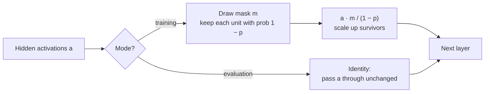

**Dropout** is a regulariser with a surprisingly blunt mechanism: during training, every time an example passes through the network, randomly switch off a fraction of the hidden units by setting their outputs to zero. Each training step therefore trains a different, thinned-out network, and no unit can rely on any particular other unit being present. Introduced by Hinton, Srivastava and colleagues around 2012, it was a key ingredient of early deep learning successes and is still standard in transformers. Its one subtlety, behaving differently during training and evaluation, is also the source of one of the most common bugs in deep learning code.

## The mechanism

For a layer's activations $\mathbf{a}$, dropout with **drop probability** $p$ samples a random **mask** $\mathbf{m}$ whose entries are independently 1 with probability $1 - p$ and 0 with probability $p$, then multiplies:

$$
\tilde{\mathbf{a}} = \frac{\mathbf{m} \odot \mathbf{a}}{1 - p}, \qquad m_j \sim \text{Bernoulli}(1 - p)
$$

where $\odot$ is element-wise multiplication. A new mask is drawn for every example and every forward pass. The division by $1 - p$ is the "inverted" part, explained below.



## Why it works

Two complementary views explain dropout's effect:

- **No co-adaptation.** Without dropout, units can develop fragile partnerships, where one unit corrects another's mistakes on specific training examples. Such partnerships are a form of memorisation. When any partner may vanish at random, each unit has to be useful on its own, which tends to produce more robust, redundant features.
- **An implicit ensemble.** A layer of $n$ units has $2^n$ possible masks, so dropout trains a huge family of thinned networks that share weights. Averaging the predictions of many models (an ensemble) reliably reduces variance; using the full network with scaled weights at test time approximates averaging over all those thinned networks, at the cost of one.

## Inverted dropout: matching training and evaluation

At evaluation time you want deterministic predictions, so dropout is switched off and every unit is used. But that creates a mismatch. If training drops half the units, the next layer is trained to expect inputs about half as large as it will receive at evaluation.

The fix is to keep the *expected* activation the same in both modes. Since $\mathbb{E}[m_j] = 1 - p$,

$$
\mathbb{E}\big[\tilde{a}_j\big] = \frac{(1 - p)\,a_j}{1 - p} = a_j
$$

so with the $1/(1 - p)$ scaling during training, evaluation can simply use the activations unchanged. This is **inverted dropout**, and it is what every modern framework implements. (The original paper instead multiplied weights by $1 - p$ at test time, which is equivalent but easier to get wrong.)

```python
import numpy as np

def dropout_forward(a, p, rng, training=True):
    if not training or p == 0:
        return a, None
    mask = (rng.random(a.shape) >= p) / (1 - p)     # 0 or 1/(1-p)
    return a * mask, mask

def dropout_backward(grad_out, mask):
    return grad_out if mask is None else grad_out * mask

rng = np.random.default_rng(0)
a = np.array([0.5, 1.2, 0.8, 2.0])

out, mask = dropout_forward(a, p=0.5, rng=rng)
print("training: ", out)
print("eval:     ", dropout_forward(a, p=0.5, rng=rng, training=False)[0])

samples = np.array([dropout_forward(a, 0.5, rng)[0] for _ in range(100_000)])
print("mean of 100,000 training passes:", samples.mean(axis=0).round(3))
```

```output
training:  [1. 0. 0. 0.]
eval:      [0.5 1.2 0.8 2. ]
mean of 100,000 training passes: [0.501 1.197 0.795 2.001]
```

Each training pass keeps a random subset and doubles it; on average, the training output equals the evaluation output.

## Forward and backward with real numbers

The backward pass reuses the *same* mask: a dropped unit contributed nothing to the loss, so it receives no gradient, and a kept unit's gradient is scaled by the same $1/(1 - p)$.

```trace
{
  "title": "inverted dropout with p = 0.5",
  "code": [
    "mask = (rng.random(a.shape) >= p) / (1 - p)",
    "out = a * mask",
    "grad_a = grad_out * mask",
    "out_eval = a"
  ],
  "steps": [
    { "line": 1, "vars": { "a": "[0.5, 1.2, 0.8, 2.0]", "p": "0.5", "mask": "[2., 0., 0., 2.]" }, "note": "Each unit survives with probability 0.5. Survivors get the value 1/(1 - p) = 2 in the mask; dropped units get 0." },
    { "line": 2, "vars": { "a": "[0.5, 1.2, 0.8, 2.0]", "mask": "[2., 0., 0., 2.]", "out": "[1.0, 0.0, 0.0, 4.0]" }, "note": "Units 2 and 3 are switched off for this example. The survivors are doubled so the expected total stays the same." },
    { "line": 3, "vars": { "grad_out": "[0.1, -0.3, 0.2, 0.05]", "mask": "[2., 0., 0., 2.]", "grad_a": "[0.2, 0.0, 0.0, 0.1]" }, "note": "Backward: dropped units get zero gradient, so their incoming weights are not updated by this example. Survivors' gradients are scaled by 2." },
    { "line": 4, "vars": { "a": "[0.5, 1.2, 0.8, 2.0]", "out_eval": "[0.5, 1.2, 0.8, 2.0]" }, "note": "Evaluation: no mask, no scaling. Thanks to the training-time scaling, the next layer sees inputs of the same expected size." }
  ]
}
```

## Dropout on an overfitting network

Here is dropout inside the overfitting network from the [regularisation](/learn/neural-network-fundamentals/regularization) lesson: a `2-64-64-1` ReLU network on 200 noisy points, with dropout after each hidden layer. The only changes from the earlier `loss_and_grads` are the mask in the forward pass and the same mask in the backward pass.

```python
from sklearn.datasets import make_moons

def init(sizes, seed):
    rng = np.random.default_rng(seed)
    return [p for m, n in zip(sizes[:-1], sizes[1:])
            for p in (rng.normal(0, np.sqrt(2 / m), (m, n)), np.zeros(n))]

class Adam:
    def __init__(self, lr=1e-3, betas=(0.9, 0.999), eps=1e-8):
        self.lr, (self.b1, self.b2), self.eps = lr, betas, eps
        self.m = self.s = None
        self.t = 0
    def step(self, params, grads):
        if self.m is None:
            self.m = [np.zeros_like(p) for p in params]
            self.s = [np.zeros_like(p) for p in params]
        self.t += 1
        for p, g, m, s in zip(params, grads, self.m, self.s):
            m[:] = self.b1 * m + (1 - self.b1) * g
            s[:] = self.b2 * s + (1 - self.b2) * g * g
            p -= self.lr * (m / (1 - self.b1 ** self.t)) / (np.sqrt(s / (1 - self.b2 ** self.t)) + self.eps)

def loss_and_grads(params, X, y, p_drop=0.0, rng=None):
    Ws, bs = params[0::2], params[1::2]
    acts, masks, A = [X], [], X
    for i, (W, b) in enumerate(zip(Ws, bs)):
        Z = A @ W + b
        if i == len(Ws) - 1:
            A = Z                                              # output logits: no dropout
        else:
            A = np.maximum(0, Z)
            A, mask = dropout_forward(A, p_drop, rng, training=p_drop > 0)
            masks.append(mask)
        acts.append(A)
    z = acts[-1]
    loss = np.mean(np.maximum(z, 0) - z * y + np.log1p(np.exp(-np.abs(z))))
    delta = (1 / (1 + np.exp(-z)) - y) / len(y)
    grads = []
    for i in reversed(range(len(Ws))):
        grads = [acts[i].T @ delta, delta.sum(axis=0)] + grads
        if i > 0:
            delta = dropout_backward(delta @ Ws[i].T, masks[i - 1]) * (acts[i] > 0)
    return loss, grads

X_all, y_all = make_moons(n_samples=1200, noise=0.35, random_state=1)
y_all = y_all.reshape(-1, 1).astype(float)
X_tr, y_tr, X_va, y_va = X_all[:200], y_all[:200], X_all[200:], y_all[200:]
mu, sd = X_tr.mean(axis=0), X_tr.std(axis=0)
X_tr, X_va = (X_tr - mu) / sd, (X_va - mu) / sd

def run(p_drop, epochs=300, seed=0):
    params = init([2, 64, 64, 1], seed)
    opt, rng = Adam(lr=1e-2), np.random.default_rng(seed)
    for epoch in range(epochs):
        order = rng.permutation(len(X_tr))
        for start in range(0, len(X_tr), 32):
            idx = order[start:start + 32]
            _, grads = loss_and_grads(params, X_tr[idx], y_tr[idx], p_drop, rng)   # training mode
            opt.step(params, grads)
    # evaluation mode: p_drop = 0, no masks
    return loss_and_grads(params, X_tr, y_tr)[0], loss_and_grads(params, X_va, y_va)[0]

for p in [0.0, 0.2, 0.5]:
    train_loss, val_loss = run(p)
    print(f"dropout {p}: train {train_loss:.3f}  val {val_loss:.3f}")
```

```output
dropout 0.0: train 0.041  val 1.104
dropout 0.2: train 0.137  val 0.611
dropout 0.5: train 0.177  val 0.427
```

The pattern is the regularisation signature again: training loss rises and validation loss falls sharply as the drop probability increases, here from 1.104 without dropout to well under half that at $p = 0.5$. All three runs trained for the full 300 epochs, so dropout is doing this on its own; combined with early stopping it would do better still.

> [!KEY]
> Dropout zeroes each hidden unit with probability $p$ during training and scales the survivors by $1/(1 - p)$. At evaluation it does nothing. The same mask must be used in the backward pass, and the model must be switched to evaluation mode before validation, testing or serving.

## Train mode versus eval mode

Because dropout behaves differently in the two modes, frameworks keep a mode flag on the model. In PyTorch, `model.train()` enables dropout and `model.eval()` disables it. Forgetting to switch is a classic bug, and its symptoms are easy to miss:

| Mistake | Symptom |
| --- | --- |
| Evaluating in training mode | Validation scores are noisy and worse than they should be; the same input gives different predictions on each call |
| Training in evaluation mode | Dropout silently does nothing, so the model overfits as if it were absent |
| Applying the $1/(1 - p)$ scale at evaluation too | Activations at test time are systematically too large |

```python
x = np.array([0.5, 1.2, 0.8, 2.0])
print("train mode, three calls:", [float(dropout_forward(x, 0.5, rng)[0].sum()) for _ in range(3)])
print("eval mode,  three calls:", [float(dropout_forward(x, 0.5, rng, training=False)[0].sum()) for _ in range(3)])
```

```output
train mode, three calls: [6.6, 3.4, 5.6]
eval mode,  three calls: [4.5, 4.5, 4.5]
```

There is one deliberate exception. **Monte Carlo dropout** keeps dropout switched on at inference, runs the same input many times and treats the spread of the predictions as an estimate of the model's uncertainty.

## Where to put dropout, and how much

| Location | Typical $p$ | Notes |
| --- | --- | --- |
| After hidden dense layers in an MLP | 0.1 to 0.5 | 0.5 was the classic choice for large fully connected layers |
| Inputs | 0 to 0.2 | Dropping raw features is a form of noise augmentation |
| Transformers (attention weights, MLP outputs, residual branches) | About 0.1 | Often reduced or removed for very large models trained on huge datasets |
| Convolutional layers | Rarely, or as dropout of whole channels | Neighbouring pixels are correlated, so dropping single values does little |
| Output layer | Never | It would randomly delete the prediction itself |

> [!TIP]
> Dropout slows convergence, because each step trains a noisy sub-network, so expect to need more epochs. Add it only when the model is overfitting, start around 0.1 to 0.3, and tune it on validation data. Very large models trained on vast datasets often overfit little and may need no dropout at all.

Dropout also interacts badly with [batch normalisation](/learn/neural-network-fundamentals/batch-normalization) when dropout comes first: batch norm's running statistics are collected on dropped-out activations during training but applied to full activations at evaluation. Putting dropout after the normalisation layers, or using only one of the two, avoids the problem.

## Exercises

**1.** With $p = 0.2$, what values can each entry of the inverted dropout mask take, and with what probabilities? What is the mask's expected value?

<details>
<summary>Show solution</summary>

The mask is $0$ with probability $0.2$ and $1/(1 - 0.2) = 1.25$ with probability $0.8$. Its expected value is $0.8 \times 1.25 = 1$, which is the point of the scaling.

</details>

**2.** Write a gradient check for dropout: fix the mask by reseeding the generator to the same seed before each forward pass, and compare `dropout_backward` with central differences for the function $f(\mathbf{a}) = \sum_j w_j \tilde{a}_j$ with random $\mathbf{w}$.

<details>
<summary>Show solution</summary>

```python
w = np.array([0.3, -1.0, 0.7, 0.2])
a = np.array([0.5, 1.2, 0.8, 2.0])
f = lambda a: w @ dropout_forward(a, 0.5, np.random.default_rng(42))[0]

_, mask = dropout_forward(a, 0.5, np.random.default_rng(42))
analytic = dropout_backward(w, mask)                  # df/da
h = 1e-6
numeric = np.array([(f(a + h * e) - f(a - h * e)) / (2 * h) for e in np.eye(4)])
print(analytic, numeric)
```

The two agree: dropped positions have zero gradient and kept positions have $w_j/(1 - p)$. Reseeding is essential, since a different mask on each call would make the function itself random.

</details>

**3.** A colleague reports that their model's validation accuracy changes slightly every time they evaluate the same checkpoint on the same data. What is the most likely cause?

<details>
<summary>Show solution</summary>

The model is being evaluated in training mode, so dropout is active and each evaluation uses different random masks. Call `model.eval()` (or the framework's equivalent) before evaluating, and `model.train()` again before resuming training.

</details>

```quiz
[
  {
    "q": "In inverted dropout with p = 0.5, a kept unit's activation of 0.8 becomes what during training?",
    "options": ["0.4", "0.8", "1.6", "0"],
    "answer": 2,
    "why": "Survivors are divided by 1 - p = 0.5, so 0.8 becomes 1.6. This keeps the expected activation equal to the evaluation-time value."
  },
  {
    "q": "What does a dropout layer do in evaluation mode?",
    "options": [
      "Drops units with probability p",
      "Multiplies activations by 1 - p",
      "Passes activations through unchanged",
      "Drops units with probability p/2"
    ],
    "answer": 2,
    "why": "With inverted dropout the scaling is applied during training, so evaluation is the identity."
  },
  {
    "q": "In the backward pass through dropout, what happens to the gradient of a unit that was dropped in the forward pass?",
    "options": [
      "It is zero",
      "It is scaled by 1/(1 - p)",
      "It is replaced by the average gradient",
      "It is computed with a freshly drawn mask"
    ],
    "answer": 0,
    "why": "The dropped unit contributed nothing to the output, so its gradient is zero. The same mask from the forward pass must be reused."
  },
  {
    "q": "Which explanation of dropout's regularising effect is described in this lesson?",
    "options": [
      "It reduces the number of parameters permanently",
      "It trains an implicit ensemble of thinned networks and prevents units from co-adapting",
      "It normalises activations to zero mean",
      "It lowers the learning rate"
    ],
    "answer": 1,
    "why": "Random masks mean no unit can rely on specific partners, and the weight-shared family of sub-networks behaves like an ensemble."
  }
]
```
