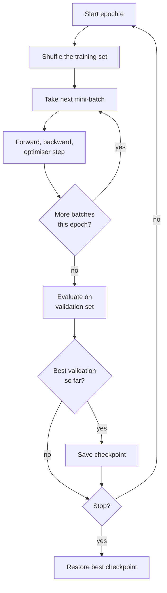

An **epoch** is one complete pass of the training data through the network. Networks almost never learn enough from a single pass over a small or medium dataset, so training runs for many epochs, and choosing how many is a real decision: too few and the model underfits, too many and it memorises the training set and gets worse on new data. This lesson pins down the vocabulary (epochs, iterations, steps), explains why data is reshuffled every epoch, and shows you how to read training and validation curves to decide when to stop and which checkpoint to keep.

## Epochs, iterations and steps

| Term | Meaning |
| --- | --- |
| Example (sample) | One training input and its target |
| Batch (mini-batch) | The $B$ examples used for one gradient estimate |
| Iteration / step | One forward pass, backward pass and optimiser update on one batch |
| Epoch | Enough iterations to use every training example once: $\lceil N/B \rceil$ iterations |
| Total steps | Epochs × iterations per epoch; what learning-rate schedules are usually defined over |

With 50,000 examples and a batch of 100, one epoch is 500 iterations, and 30 epochs is 15,000 optimiser steps. The [batch size](/learn/neural-network-fundamentals/batch-size) lesson showed why "number of epochs" alone does not say how much optimisation happened: the same 30 epochs at batch 1,000 would be only 1,500 steps.

A training loop is two nested loops, with evaluation between epochs:



## Why shuffle every epoch?

Mini-batch SGD assumes each batch is a random sample of the data. If the data is stored in some order (sorted by class, by date, by source), consecutive batches are not random. Imagine a binary dataset sorted by label: the network sees a long run of class 0 and learns "always predict 0", then a long run of class 1 and swings to "always predict 1". Its final state depends on whatever it saw last.

Reshuffling at the start of every epoch also means each epoch uses *different* batches, so the gradient noise differs from pass to pass rather than repeating the same sequence of updates. Shuffle the training set; never shuffle in a way that leaks between training and validation sets, and keep time-ordered validation splits for time series, as in [training, validation and testing](/learn/machine-learning-fundamentals/training-validation-and-testing).

## Watching a network overfit

To see how the number of epochs matters, train a network that is deliberately too big for its data: two hidden layers of 64 units on just 200 noisy two-moons points, with 1,000 more points held out for validation. The helpers are the same hand-written network and Adam optimiser as in the [optimisers](/learn/neural-network-fundamentals/optimizers) lesson.

```python
import numpy as np
from sklearn.datasets import make_moons

def init(sizes, seed):
    rng = np.random.default_rng(seed)
    return [p for m, n in zip(sizes[:-1], sizes[1:])
            for p in (rng.normal(0, np.sqrt(2 / m), (m, n)), np.zeros(n))]

def loss_and_grads(params, X, y):
    Ws, bs = params[0::2], params[1::2]
    acts, A = [X], X
    for i, (W, b) in enumerate(zip(Ws, bs)):
        Z = A @ W + b
        A = Z if i == len(Ws) - 1 else np.maximum(0, Z)
        acts.append(A)
    z = acts[-1]
    loss = np.mean(np.maximum(z, 0) - z * y + np.log1p(np.exp(-np.abs(z))))
    delta = (1 / (1 + np.exp(-z)) - y) / len(y)
    grads = []
    for i in reversed(range(len(Ws))):
        grads = [acts[i].T @ delta, delta.sum(axis=0)] + grads
        if i > 0:
            delta = (delta @ Ws[i].T) * (acts[i] > 0)
    return loss, grads

class Adam:
    def __init__(self, lr=1e-3, betas=(0.9, 0.999), eps=1e-8, weight_decay=0.0):
        self.lr, (self.b1, self.b2), self.eps, self.wd = lr, betas, eps, weight_decay
        self.m = self.s = None
        self.t = 0
    def step(self, params, grads):
        if self.m is None:
            self.m = [np.zeros_like(p) for p in params]
            self.s = [np.zeros_like(p) for p in params]
        self.t += 1
        for p, g, m, s in zip(params, grads, self.m, self.s):
            m[:] = self.b1 * m + (1 - self.b1) * g
            s[:] = self.b2 * s + (1 - self.b2) * g * g
            m_hat, s_hat = m / (1 - self.b1 ** self.t), s / (1 - self.b2 ** self.t)
            p -= self.lr * (m_hat / (np.sqrt(s_hat) + self.eps) + self.wd * p)

X_all, y_all = make_moons(n_samples=1200, noise=0.35, random_state=1)
y_all = y_all.reshape(-1, 1).astype(float)
X_tr, y_tr, X_va, y_va = X_all[:200], y_all[:200], X_all[200:], y_all[200:]
mu, sd = X_tr.mean(axis=0), X_tr.std(axis=0)          # training statistics only
X_tr, X_va = (X_tr - mu) / sd, (X_va - mu) / sd
```

Now the two nested loops, logging both losses after selected epochs and keeping a copy of the parameters whenever validation loss reaches a new best:

```python
params = init([2, 64, 64, 1], seed=0)
opt = Adam(lr=1e-2)
rng = np.random.default_rng(0)
batch = 32
best_val, best_epoch, best_params = np.inf, 0, None

for epoch in range(1, 301):
    order = rng.permutation(len(X_tr))                     # reshuffle every epoch
    for start in range(0, len(X_tr), batch):
        idx = order[start:start + batch]
        _, grads = loss_and_grads(params, X_tr[idx], y_tr[idx])
        opt.step(params, grads)

    train_loss = loss_and_grads(params, X_tr, y_tr)[0]
    val_loss = loss_and_grads(params, X_va, y_va)[0]
    if val_loss < best_val:                                # checkpoint the best model
        best_val, best_epoch = val_loss, epoch
        best_params = [p.copy() for p in params]
    if epoch in (1, 5, 10, 20, 50, 100, 200, 300):
        print(f"epoch {epoch:3d}  train {train_loss:.3f}  val {val_loss:.3f}")

print(f"best validation loss {best_val:.3f} at epoch {best_epoch}")
```

```output
epoch   1  train 0.422  val 0.451
epoch   5  train 0.342  val 0.332
epoch  10  train 0.304  val 0.319
epoch  20  train 0.231  val 0.291
epoch  50  train 0.182  val 0.366
epoch 100  train 0.154  val 0.444
epoch 200  train 0.148  val 0.759
epoch 300  train 0.041  val 1.104
best validation loss 0.290 at epoch 19
```

Read the two columns together:

- **Epochs 1 to about 20:** both losses fall. The network is learning the real shape of the two moons. More epochs help.
- **After about epoch 20:** training loss keeps falling, but validation loss turns around and rises. The network has started fitting the noise in its 200 training points, details that do not exist in new data. This is [overfitting](/learn/machine-learning-fundamentals/underfitting-and-overfitting).
- **By epoch 300:** training loss is close to zero and validation loss is several times worse than at its best. About fifteen times as many epochs produced a much worse model.

> [!KEY]
> More epochs always lower the training loss, but past a point they raise the validation loss. The number of epochs is a capacity knob: choose it by watching validation performance, and keep the checkpoint from the best epoch, not the last one.

## Reading training curves

The shapes of the two curves diagnose most training problems:

| Pattern | Diagnosis | Response |
| --- | --- | --- |
| Both losses high and flat | Underfitting, or a bug, or a learning rate far too low | Check the pipeline; bigger model; tune the learning rate |
| Both falling, gap small | Still learning | Train longer |
| Training falling, validation rising | Overfitting | Stop earlier, regularise, get more data |
| Validation below training | Often fine: dropout and augmentation make training harder than evaluation | Check the validation set is not easier or leaked |
| Losses jump around | Learning rate too high or batch too small | Lower the learning rate; add a schedule |

Two practical details. Training loss is often logged as a running average *during* the epoch, while the weights are still changing, so it lags behind a clean evaluation at the end. And always plot validation *metrics* such as accuracy alongside validation loss, because loss can rise from overconfidence while accuracy holds steady.

## How many epochs?

There is no universal number, because it depends on how much the model can learn from each pass:

| Setting | Typical epochs |
| --- | --- |
| Small tabular or toy datasets | Tens to hundreds, with early stopping |
| Image classification from scratch | Tens to a few hundred |
| Fine-tuning a pretrained model | A few, often 1 to 5 |
| Large language model pretraining | About one pass over most of the data, or less |

The reliable approach is not to guess but to set a generous maximum, evaluate every epoch (or every few hundred steps for very large datasets), checkpoint the best model, and stop when validation performance has not improved for a while. That procedure is **early stopping**, covered as a regulariser in the next lesson, [regularisation](/learn/neural-network-fundamentals/regularization).

> [!WARNING]
> If you choose the number of epochs, or the checkpoint, by looking at validation loss, the validation score is now optimistically biased: you selected for it. Report final performance on a separate test set that played no part in any of these choices.

## Epochs and learning-rate schedules

Schedules such as cosine decay need the total training length in advance. If you stop early, the learning rate never decays fully, and if you extend training, the schedule must be recomputed. Most modern recipes therefore define schedules in **steps**, fix the total in advance, and still keep the best checkpoint as a safety net.

## Exercises

**1.** Using `best_params` from the training run, compute the validation accuracy of the best checkpoint and of the final model. (Predict class 1 when the output logit is positive.)

<details>
<summary>Show solution</summary>

```python
def accuracy(params, X, y):
    Ws, bs = params[0::2], params[1::2]
    A = X
    for i, (W, b) in enumerate(zip(Ws, bs)):
        A = A @ W + b
        if i < len(Ws) - 1:
            A = np.maximum(0, A)
    return np.mean((A > 0) == (y > 0.5))

print(accuracy(best_params, X_va, y_va), accuracy(params, X_va, y_va))
```

The best checkpoint scores about 0.88 and the final model about 0.84. The accuracy gap is much smaller than the loss gap, because most of the extra validation loss comes from the overfitted model being very confident on the examples it gets wrong.

</details>

**2.** A dataset has 12,000 examples, the batch size is 64, and you train for 25 epochs with the partial batch kept. How many optimiser steps is that? If a cosine schedule should reach its minimum exactly at the end, what total step count should it be given?

<details>
<summary>Show solution</summary>

$\lceil 12000/64 \rceil = \lceil 187.5 \rceil = 188$ steps per epoch, so $188 \times 25 = 4700$ steps. Give the schedule a total of 4,700.

</details>

**3.** Change the training set from 200 to 1,000 examples (use `X_all[:1000]` for training and the remaining 200 for validation). Predict what happens to the best epoch and to the gap between training and validation loss, then check.

<details>
<summary>Show solution</summary>

Copy the training loop with the new split. In this run the best epoch is still epoch 19, but each epoch now has five times as many steps, so the network trains for five times as many updates before it starts to overfit. The best validation loss falls from 0.290 to about 0.265, and at epoch 300 the gap between training and validation loss shrinks from about 1.06 to about 0.24 (training about 0.18, validation about 0.42). With more data the network takes far longer to memorise the noise. More data is the most reliable regulariser of all.

</details>

```quiz
[
  {
    "q": "A training set has 8,000 examples and the batch size is 32. How many iterations make up one epoch?",
    "options": ["32", "250", "8,000", "256,000"],
    "answer": 1,
    "why": "8,000 / 32 = 250 batches, each one an iteration."
  },
  {
    "q": "Why is the training set usually reshuffled at the start of every epoch?",
    "options": [
      "To make the epoch run faster",
      "So batches are random samples and the order of updates differs between epochs",
      "To mix validation data into training",
      "Because the optimiser requires sorted data"
    ],
    "answer": 1,
    "why": "Stored data often has an order (by class, time or source). Shuffling makes each mini-batch a fair sample and avoids repeating the same update sequence."
  },
  {
    "q": "Training loss keeps falling while validation loss has risen for 50 epochs. What should you do?",
    "options": [
      "Train for more epochs, since training loss is still improving",
      "Use the checkpoint from the epoch with the lowest validation loss, and consider regularisation",
      "Increase the learning rate",
      "Evaluate on the training set instead"
    ],
    "answer": 1,
    "why": "Rising validation loss with falling training loss is overfitting. The best checkpoint is the one that generalised best."
  },
  {
    "q": "You picked the best epoch using validation loss. Why should you still report results on a separate test set?",
    "options": [
      "The validation set is too small to evaluate on",
      "Choosing the epoch by validation loss biases the validation score upwards",
      "Test sets are always larger",
      "Validation loss cannot be compared between epochs"
    ],
    "answer": 1,
    "why": "Any choice made by looking at the validation set fits to it a little, so its score is optimistic. An untouched test set gives an unbiased estimate."
  }
]
```
