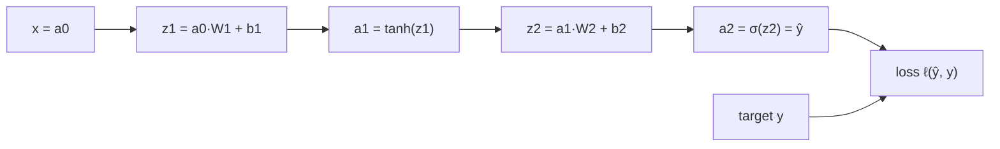

**Forward propagation** is how a network turns an input into a prediction: feed the input to the first layer, pass its output to the next, and repeat until the output layer. It is what runs every time a trained model answers a request, and during training it is the first half of every step, producing the loss that [backpropagation](/learn/neural-network-fundamentals/backpropagation) then differentiates. This lesson writes the forward pass in matrix form, works through one with real numbers, and implements it in NumPy for a whole batch at once.

## The layer recurrence

Number the layers $1, \dots, L$ and call the input $\mathbf{a}^{[0]} = \mathbf{x}$. Each layer $l$ applies the same two steps to the previous layer's output:

$$
\mathbf{z}^{[l]} = \mathbf{a}^{[l-1]}\,W^{[l]} + \mathbf{b}^{[l]}, \qquad \mathbf{a}^{[l]} = f^{[l]}\big(\mathbf{z}^{[l]}\big)
$$

Here $\mathbf{a}^{[l-1]}$ is a row vector of the previous layer's activations, $W^{[l]}$ is the weight matrix of shape (inputs, outputs) for layer $l$, $\mathbf{b}^{[l]}$ its bias vector, $\mathbf{z}^{[l]}$ the pre-activations, and $f^{[l]}$ the layer's [activation function](/learn/neural-network-fundamentals/activation-functions). The final $\mathbf{a}^{[L]}$ is the prediction $\hat{\mathbf{y}}$, and a loss function compares it with the target.



Each box is a node in a **computational graph**. Forward propagation evaluates the graph from left to right; backpropagation will walk it from right to left.

## A forward pass with real numbers

Take a tiny network: 2 inputs, 2 hidden units with tanh, 1 output unit with sigmoid, and binary cross-entropy loss. The parameters are

$$
W^{[1]} = \begin{pmatrix} 0.5 & -0.3 \\ 0.2 & 0.4 \end{pmatrix}, \quad \mathbf{b}^{[1]} = (0,\ 0.1), \quad W^{[2]} = \begin{pmatrix} 0.7 \\ -0.5 \end{pmatrix}, \quad b^{[2]} = 0.2
$$

and the example is $\mathbf{x} = (1, 2)$ with label $y = 1$. Column $j$ of $W^{[1]}$ holds the weights into hidden unit $j$. Step through the computation:

```trace
{
  "title": "forward pass through a 2-2-1 network",
  "code": [
    "z1 = x @ W1 + b1",
    "a1 = np.tanh(z1)",
    "z2 = a1 @ W2 + b2",
    "a2 = 1 / (1 + np.exp(-z2))",
    "loss = -(y * np.log(a2) + (1 - y) * np.log(1 - a2))",
    "print(a2, loss)"
  ],
  "steps": [
    { "line": 1, "vars": { "x": "[1.0, 2.0]", "z1": "[0.9, 0.6]" }, "note": "Hidden unit 1: 1(0.5) + 2(0.2) + 0 = 0.9. Hidden unit 2: 1(-0.3) + 2(0.4) + 0.1 = 0.6." },
    { "line": 2, "vars": { "z1": "[0.9, 0.6]", "a1": "[0.7163, 0.5370]" }, "note": "tanh squashes each pre-activation into (-1, 1). Both units are active and far from saturation." },
    { "line": 3, "vars": { "a1": "[0.7163, 0.5370]", "z2": "0.4329" }, "note": "The output unit: 0.7163(0.7) + 0.5370(-0.5) + 0.2 = 0.5014 - 0.2685 + 0.2 = 0.4329. This is the logit." },
    { "line": 4, "vars": { "z2": "0.4329", "a2": "0.6066" }, "note": "The sigmoid turns the logit into a probability: the network gives class 1 a probability of about 61%." },
    { "line": 5, "vars": { "a2": "0.6066", "y": "1", "loss": "0.4999" }, "note": "With y = 1 only the first term survives: -ln(0.6066) = 0.4999. A perfect prediction would give 0." },
    { "line": 6, "vars": { "a2": "0.6066", "loss": "0.4999" }, "out": ["[[0.6066]] [[0.4999]]"], "note": "The forward pass is done. Backpropagation will start from this loss and work back to every weight." }
  ]
}
```

The same computation in NumPy, which you can check against the trace:

```python
import numpy as np
np.set_printoptions(precision=4, suppress=True)

x = np.array([[1.0, 2.0]])                       # shape (1, 2): one example
y = np.array([[1.0]])
W1 = np.array([[0.5, -0.3], [0.2, 0.4]]); b1 = np.array([0.0, 0.1])
W2 = np.array([[0.7], [-0.5]]);           b2 = np.array([0.2])

z1 = x @ W1 + b1
a1 = np.tanh(z1)
z2 = a1 @ W2 + b2
a2 = 1 / (1 + np.exp(-z2))
loss = -(y * np.log(a2) + (1 - y) * np.log(1 - a2))
print(z1, a1, z2, a2, loss)
```

```output
[[0.9 0.6]] [[0.7163 0.537 ]] [[0.4329]] [[0.6066]] [[0.4999]]
```

## Processing a batch at once

Networks never process one example at a time if they can help it. Stack $n$ examples as the rows of a matrix $X$ of shape $(n, d)$ and the recurrence becomes

$$
Z^{[l]} = A^{[l-1]}\,W^{[l]} + \mathbf{b}^{[l]}, \qquad A^{[l]} = f^{[l]}\big(Z^{[l]}\big)
$$

The weights are unchanged; only the activations gain a batch dimension. The bias vector is added to every row by [broadcasting](/learn/numpy/broadcasting). One matrix multiplication processes the whole batch, which is exactly what GPUs are built to do quickly.

| Quantity | Shape | Example: batch of 4, sizes `[2, 2, 1]` |
| --- | --- | --- |
| $X = A^{[0]}$ | $(n, d)$ | `(4, 2)` |
| $W^{[l]}$ | $(n_{l-1}, n_l)$ | `(2, 2)`, then `(2, 1)` |
| $\mathbf{b}^{[l]}$ | $(n_l,)$ | `(2,)`, then `(1,)` |
| $Z^{[l]}, A^{[l]}$ | $(n, n_l)$ | `(4, 2)`, then `(4, 1)` |

> [!NOTE]
> This module stores weights as (inputs, outputs) and computes `X @ W`, the same layout scikit-learn's `MLPClassifier.coefs_` uses. PyTorch's `nn.Linear` stores its weight as (outputs, inputs) and computes `X @ W.T + b`. The maths is identical; only the bookkeeping differs, so always check which convention a library uses.

## A general forward pass in NumPy

Here is a forward pass for any number of layers. It returns not just the prediction but a **cache** of every layer's input and pre-activation, because the backward pass needs them.

```python
def init_params(sizes, rng):
    """He-initialised weights, zero biases, for layer sizes like [2, 8, 1]."""
    return [(rng.normal(0, np.sqrt(2 / m), size=(m, n)), np.zeros(n))
            for m, n in zip(sizes[:-1], sizes[1:])]

def forward(X, params):
    cache = []
    A = X
    for i, (W, b) in enumerate(params):
        Z = A @ W + b
        cache.append((A, Z))                     # remember inputs for backprop
        last = i == len(params) - 1
        A = 1 / (1 + np.exp(-Z)) if last else np.maximum(0, Z)   # sigmoid out, ReLU hidden
    return A, cache

rng = np.random.default_rng(0)
params = init_params([2, 8, 8, 1], rng)
X = np.array([[0, 0], [0, 1], [1, 0], [1, 1]], dtype=float)

y_hat, cache = forward(X, params)
print("output shape:", y_hat.shape)
print("predictions: ", y_hat.ravel())
for i, (A_in, Z) in enumerate(cache, 1):
    print(f"layer {i}: input {A_in.shape} -> pre-activation {Z.shape}")
```

```output
output shape: (4, 1)
predictions:  [0.5    0.5019 0.7215 0.557 ]
layer 1: input (4, 2) -> pre-activation (4, 8)
layer 2: input (4, 8) -> pre-activation (4, 8)
layer 3: input (4, 8) -> pre-activation (4, 1)
```

The network is untrained, so its predictions are close to arbitrary. Training, which needs gradients from the backward pass, is what turns these into the XOR answers `[0, 1, 1, 0]`.

## What a forward pass costs

For a dense layer from $m$ to $n$ units, each output needs $m$ multiplications and $m$ additions, so the layer needs about $2mn$ floating-point operations (FLOPs) per example. For an MLP that is roughly **2 FLOPs per weight per example**. The parameter count you computed in the [architecture](/learn/neural-network-fundamentals/neural-network-architecture) lesson is therefore also a good estimate of inference cost.

```python
sizes = [784, 128, 64, 10]
weights = sum(m * n for m, n in zip(sizes[:-1], sizes[1:]))
print(f"{weights:,} weights -> about {2 * weights:,} FLOPs per example")
print(f"a batch of 256 -> about {2 * weights * 256 / 1e6:.0f} million FLOPs")
```

```output
109,184 weights -> about 218,368 FLOPs per example
a batch of 256 -> about 56 million FLOPs
```

Memory is the other cost. At inference you can discard each layer's activations once the next layer has used them. During training you cannot: every cached $A$ and $Z$ must be kept until the backward pass, so activation memory grows with batch size and depth. That is why a batch that fits for inference can run out of memory in training, a theme the [batch size](/learn/neural-network-fundamentals/batch-size) lesson returns to.

> [!KEY]
> Forward propagation is repeated matrix multiplication plus a bias and an element-wise nonlinearity. Training mode caches every intermediate result for the backward pass; inference mode does not need to.

## Common forward-pass bugs

| Symptom | Likely cause |
| --- | --- |
| `ValueError: matmul: Input operand 1 has a mismatch...` | Weight matrix transposed, or wrong layer size |
| Output shape `(n, n)` instead of `(n, 1)` | Adding a `(n,)` vector to a `(n, 1)` array, which broadcasts to `(n, n)` |
| All predictions identical | All-zero or identical initial weights, or every ReLU dead |
| Softmax rows do not sum to 1 | Softmax taken over the batch axis (`axis=0`) instead of the class axis |
| `nan` in the output | Overflow in `exp`, or unscaled inputs producing huge pre-activations |

## Exercises

**1.** Change the example's input to $\mathbf{x} = (0, 0)$ and compute the forward pass by hand. Which parameters still affect the output?

<details>
<summary>Show solution</summary>

With zero input, $\mathbf{z}^{[1]} = \mathbf{b}^{[1]} = (0, 0.1)$, so $\mathbf{a}^{[1]} = (\tanh 0, \tanh 0.1) = (0, 0.0997)$. Then $z^{[2]} = 0 \cdot 0.7 + 0.0997 \cdot (-0.5) + 0.2 = 0.1502$ and $\hat{y} = \sigma(0.1502) \approx 0.537$. Only the biases and $W^{[2]}$ matter; $W^{[1]}$ is multiplied by zeros.

```python
a1 = np.tanh(np.array([[0.0, 0.0]]) @ W1 + b1)
print(1 / (1 + np.exp(-(a1 @ W2 + b2))))   # [[0.5375]]
```

</details>

**2.** Modify `forward` so that the output layer uses softmax instead of sigmoid, and run it on `params = init_params([4, 16, 3], rng)` with a random batch of 5 examples. Check that each row of the output sums to 1.

<details>
<summary>Show solution</summary>

```python
def forward_softmax(X, params):
    A = X
    for i, (W, b) in enumerate(params):
        Z = A @ W + b
        if i == len(params) - 1:
            E = np.exp(Z - Z.max(axis=1, keepdims=True))
            A = E / E.sum(axis=1, keepdims=True)
        else:
            A = np.maximum(0, Z)
    return A

P = forward_softmax(rng.normal(size=(5, 4)), init_params([4, 16, 3], rng))
print(P.shape, P.sum(axis=1))   # (5, 3) and five values of 1.0
```

The softmax normalises over `axis=1`, the class axis, separately for every example.

</details>

**3.** Estimate the forward FLOPs per example for layer sizes `[1000, 1000, 1000, 10]`. How does it compare with `[1000, 10]`?

<details>
<summary>Show solution</summary>

Weights: $10^6 + 10^6 + 10^4 = 2{,}010{,}000$, so about 4 million FLOPs per example. The single layer has $10^4$ weights, about 20,000 FLOPs: roughly 200 times cheaper.

</details>

```quiz
[
  {
    "q": "In this module's convention, `X` has shape `(32, 10)` and the first layer has 64 units. What shape is its weight matrix `W1`?",
    "options": ["`(64, 10)`", "`(32, 64)`", "`(10, 64)`", "`(64, 32)`"],
    "answer": 2,
    "why": "`X @ W1` needs `W1` to have as many rows as `X` has columns (10) and one column per unit (64)."
  },
  {
    "q": "Why does the forward pass store each layer's inputs and pre-activations during training?",
    "options": [
      "To speed up the next forward pass",
      "Because the backward pass needs them to compute gradients",
      "To reduce memory use",
      "To normalise the outputs"
    ],
    "answer": 1,
    "why": "Gradients such as $\\partial \\ell / \\partial W = A^\\top \\,\\delta$ depend on the layer's input and the activation derivative at its pre-activation, both computed in the forward pass."
  },
  {
    "q": "In the worked example, $z^{[1]} = (0.9, 0.6)$. What is $a^{[1]}$ with tanh?",
    "options": ["(0.9, 0.6)", "(0.7109, 0.6457)", "(0.7163, 0.5370)", "(0.4869, 0.7116)"],
    "answer": 2,
    "why": "$\\tanh(0.9) \\approx 0.7163$ and $\\tanh(0.6) \\approx 0.5370$. The last option is $1 - \\tanh^2$, used in the backward pass."
  },
  {
    "q": "Roughly how many FLOPs does a forward pass through an MLP with 1 million weights take per example?",
    "options": ["About 1 thousand", "About 2 million", "About 1 billion", "It depends only on the number of layers"],
    "answer": 1,
    "why": "Each weight contributes one multiplication and one addition, so about 2 FLOPs per weight per example."
  }
]
```
