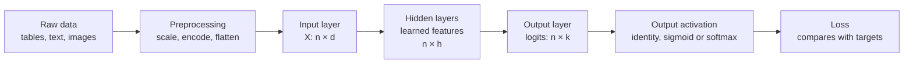

Every feed-forward network has the same three-part anatomy. The **input layer** is where your data enters, the **hidden layers** transform it into increasingly useful representations, and the **output layer** turns the final representation into an answer of the right type: a number, a probability, or a distribution over classes. Each part has its own design rules. Get the input wrong and training struggles from the first step; get the output wrong and the network cannot even express the answer you want. This lesson takes them one at a time.



Here $n$ is the number of examples in a batch, $d$ the number of input features, $h$ a hidden width and $k$ the number of outputs.

## The input layer

The input layer has no weights and does no computation. It is simply the feature vector, one number per input unit, so its size is fixed by your data: a table with 12 numeric columns needs 12 input units; a 28 by 28 greyscale image flattened into a vector needs 784.

What matters is the *form* of those numbers. A network sees only numbers, and their scale feeds directly into the first weighted sum.

| Raw data | Typical input encoding |
| --- | --- |
| Numeric columns | Standardise to mean 0, standard deviation 1 (fit on training data only) |
| Categorical columns | One-hot vectors, or a learned embedding for many categories |
| Images | Pixel values scaled to $[0, 1]$ or standardised per channel |
| Text | Token IDs mapped to learned [embedding](/learn/generative-ai-fundamentals/embeddings) vectors |

Why scaling matters so much: suppose one feature is income (tens of thousands) and another is age (tens). With weights initialised at a similar small scale, the income term dominates every pre-activation, and the gradient for the income weight is thousands of times larger than for the age weight. No single learning rate suits both.

```python
import numpy as np

rng = np.random.default_rng(0)
X_raw = np.column_stack([rng.normal(40, 12, 500),          # age in years
                         rng.normal(50_000, 15_000, 500)])  # income
W = rng.normal(0, 0.5, (2, 4))                              # 2 inputs -> 4 hidden units

Z_raw = X_raw @ W
X_std = (X_raw - X_raw.mean(axis=0)) / X_raw.std(axis=0)
Z_std = X_std @ W
print("pre-activation std, raw inputs:         ", Z_raw.std(axis=0).round(1))
print("pre-activation std, standardised inputs:", Z_std.std(axis=0).round(2))
```

```output
pre-activation std, raw inputs:          [9610.7 2740.5 6728.5 1388.8]
pre-activation std, standardised inputs: [0.9  0.25 0.49 0.17]
```

With raw inputs the hidden units start with pre-activations in the thousands, which saturates sigmoid and tanh units instantly and makes gradient steps erratic. Standardising puts everything near the scale that [weight initialisation](/learn/neural-network-fundamentals/neural-network-architecture) assumes. This is the same preprocessing you met in [data preprocessing](/learn/machine-learning-fundamentals/data-preprocessing); for neural networks it is not optional.

> [!WARNING]
> Compute the scaling statistics on the training set only and reuse them for validation, test and production inputs. Recomputing them on new data, or forgetting to apply them at all at inference time, is one of the most common reasons a model that looked good in training fails in deployment.

## Hidden layers: learned representations

Hidden layers are where the network does its work. Each one computes $H = f(XW + \mathbf{b})$ for its input $X$, and the output becomes the next layer's input. Nobody tells a hidden unit what to compute; training discovers whatever features make the final prediction easy.

You saw this by hand with XOR in the [perceptrons](/learn/neural-network-fundamentals/perceptrons) lesson. Here it is on a learned network. Two concentric circles cannot be separated by any straight line, so a linear model scores no better than chance. Train a small network with one hidden layer of 8 ReLU units using scikit-learn, then pull out the hidden layer's activations and fit a *linear* model on those instead:

```python
from sklearn.datasets import make_circles
from sklearn.linear_model import LogisticRegression
from sklearn.neural_network import MLPClassifier

X, y = make_circles(n_samples=500, noise=0.05, factor=0.5, random_state=0)
print("linear model on raw inputs:", LogisticRegression().fit(X, y).score(X, y))

mlp = MLPClassifier(hidden_layer_sizes=(8,), activation="relu",
                    max_iter=3000, random_state=0).fit(X, y)
print("network accuracy:          ", mlp.score(X, y))

W1, b1 = mlp.coefs_[0], mlp.intercepts_[0]     # shapes (2, 8) and (8,)
H = np.maximum(0, X @ W1 + b1)                  # hidden-layer representation
print("hidden representation shape:", H.shape)
print("linear model on hidden layer:", LogisticRegression().fit(H, y).score(H, y))
```

```output
linear model on raw inputs: 0.5
network accuracy:           1.0
hidden representation shape: (500, 8)
linear model on hidden layer: 1.0
```

The hidden layer has re-described every point with 8 new features in which the two circles *are* linearly separable. The output layer is then just a linear classifier on top. This is the general picture of a deep network: hidden layers are a learned feature extractor, and the output layer is a simple model fitted to those features.

> [!KEY]
> Hidden layers learn a representation; the output layer reads the answer off it. In deep networks, early layers tend to capture simple patterns and later layers combine them into more abstract ones. Reusing a trained network's hidden layers for a new task is the idea behind [transfer learning](/learn/pytorch/transfer-learning).

### How many hidden units?

There is no formula, but there are reliable rules of thumb:

- Too few units create a **bottleneck**: the representation cannot hold enough information, and the network [underfits](/learn/machine-learning-fundamentals/underfitting-and-overfitting).
- More units add capacity, cost and overfitting risk. In practice, a somewhat too-large network with good regularisation usually beats a carefully minimal one.
- Widths of 32 to 512 per layer cover most MLPs on tabular data. Powers of two are a convention, not a requirement.
- Treat depth and width as hyperparameters and tune them against validation data, as in [hyperparameter tuning](/learn/model-evaluation/hyperparameter-tuning).

## The output layer

The output layer is a dense layer whose raw outputs are called **logits**: unconstrained real numbers. An **output activation** then shapes them into the kind of answer the task needs, and that choice is tied to the [loss function](/learn/neural-network-fundamentals/loss-functions).

| Task | Output units | Output activation | Loss | Interpretation |
| --- | --- | --- | --- | --- |
| Regression (one target) | 1 | None (identity) | Mean squared error | Predicted value |
| Regression (several targets) | One per target | None | Mean squared error | One value each |
| Binary classification | 1 | Sigmoid | Binary cross-entropy | $P(y = 1)$ |
| Multi-class (one label of $k$) | $k$ | Softmax | Categorical cross-entropy | Distribution summing to 1 |
| Multi-label (any subset of $k$) | $k$ | Sigmoid on each | Binary cross-entropy per unit | Independent probabilities |

The same logits mean very different things under different activations:

```python
logits = np.array([2.0, 1.0, -1.0])

sigmoid = 1 / (1 + np.exp(-logits))
softmax = np.exp(logits - logits.max()) / np.exp(logits - logits.max()).sum()

print("identity (regression):  ", logits)
print("sigmoid  (multi-label): ", sigmoid.round(3), " sum =", sigmoid.sum().round(3))
print("softmax  (multi-class): ", softmax.round(3), " sum =", softmax.sum().round(3))
```

```output
identity (regression):   [ 2.  1. -1.]
sigmoid  (multi-label):  [0.881 0.731 0.269]  sum = 1.881
softmax  (multi-class):  [0.705 0.259 0.035]  sum = 1.0
```

Sigmoid treats each unit independently, so an image could be "cat: 0.88" and "outdoor: 0.73" at once, and the values need not sum to 1. Softmax makes the classes compete for a single unit of probability. Picking the wrong one is a silent bug: a multi-class problem trained with independent sigmoids still trains, but its outputs are not a proper distribution.

> [!TIP]
> Do not put a ReLU on a regression output: it can never predict a negative value, and if its input goes negative the gradient is zero. Use no activation for regression, and if the target must be positive, predict its logarithm or use a function such as softplus.

## Shapes through the network

Keeping track of array shapes is the single most useful debugging habit in deep learning. For a batch of 32 examples through a `[10, 64, 32, 3]` classifier:

| Stage | Array | Shape |
| --- | --- | --- |
| Input | $X$ | `(32, 10)` |
| Hidden 1 | $H_1 = \text{relu}(XW_1 + \mathbf{b}_1)$, $W_1$ is `(10, 64)` | `(32, 64)` |
| Hidden 2 | $H_2 = \text{relu}(H_1W_2 + \mathbf{b}_2)$, $W_2$ is `(64, 32)` | `(32, 32)` |
| Logits | $Z = H_2W_3 + \mathbf{b}_3$, $W_3$ is `(32, 3)` | `(32, 3)` |
| Probabilities | $\text{softmax}(Z)$, row by row | `(32, 3)` |

The batch dimension passes through untouched; only the feature dimension changes from layer to layer. The [forward propagation](/learn/neural-network-fundamentals/forward-propagation) lesson builds exactly this computation in NumPy.

## Exercises

**1.** You are predicting, for a news article, which of 20 topics apply (an article can have several). How many output units, which output activation and which loss?

<details>
<summary>Show solution</summary>

This is multi-label classification: 20 output units, a sigmoid on each, and binary cross-entropy averaged over the 20 units. Softmax would be wrong because it forces the topics to compete, so the probabilities could not all be high at once.

</details>

**2.** In the scaling example, compute the standard deviation of the pre-activations if you only divide income by 1,000 (leaving age raw). Is that good enough?

<details>
<summary>Show solution</summary>

```python
X_k = X_raw.copy()
X_k[:, 1] /= 1000
print((X_k @ W).std(axis=0).round(1))
```

The standard deviations drop from thousands to between about 2 and 12, but both features still have means far from zero (about 40 and 50), so every pre-activation is shifted by a large constant: their means range from about -20 to 10. Full standardisation (subtract the mean, divide by the standard deviation) is better because it centres the inputs as well.

</details>

**3.** Retrain the circles network with `hidden_layer_sizes=(2,)`. What happens to the accuracy, and why?

<details>
<summary>Show solution</summary>

```python
small = MLPClassifier(hidden_layer_sizes=(2,), activation="relu",
                      max_iter=3000, random_state=0).fit(X, y)
print(small.score(X, y))
```

Accuracy drops to about 0.79. Two ReLU units give at most two straight boundaries, and the output must be a linear function of them, which is not enough to enclose the inner circle. The hidden layer is a bottleneck. Three or four units can form a closed region.

</details>

```quiz
[
  {
    "q": "How many units does the input layer of an MLP have?",
    "options": ["Always 1", "One per input feature", "The same as the first hidden layer", "One per class"],
    "answer": 1,
    "why": "The input layer just holds the feature vector, so its size is the number of features after preprocessing."
  },
  {
    "q": "Which output layer suits classifying an image into exactly one of 10 classes?",
    "options": ["10 units with softmax", "1 unit with sigmoid", "10 units with ReLU", "10 units with no activation and MSE loss"],
    "answer": 0,
    "why": "Softmax over 10 units gives a probability distribution in which the classes compete, paired with categorical cross-entropy."
  },
  {
    "q": "In the circles example, why does a linear model on the hidden activations reach 100% accuracy when one on the raw inputs reaches 50%?",
    "options": [
      "The hidden layer has more training data",
      "The hidden layer removes the noise",
      "The hidden layer has transformed the inputs into features where the classes are linearly separable",
      "Logistic regression is more accurate on 8 features than on 2 regardless of what they are"
    ],
    "answer": 2,
    "why": "Training made the hidden layer a feature extractor. In its 8-dimensional representation the circles can be split by a hyperplane."
  },
  {
    "q": "What is wrong with a ReLU activation on the output of a regression network whose targets can be negative?",
    "options": [
      "It is too slow to compute",
      "It can never output a negative value, and has zero gradient when its input is negative",
      "It makes the outputs sum to 1",
      "Nothing; ReLU is the standard regression output"
    ],
    "answer": 1,
    "why": "ReLU clips at zero, so negative targets are unreachable and those examples give no gradient through the output unit."
  }
]
```
