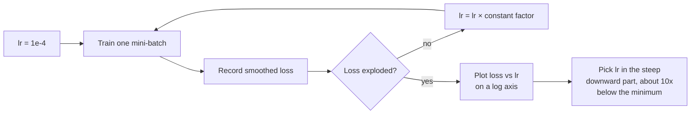

If you could tune only one hyperparameter, it should be the learning rate. It sets the size of every step the optimiser takes, and it alone can decide whether a network trains well, trains slowly, or diverges into `nan`. Module 6 introduced [learning-rate schedules](/learn/essential-mathematics-for-machine-learning/optimization-algorithms) mathematically. This lesson is the practitioner's view: what different learning rates do to a real network, why schedules and warm-up help, how to find a good value quickly with a learning-rate range test, and how to read the symptoms of a bad one in your loss curves.

## Too small, too large, just right

Gradient descent steps by $-\eta\,g$, where $g$ is the mini-batch gradient and $\eta$ the learning rate. Too small and progress is slow and can stall on plateaus. Too large and each step overshoots the valley it is trying to descend, so the loss bounces or explodes. Between them is a range that trains fast and stably.

Here is a small network on a two-moons dataset, the same model and hand-written backward pass as in the [optimisers](/learn/neural-network-fundamentals/optimizers) lesson:

```python
import numpy as np
from sklearn.datasets import make_moons

X, y = make_moons(n_samples=1000, noise=0.2, random_state=0)
X = (X - X.mean(axis=0)) / X.std(axis=0)
y = y.reshape(-1, 1).astype(float)

def init(sizes, seed):
    rng = np.random.default_rng(seed)
    return [p for m, n in zip(sizes[:-1], sizes[1:])
            for p in (rng.normal(0, np.sqrt(2 / m), (m, n)), np.zeros(n))]

def loss_and_grads(params, X, y):
    Ws, bs = params[0::2], params[1::2]
    acts, A = [X], X
    for i, (W, b) in enumerate(zip(Ws, bs)):
        Z = A @ W + b
        A = Z if i == len(Ws) - 1 else np.maximum(0, Z)
        acts.append(A)
    z = acts[-1]
    loss = np.mean(np.maximum(z, 0) - z * y + np.log1p(np.exp(-np.abs(z))))
    delta = (1 / (1 + np.exp(-z)) - y) / len(y)
    grads = []
    for i in reversed(range(len(Ws))):
        grads = [acts[i].T @ delta, delta.sum(axis=0)] + grads
        if i > 0:
            delta = (delta @ Ws[i].T) * (acts[i] > 0)
    return loss, grads
```

Train it with plain mini-batch SGD for 20 epochs at a range of constant learning rates. The training function takes a schedule: a function from (step, total steps) to a learning rate.

```python
def train_sgd(lr_fn, epochs=20, batch=32, seed=0):
    params = init([2, 32, 32, 1], seed)
    rng = np.random.default_rng(seed)
    step, total = 0, epochs * int(np.ceil(len(X) / batch))
    for epoch in range(epochs):
        order = rng.permutation(len(X))
        for start in range(0, len(X), batch):
            idx = order[start:start + batch]
            _, grads = loss_and_grads(params, X[idx], y[idx])
            lr = lr_fn(step, total)
            for p, g in zip(params, grads):
                p -= lr * g
            step += 1
    return loss_and_grads(params, X, y)[0]

print("initial loss:", round(loss_and_grads(init([2, 32, 32, 1], 0), X, y)[0], 3))
with np.errstate(over="ignore"):                 # lr = 10 overflows np.exp
    for lr in [0.001, 0.01, 0.1, 1.0, 10.0]:
        print(f"lr {lr:<6} final loss {train_sgd(lambda step, total: lr):.3f}")
```

```output
initial loss: 0.794
lr 0.001  final loss 0.353
lr 0.01   final loss 0.270
lr 0.1    final loss 0.119
lr 1.0    final loss 0.089
lr 10.0   final loss 0.753
```

The pattern is typical. At 0.001 the network has barely moved in 20 epochs. Each tenfold increase helps until about 1.0, and then at 10 training breaks: the final loss is barely better than the initial 0.794. On larger networks the failure is usually more dramatic, with the loss jumping to `inf` or `nan` within a few steps.

> [!KEY]
> Good learning rates span a narrow band, often less than a factor of ten wide, and that band depends on the model, the optimiser, the batch size and the loss scale. Always search on a logarithmic scale: 1e-4, 3e-4, 1e-3, 3e-3, and so on, never 0.001, 0.002, 0.003.

## Schedules: large early, small late

A constant learning rate is a compromise. Early in training, large steps cover ground quickly and their noise helps escape poor regions. Late in training, the same large steps keep bouncing around the minimum instead of settling into it. A **schedule** changes $\eta$ over time to get both. The most common modern recipe is **linear warm-up followed by cosine decay**:

```python
import math

def warmup_cosine(peak, warmup_frac=0.05, floor=0.0):
    def lr_fn(step, total):
        warmup = int(warmup_frac * total)
        if step < warmup:
            return peak * (step + 1) / warmup                  # linear ramp up
        progress = (step - warmup) / max(1, total - warmup)     # 0 -> 1
        return floor + 0.5 * (peak - floor) * (1 + math.cos(math.pi * progress))
    return lr_fn

sched = warmup_cosine(1.0)
print([round(sched(s, 640), 3) for s in (0, 15, 31, 32, 200, 400, 639)])
```

```output
[0.031, 0.5, 1.0, 1.0, 0.823, 0.338, 0.0]
```

Compare constant learning rates with warm-up plus cosine at the same peak value:

```python
for peak in [0.3, 1.0, 3.0]:
    const = train_sgd(lambda step, total: peak)
    cosine = train_sgd(warmup_cosine(peak))
    print(f"peak {peak}: constant {const:.3f}   warm-up + cosine {cosine:.3f}")
```

```output
peak 0.3: constant 0.083   warm-up + cosine 0.091
peak 1.0: constant 0.089   warm-up + cosine 0.078
peak 3.0: constant 0.120   warm-up + cosine 0.076
```

At the higher peaks the schedule wins: it gets the benefit of large early steps and still settles at the end. At 0.3 the two are close, because the schedule's average learning rate is lower and 20 epochs leave less time. The broader lesson is that a schedule lets you train with a higher peak learning rate than a constant one would tolerate.

| Schedule | Shape | When to use |
| --- | --- | --- |
| Constant | Flat | Quick experiments, debugging |
| Step decay | Drop by 10x at fixed epochs | Older vision recipes |
| Cosine (with warm-up) | Ramp up, then half a cosine down | Default for most modern training, including transformers |
| Linear decay (with warm-up) | Ramp up, then straight line to zero | Common for fine-tuning language models |
| Reduce on plateau | Cut when validation loss stalls | When you cannot fix the training length in advance |

## Why warm up?

Warm-up starts the learning rate near zero and ramps it up over the first few percent of steps. It helps for reasons that are specific to the start of training:

- **Adam's statistics are unreliable early.** Its second-moment estimate is based on very few gradients, so the first steps can be badly scaled.
- **Freshly initialised networks are fragile.** Gradients can be large and poorly aligned at the start; a full-size step can push weights into a region (dead ReLUs, saturated units, exploding activations) the network never recovers from.
- **Large batches and large peak learning rates** amplify both problems.

Warm-up is cheap insurance: typically 1% to 10% of total steps. If a run diverges in its first few hundred steps, lengthening the warm-up is one of the first things to try.

## The learning-rate range test

Instead of training many full runs, Leslie Smith's **learning-rate range test** finds a sensible range in one short run. Start from a tiny learning rate and multiply it by a constant factor after every mini-batch, so it grows exponentially, while recording a smoothed loss. Stop when the loss explodes.



```python
def lr_range_test(lr_min=1e-4, lr_max=100, steps=200, batch=32, seed=0, beta=0.9):
    params = init([2, 32, 32, 1], seed)
    rng = np.random.default_rng(seed)
    lrs = lr_min * (lr_max / lr_min) ** (np.arange(steps) / (steps - 1))
    avg, history = 0.0, []
    for i, lr in enumerate(lrs):
        idx = rng.integers(0, len(X), batch)
        loss, grads = loss_and_grads(params, X[idx], y[idx])
        avg = beta * avg + (1 - beta) * loss
        smooth = avg / (1 - beta ** (i + 1))            # bias-corrected moving average
        history.append(smooth)
        if not np.isfinite(smooth) or smooth > 4 * min(history):
            break                                       # the loss has exploded
        for p, g in zip(params, grads):
            p -= lr * g
    return lrs[:len(history)], np.array(history)

with np.errstate(all="ignore"):
    lrs, losses = lr_range_test()
for i in range(0, len(lrs), 24):
    print(f"lr {lrs[i]:.1e}   smoothed loss {losses[i]:.3f}")
print(f"stopped at lr {lrs[-1]:.1f}; lowest loss at lr {lrs[np.argmin(losses)]:.2f}")
```

```output
lr 1.0e-04   smoothed loss 0.837
lr 5.3e-04   smoothed loss 0.773
lr 2.8e-03   smoothed loss 0.676
lr 1.5e-02   smoothed loss 0.496
lr 7.8e-02   smoothed loss 0.382
lr 4.2e-01   smoothed loss 0.302
lr 2.2e+00   smoothed loss 0.274
stopped at lr 8.8; lowest loss at lr 1.91
```

Read the curve in three regions. Below about 1e-3 the loss barely moves: too small. From there to around 1 it falls steadily: the useful range. Near 2 it bottoms out, and soon after it climbs and the test stops. Do *not* pick the learning rate at the minimum: by then the loss is already about to blow up. A standard rule is to take a value about ten times below the minimum, here about 0.2, which agrees with the sweep above, where 0.1 to 1 trained well. For a warm-up and cosine schedule, a value near the end of the steep region makes a good peak.

> [!TIP]
> The range test runs for a few hundred steps, so it costs a tiny fraction of a full training run. Rerun it whenever you change the model size, the batch size or the optimiser, since all three shift the useful range. Many training libraries ship a learning-rate finder that implements this test.

## Learning rate and batch size are linked

A larger batch gives a less noisy gradient, so it can tolerate a larger step. A widely used heuristic for SGD, the **linear scaling rule**, says: when you multiply the batch size by $k$, multiply the learning rate by $k$ too, with a warm-up. It holds only up to a point, and adaptive optimisers often follow something closer to square-root scaling. The [batch size](/learn/neural-network-fundamentals/batch-size) lesson returns to this.

## Diagnosing the learning rate from loss curves

| What you see | Likely cause | Try |
| --- | --- | --- |
| Loss becomes `nan` or `inf` early | Learning rate far too high | Divide by 10, add or lengthen warm-up, clip gradients |
| Loss falls, then oscillates wildly at a high level | Too high late in training | Add a decaying schedule |
| Loss falls very slowly, almost linearly | Too low | Multiply by 3 to 10; run a range test |
| Loss plateaus early, then drops suddenly when the LR is cut | Plateau caused by a too-high constant rate | Decay sooner or use cosine |
| Sudden loss spikes mid-training | Occasional huge gradients | Gradient clipping, lower peak, check the data |

## Exercises

**1.** In the range test, change `lr_max` to 1.0. What does the curve look like now, and why could that mislead you?

<details>
<summary>Show solution</summary>

```python
with np.errstate(all="ignore"):
    lrs1, losses1 = lr_range_test(lr_max=1.0)
print(len(lrs1), losses1[-1], lrs1[np.argmin(losses1)])
```

The test runs all 200 steps without exploding, and the loss is still drifting down at the end (about 0.32), with its lowest smoothed value at about 0.4 purely because of noise. Without seeing the blow-up you cannot tell where the useful range ends, and you might pick a value near 1 believing it is safe when you have no evidence either way. Always sweep far enough to reach the explosion.

</details>

**2.** Write a step-decay schedule `step_decay(peak, drops=(0.5, 0.75), factor=0.1)` that multiplies the learning rate by `factor` at 50% and 75% of training, and compare it with warm-up plus cosine at a peak of 1.0.

<details>
<summary>Show solution</summary>

```python
def step_decay(peak, drops=(0.5, 0.75), factor=0.1):
    def lr_fn(step, total):
        k = sum(step >= d * total for d in drops)
        return peak * factor ** k
    return lr_fn

print(train_sgd(step_decay(1.0)), train_sgd(warmup_cosine(1.0)))
```

Both improve on the constant rate at 1.0 (about 0.079 for step decay and 0.078 for cosine, against 0.089). Which wins between them is problem-dependent; cosine is the more common default because it has no drop points to tune.

</details>

**3.** A colleague's transformer diverges to `nan` at step 150 of a 50,000-step run, using AdamW at a peak of 1e-3 with 100 warm-up steps. Suggest three changes, in order of what you would try first.

<details>
<summary>Show solution</summary>

1. Lengthen the warm-up, for example to 1,000 to 2,500 steps (2% to 5% of training): the divergence happens just after warm-up ends.
2. Lower the peak learning rate, for example to 3e-4.
3. Add gradient clipping at global norm 1.0 if it is not already on, and check the data and loss for the batch where it diverged.

</details>

```quiz
[
  {
    "q": "Why should you search learning rates on a logarithmic scale?",
    "options": [
      "Because learning rates must be powers of ten",
      "Because the useful range spans orders of magnitude and its location is unknown in advance",
      "Because the loss is logarithmic",
      "Because linear grids take longer to run"
    ],
    "answer": 1,
    "why": "Good values for different problems differ by factors of 10 to 1000, so a log grid covers the space evenly."
  },
  {
    "q": "In a learning-rate range test, the smoothed loss is lowest at lr = 2.0 and explodes just after. Which learning rate is a sensible choice?",
    "options": ["About 20", "About 2.0", "About 0.2", "About 0.0001"],
    "answer": 2,
    "why": "At the minimum the loss is already on the edge of divergence. A value about ten times smaller sits in the steadily decreasing region."
  },
  {
    "q": "What is the main purpose of learning-rate warm-up?",
    "options": [
      "To reduce memory use",
      "To avoid large, destabilising steps at the start of training when the network and the optimiser's statistics are fragile",
      "To make the final learning rate larger",
      "To replace the need for a schedule"
    ],
    "answer": 1,
    "why": "Early gradients and Adam's moment estimates are unreliable; ramping up the learning rate prevents early blow-ups."
  },
  {
    "q": "Training loss falls very slowly in a nearly straight line for many epochs. What is the most likely cause?",
    "options": ["The learning rate is too low", "The learning rate is too high", "The batch size is too small", "The model has too many layers"],
    "answer": 0,
    "why": "Tiny steps make steady but slow progress. A too-high rate would show oscillation or divergence instead."
  }
]
```
