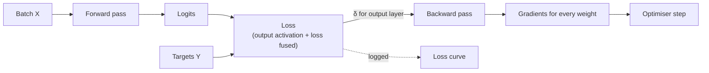

The loss function is the single number a network is trained to make small. You met the main losses mathematically in Module 6's [loss functions](/learn/essential-mathematics-for-machine-learning/loss-functions) lesson, including where MSE and cross-entropy come from. This lesson is about what changes when a loss sits at the end of a neural network: how it pairs with the output activation, why it should be computed from logits rather than probabilities, how its scale interacts with the learning rate, and the practical tweaks (class weights, label smoothing, Huber) that you will reach for in real training runs.

## Where the loss sits in training



The loss has two jobs. It is the **starting point of backpropagation**: its derivative with respect to the logits, $\delta^{[L]}$, is the error signal every gradient is built from. And it is the main **diagnostic** you watch during training. A good loss for a network must therefore be differentiable, give useful gradients when the prediction is badly wrong, and be numerically safe.

## Output activation and loss come in pairs

The [output layer](/learn/neural-network-fundamentals/input-hidden-and-output-layers) lesson matched output activations to tasks. Each standard activation has a matching loss, and the pairing is not arbitrary: it is the one that makes the output gradient simple.

| Task | Output activation | Loss | Gradient w.r.t. logits, per example |
| --- | --- | --- | --- |
| Regression | Identity | Mean squared error | $\propto \hat{y} - y$ |
| Binary / multi-label | Sigmoid | Binary cross-entropy | $\sigma(z) - y$ |
| Multi-class | Softmax | Categorical cross-entropy | $\text{softmax}(\mathbf{z}) - \mathbf{y}$ |

In every case the error signal is "prediction minus target": large when the network is confidently wrong, zero when it is right. You derived the sigmoid case in [backpropagation](/learn/neural-network-fundamentals/backpropagation). Here is a numerical check of the softmax case, with $\mathbf{y}$ a one-hot vector:

```python
import numpy as np
np.set_printoptions(precision=4, suppress=True)

def softmax(z):
    e = np.exp(z - z.max())
    return e / e.sum()

def cross_entropy(z, target):
    return -np.log(softmax(z)[target])

z = np.array([2.0, 0.5, -1.0, 0.1])
target = 2                                   # true class
y = np.eye(4)[target]                        # one-hot

h = 1e-6
numeric = np.array([(cross_entropy(z + h * np.eye(4)[i], target)
                     - cross_entropy(z - h * np.eye(4)[i], target)) / (2 * h) for i in range(4)])
print("p - y:  ", softmax(z) - y)
print("numeric:", numeric)
```

```output
p - y:   [ 0.703   0.1569 -0.965   0.1051]
numeric: [ 0.703   0.1569 -0.965   0.1051]
```

Mismatched pairs do train, but badly. Sigmoid with MSE, for example, gives an output gradient of $(\sigma(z) - y)\,\sigma(z)(1 - \sigma(z))$. When the network is confidently wrong, $\sigma(z)$ is near 0 or 1 and the extra factor is near zero, so the examples that most need correcting produce almost no gradient.

## Compute the loss from logits

Taking $\ln$ of a probability that has rounded to exactly 0 gives $-\infty$, and the loss becomes `inf` or `nan`. This happens easily: in float32, sigmoid rounds to exactly 1.0 for logits above about 17, and float64 is not much better. The fix is to never compute the probability as an intermediate step. Rewrite the loss directly in terms of the logit $z$:

$$
\text{BCE}(z, y) = \max(z, 0) - zy + \ln\!\big(1 + e^{-|z|}\big)
$$

$$
\text{CE}(\mathbf{z}, c) = \text{logsumexp}(\mathbf{z}) - z_c, \qquad \text{logsumexp}(\mathbf{z}) = m + \ln\sum_j e^{z_j - m},\ m = \max_j z_j
$$

where $c$ is the true class. Both forms only ever exponentiate non-positive numbers.

```python
def bce_naive(z, y):
    p = 1 / (1 + np.exp(-z))
    return -(y * np.log(p) + (1 - y) * np.log(1 - p))

def bce_logits(z, y):
    return np.maximum(z, 0) - z * y + np.log1p(np.exp(-np.abs(z)))

z = np.array([3.0, 40.0, -50.0])     # the last two are confidently wrong
y = np.array([1.0, 0.0, 1.0])
with np.errstate(divide="ignore", invalid="ignore"):
    print("naive:      ", bce_naive(z, y))
print("from logits:", bce_logits(z, y))
```

```output
naive:       [ 0.0486     inf 50.    ]
from logits: [ 0.0486 40.     50.    ]
```

The naive version reports infinity for the second example, where the sigmoid has rounded to exactly 1, and it would do the same for the third if its logit were below about -710, where `np.exp` overflows. These confidently wrong examples are exactly the ones whose gradients matter most. This is why the output layer of a network usually has *no* activation in code: the model returns logits and the loss applies the activation internally. In PyTorch that means `nn.BCEWithLogitsLoss` and `nn.CrossEntropyLoss`, which both expect raw logits; you will use them in [PyTorch loss functions](/learn/pytorch/loss-functions).

> [!WARNING]
> Applying softmax in the model and then passing the probabilities to a loss that expects logits is a classic silent bug. Training still runs, but the loss applies softmax a second time, which flattens the distribution and weakens the gradients.

## A sanity check: the loss at initialisation

Before training, a well-initialised classifier should be roughly uniform over its $k$ classes, so its cross-entropy should be close to $\ln k$. If the first logged loss is far from that, something is wrong with the data, the labels or the output layer.

```python
rng = np.random.default_rng(0)
k, n, d = 10, 256, 50
X = rng.normal(size=(n, d))
labels = rng.integers(0, k, size=n)
W = rng.normal(0, 0.01, size=(d, k))          # small output weights

Z = X @ W
logsumexp = Z.max(axis=1) + np.log(np.exp(Z - Z.max(axis=1, keepdims=True)).sum(axis=1))
loss = np.mean(logsumexp - Z[np.arange(n), labels])
print(f"initial loss {loss:.4f}   ln(10) = {np.log(k):.4f}")
```

```output
initial loss 2.3053   ln(10) = 2.3026
```

The same reasoning gives about $0.693$ ($\ln 2$) for binary cross-entropy, and for MSE about the variance of the targets if the network starts by predicting values near zero for zero-mean targets.

## Mean or sum: the loss scale matters

Batch losses are almost always the **mean** over examples. With a sum instead, the gradient grows in proportion to the batch size, so the effective learning rate changes whenever the batch size does. The choice also matters when you add terms: a per-pixel loss summed over a large image can be thousands of times larger than a classification loss averaged over examples, and will dominate the combined objective unless you weight it.

> [!KEY]
> The loss's scale is part of the learning rate. Multiplying the loss by 10 multiplies every gradient by 10, which for plain SGD is the same as multiplying the learning rate by 10. (Adam is largely invariant to this, because it divides by the gradient's running magnitude.)

## Practical variations

| Problem | Tweak | What it does |
| --- | --- | --- |
| Rare positive class | Class weights, e.g. `pos_weight` in PyTorch's BCE | Scales the loss of rare-class examples up so they are not ignored |
| Overconfident classifier | Label smoothing with $\varepsilon$ such as 0.1 | Replaces one-hot targets with $(1 - \varepsilon)\mathbf{y} + \varepsilon/k$, so logits cannot grow without bound |
| Regression with outliers | Huber (smooth L1) loss | Squared error near zero, absolute error far away, so outliers cannot dominate the gradient |
| Many easy negatives (detection) | Focal loss | Down-weights examples the model already gets right |

For imbalanced data, also consider resampling, covered in [imbalanced-learn](/learn/machine-learning-libraries/imbalanced-learn); weighting the loss and resampling the data are two routes to similar effects.

Label smoothing in a few lines:

```python
def smooth(one_hot, eps=0.1):
    return (1 - eps) * one_hot + eps / one_hot.shape[-1]

print(smooth(np.eye(4)[2]))
```

```output
[0.025 0.025 0.925 0.025]
```

## Loss is not the metric

Training minimises the loss because it is smooth and differentiable; you usually *report* a metric such as accuracy, F1 or RMSE from [model evaluation](/learn/model-evaluation/accuracy). They can disagree. Validation loss can rise while accuracy holds steady, because the model is becoming overconfident on the examples it gets wrong. Watch both, and select models by the metric that matches the real objective.

## Exercises

**1.** Use `bce_logits` to compute the loss for logit $z = 0$ with $y = 1$ and with $y = 0$. Explain the answer.

<details>
<summary>Show solution</summary>

```python
print(bce_logits(np.array([0.0, 0.0]), np.array([1.0, 0.0])))   # [0.6931 0.6931]
```

A logit of 0 means probability 0.5, and $-\ln 0.5 = \ln 2 \approx 0.693$ whichever the label is. It is the loss of a model that has learned nothing.

</details>

**2.** Write a numerically stable categorical cross-entropy `ce_logits(Z, labels)` for a batch, test it on logits `[[1000., 0., 0.], [0., 0., 1000.]]` with labels `[0, 0]`, and interpret both values.

<details>
<summary>Show solution</summary>

```python
def ce_logits(Z, labels):
    m = Z.max(axis=1, keepdims=True)
    lse = m[:, 0] + np.log(np.exp(Z - m).sum(axis=1))
    return lse - Z[np.arange(len(Z)), labels]

print(ce_logits(np.array([[1000., 0., 0.], [0., 0., 1000.]]), np.array([0, 0])))   # [   0. 1000.]
```

The first example is confidently right, loss 0. The second is confidently wrong by a margin of 1000, and the loss is 1000: large but finite, so its gradient is still usable. A naive implementation would produce `nan` for both.

</details>

**3.** A binary dataset has 2% positives. A network predicts a probability of 0.02 for every example. What is its mean BCE, and how does that compare with the $\ln 2$ of a model that predicts 0.5 everywhere?

<details>
<summary>Show solution</summary>

$-\big(0.02 \ln 0.02 + 0.98 \ln 0.98\big) \approx 0.098$, far below $0.693$. The network can reach a low loss by predicting the base rate and never learning to find positives, which is why class weights and per-class metrics matter on imbalanced data.

</details>

```quiz
[
  {
    "q": "For softmax with categorical cross-entropy, what is the gradient of the loss with respect to the logits?",
    "options": ["`softmax(z)`", "`softmax(z) - y`", "`y - z`", "`softmax(z) * (1 - softmax(z))`"],
    "answer": 1,
    "why": "The softmax Jacobian and the log in the loss combine to give predicted probabilities minus the one-hot target."
  },
  {
    "q": "Why do frameworks offer losses such as `BCEWithLogitsLoss` that take raw logits?",
    "options": [
      "They are faster to type",
      "Computing the loss directly from logits avoids taking the log of a probability that has rounded to 0",
      "Logits are always positive",
      "They do not need targets"
    ],
    "answer": 1,
    "why": "Fusing the activation and the log allows a stable formula such as logsumexp, which stays finite even for extreme logits."
  },
  {
    "q": "A freshly initialised 100-class classifier logs a first-batch cross-entropy of about 4.6. What does this suggest?",
    "options": [
      "A bug, because the loss should start at 0",
      "Nothing unusual: ln(100) ≈ 4.6, the loss of a uniform prediction",
      "The learning rate is too high",
      "The model is already overfitting"
    ],
    "answer": 1,
    "why": "Near-uniform initial predictions over k classes give a cross-entropy of about ln k."
  },
  {
    "q": "Why is sigmoid paired with cross-entropy rather than MSE for binary classification?",
    "options": [
      "MSE cannot be computed for probabilities",
      "With MSE the output gradient contains a factor σ(1 − σ) that is near zero when the model is confidently wrong",
      "Cross-entropy is cheaper to compute",
      "MSE always overfits"
    ],
    "answer": 1,
    "why": "The extra sigmoid-derivative factor vanishes at saturation, so badly wrong but confident predictions get almost no gradient. Cross-entropy cancels it."
  }
]
```
