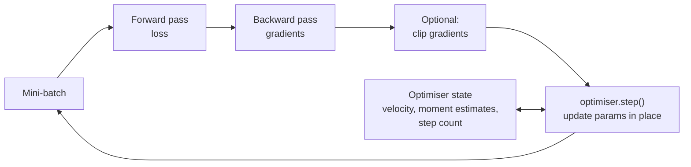

Backpropagation tells you the gradient of the loss for every weight. The **optimiser** decides what to do with it: how far to step, whether to remember past gradients, and whether to give each weight its own step size. Module 6's [optimisation algorithms](/learn/essential-mathematics-for-machine-learning/optimization-algorithms) lesson derived SGD, momentum, RMSProp and Adam and compared them on a toy surface. This lesson puts them to work inside a real network's training loop: what an optimiser object holds, how they compare when training an MLP, how much memory their state costs, and the practical defaults and safeguards (weight decay, gradient clipping) that you will use every time you train.

## The optimiser in the training loop

An optimiser is an object with **state** and a **step** method. Each training step, it receives the current parameters and their gradients and updates the parameters in place.



That separation is deliberate: the model knows nothing about how it is trained, and you can swap optimisers without touching the model. Frameworks follow the same design, as you will see in [PyTorch optimisers](/learn/pytorch/optimizers).

The update rules, as a reminder (all element-wise, with gradient $g_t$ at step $t$ and learning rate $\eta$):

| Optimiser | State per parameter | Update |
| --- | --- | --- |
| SGD | None | $\theta \leftarrow \theta - \eta g_t$ |
| SGD + momentum | Velocity $v$ | $v \leftarrow \beta v + g_t$, then $\theta \leftarrow \theta - \eta v$ |
| Adam | First moment $m$, second moment $s$ | Running means of $g_t$ and $g_t^2$, bias-corrected to $\hat m, \hat s$; $\theta \leftarrow \theta - \eta\,\hat m / (\sqrt{\hat s} + \epsilon)$ |
| AdamW | As Adam | Adam step plus a separate decay $\theta \leftarrow \theta - \eta\lambda\theta$ |

## Optimisers as NumPy classes

First, a small ReLU network with a hand-written backward pass, as in the [backpropagation](/learn/neural-network-fundamentals/backpropagation) lesson. Parameters are a flat list `[W1, b1, W2, b2, ...]` so an optimiser can treat them uniformly. The loss is binary cross-entropy computed from logits.

```python
import numpy as np
from sklearn.datasets import make_moons

X, y = make_moons(n_samples=1000, noise=0.2, random_state=0)
X = (X - X.mean(axis=0)) / X.std(axis=0)
y = y.reshape(-1, 1).astype(float)

def init(sizes, seed):
    rng = np.random.default_rng(seed)
    return [p for m, n in zip(sizes[:-1], sizes[1:])
            for p in (rng.normal(0, np.sqrt(2 / m), (m, n)), np.zeros(n))]

def loss_and_grads(params, X, y):
    Ws, bs = params[0::2], params[1::2]
    acts, A = [X], X
    for i, (W, b) in enumerate(zip(Ws, bs)):
        Z = A @ W + b
        A = Z if i == len(Ws) - 1 else np.maximum(0, Z)      # logits at the end
        acts.append(A)
    z = acts[-1]
    loss = np.mean(np.maximum(z, 0) - z * y + np.log1p(np.exp(-np.abs(z))))
    delta = (1 / (1 + np.exp(-z)) - y) / len(y)
    grads = []
    for i in reversed(range(len(Ws))):
        grads = [acts[i].T @ delta, delta.sum(axis=0)] + grads
        if i > 0:
            delta = (delta @ Ws[i].T) * (acts[i] > 0)           # ReLU derivative
    return loss, grads
```

Now the optimisers. Each keeps its own state, created lazily on the first step so it matches the parameter shapes:

```python
class SGD:
    def __init__(self, lr, momentum=0.0):
        self.lr, self.mu, self.v = lr, momentum, None

    def step(self, params, grads):
        if self.v is None:
            self.v = [np.zeros_like(p) for p in params]
        for p, g, v in zip(params, grads, self.v):
            v *= self.mu
            v += g
            p -= self.lr * v                  # in place: the caller's arrays change

class Adam:
    def __init__(self, lr=1e-3, betas=(0.9, 0.999), eps=1e-8, weight_decay=0.0):
        self.lr, (self.b1, self.b2), self.eps, self.wd = lr, betas, eps, weight_decay
        self.m = self.s = None
        self.t = 0

    def step(self, params, grads):
        if self.m is None:
            self.m = [np.zeros_like(p) for p in params]
            self.s = [np.zeros_like(p) for p in params]
        self.t += 1
        for p, g, m, s in zip(params, grads, self.m, self.s):
            m[:] = self.b1 * m + (1 - self.b1) * g
            s[:] = self.b2 * s + (1 - self.b2) * g * g
            m_hat = m / (1 - self.b1 ** self.t)
            s_hat = s / (1 - self.b2 ** self.t)
            p -= self.lr * (m_hat / (np.sqrt(s_hat) + self.eps) + self.wd * p)   # AdamW-style decay
```

With `weight_decay=0` this is Adam; with a positive value it is AdamW, because the decay term is added to the step directly rather than to the gradient.

## Comparing them on a real network

Train the same `2-32-32-1` network from the same initial weights with each optimiser, using mini-batches of 32 for 30 epochs, and record the full-data loss after epochs 1, 5, 10 and 30:

```python
def train(opt, epochs=30, batch=32, seed=0):
    params = init([2, 32, 32, 1], seed)
    rng = np.random.default_rng(seed)
    history = []
    for epoch in range(epochs):
        order = rng.permutation(len(X))
        for start in range(0, len(X), batch):
            idx = order[start:start + batch]
            _, grads = loss_and_grads(params, X[idx], y[idx])
            opt.step(params, grads)
        history.append(loss_and_grads(params, X, y)[0])
    return history

runs = {"SGD lr=0.01": SGD(0.01), "SGD lr=0.1": SGD(0.1),
        "Momentum lr=0.01": SGD(0.01, momentum=0.9),
        "Adam lr=1e-3": Adam(1e-3), "Adam lr=1e-2": Adam(1e-2)}
print(f"{'':18s} {'ep 1':>6s} {'ep 5':>6s} {'ep 10':>6s} {'ep 30':>6s}")
for name, opt in runs.items():
    h = train(opt)
    print(f"{name:18s}", " ".join(f"{h[e]:6.3f}" for e in (0, 4, 9, 29)))
```

```output
                     ep 1   ep 5  ep 10  ep 30
SGD lr=0.01         0.395  0.310  0.287  0.261
SGD lr=0.1          0.293  0.253  0.210  0.096
Momentum lr=0.01    0.295  0.261  0.224  0.095
Adam lr=1e-3        0.380  0.274  0.251  0.112
Adam lr=1e-2        0.268  0.107  0.090  0.080
```

Three lessons from one table:

- **The learning rate matters more than the optimiser.** SGD at 0.1 beats SGD at 0.01 by a wide margin, and Adam at 1e-2 beats Adam at 1e-3.
- **Momentum with $\beta = 0.9$ behaves roughly like SGD with a ten times larger learning rate**, because a steady gradient is accumulated up to $1/(1 - \beta) = 10$ times. Momentum at 0.01 tracks SGD at 0.1 closely.
- **Adam is the easiest to get going.** Its step size is roughly $\eta$ per parameter whatever the gradient scale, so a learning rate in the range 1e-4 to 1e-2 usually trains something reasonable without careful tuning.

Do not over-read one small run: rankings change with the problem, the architecture and how well each optimiser is tuned. On large vision models, well-tuned SGD with momentum remains competitive; on transformers, AdamW is the near-universal default.

## Optimiser state costs memory

Each piece of state is an array the same size as the parameters. For large models this adds up quickly:

```python
n_params = 7e9                     # an illustrative 7-billion-parameter model
bytes_fp32 = 4
for name, copies in [("SGD", 0), ("SGD + momentum", 1), ("Adam / AdamW", 2)]:
    gb = n_params * bytes_fp32 * copies / 1e9
    print(f"{name:15s} optimiser state: {gb:5.0f} GB (weights alone: {n_params * bytes_fp32 / 1e9:.0f} GB)")
```

```output
SGD             optimiser state:     0 GB (weights alone: 28 GB)
SGD + momentum  optimiser state:    28 GB (weights alone: 28 GB)
Adam / AdamW    optimiser state:    56 GB (weights alone: 28 GB)
```

Adam's two moment estimates double the memory of the weights themselves, before gradients and activations are counted. This is one reason memory-saving variants (8-bit optimiser states, sharded optimiser states across GPUs) exist for large-model training.

## Weight decay done right: AdamW

Weight decay shrinks every weight a little each step, pulling the network towards small weights; it is the main form of [regularisation](/learn/neural-network-fundamentals/regularization) for large networks. With plain SGD, adding an L2 penalty $\tfrac{\lambda}{2}\lVert\theta\rVert^2$ to the loss and decaying the weights directly are the same thing. With Adam they are not: an L2 term added to the gradient gets divided by $\sqrt{\hat s}$ like everything else, so weights with large gradients are barely regularised. **AdamW** (Loshchilov and Hutter) **decouples** the decay from the adaptive step, applying $\theta \leftarrow \theta - \eta\lambda\theta$ separately, as in the class above. In practice, use AdamW whenever you want weight decay with an adaptive optimiser.

## Gradient clipping

Occasionally a batch produces a huge gradient, from an outlier, a numerically unstable region, or a recurrent network's exploding gradients. One such step can wreck a model that has trained for hours. **Clipping by global norm** rescales the gradients whenever their combined length exceeds a threshold, keeping their direction:

```python
def clip_by_global_norm(grads, max_norm):
    total = np.sqrt(sum(np.sum(g ** 2) for g in grads))
    scale = min(1.0, max_norm / (total + 1e-12))
    return [g * scale for g in grads], total

grads = [np.array([[30.0, -40.0]]), np.array([0.0])]       # norm 50
clipped, norm = clip_by_global_norm(grads, max_norm=1.0)
print(f"norm before {norm:.1f}, after {np.sqrt(sum(np.sum(g**2) for g in clipped)):.1f}", clipped[0])
```

```output
norm before 50.0, after 1.0 [[ 0.6 -0.8]]
```

A threshold of 1.0 is a common choice for transformers. Logging the pre-clipping norm is also a useful diagnostic: spikes often precede loss spikes.

> [!KEY]
> Start with AdamW at a learning rate around 1e-3 (lower, such as 1e-4, for fine-tuning pretrained models), default betas, a small weight decay, and gradient clipping at norm 1. Switch to SGD with momentum only if you have a reason, such as following a proven recipe. Tune the learning rate before anything else.

## Practical defaults

| Setting | Common starting value | Notes |
| --- | --- | --- |
| Adam / AdamW learning rate | 1e-3 from scratch; 1e-5 to 1e-4 fine-tuning | Tune with a [learning-rate range test](/learn/neural-network-fundamentals/learning-rates) |
| Adam betas | (0.9, 0.999) | Large-model training often lowers $\beta_2$ to around 0.95 for stability |
| Adam epsilon | 1e-8 | Rarely changed |
| AdamW weight decay | 0.01 to 0.1 | Usually not applied to biases and normalisation parameters |
| SGD momentum | 0.9 | Usually with a higher learning rate and a schedule |
| Gradient clipping | Global norm 1.0 | Cheap insurance |

## Exercises

**1.** Add plain ("heavy ball") momentum with $\beta = 0.99$ to the comparison at learning rate 0.001. Using the $1/(1 - \beta)$ rule, which plain-SGD run should it resemble? Check.

<details>
<summary>Show solution</summary>

$1/(1 - 0.99) = 100$, so momentum 0.99 at 0.001 should behave roughly like SGD at 0.1.

```python
h = train(SGD(0.001, momentum=0.99))
print(" ".join(f"{h[e]:.3f}" for e in (0, 4, 9, 29)))   # 0.369 0.316 0.248 0.107
```

The final loss, about 0.107, is close to SGD at 0.1 (0.096), though the path differs: high momentum takes longer to build up speed and can overshoot.

</details>

**2.** Why does the `Adam` class divide `m` by `1 - b1 ** t`? What would go wrong on the first step without it?

<details>
<summary>Show solution</summary>

`m` starts at zero, so after one step it is $(1 - \beta_1)g_1 = 0.1g_1$, ten times too small; `s` is $0.001g_1^2$, a thousand times too small. Without correction the first step would be $\eta \cdot 0.1g_1 / \sqrt{0.001g_1^2} \approx 3.2\eta$ in size instead of about $\eta$. Dividing by $1 - \beta^t$ removes this start-up bias, and the correction fades as $t$ grows.

</details>

**3.** A model has 350 million parameters stored in float32. Estimate the memory for the weights, the gradients and the AdamW state together.

<details>
<summary>Show solution</summary>

Each copy is $350 \times 10^6 \times 4$ bytes $= 1.4$ GB. Weights, gradients, and two Adam moments make four copies: about 5.6 GB, before counting activations.

</details>

```quiz
[
  {
    "q": "What state does Adam keep for each parameter?",
    "options": ["None", "A velocity only", "Running means of the gradient and of the squared gradient", "The full history of gradients"],
    "answer": 2,
    "why": "Adam stores a first-moment estimate (like momentum) and a second-moment estimate (like RMSProp) per parameter, plus a global step count."
  },
  {
    "q": "Why is AdamW preferred over adding an L2 penalty to the loss when using Adam?",
    "options": [
      "AdamW uses less memory",
      "With Adam, an L2 gradient term is divided by the adaptive scale, so weights with large gradients are under-regularised; AdamW applies decay separately",
      "L2 penalties cannot be differentiated",
      "AdamW does not need a learning rate"
    ],
    "answer": 1,
    "why": "Decoupling weight decay from the adaptive update makes the decay act uniformly on every weight, as intended."
  },
  {
    "q": "SGD with momentum 0.9 at learning rate 0.01 most closely resembles which plain SGD run on a smooth problem?",
    "options": ["Learning rate 0.001", "Learning rate 0.009", "Learning rate 0.01", "Learning rate 0.1"],
    "answer": 3,
    "why": "A steady gradient accumulates in the velocity up to $1/(1-\\beta) = 10$ times, giving an effective learning rate about ten times larger."
  },
  {
    "q": "What does gradient clipping by global norm do?",
    "options": [
      "Sets negative gradients to zero",
      "Rescales all gradients together when their combined norm exceeds a threshold, preserving direction",
      "Clips each gradient element to the range [-1, 1]",
      "Removes the largest gradient from each batch"
    ],
    "answer": 1,
    "why": "It multiplies every gradient by the same factor, so the update keeps its direction but has bounded length."
  }
]
```
