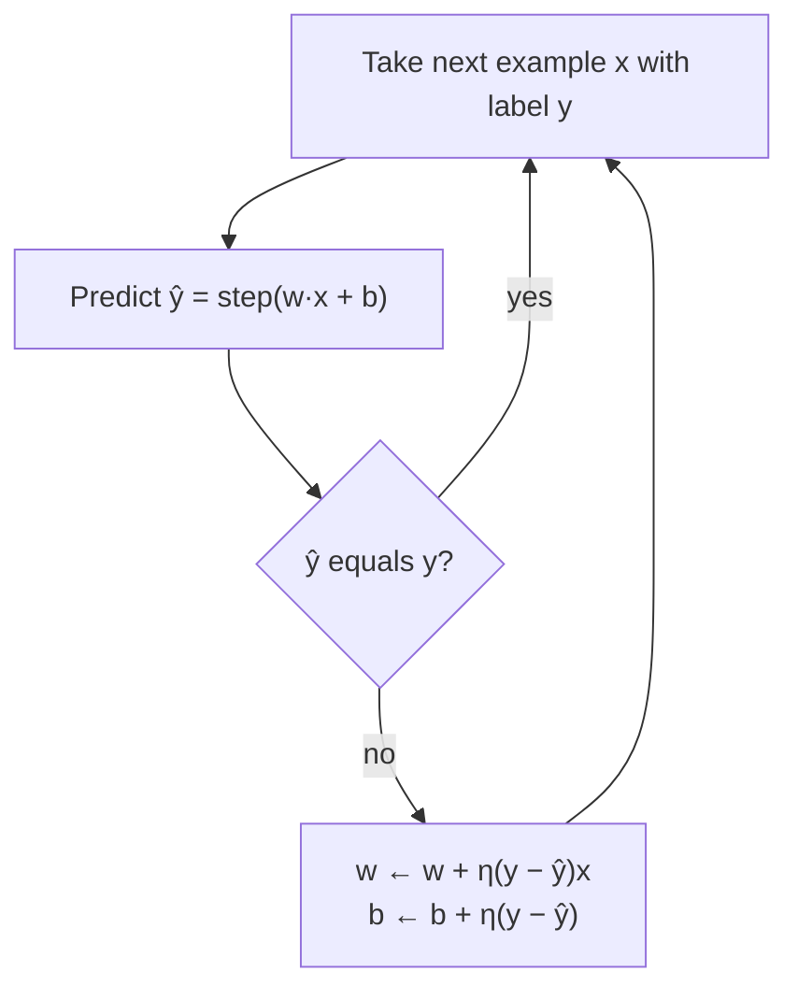
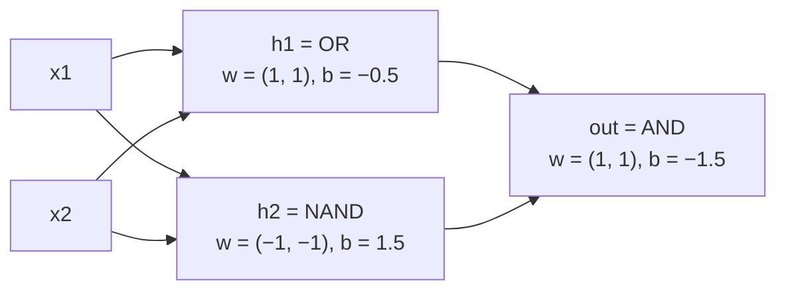

The perceptron is the first artificial neuron that could *learn* its weights from examples instead of having them set by hand. Frank Rosenblatt introduced it in 1958, and it sparked the first wave of excitement about neural networks. It also exposed their first famous limitation: a single perceptron cannot learn XOR, a function a child could describe. Understanding why, and how a hidden layer fixes it, is the cleanest possible introduction to why deep learning uses *layers* at all.

## The perceptron model

A perceptron is a single neuron with a **step activation**:

$$
\hat{y} = \text{step}(\mathbf{w}^\top \mathbf{x} + b), \qquad \text{step}(z) = \begin{cases} 1 & z \ge 0 \\ 0 & z < 0 \end{cases}
$$

where $\mathbf{x}$ is the input vector, $\mathbf{w}$ the weights, $b$ the bias and $\hat{y}$ the predicted class, 0 or 1. It is a binary classifier.

Geometrically, the set of points where $\mathbf{w}^\top\mathbf{x} + b = 0$ is a straight line in two dimensions, a plane in three, and a **hyperplane** in general. The perceptron predicts 1 on one side of it and 0 on the other. The weight vector $\mathbf{w}$ is perpendicular to the boundary and points towards the "1" side; the bias shifts the boundary away from the origin.

## The perceptron learning rule

Rosenblatt's rule is beautifully simple. Go through the training examples one at a time. When the perceptron gets one right, do nothing. When it gets one wrong, nudge the weights towards the correct answer:

$$
\mathbf{w} \leftarrow \mathbf{w} + \eta\,(y - \hat{y})\,\mathbf{x}, \qquad b \leftarrow b + \eta\,(y - \hat{y})
$$

Here $y$ is the true label and $\eta$ (eta) is the **learning rate**, a positive step size. Because $y$ and $\hat{y}$ are 0 or 1, the factor $y - \hat{y}$ is $+1$ (missed a positive: add the input to the weights), $-1$ (false alarm: subtract it) or $0$ (correct: no change).

Why does this help? After a missed positive, the new pre-activation for the same input is

$$
(\mathbf{w} + \eta\mathbf{x})^\top\mathbf{x} + (b + \eta) = \mathbf{w}^\top\mathbf{x} + b + \eta(\lVert\mathbf{x}\rVert^2 + 1)
$$

which is strictly larger, so the example moves towards the correct side. A false alarm moves it the other way.



## Learning AND, step by step

Here is the whole algorithm learning the AND gate from zero weights with $\eta = 1$:

```python
import numpy as np

X = np.array([[0, 0], [0, 1], [1, 0], [1, 1]])
y = np.array([0, 0, 0, 1])                    # AND
w, b, lr = np.zeros(2), 0.0, 1.0

for epoch in range(10):
    errors = 0
    for x, t in zip(X, y):
        pred = int(w @ x + b >= 0)
        if pred != t:
            w = w + lr * (t - pred) * x
            b = b + lr * (t - pred)
            errors += 1
    print(epoch, errors, w, b)
    if errors == 0:
        break
```

```output
0 2 [1. 1.] 0.0
1 3 [2. 1.] -1.0
2 3 [2. 1.] -2.0
3 2 [2. 2.] -2.0
4 1 [2. 1.] -3.0
5 0 [2. 1.] -3.0
```

Step through the first pass and watch each mistake move the boundary:

```trace
{
  "title": "perceptron learning AND",
  "code": [
    "for epoch in range(10):",
    "    errors = 0",
    "    for x, t in zip(X, y):",
    "        pred = int(w @ x + b >= 0)",
    "        if pred != t:",
    "            w = w + lr * (t - pred) * x",
    "            b = b + lr * (t - pred)",
    "            errors += 1",
    "    print(epoch, errors, w, b)",
    "    if errors == 0:",
    "        break"
  ],
  "steps": [
    { "line": 4, "vars": { "epoch": "0", "x": "[0 0]", "t": "0", "w": "[0. 0.]", "b": "0.0", "w@x+b": "0.0", "pred": "1" }, "note": "With zero weights the pre-activation is exactly 0, and step(0) = 1. Wrong: the target is 0." },
    { "line": 7, "vars": { "epoch": "0", "x": "[0 0]", "t": "0", "w": "[0. 0.]", "b": "-1.0", "pred": "1", "errors": "1" }, "note": "t - pred = -1. The input is all zeros, so only the bias changes: the unit becomes harder to fire." },
    { "line": 4, "vars": { "epoch": "0", "x": "[0 1]", "t": "0", "w": "[0. 0.]", "b": "-1.0", "w@x+b": "-1.0", "pred": "0" }, "note": "Correct, no update. The same happens for [1 0]." },
    { "line": 4, "vars": { "epoch": "0", "x": "[1 1]", "t": "1", "w": "[0. 0.]", "b": "-1.0", "w@x+b": "-1.0", "pred": "0" }, "note": "Missed positive: the only example that should fire does not." },
    { "line": 7, "vars": { "epoch": "0", "x": "[1 1]", "t": "1", "w": "[1. 1.]", "b": "0.0", "errors": "2" }, "note": "t - pred = +1, so the input is added to w and 1 is added to b." },
    { "line": 9, "vars": { "epoch": "0", "errors": "2", "w": "[1. 1.]", "b": "0.0" }, "out": ["0 2 [1. 1.] 0.0"], "note": "Two mistakes in the first epoch. The boundary has moved but is not right yet." },
    { "line": 9, "vars": { "epoch": "3", "errors": "2", "w": "[2. 2.]", "b": "-2.0" }, "out": ["0 2 [1. 1.] 0.0", "1 3 [2. 1.] -1.0", "2 3 [2. 1.] -2.0", "3 2 [2. 2.] -2.0"], "note": "Epochs 1 to 3 keep correcting false alarms (pushing b down) and missed positives (pushing w up)." },
    { "line": 9, "vars": { "epoch": "5", "errors": "0", "w": "[2. 1.]", "b": "-3.0" }, "out": ["0 2 [1. 1.] 0.0", "1 3 [2. 1.] -1.0", "2 3 [2. 1.] -2.0", "3 2 [2. 2.] -2.0", "4 1 [2. 1.] -3.0", "5 0 [2. 1.] -3.0"], "note": "A full pass with no mistakes: 2x1 + x2 - 3 >= 0 only for (1, 1)." },
    { "line": 11, "vars": { "epoch": "5", "errors": "0", "w": "[2. 1.]", "b": "-3.0" }, "out": ["0 2 [1. 1.] 0.0", "1 3 [2. 1.] -1.0", "2 3 [2. 1.] -2.0", "3 2 [2. 2.] -2.0", "4 1 [2. 1.] -3.0", "5 0 [2. 1.] -3.0"], "note": "Converged, so the loop stops." }
  ]
}
```

The **perceptron convergence theorem** (Novikoff, 1962) guarantees this always happens when the data is **linearly separable**: if some hyperplane separates the classes with a margin $\gamma$, and every input has length at most $R$, the perceptron makes at most $(R/\gamma)^2$ mistakes before it stops making any. Note what the theorem does *not* promise: it says nothing about which separating line you get (the one above only just includes $(1,1)$, with $z = 0$), and nothing at all about data that is not separable.

## XOR: the problem a perceptron cannot learn

XOR outputs 1 when exactly one input is 1. Run the same loop on it:

```python
y_xor = np.array([0, 1, 1, 0])
w, b = np.zeros(2), 0.0

for epoch in range(100):
    errors = 0
    for x, t in zip(X, y_xor):
        pred = int(w @ x + b >= 0)
        if pred != t:
            w, b = w + (t - pred) * x, b + (t - pred)
            errors += 1
    if epoch < 4 or epoch == 99:
        print(epoch, errors, w, b)
```

```output
0 3 [-1.  0.] -1.0
1 3 [-1.  0.] 0.0
2 4 [-1.  0.] 0.0
3 4 [-1.  0.] 0.0
99 4 [-1.  0.] 0.0
```

From the third epoch on, the weights return to exactly the same values at the end of every pass, and every pass makes four mistakes. The loop would cycle forever. This is not bad luck. No line can separate XOR: plot the four points and the two 1s sit on opposite corners of the square, with the two 0s on the other diagonal.

You can prove it in four lines. A perceptron computing XOR would need:

| Input | Required | Condition |
| --- | --- | --- |
| (0, 0) | 0 | $b < 0$ |
| (0, 1) | 1 | $w_2 + b \ge 0$ |
| (1, 0) | 1 | $w_1 + b \ge 0$ |
| (1, 1) | 0 | $w_1 + w_2 + b < 0$ |

Adding the middle two rows gives $w_1 + w_2 + 2b \ge 0$, so $w_1 + w_2 + b \ge -b > 0$, contradicting the last row. No weights exist.

Marvin Minsky and Seymour Papert's 1969 book *Perceptrons* analysed limits like this in depth. It is often credited with cooling interest and funding in neural networks for more than a decade.

> [!KEY]
> A single neuron draws one hyperplane, so it can only solve linearly separable problems. XOR is the smallest problem that is not. Every interesting real task, from images to language, is far from linearly separable.

## The fix: a hidden layer

XOR can be written in terms of gates a perceptron *can* compute: $\text{XOR}(x_1, x_2) = \text{AND}(\text{OR}(x_1, x_2), \text{NAND}(x_1, x_2))$. Two neurons compute OR and NAND, and a third combines them. The middle neurons form a **hidden layer**.



```python
step = lambda z: (z >= 0).astype(int)

W1 = np.array([[1.0, 1.0],      # OR
               [-1.0, -1.0]])   # NAND
b1 = np.array([-0.5, 1.5])
w2, b2 = np.array([1.0, 1.0]), -1.5   # AND

H = step(X @ W1.T + b1)          # hidden layer, all four inputs at once
out = step(H @ w2 + b2)
for x, h, o in zip(X, H, out):
    print(x, "-> hidden", h, "-> output", o)
```

```output
[0 0] -> hidden [0 1] -> output 0
[0 1] -> hidden [1 1] -> output 1
[1 0] -> hidden [1 1] -> output 1
[1 1] -> hidden [1 0] -> output 0
```

Look at the hidden column. The hidden layer maps the four inputs to just three distinct points: $(0,1)$, $(1,1)$ and $(1,0)$. In this *new* space the two 1s collapse onto the same point $(1,1)$, and a single line separates it from the others. That is the central idea of deep learning: **hidden layers transform the data into a representation where the final problem becomes easy**.

Here we chose the hidden weights by hand. With step activations there is no useful gradient, so there is no obvious way to *learn* them. The solution, smooth activations plus [backpropagation](/learn/neural-network-fundamentals/backpropagation), came to prominence in the 1980s and is the subject of the rest of this module.

> [!NOTE]
> The perceptron rule only works for a single layer because it needs to know the correct output of every neuron it updates. For a hidden neuron there is no target: nobody tells you what $h_1$ should have been. Backpropagation solves exactly this credit assignment problem.

## Perceptron versus logistic regression

| | Perceptron | Logistic regression (sigmoid neuron) |
| --- | --- | --- |
| Activation | Step | Sigmoid |
| Output | Hard 0 or 1 | Probability in (0, 1) |
| Update | Only on mistakes | On every example, scaled by error size |
| Objective | No explicit smooth loss | Minimises cross-entropy |
| Non-separable data | Never settles | Converges to a best compromise |

The sigmoid neuron is the perceptron made differentiable, which is what lets it be stacked and trained with gradients.

## Exercises

**1.** Train the perceptron on OR (`y = [0, 1, 1, 1]`) from zero weights with $\eta = 1$. How many epochs does it need, and what weights does it find?

<details>
<summary>Show solution</summary>

```python
import numpy as np
X = np.array([[0, 0], [0, 1], [1, 0], [1, 1]])
y = np.array([0, 1, 1, 1])
w, b = np.zeros(2), 0.0
for epoch in range(10):
    errors = 0
    for x, t in zip(X, y):
        pred = int(w @ x + b >= 0)
        if pred != t:
            w, b = w + (t - pred) * x, b + (t - pred)
            errors += 1
    print(epoch, errors, w, b)
    if errors == 0:
        break
```

It makes mistakes in epochs 0 to 2 and has a clean pass in epoch 3, ending with `w = [1. 1.]` and `b = -1.0`: the boundary $x_1 + x_2 = 1$, which correctly puts $(0,0)$ alone on the 0 side.

</details>

**2.** Can a single perceptron compute XNOR (output 1 when both inputs are equal)? Answer with the same style of argument as the XOR proof.

<details>
<summary>Show solution</summary>

It cannot. XNOR requires $b \ge 0$, $w_2 + b < 0$, $w_1 + b < 0$ and $w_1 + w_2 + b \ge 0$. Adding the middle two gives $w_1 + w_2 + 2b < 0$, so $w_1 + w_2 + b < -b \le 0$, contradicting the last condition. XNOR is XOR with the labels swapped, and swapping labels does not make a problem linearly separable.

</details>

**3.** Build XOR from a different hidden layer: $h_1 = \text{AND}(x_1, \text{NOT } x_2)$ and $h_2 = \text{AND}(\text{NOT } x_1, x_2)$, with output $\text{OR}(h_1, h_2)$. Find weights and verify in NumPy.

<details>
<summary>Show solution</summary>

$h_1$ fires only for $(1, 0)$: weights $(1, -1)$, bias $-0.5$. $h_2$ fires only for $(0, 1)$: weights $(-1, 1)$, bias $-0.5$. The output is OR: weights $(1, 1)$, bias $-0.5$.

```python
step = lambda z: (z >= 0).astype(int)
W1 = np.array([[1.0, -1.0], [-1.0, 1.0]])
b1 = np.array([-0.5, -0.5])
H = step(X @ W1.T + b1)
print(step(H @ np.array([1.0, 1.0]) - 0.5))   # [0 1 1 0]
```

</details>

```quiz
[
  {
    "q": "A perceptron with weights `w` and bias `b` misclassifies a positive example `x` (true label 1, predicted 0). With learning rate 1, what is the update?",
    "options": ["`w = w - x`, `b = b - 1`", "`w = w + x`, `b = b + 1`", "`w = w * x`, `b` unchanged", "No update; the perceptron only updates on negatives"],
    "answer": 1,
    "why": "The factor $y - \\hat{y} = 1 - 0 = +1$, so the input is added to the weights and 1 to the bias, raising the pre-activation for that input."
  },
  {
    "q": "Why can a single perceptron not learn XOR?",
    "options": ["Its learning rate is too small", "XOR needs more than two inputs", "No single hyperplane separates the XOR classes", "The step function is not defined at zero"],
    "answer": 2,
    "why": "A perceptron's decision boundary is one hyperplane, and XOR's positive points lie on opposite corners, which no straight line can separate from the other two."
  },
  {
    "q": "What does the perceptron convergence theorem guarantee?",
    "options": [
      "On linearly separable data, the perceptron stops making mistakes after a finite number of updates",
      "The perceptron finds the maximum-margin boundary",
      "The perceptron converges on any dataset",
      "The perceptron reaches zero loss in one epoch"
    ],
    "answer": 0,
    "why": "The theorem bounds the number of mistakes by $(R/\\gamma)^2$ for separable data. It does not promise a particular boundary and says nothing about non-separable data."
  },
  {
    "q": "In the hand-built XOR network, what does the hidden layer achieve?",
    "options": [
      "It reduces the number of parameters",
      "It maps the inputs to a new representation in which the classes are linearly separable",
      "It makes the step function differentiable",
      "It normalises the inputs to zero mean"
    ],
    "answer": 1,
    "why": "The OR and NAND units map the four inputs to points where both XOR-true inputs land on (1, 1), which a single AND unit can then separate."
  }
]
```
