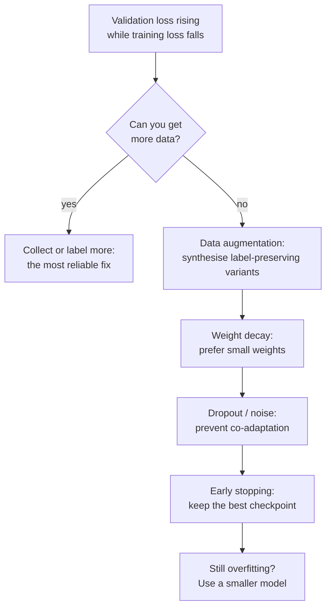

A neural network with enough parameters can memorise its training set, noise and all. You saw this in the [epochs](/learn/neural-network-fundamentals/epochs) lesson: training loss marched towards zero while validation loss tripled. **Regularisation** is any technique that makes a model generalise better to new data, usually at some cost in training loss. This lesson covers the core regularisers for neural networks (L2 penalties and weight decay, early stopping and data augmentation), compares them on the same overfitting network, and maps out the others you will meet, including the two that get their own lessons, [dropout](/learn/neural-network-fundamentals/dropout) and [batch normalisation](/learn/neural-network-fundamentals/batch-normalization).

## Why networks overfit

In the language of the [bias-variance trade-off](/learn/machine-learning-fundamentals/bias-variance-tradeoff), a large network has low bias and potentially high variance: many different weight settings fit the training data perfectly, and most of them behave badly between the training points. Regularisation adds a preference among those solutions, typically for simpler, smoother functions, or makes the training data harder to memorise.



## L2 regularisation and weight decay

**L2 regularisation** adds a penalty on the squared size of the weights to the loss:

$$
\mathcal{L}_{\text{reg}}(\theta) = \mathcal{L}(\theta) + \frac{\lambda}{2} \sum_{l} \lVert W^{[l]} \rVert^2
$$

where $\mathcal{L}$ is the data loss, $W^{[l]}$ the weight matrices, $\lVert\cdot\rVert^2$ the sum of squared entries, and $\lambda$ the regularisation strength. Its gradient adds $\lambda W$ to each weight's gradient, so a plain SGD step with learning rate $\eta$ becomes

$$
W \leftarrow W - \eta(\nabla_W \mathcal{L} + \lambda W) = (1 - \eta\lambda)\,W - \eta\nabla_W\mathcal{L}
$$

Every step first shrinks the weights by the factor $(1 - \eta\lambda)$, then applies the usual update. That is why the same idea is called **weight decay**. Small weights mean each unit responds gently to its inputs, so the network computes a smoother function that cannot bend sharply around individual noisy points.

Three practical points:

- **Biases and normalisation parameters are usually excluded.** They do not create the sharp, input-dependent behaviour that overfitting needs.
- **With Adam, use decoupled weight decay (AdamW).** As the [optimisers](/learn/neural-network-fundamentals/optimizers) lesson explained, an L2 term inside Adam's gradient gets rescaled per parameter; AdamW applies $W \leftarrow W - \eta\lambda W$ separately.
- **L1 regularisation**, a penalty $\lambda\sum|w|$, pushes weights to exactly zero and gives sparse networks. It is rarely used for whole networks, but it is the same idea you met in regularised linear models.

## Early stopping

The epochs lesson showed that validation loss has a minimum somewhere during training. **Early stopping** simply stops there: evaluate after every epoch, keep a copy of the best parameters, and stop when validation loss has not improved for a set number of epochs, called the **patience**.

```python
import numpy as np

class EarlyStopping:
    def __init__(self, patience=20, min_delta=0.0):
        self.patience, self.min_delta = patience, min_delta
        self.best, self.best_params, self.wait = np.inf, None, 0

    def update(self, val_loss, params):
        """Record this epoch; return True when training should stop."""
        if val_loss < self.best - self.min_delta:
            self.best, self.wait = val_loss, 0
            self.best_params = [p.copy() for p in params]
        else:
            self.wait += 1
        return self.wait >= self.patience
```

Early stopping is a regulariser because training time acts as a capacity limit: starting from small random weights, the network fits the broad structure of the data first and the noise later. Stopping early keeps the weights closer to their small initial values, an effect related to weight decay. It is nearly free and should be part of almost every training run. The patience trades off robustness to noisy validation curves against wasted epochs.

## Data augmentation

The best regulariser is more data. **Data augmentation** manufactures more of it by applying transformations that change the input but not the correct label:

| Data | Typical label-preserving augmentations |
| --- | --- |
| Images | Random crops, horizontal flips, small rotations, colour jitter (see [image augmentation](/learn/computer-vision/image-augmentation)) |
| Audio | Time shifts, added background noise, speed and pitch changes |
| Text | Synonym replacement, back-translation, random token masking |
| Tabular | Small Gaussian noise on numeric features (use with care) |

Augmentation is applied on the fly, freshly randomised every time an example is drawn, so the network never sees exactly the same input twice. The transformations encode your knowledge of what *should not* matter: a cat flipped left to right is still a cat. They must truly preserve the label: flipping a photo of a road sign with text, or rotating a handwritten 6 into a 9, teaches the network something false.

## Comparing regularisers on one network

Here is the overfitting setup from the epochs lesson (a `2-64-64-1` network, 200 noisy training points, 1,000 validation points) trained for up to 300 epochs, with each regulariser applied in turn. The helpers are the same as before; `Adam` with `weight_decay` above zero is AdamW.

```python
from sklearn.datasets import make_moons

def init(sizes, seed):
    rng = np.random.default_rng(seed)
    return [p for m, n in zip(sizes[:-1], sizes[1:])
            for p in (rng.normal(0, np.sqrt(2 / m), (m, n)), np.zeros(n))]

def logits(params, X):
    Ws, bs = params[0::2], params[1::2]
    A = X
    for i, (W, b) in enumerate(zip(Ws, bs)):
        A = A @ W + b
        if i < len(Ws) - 1:
            A = np.maximum(0, A)
    return A

def loss_and_grads(params, X, y):
    Ws, bs = params[0::2], params[1::2]
    acts, A = [X], X
    for i, (W, b) in enumerate(zip(Ws, bs)):
        Z = A @ W + b
        A = Z if i == len(Ws) - 1 else np.maximum(0, Z)
        acts.append(A)
    z = acts[-1]
    loss = np.mean(np.maximum(z, 0) - z * y + np.log1p(np.exp(-np.abs(z))))
    delta = (1 / (1 + np.exp(-z)) - y) / len(y)
    grads = []
    for i in reversed(range(len(Ws))):
        grads = [acts[i].T @ delta, delta.sum(axis=0)] + grads
        if i > 0:
            delta = (delta @ Ws[i].T) * (acts[i] > 0)
    return loss, grads

class Adam:
    def __init__(self, lr=1e-3, betas=(0.9, 0.999), eps=1e-8, weight_decay=0.0):
        self.lr, (self.b1, self.b2), self.eps, self.wd = lr, betas, eps, weight_decay
        self.m = self.s = None
        self.t = 0
    def step(self, params, grads):
        if self.m is None:
            self.m = [np.zeros_like(p) for p in params]
            self.s = [np.zeros_like(p) for p in params]
        self.t += 1
        for p, g, m, s in zip(params, grads, self.m, self.s):
            m[:] = self.b1 * m + (1 - self.b1) * g
            s[:] = self.b2 * s + (1 - self.b2) * g * g
            m_hat, s_hat = m / (1 - self.b1 ** self.t), s / (1 - self.b2 ** self.t)
            p -= self.lr * (m_hat / (np.sqrt(s_hat) + self.eps) + self.wd * p)

X_all, y_all = make_moons(n_samples=1200, noise=0.35, random_state=1)
y_all = y_all.reshape(-1, 1).astype(float)
X_tr, y_tr, X_va, y_va = X_all[:200], y_all[:200], X_all[200:], y_all[200:]
mu, sd = X_tr.mean(axis=0), X_tr.std(axis=0)
X_tr, X_va = (X_tr - mu) / sd, (X_va - mu) / sd
```

One training function with a switch for each regulariser. (For brevity this applies weight decay to the biases too.)

```python
def run(weight_decay=0.0, input_noise=0.0, patience=None, epochs=300, seed=0):
    params = init([2, 64, 64, 1], seed)
    opt = Adam(lr=1e-2, weight_decay=weight_decay)
    stopper = EarlyStopping(patience) if patience else None
    rng = np.random.default_rng(seed)
    for epoch in range(1, epochs + 1):
        order = rng.permutation(len(X_tr))
        for start in range(0, len(X_tr), 32):
            idx = order[start:start + 32]
            xb = X_tr[idx]
            if input_noise:                                   # augmentation: fresh noise each time
                xb = xb + rng.normal(0, input_noise, xb.shape)
            _, grads = loss_and_grads(params, xb, y_tr[idx])
            opt.step(params, grads)
        if stopper and stopper.update(loss_and_grads(params, X_va, y_va)[0], params):
            params = stopper.best_params                      # restore the best checkpoint
            break
    train_loss = loss_and_grads(params, X_tr, y_tr)[0]
    val_loss = loss_and_grads(params, X_va, y_va)[0]
    val_acc = np.mean((logits(params, X_va) > 0) == (y_va > 0.5))
    w_norm = np.sqrt(sum((W ** 2).sum() for W in params[0::2]))
    return f"stopped at {epoch:3d}  train {train_loss:.3f}  val {val_loss:.3f}  val acc {val_acc:.3f}  |W| {w_norm:5.1f}"

print("none            ", run())
print("weight decay 0.1", run(weight_decay=0.1))
print("weight decay 0.3", run(weight_decay=0.3))
print("input noise 0.2 ", run(input_noise=0.2))
print("early stopping  ", run(patience=20))
```

```output
none             stopped at 300  train 0.041  val 1.104  val acc 0.841  |W|  35.3
weight decay 0.1 stopped at 300  train 0.136  val 0.468  val acc 0.860  |W|  22.1
weight decay 0.3 stopped at 300  train 0.198  val 0.327  val acc 0.856  |W|  13.9
input noise 0.2  stopped at 300  train 0.215  val 0.318  val acc 0.870  |W|  20.9
early stopping   stopped at  39  train 0.238  val 0.290  val acc 0.878  |W|  16.7
```

All four regularised runs beat the unregularised one on validation loss, and by a large margin, while every one of them has a *higher* training loss. That is the signature of regularisation: give up some fit to the training data to fit new data better. The weight norm column shows the mechanism for weight decay: stronger decay, smaller weights. Input noise and early stopping also end with much smaller weights, even though neither penalises them directly.

The accuracy differences are smaller than the loss differences. Much of the unregularised model's bad validation loss comes from extreme overconfidence on the points it gets wrong, which is exactly what you want to avoid in a model whose probabilities will be used for decisions.

> [!KEY]
> Regularisation trades training fit for generalisation. Weight decay prefers small weights, augmentation and noise make memorisation harder, and early stopping limits how long the network has to memorise. They combine well, and early stopping with a saved best checkpoint costs almost nothing.

## The wider toolbox

| Technique | Mechanism | Where it is common |
| --- | --- | --- |
| Weight decay (L2) | Shrinks weights every step | Almost everywhere; AdamW for transformers |
| Early stopping | Stops at the best validation epoch | Almost everywhere |
| Data augmentation | Label-preserving input transformations | Vision, audio, speech |
| [Dropout](/learn/neural-network-fundamentals/dropout) | Randomly zeroes units during training | MLPs, transformers, older CNNs |
| [Batch normalisation](/learn/neural-network-fundamentals/batch-normalization) | Batch-dependent noise is a side effect; mainly speeds training | CNNs |
| Label smoothing | Softens one-hot targets | Classification, see [loss functions](/learn/neural-network-fundamentals/loss-functions) |
| Smaller model | Less capacity | When nothing else is enough |
| Ensembles | Average several independently trained networks | When accuracy justifies the cost |

> [!TIP]
> Tune regularisation strength on the validation set, like any other hyperparameter, and change one thing at a time. A useful order: first make sure the model *can* overfit (if it cannot, regularisation is the wrong lever), then add augmentation and weight decay, then dropout, keeping early stopping on throughout.

## Exercises

**1.** With SGD at learning rate 0.1 and weight decay $\lambda = 5 \times 10^{-4}$, by what factor is every weight multiplied each step before the gradient update? Roughly how much would a weight shrink after 1,000 steps with no gradient pushing back?

<details>
<summary>Show solution</summary>

The factor is $1 - \eta\lambda = 1 - 0.1 \times 0.0005 = 0.99995$. After 1,000 steps, $0.99995^{1000} \approx e^{-0.05} \approx 0.951$: about a 5% shrink. Weight decay is gentle per step but relentless.

</details>

**2.** Combine regularisers: run with `weight_decay=0.1, input_noise=0.2, patience=20`. Does combining beat the best single technique?

<details>
<summary>Show solution</summary>

```python
print(run(weight_decay=0.1, input_noise=0.2, patience=20))
```

In this run the combination stops at epoch 43 with a validation loss of about 0.278 and accuracy of about 0.881, slightly better than any single technique above. Combinations often help, but not always: two regularisers that both shrink the effective capacity can together over-regularise, raising training *and* validation loss. That is why strength should be tuned for the combination, not for each technique separately.

</details>

**3.** Why would random vertical flips be a poor augmentation for a model that classifies street scenes, while horizontal flips are fine?

<details>
<summary>Show solution</summary>

A horizontally flipped street scene is still a plausible street scene with the same objects. A vertically flipped one, with the sky at the bottom, never occurs in real inputs, so the model wastes capacity learning to handle impossible images and may learn misleading cues. Augmentations should produce inputs that could genuinely appear, with the same label.

</details>

```quiz
[
  {
    "q": "With plain SGD, adding the L2 penalty $\\frac{\\lambda}{2}\\lVert W \\rVert^2$ to the loss is equivalent to what?",
    "options": [
      "Clipping the gradients",
      "Multiplying the weights by $(1 - \\eta\\lambda)$ each step before the usual update",
      "Adding noise to the inputs",
      "Lowering the learning rate"
    ],
    "answer": 1,
    "why": "The penalty's gradient is $\\lambda W$, so the update becomes $W - \\eta\\lambda W - \\eta\\nabla\\mathcal{L} = (1 - \\eta\\lambda)W - \\eta\\nabla\\mathcal{L}$."
  },
  {
    "q": "What is the role of 'patience' in early stopping?",
    "options": [
      "The number of epochs without validation improvement to wait before stopping",
      "The minimum number of epochs to train",
      "The learning-rate decay factor",
      "The batch size used for validation"
    ],
    "answer": 0,
    "why": "Validation loss is noisy, so you stop only after it has failed to improve for several consecutive evaluations, then restore the best checkpoint."
  },
  {
    "q": "In the comparison, every regularised run had a higher training loss than the unregularised one. Is that a problem?",
    "options": [
      "Yes, it means the regularisers are broken",
      "No, giving up some training fit to generalise better is exactly what regularisation does",
      "Yes, training loss should always be minimised",
      "No, because training loss is never reported"
    ],
    "answer": 1,
    "why": "The goal is low validation and test error. Their validation losses were much lower, which is what matters."
  },
  {
    "q": "Which augmentation is most likely to hurt a handwritten digit classifier?",
    "options": ["Small translations", "Slight changes in stroke thickness", "Rotations by 180 degrees", "Small amounts of pixel noise"],
    "answer": 2,
    "why": "A 180-degree rotation turns a 6 into something that looks like a 9 (and vice versa), so the transformation does not preserve the label."
  }
]
```
