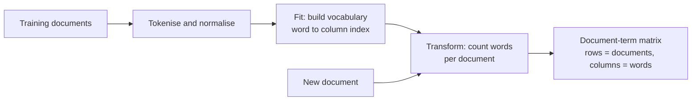

Machine learning models work on vectors of numbers, and text is a variable-length sequence of symbols. The simplest bridge between the two is the **bag of words** (BoW): describe each document by how many times each vocabulary word occurs in it, and ignore the order entirely. "The dog bit the man" and "the man bit the dog" become the same vector.

That sounds too crude to work, yet bag-of-words features with a linear model remain a strong, fast, interpretable baseline for spam filtering, topic tagging and many classification tasks. It is also the foundation that TF-IDF, n-grams and BM25 build on, so it is worth understanding exactly.

## From documents to a matrix

Building a bag-of-words representation has two phases: **fit** learns a vocabulary from training documents, and **transform** counts vocabulary words in any document.



Formally, with a vocabulary of $V$ words $w_1, \dots, w_V$, document $d$ becomes the vector

$$
\mathbf{x}_d = \big(\,\text{count}(w_1, d),\ \text{count}(w_2, d),\ \dots,\ \text{count}(w_V, d)\,\big)
$$

where $\text{count}(w_j, d)$ is the number of times word $w_j$ appears in $d$. Stacking these row vectors for $N$ documents gives an $N \times V$ **document-term matrix**.

## Building it by hand

Doing it once in plain Python removes any mystery:

```python
import re

docs = [
    "the cat sat on the mat",
    "the dog sat on the log",
    "the cat chased the dog",
]

def tokenize(text):
    return re.findall(r"[a-z]+", text.lower())

vocab = sorted({tok for d in docs for tok in tokenize(d)})
index = {word: j for j, word in enumerate(vocab)}

matrix = []
for d in docs:
    row = [0] * len(vocab)
    for tok in tokenize(d):
        row[index[tok]] += 1
    matrix.append(row)

print(vocab)
for row in matrix:
    print(row)
```

```output
['cat', 'chased', 'dog', 'log', 'mat', 'on', 'sat', 'the']
[1, 0, 0, 0, 1, 1, 1, 2]
[0, 0, 1, 1, 0, 1, 1, 2]
[1, 1, 1, 0, 0, 0, 0, 2]
```

Each column is a word; each row is a document. `the` scores 2 in every row, which is a hint of why later lessons reweight common words.

## CountVectorizer

scikit-learn's `CountVectorizer` does the same thing, faster, with many options, and returns a **sparse matrix**:

```python
from sklearn.feature_extraction.text import CountVectorizer

vec = CountVectorizer()
X = vec.fit_transform(docs)

print(vec.get_feature_names_out())
print(X.toarray())
print(type(X).__name__, X.shape, "stored values:", X.nnz)
```

```output
['cat' 'chased' 'dog' 'log' 'mat' 'on' 'sat' 'the']
[[1 0 0 0 1 1 1 2]
 [0 0 1 1 0 1 1 2]
 [1 1 1 0 0 0 0 2]]
csr_matrix (3, 8) stored values: 14
```

The result matches the hand-built matrix. `X.nnz` is the number of non-zero entries actually stored.

### Why sparse matters

A real corpus might have 100,000 documents and a vocabulary of 50,000 words: five billion cells. But a typical document uses only a few hundred distinct words, so well over 99 percent of the cells are zero. A sparse matrix (scikit-learn uses SciPy's CSR format) stores only the non-zero values and their positions, which makes the representation feasible in memory. Avoid calling `.toarray()` on real data; most scikit-learn models accept sparse input directly.

### Transforming new text

Once fitted, the vocabulary is frozen. Words never seen during fitting are **silently ignored** at transform time:

```python
new = ["the cat sat on the sofa", "a parrot squawked"]
print(vec.transform(new).toarray())
```

```output
[[1 0 0 0 0 1 1 2]
 [0 0 0 0 0 0 0 0]]
```

`sofa`, `parrot` and `squawked` are not in the vocabulary, so the second document becomes an all-zero vector. A model will still produce a prediction for it, based only on its intercept or class prior, and nothing warns you. Monitoring the fraction of empty or near-empty vectors in production is a cheap way to detect vocabulary drift.

> [!WARNING]
> Call `fit` (or `fit_transform`) on training data only, and `transform` on validation, test and live data. Refitting on test data builds a different vocabulary with different column meanings, so the model's learned weights no longer line up with the features.

## Useful options

| Parameter | Effect | Typical use |
| --- | --- | --- |
| `lowercase=True` | Lowercase before tokenising (default) | Usually leave on |
| `stop_words="english"` or a list | Drop listed words | See the [stop-word lesson](/learn/nlp-fundamentals/stop-word-removal) |
| `min_df=2` | Drop words in fewer than 2 documents (an int is a count, a float a fraction) | Remove typos and rare noise |
| `max_df=0.9` | Drop words in more than 90 percent of documents | Corpus-specific stop words |
| `max_features=5000` | Keep only the most frequent words | Cap memory and model size |
| `binary=True` | Record presence (1) instead of count | Short texts, Bernoulli models |
| `ngram_range=(1, 2)` | Add word pairs as features | Capture `not good`; see [n-grams](/learn/nlp-fundamentals/n-grams) |
| `token_pattern`, `tokenizer` | Control tokenisation | Keep one-letter tokens, plug in a stemmer |

## Comparing documents

Because documents are now vectors, you can measure how similar they are. **Cosine similarity**, the cosine of the angle between two vectors, is the standard choice for text because it ignores document length (a long document is not "more similar" to everything just because its counts are bigger). It is the normalised [dot product](/learn/linear-algebra/dot-product):

$$
\cos(\mathbf{a}, \mathbf{b}) = \frac{\mathbf{a}^\top \mathbf{b}}{\lVert \mathbf{a} \rVert\, \lVert \mathbf{b} \rVert}
$$

For count vectors all entries are non-negative, so the value lies between 0 (no words in common) and 1 (identical proportions).

```python
from sklearn.metrics.pairwise import cosine_similarity

print(cosine_similarity(X).round(2))
```

```output
[[1.   0.75 0.67]
 [0.75 1.   0.67]
 [0.67 0.67 1.  ]]
```

Documents 1 and 2 share `the`, `sat` and `on`, so they look fairly similar (0.75), even though one is about a cat on a mat and the other a dog on a log. Shared function words inflate similarity; TF-IDF weighting fixes much of this.

## A bag-of-words classifier

Bag-of-words features plus a linear model is the classic text classification baseline. Putting the vectoriser and model in one [pipeline](/learn/machine-learning-libraries/scikit-learn) guarantees the fit and transform discipline above.

```python
from sklearn.pipeline import make_pipeline
from sklearn.naive_bayes import MultinomialNB

texts = ["win a free prize now", "free money click now", "claim your free reward",
         "meeting moved to monday", "lunch on monday?", "notes from the meeting"]
labels = ["spam", "spam", "spam", "ham", "ham", "ham"]

model = make_pipeline(CountVectorizer(), MultinomialNB())
model.fit(texts, labels)
print(model.predict(["free prize for you", "see you at the meeting"]))
```

```output
['spam' 'ham']
```

Multinomial [Naive Bayes](/learn/supervised-learning-algorithms/naive-bayes) is designed for count features and trains almost instantly. Logistic regression is the other standard choice; you will compare them in the [text classification lesson](/learn/nlp-fundamentals/text-classification).

## Strengths and limits

| Strength | Limitation |
| --- | --- |
| Simple, fast, no training data beyond your labels | Word order is lost: "dog bit man" equals "man bit dog" |
| Interpretable: each weight belongs to a word | No notion of meaning: `film` and `movie` are unrelated columns |
| Works well with linear models on many tasks | Vocabulary is fixed at fit time; new words are ignored |
| Sparse, memory-efficient | Very high-dimensional |

> [!KEY]
> Bag of words throws away order and meaning but keeps *which words occur*, and for many tasks that is most of the signal. The rest of this module adds back what it loses: TF-IDF fixes weighting, n-grams recover local order, and embeddings recover meaning.

## Exercises

**1.** Using `CountVectorizer(binary=True)`, transform `"the the the cat"`. How does the vector differ from the default, and when might presence be better than counts?

<details>
<summary>Show solution</summary>

```python
for binary in [False, True]:
    v = CountVectorizer(binary=binary).fit(docs)
    print(binary, v.transform(["the the the cat"]).toarray())
```

```output
False [[1 0 0 0 0 0 0 3]]
True [[1 0 0 0 0 0 0 1]]
```

With `binary=True` the `the` column is 1 rather than 3. Presence is often better for short texts such as tweets or titles, where repetition is rare and mostly noise, and it stops one repeated word dominating the vector.

</details>

**2.** Write a function `most_similar(query, docs)` that returns the document most similar to `query` by cosine similarity of bag-of-words vectors. Test it with the query `"a cat on a mat"`.

<details>
<summary>Show solution</summary>

```python
def most_similar(query, docs):
    v = CountVectorizer().fit(docs)
    sims = cosine_similarity(v.transform([query]), v.transform(docs))[0]
    best = sims.argmax()
    return docs[best], round(float(sims[best]), 2)

print(most_similar("a cat on a mat", docs))
```

```output
('the cat sat on the mat', 0.61)
```

This is a tiny keyword search engine. The default token pattern ignores the single letter `a`, so the query matches on `cat`, `on` and `mat`.

</details>

```quiz
[
  {
    "q": "What does a bag-of-words representation discard?",
    "options": ["The order of the words", "How often each word occurs", "Which words occur", "The vocabulary"],
    "answer": 0,
    "why": "BoW keeps word counts but ignores order, so 'dog bit man' and 'man bit dog' get identical vectors."
  },
  {
    "q": "A fitted `CountVectorizer` transforms a document containing only words it has never seen. What is the result?",
    "options": ["An error", "A vector of ones", "The vocabulary is extended automatically", "A vector of all zeros"],
    "answer": 3,
    "why": "Unknown words are silently ignored, so the document maps to an all-zero vector."
  },
  {
    "q": "Why is the document-term matrix stored as a sparse matrix?",
    "options": ["Sparse matrices are more accurate", "Most entries are zero because each document uses a tiny fraction of the vocabulary", "scikit-learn cannot use dense arrays", "To preserve word order"],
    "answer": 1,
    "why": "Storing only non-zero entries makes large vocabularies feasible in memory."
  },
  {
    "q": "Why is cosine similarity preferred over raw dot product for comparing documents?",
    "options": ["It normalises for document length, so long documents do not dominate", "It is faster to compute", "It handles negative counts", "It considers word order"],
    "answer": 0,
    "why": "Dividing by the vector norms compares proportions rather than magnitudes, removing the length effect."
  }
]
```
