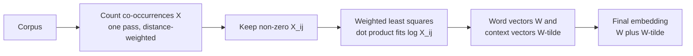

There were two families of word-vector methods by 2013. **Count-based** methods such as latent semantic analysis built a big word co-occurrence matrix and compressed it, using statistics of the whole corpus at once. **Prediction-based** methods such as Word2Vec slid a window over the text and learned from one local context at a time. **GloVe** (Global Vectors), published by Pennington, Socher and Manning at Stanford in 2014, combined them: it trains word vectors with a regression objective defined directly on global co-occurrence counts.

GloVe's pretrained vectors are among the most widely downloaded word embeddings, and they are a convenient way to explore what word vectors capture. This lesson explains the objective, what it is trying to encode, and how to use pretrained GloVe vectors, including the famous analogy test.

## Step one: the co-occurrence matrix

GloVe starts by counting. $X_{ij}$ is how often word $j$ appears in the context window of word $i$, summed over the whole corpus. GloVe weights each co-occurrence by $1/\text{distance}$, so a word right next to $i$ counts 1 and a word three positions away counts $1/3$.

From the counts you get conditional probabilities:

$$
P_{ij} = P(j \mid i) = \frac{X_{ij}}{X_i}, \qquad X_i = \sum_k X_{ik}
$$

$P_{ij}$ is the probability that word $j$ appears in the context of word $i$.



## The key insight: ratios of probabilities

Raw probabilities mix up meaning with frequency. GloVe's insight is that **ratios** of co-occurrence probabilities isolate meaning. Take `ice` and `steam`, and probe them with other words $k$:

| Probe word $k$ | Related to ice? | Related to steam? | $P(k \mid \text{ice}) / P(k \mid \text{steam})$ |
| --- | --- | --- | --- |
| `solid` | Yes | No | Large |
| `gas` | No | Yes | Small |
| `water` | Yes | Yes | Close to 1 |
| `fashion` | No | No | Close to 1 |

The ratio cleanly separates words that discriminate between `ice` and `steam` (`solid`, `gas`) from words that do not (`water`, `fashion`). You can see the effect on a tiny made-up corpus:

```python
import numpy as np
from collections import Counter

corpus = [
    "ice is solid and cold", "ice is frozen water", "solid ice floats on water",
    "steam is gas and hot", "steam is water vapour", "hot gas rises as steam",
    "fashion is not water", "water is wet",
]
cooc = {w: Counter() for w in ["ice", "steam"]}
for s in corpus:
    toks = s.split()
    for i, w in enumerate(toks):
        if w in cooc:
            for j in range(max(0, i - 3), min(len(toks), i + 4)):
                if j != i:
                    cooc[w][toks[j]] += 1 / abs(i - j)   # distance weighting

for k in ["solid", "gas", "water", "fashion"]:
    p_ice = (cooc["ice"][k] + 0.1) / sum(cooc["ice"].values())       # 0.1 avoids zeros
    p_steam = (cooc["steam"][k] + 0.1) / sum(cooc["steam"].values())
    print(f"{k:8} ratio = {p_ice / p_steam:.2f}")
```

```output
solid    ratio = 13.54
gas      ratio = 0.09
water    ratio = 1.08
fashion  ratio = 0.85
```

Even with eight sentences, `solid` gives a large ratio, `gas` a small one, and the neutral words land near 1. On a corpus of billions of words the pattern is sharp and holds for thousands of word pairs.

## The GloVe objective

GloVe asks for word vectors $\mathbf{w}_i$ and context vectors $\tilde{\mathbf{w}}_j$ whose dot product predicts the **log** co-occurrence count:

$$
\mathbf{w}_i^\top \tilde{\mathbf{w}}_j + b_i + \tilde{b}_j \approx \log X_{ij}
$$

where $b_i$ and $\tilde{b}_j$ are scalar biases that absorb how frequent each word is overall. Why the log? Because then differences of vectors relate to ratios: $(\mathbf{w}_a - \mathbf{w}_b)^\top \tilde{\mathbf{w}}_k \approx \log P_{ak} - \log P_{bk} = \log \frac{P_{ak}}{P_{bk}}$ (up to bias terms). The meaningful quantity, the ratio, becomes a vector difference, which is exactly why vector arithmetic works for analogies.

The model is trained by weighted least squares over all non-zero entries of $X$:

$$
J = \sum_{i,j \,:\, X_{ij} > 0} f(X_{ij}) \left( \mathbf{w}_i^\top \tilde{\mathbf{w}}_j + b_i + \tilde{b}_j - \log X_{ij} \right)^2
$$

The weighting function $f$ stops two kinds of pair from dominating:

$$
f(x) = \begin{cases} (x / x_{\max})^{\alpha} & \text{if } x < x_{\max} \\ 1 & \text{otherwise} \end{cases}
$$

The paper used $x_{\max} = 100$ and $\alpha = 3/4$. Rare co-occurrences (small $x$, noisy) get small weights; very frequent ones (such as with `the`) are capped at 1 so they cannot overwhelm the loss. Zero counts are skipped entirely, since $\log 0$ is undefined, which also makes training cost depend on the number of non-zero entries rather than $V^2$.

```python
def glove_weight(x, x_max=100, alpha=0.75):
    return np.minimum((x / x_max) ** alpha, 1.0)

counts = np.array([1, 5, 10, 50, 100, 1000])
print(dict(zip(counts.tolist(), glove_weight(counts).round(3).tolist())))
```

```output
{1: 0.032, 5: 0.106, 10: 0.178, 50: 0.595, 100: 1.0, 1000: 1.0}
```

After training, GloVe uses the sum $\mathbf{w}_i + \tilde{\mathbf{w}}_i$ as the final vector for word $i$; because $X$ is symmetric, the two sets of vectors are equivalent up to random initialisation, and summing them gives a small improvement.

## GloVe compared with Word2Vec

| | Word2Vec (skip-gram, negative sampling) | GloVe |
| --- | --- | --- |
| Training signal | Local windows, one pair at a time | Global co-occurrence counts |
| Objective | Binary classification of real vs sampled pairs | Weighted least squares on $\log X_{ij}$ |
| Preprocessing | None beyond tokenising | One pass to build $X$ (memory-heavy for big vocabularies) |
| Result quality | Similar | Similar |

In practice the two produce embeddings of comparable quality, and later analysis showed that skip-gram with negative sampling is itself implicitly factorising a shifted matrix of word-context statistics, so the two families are closer than they first appeared.

## Using pretrained GloVe vectors

The Stanford NLP group distributes vectors trained on several corpora, in 50 to 300 dimensions. `gensim` can download a converted copy:

```python
import gensim.downloader as api

glove = api.load("glove-wiki-gigaword-50")   # 400,000 lowercase words, 50 dimensions
print(glove["king"][:5].round(3))
```

```output
[ 0.505  0.686 -0.595 -0.023  0.6  ]
```

### Analogies

`most_similar` with `positive` and `negative` lists computes $\mathbf{v}_b - \mathbf{v}_a + \mathbf{v}_c$ and returns the nearest words by cosine similarity, excluding the input words:

```python
def analogy(a, b, c, topn=3):
    """a is to b as c is to ?"""
    result = glove.most_similar(positive=[b, c], negative=[a], topn=topn)
    return [(w, round(s, 3)) for w, s in result]

print(analogy("man", "king", "woman"))
print(analogy("france", "paris", "italy"))
print(analogy("walk", "walked", "swim"))
print(analogy("big", "bigger", "small"))
print(analogy("japan", "tokyo", "germany"))
```

```output
[('queen', 0.852), ('throne', 0.766), ('prince', 0.759)]
[('rome', 0.847), ('milan', 0.777), ('turin', 0.767)]
[('swam', 0.799), ('rowed', 0.691), ('raced', 0.677)]
[('larger', 0.924), ('smaller', 0.885), ('large', 0.884)]
[('frankfurt', 0.889), ('berlin', 0.868), ('munich', 0.813)]
```

The first three work: royalty and gender, country and capital, and present and past tense are all encoded as consistent offsets. The last two are instructive failures. `big : bigger :: small : ?` returns `larger` before `smaller`, and `japan : tokyo :: germany : ?` returns `frankfurt` before `berlin`, presumably because Frankfurt appears in financial news contexts much like Tokyo does. Close, but not right.

And if you do the arithmetic yourself without excluding the inputs:

```python
v = glove["king"] - glove["man"] + glove["woman"]
print([(w, round(s, 3)) for w, s in glove.similar_by_vector(v, topn=3)])
```

```output
[('king', 0.886), ('queen', 0.861), ('daughter', 0.768)]
```

The nearest word to the result is `king` itself. The offset moves the vector only a little, so analogy benchmarks always exclude the query words.

> [!WARNING]
> Pretrained vectors encode their training corpus, including its biases and its era. Vectors trained on news and encyclopaedia text from years ago will not know recent terms and will reflect stereotypes present in that text. Check them before using them in anything that affects people.

> [!KEY]
> GloVe shows that meaning can be read off global co-occurrence statistics: fit vector dot products to log counts, and ratios of probabilities become differences of vectors. Like Word2Vec it gives one static vector per word; contextual models replaced both for most tasks, but the vectors remain a fast, free, interpretable resource.

## Exercises

**1.** Using `glove_weight`, at what co-occurrence count does a pair reach half of the maximum weight with the paper's settings? Solve $(x/100)^{0.75} = 0.5$ and check numerically.

<details>
<summary>Show solution</summary>

$x = 100 \times 0.5^{1/0.75} = 100 \times 0.5^{4/3} \approx 39.7$.

```python
x = 100 * 0.5 ** (1 / 0.75)
print(round(x, 1), round(float(glove_weight(x)), 3))
```

```output
39.7 0.5
```

</details>

**2.** Use `glove.doesnt_match` to find the odd one out in `["breakfast", "cereal", "dinner", "lunch"]`, then explain how it could work using only cosine similarity.

<details>
<summary>Show solution</summary>

```python
print(glove.doesnt_match(["breakfast", "cereal", "dinner", "lunch"]))
```

```output
cereal
```

It averages the normalised vectors of all the words and returns the word whose vector is least similar (lowest cosine) to that mean. Three of the words are meals, so the mean points towards "meal", and `cereal`, a food, is furthest from it.

</details>

**3.** Why does GloVe skip pairs with $X_{ij} = 0$, and what would go wrong if it tried to include them?

<details>
<summary>Show solution</summary>

The target is $\log X_{ij}$, and $\log 0$ is undefined (negative infinity). Including zeros would require an arbitrary substitute value, and since most of the $V^2$ entries are zero they would dominate the loss and the training cost. The weighting function also gives $f(0) = 0$, so skipping them is consistent with the objective.

</details>

```quiz
[
  {
    "q": "What does the GloVe model try to make the dot product of a word vector and a context vector (plus biases) equal?",
    "options": ["The raw co-occurrence count", "The probability that the pair is real", "The cosine similarity", "The logarithm of the co-occurrence count"],
    "answer": 3,
    "why": "GloVe fits w_i·w̃_j + b_i + b̃_j to log X_ij by weighted least squares."
  },
  {
    "q": "Why does GloVe focus on ratios of co-occurrence probabilities such as P(k|ice)/P(k|steam)?",
    "options": ["Ratios are faster to compute", "Ratios separate words that distinguish two concepts from words that are related to both or neither", "Ratios avoid the need for a vocabulary", "They remove stop words"],
    "answer": 1,
    "why": "Discriminative probe words give large or small ratios; neutral words give ratios near 1."
  },
  {
    "q": "What is the purpose of the weighting function f(X_ij)?",
    "options": ["To down-weight rare noisy co-occurrences and cap very frequent ones", "To normalise vectors to unit length", "To sample negative examples", "To choose the window size"],
    "answer": 0,
    "why": "f grows as (x/x_max)^alpha below x_max and is capped at 1, balancing rare and frequent pairs."
  },
  {
    "q": "Computing king - man + woman with GloVe and taking the nearest word without excluding inputs returns:",
    "options": ["queen", "woman", "king", "prince"],
    "answer": 2,
    "why": "The offset is small, so the result stays closest to king; analogy evaluation excludes the input words."
  }
]
```
