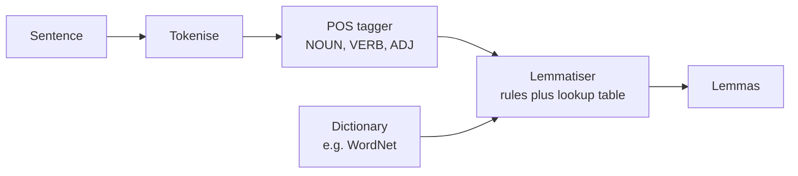
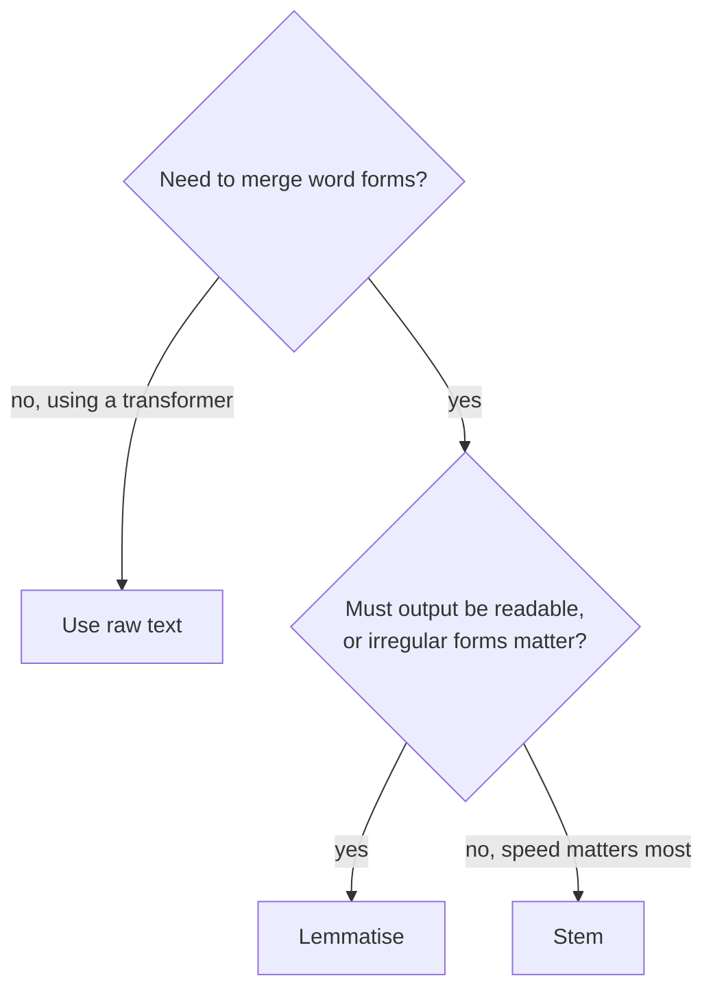

Stemming chops suffixes by rule and produces stems such as `happi` and `univers`. **Lemmatisation** does the same job, reducing words to a base form, but does it properly: it uses a dictionary and the word's grammatical role to return the **lemma**, the form you would look up in a dictionary. `ran` becomes `run`, `better` (as an adjective) becomes `good`, `mice` becomes `mouse`, and `was` becomes `be`.

The price is speed and complexity: a lemmatiser needs vocabulary data and, to work well, a part-of-speech tagger. This lesson shows how lemmatisers work, how to use NLTK's and spaCy's, and when the extra effort is worth it.

## Lemma versus stem

| Word | Porter stem | Lemma | Why they differ |
| --- | --- | --- | --- |
| `studies` | `studi` | `study` | Lemma is a real word |
| `ran` | `ran` | `run` | Irregular form needs a dictionary |
| `mice` | `mice` | `mouse` | Irregular plural |
| `better` (adjective) | `better` | `good` | Comparative of an irregular adjective |
| `meeting` (noun) | `meet` | `meeting` | As a noun, `meeting` is already a lemma |
| `meeting` (verb) | `meet` | `meet` | As a verb, its lemma is `meet` |

The last two rows show the key difference. A stemmer treats every `meeting` identically. A lemmatiser asks "which word is this?" first, which requires knowing the **part of speech** (POS): noun, verb, adjective, adverb and so on.



## How a lemmatiser works

Most lemmatisers combine two mechanisms:

1. **An exception table** for irregular forms: `ran` to `run`, `went` to `go`, `mice` to `mouse`, `geese` to `goose`.
2. **Suffix rules checked against a vocabulary**: strip `-ies` and add `-y`, strip `-ing`, strip `-es`, and accept the result only if it is a known word of the right part of speech.

Here is that idea in miniature, so there is no magic:

```python
EXCEPTIONS = {("ran", "v"): "run", ("went", "v"): "go", ("mice", "n"): "mouse",
              ("better", "a"): "good", ("was", "v"): "be"}
VOCAB = {"n": {"study", "mouse", "meeting", "box", "city"},
         "v": {"study", "run", "go", "meet", "be", "box"},
         "a": {"good", "happy"}}
RULES = {"n": [("ies", "y"), ("es", ""), ("s", "")],
         "v": [("ies", "y"), ("ing", ""), ("ed", ""), ("es", ""), ("s", "")],
         "a": [("er", ""), ("est", "")]}

def toy_lemma(word, pos):
    if (word, pos) in EXCEPTIONS:
        return EXCEPTIONS[(word, pos)]
    if word in VOCAB[pos]:
        return word
    for old, new in RULES[pos]:
        if word.endswith(old):
            candidate = word[: -len(old)] + new
            if candidate in VOCAB[pos]:
                return candidate
    return word          # unknown: leave unchanged

for word, pos in [("studies", "n"), ("cities", "n"), ("boxes", "v"),
                  ("meeting", "n"), ("meeting", "v"), ("ran", "v"), ("better", "a")]:
    print(f"{word:8} {pos} -> {toy_lemma(word, pos)}")
```

```output
studies  n -> study
cities   n -> city
boxes    v -> box
meeting  n -> meeting
meeting  v -> meet
ran      v -> run
better   a -> good
```

Because each candidate is checked against the vocabulary, the lemmatiser never invents a non-word like `studi`. Real lemmatisers have far larger tables but follow the same pattern.

## Lemmatising with NLTK

NLTK's `WordNetLemmatizer` uses the WordNet lexical database. Its most important, and most often forgotten, detail is the `pos` argument, which **defaults to noun**.

```python
from nltk.stem import WordNetLemmatizer   # needs: nltk.download("wordnet")

lem = WordNetLemmatizer()

print(lem.lemmatize("running"), lem.lemmatize("running", pos="v"))
print(lem.lemmatize("better"), lem.lemmatize("better", pos="a"))
print(lem.lemmatize("mice"), lem.lemmatize("was", pos="v"), lem.lemmatize("studies"))
```

```output
running run
better good
mouse be study
```

Without `pos="v"`, `running` is treated as a noun (as in "the running of the business") and left alone. To lemmatise real sentences you therefore need a POS tagger first, and you must map the tagger's Penn Treebank tags (`VBG`, `NNS`, `JJR`) to WordNet's four categories:

```python
from nltk import pos_tag, word_tokenize   # needs: averaged_perceptron_tagger_eng, punkt_tab

def wordnet_pos(treebank_tag):
    return {"J": "a", "V": "v", "R": "r"}.get(treebank_tag[0], "n")

sentence = "The striped bats were hanging on their feet and ate better fruits"
tagged = pos_tag(word_tokenize(sentence))
print(tagged)
print([lem.lemmatize(w.lower(), wordnet_pos(t)) for w, t in tagged])
```

```output
[('The', 'DT'), ('striped', 'JJ'), ('bats', 'NNS'), ('were', 'VBD'), ('hanging', 'VBG'), ('on', 'IN'), ('their', 'PRP$'), ('feet', 'NNS'), ('and', 'CC'), ('ate', 'VB'), ('better', 'JJR'), ('fruits', 'NNS')]
['the', 'striped', 'bat', 'be', 'hang', 'on', 'their', 'foot', 'and', 'eat', 'good', 'fruit']
```

The tagger recognised `were` and `hanging` as verbs, so they became `be` and `hang`, and `feet` became `foot`. Lemmatisation is only as good as the tags it receives: if the tagger gets a word's role wrong, the lemma will be wrong too.

## Lemmatising with spaCy

spaCy bundles tokenisation, tagging and lemmatisation into a single pipeline, which is usually what you want in practice. You install a trained pipeline once (`python -m spacy download en_core_web_sm`) and every token gets a `.lemma_`:

```python
import spacy

nlp = spacy.load("en_core_web_sm")
doc = nlp("The striped bats were hanging on their feet and ate better fruits")
print([(t.text, t.pos_, t.lemma_) for t in doc])
```

```output
[('The', 'DET', 'the'), ('striped', 'ADJ', 'striped'), ('bats', 'NOUN', 'bat'), ('were', 'AUX', 'be'), ('hanging', 'VERB', 'hang'), ('on', 'ADP', 'on'), ('their', 'PRON', 'their'), ('feet', 'NOUN', 'foot'), ('and', 'CCONJ', 'and'), ('ate', 'VERB', 'eat'), ('better', 'ADJ', 'well'), ('fruits', 'NOUN', 'fruit')]
```

This output is from the `en_core_web_sm` model; other versions or larger models can tag the odd word differently. spaCy's lemmatiser for English is rule- and lookup-based, driven by the POS tags its statistical tagger predicts, so it handles context: the same word can get different lemmas in different sentences. It is not perfect either: here it lemmatised the adjective `better` as `well` rather than `good`. Treat lemmatiser output as a useful normalisation, not ground truth.

> [!TIP]
> When processing many documents with spaCy, use `nlp.pipe(texts, batch_size=...)` instead of calling `nlp` in a loop, and disable components you do not need, for example `spacy.load("en_core_web_sm", disable=["ner", "parser"])` if you only want lemmas. Both make a large difference to throughput.

## Stemming or lemmatisation?

| | Stemming | Lemmatisation |
| --- | --- | --- |
| Output | Crude stem, often not a word | Dictionary word |
| Needs | Suffix rules only | Vocabulary, usually a POS tagger |
| Speed | Very fast | Slower (tagging dominates) |
| Irregular forms | Not handled | Handled |
| Typical use | Search indexing (BM25) | Feature engineering, readable topics, linguistic analysis |



Lemmas are the better choice when humans will read the features: topic-model keywords, word clouds, the top coefficients of a linear classifier. `study` is easier to interpret than `studi`. For pure search recall, stemming is cheaper and the difference in retrieval quality is often small; measure on your own queries.

> [!KEY]
> Like stemming, lemmatisation is a classical-NLP tool. Transformers and LLMs should receive the original text, because their subword tokenizers and training already capture the relationship between `ran` and `run` in context.

## Exercises

**1.** Lemmatise `"She was meeting the leaders of the meeting"` with spaCy and confirm that the two occurrences of `meeting` get different lemmas. Explain why a stemmer cannot do this.

<details>
<summary>Show solution</summary>

```python
doc = nlp("She was meeting the leaders of the meeting")
print([(t.text, t.pos_, t.lemma_) for t in doc if t.text == "meeting"])
```

```output
[('meeting', 'VERB', 'meet'), ('meeting', 'NOUN', 'meeting')]
```

The first `meeting` is tagged as a verb (lemma `meet`), the second as a noun (lemma `meeting`). A stemmer looks only at the string, so both would become `meet`.

</details>

**2.** Write a function `lemmatize_text(text)` using NLTK that tokenises, tags, maps tags to WordNet categories and lemmatises, returning a single lowercase string. Apply it to `"The children were playing with geese"` and check every lemma.

<details>
<summary>Show solution</summary>

```python
def lemmatize_text(text):
    tagged = pos_tag(word_tokenize(text))
    return " ".join(lem.lemmatize(w.lower(), wordnet_pos(t)) for w, t in tagged)

print(lemmatize_text("The children were playing with geese"))
print(pos_tag(word_tokenize("The children were playing with geese"))[-1])
```

```output
the child be play with geese
('geese', 'JJ')
```

Notice that `geese` was not lemmatised. The second line shows why: the tagger mislabelled it as an adjective (`JJ`), so WordNet looked it up as an adjective and found nothing. With `"...with the geese"` the tagger outputs `NN` and the lemma becomes `goose`. This is exactly the tagging dependency described above. You could pass this function as the `preprocessor` of a `CountVectorizer` to lemmatise inside a pipeline.

</details>

**3.** Why is calling `WordNetLemmatizer().lemmatize(word)` without a `pos` argument a common source of bugs?

<details>
<summary>Show solution</summary>

The default part of speech is noun, so verbs and adjectives are usually returned unchanged: `running`, `was` and `better` come back as they went in. The code runs without error and looks as if it works on nouns, so the bug is easy to miss.

</details>

```quiz
[
  {
    "q": "What does a lemmatiser need that a stemmer does not?",
    "options": ["A GPU", "A vocabulary or dictionary, and ideally the part of speech of each word", "A list of stop words", "A trained neural network in every case"],
    "answer": 1,
    "why": "Lemmatisers check candidates against a dictionary and use POS to choose the right base form."
  },
  {
    "q": "What does `WordNetLemmatizer().lemmatize(\"running\")` return, and why?",
    "options": ["`running`, because the default part of speech is noun", "`run`, because it strips -ing", "`runn`, because it is rule-based", "An error, because pos is required"],
    "answer": 0,
    "why": "Without pos=\"v\" WordNet treats the word as a noun, and the noun running is already a lemma."
  },
  {
    "q": "Which task benefits most from lemmatisation rather than stemming?",
    "options": ["Maximum-speed search indexing of billions of documents", "Feeding text to a BERT model", "Producing human-readable keywords for topics or classifier explanations", "Byte-pair encoding"],
    "answer": 2,
    "why": "Lemmas are real words, so features and keywords stay readable; stems such as studi do not."
  },
  {
    "q": "spaCy gives `meeting` the lemma `meet` in one sentence and `meeting` in another. What explains this?",
    "options": ["A bug in spaCy", "The predicted part of speech differs: verb in one, noun in the other", "Random sampling in the lemmatiser", "Different tokenizers were used"],
    "answer": 1,
    "why": "spaCy's lemmatiser uses the POS tag predicted from context, so the same string can get different lemmas."
  }
]
```
