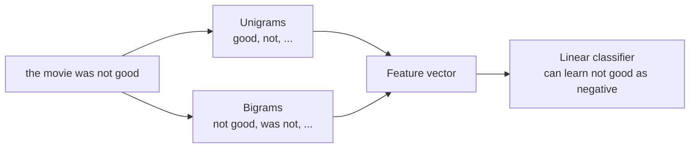

Bag of words forgets order, so "not good" and "good, not bad" look alike, and "New York" is just `new` plus `york`. An **n-gram** is a contiguous sequence of $n$ tokens. Adding n-grams as features brings back short-range word order cheaply: the bigram `not good` becomes its own feature, distinct from `good`.

N-grams also have a second life. Counting them gives you **n-gram language models**, which predict the next word from the previous few. They powered speech recognition and machine translation for decades, and they are the direct conceptual ancestor of the next-token prediction that LLMs perform. This lesson covers both uses.

## What n-grams are

For the sentence "the movie was not good":

| $n$ | Name | n-grams |
| --- | --- | --- |
| 1 | Unigrams | `the`, `movie`, `was`, `not`, `good` |
| 2 | Bigrams | `the movie`, `movie was`, `was not`, `not good` |
| 3 | Trigrams | `the movie was`, `movie was not`, `was not good` |

A sequence of $L$ tokens has $L - n + 1$ n-grams of size $n$. Extracting them in Python takes one list comprehension:

```python
def ngrams(tokens, n):
    return [" ".join(tokens[i:i + n]) for i in range(len(tokens) - n + 1)]

tokens = "the movie was not good".split()
print(ngrams(tokens, 2))
print(ngrams(tokens, 3))
```

```output
['the movie', 'movie was', 'was not', 'not good']
['the movie was', 'movie was not', 'was not good']
```

## N-gram features in scikit-learn

`CountVectorizer` and `TfidfVectorizer` take `ngram_range=(min_n, max_n)`. `(1, 2)` means unigrams and bigrams together.

```python
from sklearn.feature_extraction.text import CountVectorizer

docs = ["the movie was not good", "the movie was good, not bad"]

for rng in [(1, 1), (1, 2)]:
    vec = CountVectorizer(ngram_range=rng)
    X = vec.fit_transform(docs)
    print(rng, len(vec.vocabulary_), "features")
    print(vec.get_feature_names_out())
```

```output
(1, 1) 6 features
['bad' 'good' 'movie' 'not' 'the' 'was']
(1, 2) 13 features
['bad' 'good' 'good not' 'movie' 'movie was' 'not' 'not bad' 'not good'
 'the' 'the movie' 'was' 'was good' 'was not']
```

With unigrams alone, the two reviews share every word except `bad`, and their vectors are nearly identical. With bigrams, `was not` and `not good` appear only in the negative review, while `was good` and `not bad` appear only in the positive one, so a classifier can tell them apart.



### The cost: vocabulary explosion

Every extra $n$ multiplies the number of distinct features, and most of them are rare. The counts below come from a small synthetic corpus, but the pattern holds on real data:

```python
import random

random.seed(0)
words = ["the", "a", "model", "data", "train", "test", "good", "bad", "fast", "slow",
         "is", "was", "not", "very", "result", "loss", "score", "high", "low", "and"]
corpus = [" ".join(random.choices(words, k=12)) for _ in range(200)]

for rng in [(1, 1), (1, 2), (1, 3)]:
    for min_df in [1, 3]:
        vec = CountVectorizer(ngram_range=rng, min_df=min_df, token_pattern=r"\S+").fit(corpus)
        print(rng, f"min_df={min_df}", len(vec.vocabulary_))
```

```output
(1, 1) min_df=1 20
(1, 1) min_df=3 20
(1, 2) min_df=1 417
(1, 2) min_df=3 384
(1, 3) min_df=1 2173
(1, 3) min_df=3 402
```

Twenty words produce almost 400 distinct bigrams, and adding trigrams pushes the vocabulary past 2,000. Most of those trigrams occur only once or twice, so `min_df=3` removes nearly all of them: they are too rare to learn anything from. On real corpora the usual recipe is `ngram_range=(1, 2)` with `min_df` of 2 to 5; trigrams and beyond rarely pay for their size in classification.

> [!TIP]
> If the n-gram vocabulary is too large to store, `HashingVectorizer` maps each n-gram to a column with a hash function instead of a stored vocabulary. It uses fixed memory and works on streaming data, at the price of occasional collisions and features you cannot map back to words.

## Character n-grams

N-grams also work on characters. `analyzer="char_wb"` extracts character n-grams within word boundaries (padding each word with spaces); `analyzer="char"` lets them cross word boundaries.

```python
vec = CountVectorizer(analyzer="char_wb", ngram_range=(3, 3))
vec.fit(["colour"])
print(vec.get_feature_names_out())

a, b = vec.transform(["colour"]), vec.transform(["color"])
print("shared trigrams:", (a.multiply(b) > 0).sum())
```

```output
[' co' 'col' 'lou' 'olo' 'our' 'ur ']
shared trigrams: 3
```

`colour` and `color` share three of their character trigrams, so a model sees them as related, which word features never would. Character n-grams are robust to typos, spelling variants and creative spellings (`soooo good`), work for languages without spaces between words, and capture morphology such as `-ing` and `un-`. They are a strong choice for short, noisy text and for language identification.

| Feature type | Captures | Weakness |
| --- | --- | --- |
| Word unigrams | Topic words | No order, no negation |
| Word bigrams | Negation, phrases (`new york`) | Larger, sparser vocabulary |
| Character n-grams | Spelling variants, morphology, typos | Many features, less interpretable |

## N-gram language models

A **language model** assigns a probability to a sequence of words. By the chain rule of [probability](/learn/probability-and-statistics/conditional-probability), any sentence probability factorises into next-word predictions:

$$
P(w_1, \dots, w_L) = \prod_{i=1}^{L} P(w_i \mid w_1, \dots, w_{i-1})
$$

Conditioning on the entire history is impossible to estimate from counts, so an n-gram model makes the **Markov assumption**: only the previous $n - 1$ words matter. For a bigram model:

$$
P(w_i \mid w_1, \dots, w_{i-1}) \approx P(w_i \mid w_{i-1}) = \frac{\text{count}(w_{i-1}, w_i)}{\text{count}(w_{i-1})}
$$

The right-hand side is the [maximum likelihood estimate](/learn/essential-mathematics-for-machine-learning/maximum-likelihood-estimation): of all the times $w_{i-1}$ appeared, what fraction was followed by $w_i$?

```python
from collections import Counter, defaultdict

text = """i like nlp . i like python . i love python . you like nlp ."""
toks = text.split()

bigrams = defaultdict(Counter)
for prev, nxt in zip(toks, toks[1:]):
    bigrams[prev][nxt] += 1

def p_next(prev):
    total = sum(bigrams[prev].values())
    return {w: round(c / total, 3) for w, c in bigrams[prev].items()}

print("after 'i':", p_next("i"))
print("after 'like':", p_next("like"))
```

```output
after 'i': {'like': 0.667, 'love': 0.333}
after 'like': {'nlp': 0.667, 'python': 0.333}
```

`i` was followed by `like` twice and `love` once, so $P(\text{like} \mid \text{i}) = 2/3$. Generating text means repeatedly sampling the next word from these distributions.

### The sparsity problem and smoothing

Any bigram never seen in training gets probability zero, which makes the whole sentence probability zero: `"you love nlp"` is impossible under the model above. **Smoothing** reserves some probability for unseen events. The simplest, add-one (Laplace) smoothing, adds 1 to every count:

$$
P_{\text{add-1}}(w_i \mid w_{i-1}) = \frac{\text{count}(w_{i-1}, w_i) + 1}{\text{count}(w_{i-1}) + V}
$$

where $V$ is the vocabulary size. Practical systems used better methods such as Kneser-Ney smoothing and backoff to shorter n-grams.

> [!KEY]
> An n-gram model and an LLM solve the same problem, predicting the next token. The n-gram model looks at a fixed window of a few words and stores counts; a transformer looks at thousands of tokens and learns dense representations that generalise to sequences it has never seen. The sparsity problem is exactly what neural language models solved.

## Exercises

**1.** Train two pipelines, `CountVectorizer(ngram_range=(1, 1))` and `(1, 2)`, each followed by `LogisticRegression`, on the data below and predict `"not good"` and `"not bad"`. Explain the difference.

```python
train = ["good", "very good", "bad", "very bad", "not good", "not bad",
         "really good", "really bad", "not good at all", "not bad at all"]
y = [1, 1, 0, 0, 0, 1, 1, 0, 0, 1]
```

<details>
<summary>Show solution</summary>

```python
from sklearn.linear_model import LogisticRegression
from sklearn.pipeline import make_pipeline

train = ["good", "very good", "bad", "very bad", "not good", "not bad",
         "really good", "really bad", "not good at all", "not bad at all"]
y = [1, 1, 0, 0, 0, 1, 1, 0, 0, 1]

for rng in [(1, 1), (1, 2)]:
    model = make_pipeline(CountVectorizer(ngram_range=rng), LogisticRegression(C=10))
    model.fit(train, y)
    print(rng, model.predict(["not good", "not bad"]))
```

```output
(1, 1) [1 0]
(1, 2) [0 1]
```

With unigrams, `not` appears equally in positive and negative examples, so it carries no signal and the prediction follows `good` or `bad` alone, getting both wrong. With bigrams, `not good` and `not bad` are features with their own weights, and both are classified correctly.

</details>

**2.** Extend the bigram model with add-one smoothing and compute $P(\text{love} \mid \text{you})$, which is zero without smoothing.

<details>
<summary>Show solution</summary>

```python
V = len(set(toks))

def p_add1(prev, nxt):
    return (bigrams[prev][nxt] + 1) / (sum(bigrams[prev].values()) + V)

print(V, round(p_add1("you", "love"), 3), round(p_add1("you", "like"), 3))
```

```output
7 0.125 0.25
```

`you` was seen once (followed by `like`), and there are 7 vocabulary items including `.`, so $P(\text{love} \mid \text{you}) = (0 + 1)/(1 + 7) = 0.125$ and $P(\text{like} \mid \text{you}) = 2/8 = 0.25$. Smoothing moved a lot of probability onto unseen words, which is why add-one is considered too crude for real models.

</details>

```quiz
[
  {
    "q": "How many bigrams does a sequence of 6 tokens contain?",
    "options": ["5", "6", "4", "12"],
    "answer": 0,
    "why": "A sequence of L tokens has L - n + 1 n-grams: 6 - 2 + 1 = 5."
  },
  {
    "q": "Why do bigram features often help sentiment classification?",
    "options": ["They make the vocabulary smaller", "They remove stop words", "They capture local order such as `not good`, which unigrams cannot represent", "They are dense"],
    "answer": 2,
    "why": "A bigram like `not good` is its own feature, so the model can learn that negation flips sentiment."
  },
  {
    "q": "What assumption does a trigram language model make?",
    "options": ["Every word is independent", "The next word depends only on the previous two words", "The next word depends on the whole document", "Word order does not matter"],
    "answer": 1,
    "why": "The Markov assumption for n = 3 conditions on the previous n - 1 = 2 words."
  },
  {
    "q": "Which feature type is most robust to spelling variants such as `colour` and `color`?",
    "options": ["Word unigrams", "Word bigrams", "Stop-word lists", "Character n-grams"],
    "answer": 3,
    "why": "The variants share most of their character n-grams, so their vectors overlap."
  }
]
```
