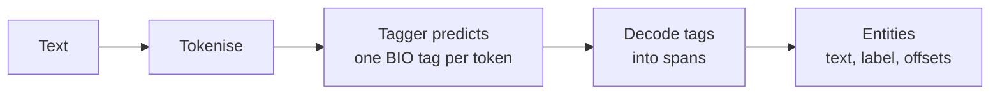
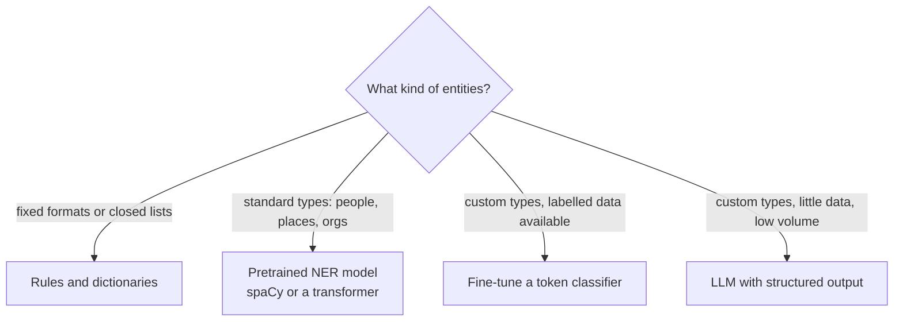

A support ticket says: "Order ORD-48213 for the Pixel 9 was shipped to Berlin by DHL on Tuesday." A human instantly picks out the order number, the product, the city, the courier and the date. **Named entity recognition** (NER) is the task of finding such spans in text and labelling each with a type: person, organisation, location, date, amount of money, or any custom type your application needs.

NER turns unstructured text into structured fields. It powers search filters ("documents mentioning Siemens in 2023"), redaction of personal data, routing of tickets, knowledge-graph construction and the metadata extraction step of many RAG pipelines. This lesson covers how NER is framed as a token-labelling problem, how to use spaCy's pretrained models and rules, how to evaluate NER properly, and when an LLM is a better tool.

## Entities and entity types

An **entity** is a span of one or more tokens plus a label. Common label sets come from annotated corpora; spaCy's English models use the OntoNotes scheme:

| Label | Meaning | Example |
| --- | --- | --- |
| `PERSON` | People, including fictional | Ada Lovelace |
| `ORG` | Companies, agencies, institutions | DHL, the United Nations |
| `GPE` | Geopolitical entities: countries, cities, states | Berlin, Japan |
| `LOC` | Non-GPE locations: mountains, rivers | the Alps |
| `DATE`, `TIME` | Absolute or relative dates and times | next March, Tuesday |
| `MONEY`, `PERCENT`, `CARDINAL` | Amounts and numbers | about 50 million pounds |
| `PRODUCT`, `EVENT`, `WORK_OF_ART` | Objects, named events, titles | the Olympics |

The hard parts are **boundaries** (is it "Bank of England" or just "England"?) and **ambiguity** (`Jaguar` the carmaker or the animal; `Washington` the person, city or state). Both depend on context, which is why NER is a learned task rather than a dictionary lookup.

## NER as sequence labelling: the BIO scheme

Machine learning models label tokens, not spans. The standard trick is to encode spans as per-token tags with the **BIO** scheme (also called IOB2):

- `B-TYPE`: the **b**eginning of an entity of that type,
- `I-TYPE`: **i**nside an entity, continuing the previous token's entity,
- `O`: **o**utside any entity.

| Token | Ada | Lovelace | worked | with | Charles | Babbage | in | London | . |
| --- | --- | --- | --- | --- | --- | --- | --- | --- | --- |
| Tag | `B-PER` | `I-PER` | `O` | `O` | `B-PER` | `I-PER` | `O` | `B-GPE` | `O` |

The `B` tag is what lets you separate two adjacent entities of the same type: "gave Ada Charles the notes" would be `B-PER B-PER`, not one two-word person. Variants such as BIOES (adding **E**nd and **S**ingle tags) give the model more explicit boundary information.



Converting between spans and tags is a routine, error-prone job, so it is worth writing once:

```python
def spans_to_bio(tokens, spans):
    """spans: list of (start_token, end_token_exclusive, label)."""
    tags = ["O"] * len(tokens)
    for start, end, label in spans:
        tags[start] = f"B-{label}"
        for i in range(start + 1, end):
            tags[i] = f"I-{label}"
    return tags

def bio_to_spans(tags):
    spans, start, label = [], None, None
    for i, tag in enumerate(tags + ["O"]):              # sentinel closes a final entity
        if tag.startswith("B-") or tag == "O" or (tag.startswith("I-") and tag[2:] != label):
            if start is not None:
                spans.append((start, i, label))
                start, label = None, None
            if tag.startswith("B-") or tag.startswith("I-"):   # stray I- starts a new entity
                start, label = i, tag[2:]
    return spans

tokens = "Ada Lovelace worked with Charles Babbage in London .".split()
tags = spans_to_bio(tokens, [(0, 2, "PER"), (4, 6, "PER"), (7, 8, "GPE")])
print(tags)
print(bio_to_spans(tags))
```

```output
['B-PER', 'I-PER', 'O', 'O', 'B-PER', 'I-PER', 'O', 'B-GPE', 'O']
[(0, 2, 'PER'), (4, 6, 'PER'), (7, 8, 'GPE')]
```

Classical NER models predicted these tags with conditional random fields (CRFs) over hand-crafted features: capitalisation, suffixes, neighbouring words, gazetteer lists. Modern systems use neural networks, typically a transformer with a classification layer over each token, but the BIO framing is unchanged.

## NER with spaCy

spaCy ships trained pipelines that include an NER component. After `python -m spacy download en_core_web_sm`:

```python
import spacy

nlp = spacy.load("en_core_web_sm")
doc = nlp("Apple is opening a new office in London next March, "
          "hiring 200 engineers for about 50 million pounds.")

for ent in doc.ents:
    print(f"{ent.text:24} {ent.label_:9} chars {ent.start_char}-{ent.end_char}")

print([(t.text, t.ent_iob_, t.ent_type_) for t in doc[:3]])
print(spacy.explain("GPE"))
```

```output
Apple                    ORG       chars 0-5
London                   GPE       chars 33-39
next March               DATE      chars 40-50
200                      CARDINAL  chars 59-62
about 50 million pounds  MONEY     chars 77-100
[('Apple', 'B', 'ORG'), ('is', 'O', ''), ('opening', 'O', '')]
Countries, cities, states
```

Each entity is a `Span` with its text, label and character offsets, and each token exposes its BIO position (`ent_iob_`) and type. These outputs come from the small English model; larger models (`en_core_web_md`, `en_core_web_lg`, or the transformer-based `en_core_web_trf`) are usually more accurate and may disagree on edge cases.

Pretrained models make characteristic mistakes:

```python
for text in ["Ada Lovelace visited 10 Downing Street on Tuesday.",
             "The Jaguar sprinted across the road.",
             "Order ORD-48213 for the Pixel 9 was shipped to Berlin by DHL."]:
    print([(e.text, e.label_) for e in nlp(text).ents])
```

```output
[('Ada Lovelace', 'PERSON'), ('10 Downing Street', 'ORG'), ('Tuesday', 'DATE')]
[('Jaguar', 'ORG')]
[('Berlin', 'GPE'), ('DHL', 'ORG')]
```

`10 Downing Street` is labelled an organisation (it is better described as a facility), the animal `Jaguar` is labelled an organisation because the model has mostly seen the brand, and the order number and product are missed entirely because no general-purpose model knows your ID formats.

## Adding rules for domain entities

For entities with a predictable form (IDs, product names from a catalogue, error codes) rules are cheap, precise and need no training data. spaCy's `entity_ruler` component matches token patterns or phrases and can run before the statistical model:

```python
ruler = nlp.add_pipe("entity_ruler", before="ner")
ruler.add_patterns([
    {"label": "ORDER_ID", "pattern": [{"TEXT": {"REGEX": r"^ORD-\d+$"}}]},
    {"label": "PRODUCT", "pattern": "Pixel 9"},
])

doc = nlp("Order ORD-48213 for the Pixel 9 was shipped to Berlin by DHL.")
print([(e.text, e.label_) for e in doc.ents])
```

```output
[('ORD-48213', 'ORDER_ID'), ('Pixel 9', 'PRODUCT'), ('Berlin', 'GPE'), ('DHL', 'ORG')]
```

The rule-based entities are added first and the statistical model fills in the rest. Combining a gazetteer or pattern list for known entities with a learned model for open-ended ones is a robust, common design. For new open-ended entity types, you would instead fine-tune a model on a few hundred to a few thousand annotated examples.

> [!TIP]
> Before training anything, check whether your entities are a closed list (products, branch names, drug names) or follow a pattern (IDs, postcodes, email addresses). If so, rules or a dictionary will often beat a model and are trivially explainable.

## Evaluating NER

NER is evaluated at the **entity level**, not the token level. A predicted entity counts as correct only if both its boundaries and its type exactly match a gold entity. Then [precision](/learn/model-evaluation/precision), [recall](/learn/model-evaluation/recall) and [F1](/learn/model-evaluation/f1-score) are computed over entities:

```python
def entity_prf(gold_tags, pred_tags):
    gold, pred = set(bio_to_spans(gold_tags)), set(bio_to_spans(pred_tags))
    tp = len(gold & pred)
    precision = tp / len(pred) if pred else 0.0
    recall = tp / len(gold) if gold else 0.0
    f1 = 2 * precision * recall / (precision + recall) if precision + recall else 0.0
    return round(precision, 3), round(recall, 3), round(f1, 3)

gold = ["B-PER", "I-PER", "O", "O", "B-PER", "I-PER", "O", "B-GPE", "O"]
pred = ["B-PER", "I-PER", "O", "O", "B-PER", "O",     "O", "B-ORG", "O"]

token_acc = sum(g == p for g, p in zip(gold, pred)) / len(gold)
print("token accuracy:", round(token_acc, 3))
print("entity P, R, F1:", entity_prf(gold, pred))
```

```output
token accuracy: 0.778
entity P, R, F1: (0.333, 0.333, 0.333)
```

Token accuracy is 78 percent here, and on real text, where the large majority of tokens are `O`, it is usually far higher, because predicting `O` is easy. At entity level only one of three entities is right: `Charles` alone has the wrong boundary and `London` the wrong type. Always report entity-level scores; the `seqeval` library implements this standard evaluation if you need it.

## Classical NER, transformers or an LLM?



An LLM prompted to "extract every person, company and date as JSON" handles new entity types with no training data and copes well with ambiguity. The trade-offs are cost and latency per document, occasional hallucinated or paraphrased entities that do not appear verbatim in the text, and no character offsets unless you ask for and verify them. For millions of documents a fine-tuned token classifier is far cheaper; a common pattern is to use an LLM to label a training set, review it, and then train a small fast model on it. [Structured outputs](/learn/working-with-llms/structured-outputs) covers making LLM extraction reliable.

> [!KEY]
> NER is span labelling expressed as per-token BIO tags. Evaluate it on exact entity matches, start with rules for predictable entities, and choose between pretrained models, fine-tuning and LLM extraction by entity type, data volume and cost.

## Exercises

**1.** Convert this tagging to spans with `bio_to_spans` and explain how the stray `I-ORG` is handled: `["O", "I-ORG", "I-ORG", "O", "B-GPE", "I-GPE"]`.

<details>
<summary>Show solution</summary>

```python
print(bio_to_spans(["O", "I-ORG", "I-ORG", "O", "B-GPE", "I-GPE"]))
```

```output
[(1, 3, 'ORG'), (4, 6, 'GPE')]
```

An `I-` tag that does not continue an entity of the same type is invalid in strict BIO. This decoder treats it leniently as the start of a new entity, so tokens 1-2 become an `ORG`. Different tools handle invalid sequences differently, which is one reason to use a standard evaluation library.

</details>

**2.** Add an `entity_ruler` pattern that labels UK-style postcodes such as `SW1A 2AA` as `POSTCODE`. Hint: spaCy tokenises a postcode into two tokens, so use a two-token pattern with a regex for each part.

<details>
<summary>Show solution</summary>

```python
ruler.add_patterns([{"label": "POSTCODE", "pattern": [
    {"TEXT": {"REGEX": r"^[A-Z]{1,2}\d[A-Z\d]?$"}},
    {"TEXT": {"REGEX": r"^\d[A-Z]{2}$"}},
]}])
doc = nlp("Please send it to SW1A 2AA by Friday.")
print([(e.text, e.label_) for e in doc.ents])
```

```output
[('SW1A 2AA', 'POSTCODE'), ('Friday', 'DATE')]
```

This simplified pattern covers common formats; full postcode validation has more cases. Patterns added later to the same ruler are used on the next call to `nlp`.

</details>

**3.** A model achieves 97 percent token accuracy on your NER test set. Why is that not enough to judge it, and what would you report instead?

<details>
<summary>Show solution</summary>

Most tokens are `O`, so a model that predicts `O` almost everywhere gets high token accuracy while finding few entities. Report entity-level precision, recall and F1 (overall and per entity type), with exact boundary and type matching.

</details>

```quiz
[
  {
    "q": "In the BIO scheme, why is a separate `B-` tag needed rather than just `I-` and `O`?",
    "options": ["To mark the end of a sentence", "To mark entity types", "To separate two adjacent entities of the same type", "It is only used for single-token entities"],
    "answer": 2,
    "why": "Without B-, two consecutive people would merge into one span; B- marks where a new entity starts."
  },
  {
    "q": "A gold entity is `Bank of England` (ORG) and the model predicts `England` (GPE). Under standard entity-level evaluation this is:",
    "options": ["A partial true positive", "A false positive and a false negative", "Ignored", "A true positive because England overlaps"],
    "answer": 1,
    "why": "Exact match requires identical boundaries and type, so the prediction is wrong (FP) and the gold entity is missed (FN)."
  },
  {
    "q": "Your application must extract internal order IDs that always look like `ORD-` followed by digits. What is the best first approach?",
    "options": ["Fine-tune a transformer NER model", "Use the default pretrained spaCy model", "Ask an LLM for each document", "A rule or regex pattern, for example with spaCy's entity_ruler"],
    "answer": 3,
    "why": "Fixed-format entities are matched precisely and cheaply by rules; pretrained models do not know your ID format."
  },
  {
    "q": "Which is a genuine risk of using an LLM for entity extraction?",
    "options": ["It cannot handle custom entity types", "It requires BIO-tagged training data", "It may return entities that are paraphrased or not present verbatim in the text", "It cannot output JSON"],
    "answer": 2,
    "why": "Generated entities should be verified against the source text; LLMs can paraphrase or hallucinate spans."
  }
]
```
