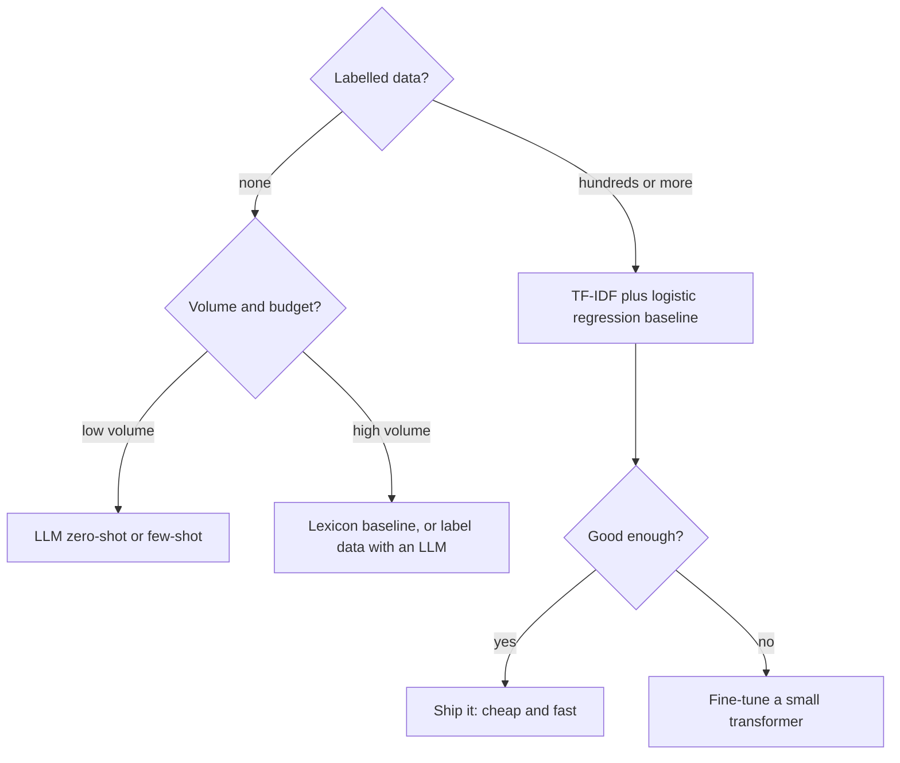

**Sentiment analysis** decides whether a piece of text expresses a positive, negative or neutral opinion. It is the most common commercial NLP task: companies run it over product reviews, support tickets, survey comments and social media to track satisfaction, find unhappy customers and spot problems with a release before they show up in sales figures.

It is also the classic place to learn how text classification goes wrong. Negation, sarcasm, mixed opinions and heavily imbalanced data all show up immediately. This lesson builds three kinds of sentiment system (a lexicon, a trained classifier, and an LLM), and shows how to evaluate them honestly.

## Framing the task

"Sentiment" covers several related problems, and choosing the right framing matters more than choosing the model.

| Framing | Output | Example use |
| --- | --- | --- |
| Binary polarity | positive or negative | Review star prediction, alerting |
| Three-class | positive, neutral, negative | Social media monitoring |
| Fine-grained or intensity | 1 to 5 stars, or a score from -1 to 1 | Ranking feedback by severity |
| Aspect-based | sentiment per aspect: battery negative, screen positive | Product analytics |
| Emotion | anger, joy, fear, ... | Support triage |

"The screen is gorgeous but the battery is a joke" is neither positive nor negative overall; it is positive about the screen and negative about the battery. If your users care about aspects, document-level polarity will mislead them.

## Approach 1: a sentiment lexicon

The oldest approach needs no training data: look words up in a dictionary of scored words and combine the scores. **VADER**, which ships with NLTK, is a lexicon tuned for social media, with rules for negation (`not good`), intensifiers (`very`), capitals and exclamation marks.

```python
from nltk.sentiment import SentimentIntensityAnalyzer   # needs: nltk.download("vader_lexicon")

sia = SentimentIntensityAnalyzer()
for text in ["The battery life is great!",
             "The battery life is not great.",
             "The battery life is GREAT!!!",
             "Oh great, it broke after two days.",
             "The screen is fine, but the battery is awful."]:
    print(f"{sia.polarity_scores(text)['compound']:+.3f}  {text}")
```

```output
+0.659  The battery life is great!
-0.510  The battery life is not great.
+0.772  The battery life is GREAT!!!
+0.318  Oh great, it broke after two days.
-0.557  The screen is fine, but the battery is awful.
```

The `compound` score runs from -1 to +1. VADER handles negation and emphasis well, but the sarcastic "Oh great, it broke after two days" comes out positive: the lexicon sees `great` and cannot know that breaking after two days is bad.

Lexicons are transparent and free to run, and they make a useful zero-training baseline. They break on domain-specific language (`unpredictable` is good for a thriller and bad for a car's steering), sarcasm and anything their dictionary does not contain.

## Approach 2: a trained classifier

With labelled examples, a TF-IDF and logistic regression pipeline learns which words and phrases signal sentiment in *your* domain. Bigrams let it learn negation.

```python
from sklearn.feature_extraction.text import TfidfVectorizer
from sklearn.linear_model import LogisticRegression
from sklearn.pipeline import make_pipeline

train_texts = [
    "love this phone", "great battery life", "the screen is excellent", "works perfectly, very happy",
    "best purchase this year", "really good value", "the camera is amazing", "good phone, fast and reliable",
    "not bad, quite nice", "great sound and a good screen",
    "terrible battery life", "stopped working after a week", "the screen is awful", "very disappointed",
    "not good, returned it", "waste of money", "the camera is poor", "slow and buggy",
    "not worth the price", "bad phone, not good at all",
]
train_labels = ["pos"] * 10 + ["neg"] * 10

clf = make_pipeline(TfidfVectorizer(ngram_range=(1, 2)), LogisticRegression(C=10))
clf.fit(train_texts, train_labels)

tests = ["the battery is great", "not good at all", "disappointed with the camera", "good value but slow"]
for text, p in zip(tests, clf.predict_proba(tests)[:, 1]):
    print(f"P(pos)={p:.2f}  {text}")
```

```output
P(pos)=0.66  the battery is great
P(pos)=0.17  not good at all
P(pos)=0.32  disappointed with the camera
P(pos)=0.63  good value but slow
```

`clf.classes_` is `['neg', 'pos']`, so column 1 is the positive probability. Twenty examples are far too few for a real system (you would want hundreds to thousands per class), but the mechanics are identical at scale. The mixed review `"good value but slow"` leans positive but with less confidence than clear praise, which is arguably reasonable.

### What the model learned

A linear model is interpretable: each feature has a weight.

```python
import numpy as np

vec, lr = clf.named_steps["tfidfvectorizer"], clf.named_steps["logisticregression"]
names, coefs = vec.get_feature_names_out(), lr.coef_[0]
order = np.argsort(coefs)
print("most negative:", list(names[order[:6]]))
print("most positive:", list(names[order[-6:]]))
```

```output
most negative: ['awful', 'is awful', 'terrible', 'terrible battery', 'is poor', 'poor']
most positive: ['is excellent', 'great battery', 'this', 'amazing', 'is amazing', 'great']
```

The negative side looks sensible. On the positive side, `this` is a warning sign: it appears only in positive training reviews ("love this phone", "best purchase this year"), so the model treats it as evidence of praise. Inspecting the top features is the fastest sanity check you can do. If the strongest features are product names, dates or a template phrase that only appears in one class, the model has learned a shortcut from your data collection rather than sentiment.

## Class imbalance

Real sentiment data is rarely balanced. Most product reviews are positive; the negative ones are rare and are the ones you most need to catch. Here is a synthetic dataset with 95 percent positive reviews, generated from templates with some mixed reviews thrown in:

```python
import random
from sklearn.model_selection import train_test_split
from sklearn.metrics import accuracy_score, f1_score, recall_score

random.seed(42)
things = ["battery", "screen", "camera", "delivery", "price", "sound", "app", "case"]
pos = ["love the {}", "great {}", "the {} is excellent", "really happy with the {}", "{} works perfectly"]
neg = ["the {} stopped working", "terrible {}", "very disappointed with the {}", "{} is awful", "the {} broke"]

def review(templates, other):
    parts = [random.choice(templates).format(random.choice(things)) for _ in range(random.randint(1, 2))]
    if random.random() < 0.3:                      # some mixed reviews
        parts.append(random.choice(other).format(random.choice(things)))
    random.shuffle(parts)
    return ", ".join(parts)

texts = [review(pos, neg) for _ in range(570)] + [review(neg, pos) for _ in range(30)]
labels = ["pos"] * 570 + ["neg"] * 30
X_tr, X_te, y_tr, y_te = train_test_split(texts, labels, test_size=0.3, stratify=labels, random_state=0)

for weight in [None, "balanced"]:
    model = make_pipeline(TfidfVectorizer(ngram_range=(1, 2)),
                          LogisticRegression(class_weight=weight, max_iter=1000))
    pred = model.fit(X_tr, y_tr).predict(X_te)
    print(f"class_weight={weight!s:9} accuracy={accuracy_score(y_te, pred):.3f} "
          f"macro-F1={f1_score(y_te, pred, average='macro'):.3f} "
          f"neg recall={recall_score(y_te, pred, pos_label='neg'):.3f}")
```

```output
class_weight=None      accuracy=0.950 macro-F1=0.487 neg recall=0.000
class_weight=balanced  accuracy=0.967 macro-F1=0.841 neg recall=0.778
```

Look at the first line carefully. Accuracy is 95 percent, so the model looks excellent, yet negative recall is zero: it did not find a single complaint. It has learned to predict "positive" for everything, which is exactly what a trivial majority-class predictor does, and that also scores 95 percent here. `class_weight="balanced"` reweights the loss so each class contributes equally in total, and negative recall jumps to 0.78. Here accuracy even rose slightly; more often you pay for minority recall with some extra false alarms, which is usually a good trade when the minority class is the one you care about.

> [!WARNING]
> On imbalanced data, accuracy is close to meaningless. Report per-class [recall](/learn/model-evaluation/recall) and [precision](/learn/model-evaluation/precision), macro-averaged [F1](/learn/model-evaluation/f1-score), and the [confusion matrix](/learn/model-evaluation/confusion-matrix), and always compare against a trivial majority-class baseline.

Other tools for imbalance include adjusting the decision threshold on `predict_proba` (cheap and often the most effective), collecting more minority examples, and resampling techniques from [imbalanced-learn](/learn/machine-learning-libraries/imbalanced-learn).

## Hard cases

| Phenomenon | Example | Why it is hard |
| --- | --- | --- |
| Negation | "not bad at all" | Needs order; unigrams see `bad` |
| Sarcasm | "Oh great, it broke again" | Positive words, negative meaning |
| Contrast | "Great screen, but the battery is useless" | The clause after `but` usually dominates |
| Domain shift | `unpredictable` plot vs `unpredictable` brakes | Same word, opposite sentiment |
| Implicit sentiment | "It lasted two days" | No sentiment words at all |
| Comparison | "Better than the old one, which was terrible" | Sentiment about two things |

Bag-of-words models handle the first row with n-grams and partly handle the last rows with enough data. The middle rows need context and world knowledge, which is where transformers excel.

## Approach 3: transformers and LLMs



- **Fine-tuned transformer classifiers** (for example a BERT-style model trained on your labels) handle negation, contrast and much sarcasm far better than bag of words, and are still cheap enough to run on millions of texts. You will train these in the [Hugging Face module](/learn/hugging-face-ecosystem/fine-tuning-models).
- **LLMs with a prompt** need no training data, cope with aspects and nuance, and can explain their label. They cost more per text, are slower, and can be inconsistent between runs or prompt versions, so pin the prompt, constrain the output to a fixed label set, and evaluate them on a labelled test set exactly as you would any other model.

A pragmatic pattern is to use an LLM to label a few thousand examples, have humans review a sample, then train a small fast classifier on those labels for production.

> [!KEY]
> Whatever produces the labels (a lexicon, logistic regression or an LLM), evaluate it on a held-out, human-labelled test set drawn from your real data, with metrics that respect class imbalance. The baseline is cheap; build it first so you know what the expensive option is buying you.

## Exercises

**1.** On the imbalanced dataset, train the unweighted model but predict `"neg"` whenever `P(neg) > 0.1` instead of 0.5. Report negative recall and macro-F1. How does threshold tuning compare with `class_weight="balanced"`?

<details>
<summary>Show solution</summary>

```python
model = make_pipeline(TfidfVectorizer(ngram_range=(1, 2)), LogisticRegression(max_iter=1000))
model.fit(X_tr, y_tr)
p_neg = model.predict_proba(X_te)[:, list(model.classes_).index("neg")]
pred = np.where(p_neg > 0.1, "neg", "pos")
print(f"neg recall={recall_score(y_te, pred, pos_label='neg'):.3f} "
      f"macro-F1={f1_score(y_te, pred, average='macro'):.3f}")
```

```output
neg recall=0.889 macro-F1=0.874
```

Without retraining, lowering the threshold lifts negative recall from 0 to 0.89, with macro-F1 comparable to the reweighted model. The unweighted model was ranking the negative reviews above the positives all along; its probabilities were simply never high enough to cross 0.5. In practice, choose the threshold on a validation set (never the test set) to hit the recall or precision your application needs.

</details>

**2.** Find two short reviews that VADER scores with the wrong sign, and explain each failure in terms of the hard cases table.

<details>
<summary>Show solution</summary>

```python
for text in ["It lasted two days.", "Oh great, it broke after two days."]:
    print(f"{sia.polarity_scores(text)['compound']:+.3f}  {text}")
```

```output
+0.000  It lasted two days.
+0.318  Oh great, it broke after two days.
```

"It lasted two days" is implicit sentiment: no word in the lexicon is negative, so it scores 0 (neutral) although the meaning is clearly negative. The sarcastic review contains `great`, which outweighs `broke` in VADER's lexicon. Other answers are possible.

</details>

```quiz
[
  {
    "q": "A sentiment classifier reaches 95 percent accuracy on a test set where 95 percent of reviews are positive. What can you conclude?",
    "options": ["It is excellent", "Nothing useful yet: a majority-class predictor scores the same; check negative-class recall and macro-F1", "It is overfitting", "It needs more features"],
    "answer": 1,
    "why": "Accuracy on imbalanced data can be achieved by ignoring the minority class entirely."
  },
  {
    "q": "What does `LogisticRegression(class_weight=\"balanced\")` do?",
    "options": ["Removes examples from the majority class", "Sets the decision threshold to the class ratio", "Adds synthetic minority examples", "Weights each class's loss inversely to its frequency so classes contribute equally"],
    "answer": 3,
    "why": "Balanced weights scale each sample's loss by n_samples / (n_classes * class_count)."
  },
  {
    "q": "Why does a lexicon such as VADER misclassify 'Oh great, it broke after two days'?",
    "options": ["It cannot handle punctuation", "It requires training data", "It scores words from a fixed dictionary and cannot detect sarcasm, so `great` dominates", "It ignores negative words"],
    "answer": 2,
    "why": "Lexicons have no model of context or world knowledge, so sarcastic positives look positive."
  },
  {
    "q": "You need sentiment labels for 50 million short texts per day with modest hardware. Which is usually most sensible?",
    "options": ["A trained classifier, such as TF-IDF with logistic regression or a small fine-tuned transformer, evaluated against a labelled test set", "Call a large LLM for every text", "Manual labelling", "A lexicon with no evaluation"],
    "answer": 0,
    "why": "At high volume, a small trained model is far cheaper and faster; LLMs can help create its training labels."
  }
]
```
