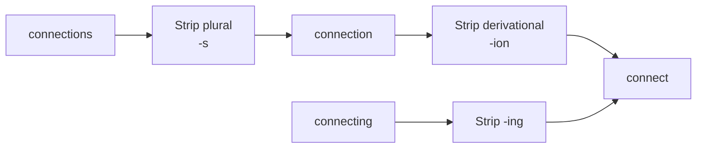
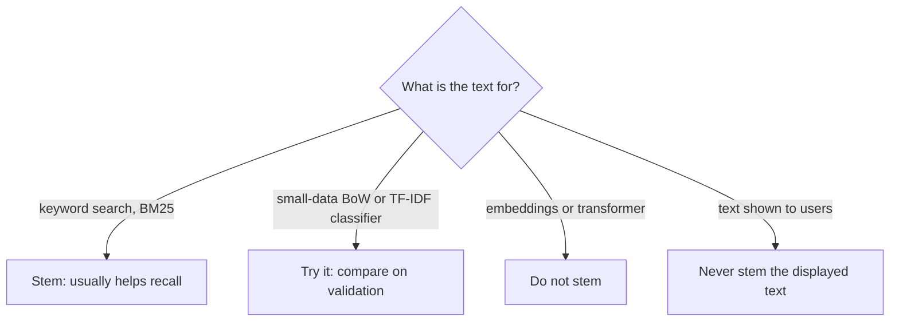

A user searches a help centre for "connecting printers". The best article is titled "How to connect a printer". To a computer, `connecting` and `connect`, `printers` and `printer` are different strings, so a naive keyword match misses it. **Stemming** fixes this by chopping words down to a crude common root, the **stem**, so that `connect`, `connected`, `connecting` and `connection` all become `connect`.

Stemming is fast, rule-based and language-specific. It is still built into search engines such as Elasticsearch and OpenSearch, and it remains a useful knob for classical text classifiers. For transformers it is almost always the wrong thing to do, and this lesson explains why.

## What a stemmer does

A stemmer applies suffix-stripping rules. It does not know what words mean and does not look anything up in a dictionary; it pattern-matches on endings.



The stem does not need to be a real word. The Porter stemmer turns `happiness` into `happi` and `university` into `univers`. That is fine for matching, as long as every form of a word maps to the same stem and different words do not.

### A toy stemmer

To see the idea, here is a deliberately simple suffix stripper in plain Python:

```python
SUFFIXES = ["ational", "ization", "ness", "ing", "ion", "ed", "ly", "es", "s"]

def toy_stem(word: str) -> str:
    for suffix in SUFFIXES:                       # longest suffixes first
        if word.endswith(suffix) and len(word) - len(suffix) >= 3:
            return word[: -len(suffix)]
    return word

for w in ["connecting", "connected", "connection", "connects", "sing", "this", "news"]:
    print(f"{w:12} -> {toy_stem(w)}")
```

```output
connecting   -> connect
connected    -> connect
connection   -> connect
connects     -> connect
sing         -> sing
this         -> thi
news         -> new
```

The length guard stops `sing` becoming `s`, but `this` still becomes `thi` and `news` becomes `new`, conflating two unrelated words. Real stemmers are built from many such rules with conditions on what remains, and they still make mistakes like this.

## The Porter, Snowball and Lancaster stemmers

Three stemmers dominate English, and NLTK implements all of them.

| Stemmer | Published | Character | Notes |
| --- | --- | --- | --- |
| Porter | 1980 | Moderate | The classic; five phases of rules with conditions on the stem |
| Snowball (Porter2) | 2001 | Moderate, refined | Porter's improved version; supports many languages |
| Lancaster (Paice-Husk) | 1990 | Aggressive | Short stems, more over-stemming |

```python
from nltk.stem import PorterStemmer, SnowballStemmer, LancasterStemmer

porter = PorterStemmer()
snowball = SnowballStemmer("english")
lancaster = LancasterStemmer()

words = ["running", "runs", "ran", "easily", "fairly", "generous",
         "generation", "university", "universe", "organization", "organ"]

print(f"{'word':13}{'porter':12}{'snowball':12}{'lancaster'}")
for w in words:
    print(f"{w:13}{porter.stem(w):12}{snowball.stem(w):12}{lancaster.stem(w)}")
```

```output
word         porter      snowball    lancaster
running      run         run         run
runs         run         run         run
ran          ran         ran         ran
easily       easili      easili      easy
fairly       fairli      fair        fair
generous     gener       generous    gen
generation   gener       generat     gen
university   univers     univers     univers
universe     univers     univers     univers
organization organ       organ       org
organ        organ       organ       org
```

Read the table row by row and you can see each stemmer's personality:

- `ran` is untouched by all three. Stemmers cannot handle irregular forms, because no suffix rule turns `ran` into `run`. That needs a dictionary, which is what [lemmatisation](/learn/nlp-fundamentals/lemmatization) adds.
- All three merge `university` and `universe` into `univers`, and all three merge `organization` with `organ`: different meanings, one stem. This is **over-stemming**.
- Porter also merges `generous` with `generation` (`gener`); Snowball keeps them apart. Lancaster cuts both to `gen` and shortens `organ` to `org`.
- Porter turns `fairly` into `fairli`, while Snowball and Lancaster produce `fair`, which matches the adjective. Small refinements like this are why Snowball is the usual default today.

> [!TIP]
> If you need a stemmer, start with Snowball (`SnowballStemmer("english")`). It fixes several of Porter's quirks, is still fast, and has rule sets for many other languages, including German, French, Spanish and Russian.

## Over-stemming and under-stemming

Every stemmer sits somewhere on a trade-off:

| Error | What happens | Example | Effect in search |
| --- | --- | --- | --- |
| Over-stemming | Unrelated words share a stem | `universe`, `university` to `univers` | False matches, lower precision |
| Under-stemming | Related words keep different stems | `ran` vs `run`, `absorb` vs `absorption` | Missed matches, lower recall |

You learned [precision and recall](/learn/model-evaluation/precision) in Module 15. Stemming generally **raises recall** (more relevant documents match) at some **cost to precision** (some irrelevant ones match too). Aggressive stemmers move further along that trade-off.

## Stemming in a scikit-learn pipeline

scikit-learn has no stemmer of its own, but `CountVectorizer` and `TfidfVectorizer` accept a custom `tokenizer`. Wrapping a stemmer in one keeps stemming inside the fitted pipeline:

```python
import re
from sklearn.feature_extraction.text import CountVectorizer

def stem_tokenizer(text):
    return [snowball.stem(t) for t in re.findall(r"[a-z]+", text.lower())]

docs = ["The printer is connected.", "Connecting printers is easy.", "Printing failed."]

vec = CountVectorizer(tokenizer=stem_tokenizer, token_pattern=None)
X = vec.fit_transform(docs)
print(vec.get_feature_names_out())
print(X.toarray())
```

```output
['connect' 'easi' 'fail' 'is' 'print' 'printer' 'the']
[[1 0 0 1 0 1 1]
 [1 1 0 1 0 1 0]
 [0 0 1 0 1 0 0]]
```

`connected` and `connecting` now share the column `connect`, and `printer` and `printers` share `printer`, so the first two documents overlap strongly. Notice the under-stemming too: `printing` became `print`, a separate feature from `printer`. Passing `token_pattern=None` tells scikit-learn you are deliberately replacing the default tokenization (otherwise it warns that the pattern is unused).

## Where stemming still matters



- **Keyword and BM25 search.** Search engines stem both documents and queries with the same analyser so that word forms match. This is the most important surviving use, including the keyword half of hybrid search in RAG systems.
- **Classical classifiers with little data.** Merging word forms gives each feature more examples. With large datasets the benefit usually shrinks, because the model sees enough of every form to learn them separately.
- **Transformers and embedding models.** Do not stem. These models were trained on natural text with subword tokenizers that already share pieces between `connect` and `connecting`. Feeding them `happi` and `univers` makes the input look unlike anything in training and typically hurts quality.

> [!WARNING]
> Stemming is applied to text for matching and features only. Never show stemmed text to users, and never stem text you will pass to an LLM to read.

## Exercises

**1.** Find a pair of unrelated English words that the Porter stemmer maps to the same stem (other than the ones above), and a pair of related words it fails to merge. Verify with `PorterStemmer().stem`.

<details>
<summary>Show solution</summary>

```python
p = PorterStemmer()
print(p.stem("experiment"), p.stem("experience"))
print(p.stem("communism"), p.stem("community"))
print(p.stem("absorb"), p.stem("absorption"))
print(p.stem("index"), p.stem("indices"))
```

```output
experi experi
commun commun
absorb absorpt
index indic
```

`experiment` and `experience` collapse to `experi`, and `communism` and `community` to `commun` (over-stemming), while `absorb` and `absorption`, and `index` and `indices`, stay apart (under-stemming). Many other answers are possible.

</details>

**2.** Build two pipelines, `CountVectorizer()` and `CountVectorizer(tokenizer=stem_tokenizer, token_pattern=None)`, fit them on the three `docs` above and compare vocabulary sizes. Why does stemming make the vocabulary smaller?

<details>
<summary>Show solution</summary>

```python
plain = CountVectorizer().fit(docs)
stemmed = CountVectorizer(tokenizer=stem_tokenizer, token_pattern=None).fit(docs)
print(len(plain.vocabulary_), len(stemmed.vocabulary_))
```

```output
9 7
```

Every set of word forms that shares a stem collapses into a single feature (`connected` and `connecting` become `connect`; `printer` and `printers` become `printer`), so there are fewer distinct features.

</details>

```quiz
[
  {
    "q": "Why does no standard stemmer map `ran` to `run`?",
    "options": ["`ran` is a stop word", "`ran` is too short to stem", "The Porter stemmer is broken", "Stemmers only strip suffixes by rule; irregular forms need a dictionary lookup"],
    "answer": 3,
    "why": "Stemmers apply suffix rules without a dictionary, so irregular forms like ran are untouched. Lemmatisation handles them."
  },
  {
    "q": "In a search engine, what is the usual effect of stemming documents and queries?",
    "options": ["No effect on retrieval", "Higher precision, lower recall", "Higher recall, possibly lower precision", "It only affects ranking speed"],
    "answer": 2,
    "why": "More word forms match each query (recall up), but over-stemming creates some false matches (precision can drop)."
  },
  {
    "q": "Which statement about stemming and transformer models is most accurate?",
    "options": ["Stemming usually hurts, because the model was trained on natural text and its subword tokenizer already shares pieces between word forms", "Transformers require stemmed input", "Stemming always improves transformer accuracy", "Stemming only matters for GPT models"],
    "answer": 0,
    "why": "Stemmed text looks unlike the training distribution, and subword tokenization already captures shared roots."
  },
  {
    "q": "Which stemmer is the most aggressive of the three common English ones?",
    "options": ["Porter", "Snowball", "They are identical", "Lancaster"],
    "answer": 3,
    "why": "Lancaster (Paice-Husk) produces the shortest stems and over-stems the most."
  }
]
```
