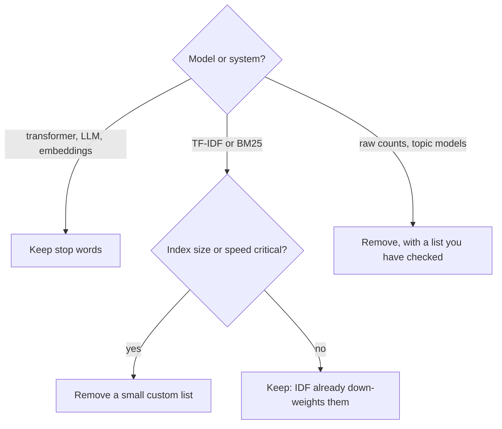

Count the words in almost any English document and the top of the list is always the same: `the`, `of`, `and`, `to`, `a`, `in`. These **stop words** are grammatically essential but, for a bag-of-words model, carry almost no information about what the document is *about*. Removing them shrinks the vocabulary, speeds up indexing and lets topic-bearing words stand out.

That was the standard advice for decades. Today the picture is more nuanced: stop-word removal can destroy meaning (`not`), weighting schemes such as TF-IDF and BM25 already discount common words automatically, and transformers need every word. This lesson shows how to remove stop words, and how to decide whether you should.

## Why common words are uninformative

Word frequencies in natural language follow a very skewed distribution, often described by **Zipf's law**: the frequency of a word is roughly inversely proportional to its rank, so the second most common word appears about half as often as the first, the third about a third as often, and so on.

$$
f(r) \propto \frac{1}{r}
$$

Here $f(r)$ is the frequency of the word with rank $r$ (rank 1 is the most frequent). The consequence is that a handful of function words account for a large share of all tokens. Because they appear in nearly every document, they do little to distinguish one document from another.

```python
from collections import Counter
import re

text = """The model reads the text and the model predicts the label. A label is
a category, and the category of the text is what the model learns to predict
from the words in the text."""

counts = Counter(re.findall(r"[a-z]+", text.lower()))
print(counts.most_common(8))
```

```output
[('the', 9), ('model', 3), ('text', 3), ('and', 2), ('label', 2), ('a', 2), ('is', 2), ('category', 2)]
```

Even in three sentences about models, `the` is far ahead of `model`, and the content words are mixed in with `and`, `is` and `a`.

## Removing stop words

The mechanics are trivial: keep tokens not in a set.

```python
from sklearn.feature_extraction.text import ENGLISH_STOP_WORDS

tokens = re.findall(r"[a-z]+", text.lower())
content = [t for t in tokens if t not in ENGLISH_STOP_WORDS]
print(len(tokens), "->", len(content))
print(Counter(content).most_common(5))
```

```output
35 -> 15
[('model', 3), ('text', 3), ('label', 2), ('category', 2), ('reads', 1)]
```

Removing stop words cut the token count by more than half and left the words that say what the text is about. In scikit-learn you normally do this inside the vectoriser:

```python
from sklearn.feature_extraction.text import CountVectorizer

docs = ["The battery is not good", "The battery is good", "The screen is very good"]

for stop in [None, "english"]:
    vec = CountVectorizer(stop_words=stop)
    X = vec.fit_transform(docs)
    print(stop, vec.get_feature_names_out())
    print(X.toarray())
```

```output
None ['battery' 'good' 'is' 'not' 'screen' 'the' 'very']
[[1 1 1 1 0 1 0]
 [1 1 1 0 0 1 0]
 [0 1 1 0 1 1 1]]
english ['battery' 'good' 'screen']
[[1 1 0]
 [1 1 0]
 [0 1 1]]
```

Look closely at the second matrix. With stop words removed, `"The battery is not good"` and `"The battery is good"` have **identical** vectors. Any model built on these features cannot tell a complaint from praise. `very` vanished too, along with its intensity.

> [!WARNING]
> Standard stop-word lists include negations (`not`, `no`, `nor`) and intensifiers (`very`). For sentiment analysis, intent detection and anything else where these words change meaning, never use an off-the-shelf list unmodified.

## Lists differ, and some are odd

There is no single correct stop-word list. They differ in size and contents, and you should look at the one you use.

```python
from nltk.corpus import stopwords   # needs: nltk.download("stopwords")

nltk_stops = set(stopwords.words("english"))
print(len(ENGLISH_STOP_WORDS), len(nltk_stops))
for w in ["not", "never", "very", "computer", "system", "fire", "bill", "isn't"]:
    print(f"{w:9} sklearn={w in ENGLISH_STOP_WORDS!s:5} nltk={w in nltk_stops}")
```

```output
318 198
not       sklearn=True  nltk=True
never     sklearn=True  nltk=False
very      sklearn=True  nltk=True
computer  sklearn=False nltk=False
system    sklearn=True  nltk=False
fire      sklearn=True  nltk=False
bill      sklearn=True  nltk=False
isn't     sklearn=False nltk=True
```

scikit-learn's list contains `system`, `fire` and `bill`, which are content words in many domains (an IT ticket about a "system fire" would lose both). Its documentation itself warns that the built-in English list has known issues and that you should consider an alternative. NLTK's list contains contractions such as `isn't`, which only matter if your tokenizer keeps them whole.

| Source | Size here | Notable contents |
| --- | --- | --- |
| scikit-learn `ENGLISH_STOP_WORDS` | 318 | Includes `system`, `fire`, `bill`, number words |
| NLTK `stopwords.words("english")` | 198 | Includes contractions such as `isn't`; omits `never` |
| spaCy `nlp.Defaults.stop_words` | A few hundred | Also flags tokens via `token.is_stop` |

## Custom and corpus-driven stop words

Often the best stop words are specific to your corpus. In a dataset of support tickets, `please`, `thanks` and `hi` appear everywhere and carry no signal; in a dataset of legal contracts, `agreement` and `party` may behave the same way.

Two practical approaches. First, **start from a list and edit it**, for example removing negations and intensifiers:

```python
my_stops = list(ENGLISH_STOP_WORDS - {"not", "no", "nor", "never", "very"})
vec = CountVectorizer(stop_words=my_stops)
print(vec.fit(docs).get_feature_names_out())
```

```output
['battery' 'good' 'not' 'screen' 'very']
```

Second, **let document frequency decide**. `CountVectorizer(max_df=0.8)` ignores terms appearing in more than 80 percent of training documents, which removes corpus-specific filler automatically. Its counterpart `min_df` drops very rare terms.

```python
vec = CountVectorizer(max_df=0.6)   # ignore terms in more than 60 percent of the 3 docs
vec.fit(docs)
all_terms = set(CountVectorizer().fit(docs).get_feature_names_out())
print(vec.get_feature_names_out())
print("dropped:", sorted(all_terms - set(vec.get_feature_names_out())))
```

```output
['not' 'screen' 'very']
dropped: ['battery', 'good', 'is', 'the']
```

`the`, `is` and `good` appear in all three documents and `battery` in two of three (67 percent), so all four were dropped. On this tiny sample that throws away `good` and `battery`, a reminder to set thresholds on realistically sized data.

## Do you need it at all?



- **Raw counts and topic models (such as LDA)** benefit the most, because otherwise the top terms of every topic are function words.
- **TF-IDF and BM25** already assign a low weight to terms that appear in most documents, which is a soft, data-driven version of stop-word removal. You will see the formula in the [TF-IDF lesson](/learn/nlp-fundamentals/tf-idf). Removal still saves index space, but it can break phrase queries such as "to be or not to be" or "The Who", which is one reason many modern search engines keep stop words by default.
- **Transformers and LLMs** should get the full text. Words such as `not`, `to` and `of` carry grammar that the model relies on, and removing them makes the input unlike the training data. Removing stop words to "save tokens" in a prompt usually costs more in quality than it saves.

> [!KEY]
> Stop-word removal is a feature-selection decision, not a cleaning step. Treat it as a hyperparameter: compare a model with and without it on validation data.

## Exercises

**1.** Train two `LogisticRegression` classifiers on this tiny dataset, one with `stop_words="english"` and one without, and predict the label of `"not good at all"`. Explain the difference.

```python
train = ["good phone", "really good", "good battery", "good screen",
         "not good", "not good at all", "not great", "bad battery"]
labels = [1, 1, 1, 1, 0, 0, 0, 0]
```

<details>
<summary>Show solution</summary>

```python
from sklearn.linear_model import LogisticRegression
from sklearn.pipeline import make_pipeline

train = ["good phone", "really good", "good battery", "good screen",
         "not good", "not good at all", "not great", "bad battery"]
labels = [1, 1, 1, 1, 0, 0, 0, 0]

for stop in [None, "english"]:
    model = make_pipeline(CountVectorizer(stop_words=stop), LogisticRegression())
    model.fit(train, labels)
    proba = model.predict_proba(["not good at all"])[0, 1]
    print(stop, model.predict(["not good at all"]), round(proba, 2))
```

```output
None [0] 0.28
english [1] 0.51
```

With stop words kept, `not` is the strongest negative feature and the review is classified as negative. With the English list, `not`, `at` and `all` are removed, leaving only `good`, which mostly appears in positive training reviews, so the model predicts positive. The training examples `"not good"` and `"good battery"` have become nearly indistinguishable.

</details>

**2.** Using `max_df`, find which words appear in more than half of these documents: `["please reset my password thanks", "please help with billing thanks", "app crashes please help", "thanks for the quick reply"]`.

<details>
<summary>Show solution</summary>

```python
tickets = ["please reset my password thanks", "please help with billing thanks",
           "app crashes please help", "thanks for the quick reply"]
vec = CountVectorizer(max_df=0.5).fit(tickets)
full = set(CountVectorizer().fit(tickets).get_feature_names_out())
print(sorted(full - set(vec.get_feature_names_out())))
```

```output
['please', 'thanks']
```

`please` and `thanks` each appear in three of four tickets (75 percent), above the 50 percent threshold. `help` appears in exactly half, which is not more than `max_df=0.5`, so it is kept. These are good candidates for a custom stop-word list in a support-ticket classifier.

</details>

```quiz
[
  {
    "q": "Why does stop-word removal often hurt sentiment classifiers?",
    "options": ["Stop words are always positive", "It makes the vocabulary too large", "Standard lists include negations such as `not`, so opposite reviews can get identical features", "Classifiers cannot handle short documents"],
    "answer": 2,
    "why": "Removing not, no and very erases the words that flip or intensify sentiment."
  },
  {
    "q": "What does `CountVectorizer(max_df=0.8)` do?",
    "options": ["Ignores terms that appear in more than 80 percent of training documents", "Keeps only the 80 percent most frequent words", "Drops 80 percent of documents", "Limits each document to 80 tokens"],
    "answer": 0,
    "why": "max_df sets a document-frequency ceiling, which removes corpus-specific stop words automatically."
  },
  {
    "q": "Why is explicit stop-word removal less important with TF-IDF or BM25 than with raw counts?",
    "options": ["They ignore all short words", "They remove stop words internally by default", "They only work on nouns", "Their inverse document frequency term already gives very common words low weight"],
    "answer": 3,
    "why": "IDF shrinks the weight of terms that occur in most documents, a soft version of stop-word removal."
  },
  {
    "q": "You are sending documents to an LLM for summarisation. Should you remove stop words to save tokens?",
    "options": ["Yes, it saves cost with no downside", "No: the model relies on function words for grammar and meaning, so quality usually drops", "Only for documents in English", "Yes, but only `the` and `a`"],
    "answer": 1,
    "why": "LLMs were trained on natural text; telegraphic input loses meaning (negation, relations) and looks out of distribution."
  }
]
```
