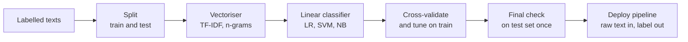
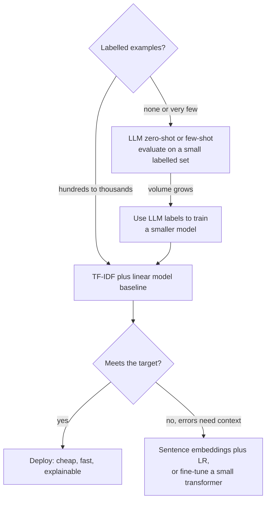

**Text classification** assigns one or more labels from a fixed set to a piece of text. Spam filtering, routing support tickets to the right team, tagging news by topic, detecting the intent behind a chatbot message, flagging toxic content and sentiment analysis are all text classification. It is the most widely deployed NLP task, and it brings together everything in this module: preprocessing, tokenization, vectorisation, and a classifier trained and evaluated with the discipline from the [model evaluation module](/learn/model-evaluation/cross-validation).

This lesson builds a support-ticket router end to end with scikit-learn, compares the standard classical models, tunes and inspects the result, and then asks the question every team now faces: should this be a classical model, a fine-tuned transformer, or a prompt to an LLM?

## The classical pipeline



Wrapping the vectoriser and model in one `Pipeline` matters for two reasons: the vocabulary and idf weights are learned inside each cross-validation fold (no leakage), and the deployed object takes raw strings, so serving cannot drift from training.

## A dataset

Here are 48 short support tickets in four classes, 12 per class. That is tiny, chosen so you can see every example; real projects use hundreds to thousands per class.

```python
tickets = {
    "billing": ["I was charged twice for my subscription this month", "please refund the duplicate payment on my card",
        "my invoice shows the wrong amount", "why did my monthly price go up", "how do I update the credit card on file",
        "cancel my plan and stop charging me", "I need a VAT invoice for last quarter", "the discount code was not applied to my bill",
        "payment failed but money left my account", "can I switch from monthly to annual billing", "you charged me after I cancelled",
        "where can I download past receipts"],
    "technical": ["the app crashes when I open the camera", "error 500 when uploading a file", "the page keeps loading forever",
        "sync stopped working after the latest update", "I get a blank screen on startup", "the export to CSV produces an empty file",
        "notifications are not arriving on android", "search returns no results even for exact names", "the desktop app freezes when I scroll",
        "API requests time out since this morning", "images fail to load in the gallery", "dark mode makes the text unreadable"],
    "account": ["I forgot my password and the reset email never arrives", "how do I change the email address on my account",
        "please delete my account and all my data", "I am locked out after too many login attempts", "two factor authentication codes are not accepted",
        "can I add a second user to my account", "how do I change my username", "my account was hacked, someone changed my password",
        "I cannot log in with my google account", "how do I transfer ownership of the workspace", "verify my identity to unlock my profile",
        "remove an old phone number from my login settings"],
    "shipping": ["my parcel has not arrived after two weeks", "the tracking number does not work", "the box arrived damaged",
        "can you deliver to a different address", "I received the wrong item in my order", "how long does delivery take to Canada",
        "the courier left my package at the wrong house", "my order shows delivered but I have nothing", "do you ship to PO boxes",
        "I want to return the item, how do I get a label", "part of my order is missing", "can I pick up the order from a store instead"],
}
texts = [t for label in tickets for t in tickets[label]]
labels = [label for label in tickets for _ in tickets[label]]
print(len(texts), "tickets,", len(tickets), "classes")
```

```output
48 tickets, 4 classes
```

## Baseline first, then models

With so little data, a single train/test split would be very noisy, so compare models with stratified [cross-validation](/learn/model-evaluation/cross-validation) and macro-averaged F1 (each class counts equally). Always include a trivial baseline: it tells you what "no learning" scores.

```python
from sklearn.dummy import DummyClassifier
from sklearn.feature_extraction.text import TfidfVectorizer
from sklearn.linear_model import LogisticRegression
from sklearn.model_selection import StratifiedKFold, cross_val_score
from sklearn.naive_bayes import MultinomialNB
from sklearn.pipeline import make_pipeline
from sklearn.svm import LinearSVC

cv = StratifiedKFold(n_splits=4, shuffle=True, random_state=0)
models = {
    "majority baseline": DummyClassifier(strategy="most_frequent"),
    "naive Bayes": MultinomialNB(),
    "logistic regression": LogisticRegression(max_iter=1000),
    "linear SVM": LinearSVC(),
}
for name, model in models.items():
    pipe = make_pipeline(TfidfVectorizer(stop_words="english", sublinear_tf=True), model)
    scores = cross_val_score(pipe, texts, labels, cv=cv, scoring="f1_macro")
    print(f"{name:20} macro-F1 = {scores.mean():.3f} +/- {scores.std():.3f}")
```

```output
majority baseline    macro-F1 = 0.100 +/- 0.000
naive Bayes          macro-F1 = 0.583 +/- 0.032
logistic regression  macro-F1 = 0.751 +/- 0.102
linear SVM           macro-F1 = 0.730 +/- 0.069
```

All three real models beat the baseline by a wide margin. Naive Bayes trails here, but the gap between logistic regression and the SVM is well within the fold-to-fold noise of a 48-example dataset, which is itself a lesson: do not crown a winner from tiny differences. On larger datasets, the usual picture is:

| Model | Strengths | Weaknesses |
| --- | --- | --- |
| [Multinomial naive Bayes](/learn/supervised-learning-algorithms/naive-bayes) | Trains instantly, good with very little data | Independence assumption; probabilities poorly calibrated |
| [Logistic regression](/learn/supervised-learning-algorithms/logistic-regression) | Strong default, gives probabilities, interpretable weights | Needs regularisation tuning (`C`) |
| [Linear SVM](/learn/supervised-learning-algorithms/support-vector-machines) (`LinearSVC`) | Often the most accurate linear model on sparse text | No probabilities without calibration |
| Tree ensembles (XGBoost, random forests) | Excellent on tabular data | Usually worse than linear models on sparse, high-dimensional text |

> [!TIP]
> For a new text classification problem, TF-IDF with unigrams and bigrams plus logistic regression or a linear SVM is the baseline to beat. It trains in seconds, runs on a CPU, and is surprisingly hard to outperform when you have a few thousand labelled examples of clear-cut classes.

## Tuning the whole pipeline

Preprocessing choices are hyperparameters too. `GridSearchCV` can tune vectoriser and model settings together, using the `step__parameter` naming convention:

```python
from sklearn.model_selection import GridSearchCV
from sklearn.pipeline import Pipeline

pipe = Pipeline([("tfidf", TfidfVectorizer(sublinear_tf=True)),
                 ("clf", LogisticRegression(max_iter=1000))])
grid = {
    "tfidf__ngram_range": [(1, 1), (1, 2)],
    "tfidf__stop_words": [None, "english"],
    "clf__C": [1, 10, 100],
}
search = GridSearchCV(pipe, grid, cv=cv, scoring="f1_macro")
search.fit(texts, labels)
print(search.best_params_)
print(round(search.best_score_, 3))

res = search.cv_results_
for params, score in zip(res["params"], res["mean_test_score"]):
    if params["clf__C"] == 1 and params["tfidf__ngram_range"] == (1, 1):
        print("stop_words =", params["tfidf__stop_words"], "->", round(score, 3))
```

```output
{'clf__C': 1, 'tfidf__ngram_range': (1, 1), 'tfidf__stop_words': 'english'}
0.751
stop_words = None -> 0.483
stop_words = english -> 0.751
```

`cv_results_` holds the score of every combination. On this dataset removing stop words helps a lot: with only 36 training tickets per fold, words such as `my`, `the` and `I` add noise that the model cannot learn to ignore. With more data that benefit usually shrinks, which is why it is worth testing rather than assuming. See [grid search](/learn/model-evaluation/grid-search) for the general technique.

> [!WARNING]
> `best_score_` is an optimistic estimate, because you chose the configuration that scored best on those same folds. Report final performance on a test set you have not touched during tuning, or use nested cross-validation when data is scarce.

## Inspecting the model

Two checks catch most problems: what the model relies on, and where it fails.

```python
import numpy as np

best = search.best_estimator_
names = best.named_steps["tfidf"].get_feature_names_out()
coefs = best.named_steps["clf"].coef_
for label, row in zip(best.classes_, coefs):
    print(f"{label:10}", list(names[np.argsort(row)[-5:][::-1]]))
```

```output
account    ['account', 'change', 'login', 'password', 'email']
billing    ['charged', 'invoice', 'monthly', 'card', 'payment']
shipping   ['order', 'arrived', 'does', 'item', 'missing']
technical  ['app', 'file', 'startup', 'blank', 'notifications']
```

Most top features are sensible routing words, but `does` is a shortcut: it happens to appear in two shipping tickets ("the tracking number does not work", "how long does delivery take") and nowhere else. With more data such accidents wash out; with little data, they are worth spotting. Next, out-of-fold predictions and a confusion matrix show which classes get confused:

```python
from sklearn.metrics import confusion_matrix
from sklearn.model_selection import cross_val_predict

pred = cross_val_predict(best, texts, labels, cv=cv)
print(best.classes_)
print(confusion_matrix(labels, pred, labels=best.classes_))
for t, y, p in zip(texts, labels, pred):
    if y != p:
        print(f"{y:>9} -> {p:9} {t}")
```

```output
['account' 'billing' 'shipping' 'technical']
[[ 9  0  0  3]
 [ 1  7  1  3]
 [ 1  1  9  1]
 [ 0  1  0 11]]
  billing -> shipping  my invoice shows the wrong amount
  billing -> technical cancel my plan and stop charging me
  billing -> technical the discount code was not applied to my bill
  billing -> account   payment failed but money left my account
  billing -> technical where can I download past receipts
technical -> billing   sync stopped working after the latest update
  account -> technical two factor authentication codes are not accepted
  account -> technical how do I transfer ownership of the workspace
  account -> technical verify my identity to unlock my profile
 shipping -> account   can you deliver to a different address
 shipping -> billing   the courier left my package at the wrong house
 shipping -> technical do you ship to PO boxes
```

Reading the misclassified tickets is the most valuable debugging step in text classification. Some errors are genuine ambiguity (a payment problem can look like an account problem), some reveal missing vocabulary (words that appear in only one ticket cannot be learned), and some reveal labelling mistakes. Each suggests a different fix: clearer label definitions, more data, or cleaned labels.

## Multi-class and multi-label

The tickets above are **multi-class**: exactly one label each. If a ticket can be both `billing` and `account`, the problem is **multi-label**. In scikit-learn you encode the targets with `MultiLabelBinarizer` and wrap a binary classifier in `OneVsRestClassifier`, which trains one yes/no classifier per label; evaluation then uses per-label or micro/macro-averaged F1.

## Classical model, fine-tuned transformer, or LLM?



| Option | Data needed | Cost per prediction | Handles nuance | Best when |
| --- | --- | --- | --- | --- |
| TF-IDF + linear model | Hundreds+ labels | Negligible | Keywords and short phrases | Clear-cut classes, high volume, need explanations |
| Embeddings + linear model | Fewer labels | Low (one embedding call or model run) | Synonyms, paraphrase | Little data, varied wording |
| Fine-tuned transformer | Thousands of labels | Low to moderate (GPU helps) | Context, negation, long-range cues | High accuracy at high volume |
| LLM prompt (zero/few-shot) | None to a few examples | Highest | Strong, with instructions | New or changing label sets, low volume, prototypes |

LLMs are a strong choice when labels change often (add a class by editing the prompt), when you have no training data, or when volume is low. Their costs are per-request price and latency, sensitivity to prompt wording, and the need to constrain the output to valid labels. Whichever you pick, the evaluation is identical: a held-out, human-labelled test set and per-class metrics. Do not skip it because the model "sounds" right.

> [!KEY]
> Build the cheap baseline first, measure it properly, and read its errors. Then you know whether a transformer or an LLM is buying you accuracy worth its cost, and you have a fallback that runs anywhere.

## Exercises

**1.** Use the tuned `best` pipeline to route three new tickets: `"I was billed for a plan I never ordered"`, `"the app shows error 404 after login"` and `"my package is stuck in customs"`. Which ones do you expect to be difficult, and why?

<details>
<summary>Show solution</summary>

```python
new = ["I was billed for a plan I never ordered",
       "the app shows error 404 after login",
       "my package is stuck in customs"]
for t, p in zip(new, best.predict(new)):
    print(f"{p:10} {t}")
```

```output
billing    I was billed for a plan I never ordered
technical  the app shows error 404 after login
shipping   my package is stuck in customs
```

Look at which words each ticket shares with the training set. `billed`, `404`, `stuck` and `customs` never appear in training, so the model must rely on the remaining words, such as `plan`, `error`, `app`, `login` and `package`. The second ticket mixes technical (`app`, `error`) and account (`login`) vocabulary, so it is ambiguous even for a human. Unseen words are ignored by the vectoriser, which is the core weakness of bag-of-words features with little data.

</details>

**2.** Compare the four-fold cross-validated macro-F1 of the best pipeline with and without `class_weight="balanced"`. Why does it make little difference here, and when would it matter?

<details>
<summary>Show solution</summary>

```python
for cw in [None, "balanced"]:
    p = Pipeline([("tfidf", TfidfVectorizer(sublinear_tf=True, stop_words="english")),
                  ("clf", LogisticRegression(C=search.best_params_["clf__C"], class_weight=cw, max_iter=1000))])
    p.set_params(tfidf__ngram_range=search.best_params_["tfidf__ngram_range"])
    print(cw, round(cross_val_score(p, texts, labels, cv=cv, scoring="f1_macro").mean(), 3))
```

```output
None 0.751
balanced 0.751
```

The classes are perfectly balanced (12 each), so "balanced" weights are all equal and the model is unchanged. Class weighting matters when some classes are much rarer than others, as in the sentiment lesson.

</details>

```quiz
[
  {
    "q": "Why should the TF-IDF vectoriser be inside the pipeline that is cross-validated?",
    "options": ["So the vocabulary and idf weights are learned only from each training fold, avoiding leakage, and serving uses identical preprocessing", "It makes training faster", "TfidfVectorizer cannot be used alone", "To enable GPU acceleration"],
    "answer": 0,
    "why": "Fitting the vectoriser on all data leaks test-fold statistics; a pipeline refits it per fold and is deployed as one object."
  },
  {
    "q": "Three models score macro-F1 of 0.73, 0.75 and 0.75 with standard deviations near 0.1 across 4 folds of 48 examples. What should you conclude?",
    "options": ["The 0.75 models are clearly better", "Use the 0.73 model because it is more stable", "Cross-validation failed", "The differences are within noise; prefer the simplest or cheapest, or collect more data"],
    "answer": 3,
    "why": "Differences smaller than fold-to-fold variation are not evidence of a real difference."
  },
  {
    "q": "In `GridSearchCV`, what does the parameter name `tfidf__ngram_range` refer to?",
    "options": ["A global setting", "The `ngram_range` parameter of the pipeline step named `tfidf`", "A typo; it should use one underscore", "The number of folds"],
    "answer": 1,
    "why": "Pipeline parameters are addressed as step name, double underscore, parameter name."
  },
  {
    "q": "Your label set changes every few weeks and you have almost no labelled data, with a few hundred texts per day. Which approach fits best initially?",
    "options": ["An LLM with a prompt listing the current labels, evaluated on a small labelled sample", "TF-IDF with a linear SVM", "Fine-tune a large transformer", "A naive Bayes model trained on the label names"],
    "answer": 0,
    "why": "LLMs handle changing labels with no training data, and low volume keeps cost manageable; evaluation is still required."
  }
]
```
