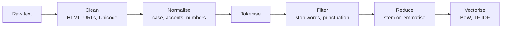
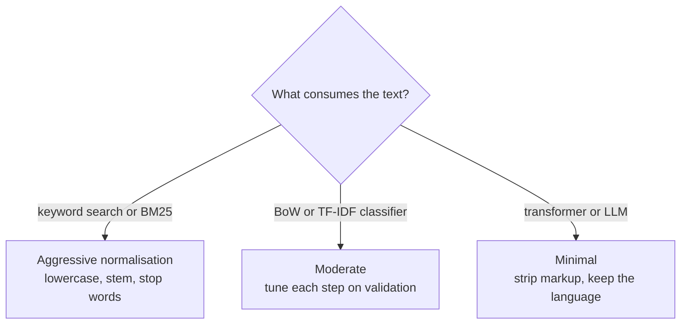

Raw text is messy. A product review arrives with HTML tags, a curly apostrophe, three exclamation marks, an emoji and a URL. A support ticket mixes upper and lower case, accented names and a pasted stack trace. Before a classical model can count words, someone has to decide what a "word" is and which differences between strings matter. That set of decisions is **text preprocessing**, and it quietly determines how well everything downstream works.

This module teaches classical NLP: the techniques that powered search engines, spam filters and sentiment models before large language models, and that still run inside keyword search, cheap high-volume classifiers and the retrieval half of many RAG systems. Throughout, you will see an honest note on which steps still matter when the model is a transformer. Often the answer is "much less than you think".

## What preprocessing is for

A classical model such as bag of words treats `"Great"`, `"great"` and `"great!"` as three unrelated features unless you tell it otherwise. Preprocessing **collapses variation that does not change meaning** so that the model sees fewer, better-populated features. Every step is a trade-off: collapse too little and your vocabulary explodes with near-duplicates; collapse too much and you throw away signal.



The order is not fixed, and you will rarely use every step. The rest of this module gives each stage its own lesson; here you get the overview and a working pipeline.

## The common steps

| Step | Example | Why | Risk |
| --- | --- | --- | --- |
| Strip markup | `<b>Great</b>` to `Great` | Tags are not language | Losing structure such as headings |
| Unicode normalisation | `fi` ligature to `fi`, curly to straight quotes | Same text, different bytes | Rare: NFKC can change some symbols |
| Lowercasing | `Apple` to `apple` | Merges sentence-initial words | Loses `Apple` (company) vs `apple` (fruit), `US` vs `us` |
| Replace URLs, emails, numbers | `https://x.io` to `URL` | Each URL is unique noise | Numbers can matter (prices, versions) |
| Remove punctuation | `great!!!` to `great` | Fewer variants | `!!!` and `?` carry sentiment |
| Stop-word removal | drop `the`, `is` | Shrinks vocabulary | Dropping `not` flips sentiment |
| Stemming or lemmatisation | `running` to `run` | Merges word forms | Over-merging unrelated words |

The "Risk" column is the important one. Each step encodes an assumption about your task, and the assumption can be wrong.

## Building a cleaning function

Python's `re` and `unicodedata` modules cover most cleaning without extra libraries. You met regular expressions in [string manipulation](/learn/python-programming/string-manipulation).

```python
import re
import unicodedata

def clean(text: str) -> str:
    text = unicodedata.normalize("NFKC", text)        # unify equivalent characters
    text = text.replace("\u2019", "'")                # curly apostrophe to straight
    text = re.sub(r"<[^>]+>", " ", text)              # strip HTML tags
    text = text.lower()
    text = re.sub(r"https?://\S+", " url ", text)     # replace links
    text = re.sub(r"\S+@\S+\.\w+", " email ", text)   # replace email addresses
    text = re.sub(r"\d+(\.\d+)?", " num ", text)      # replace numbers
    text = re.sub(r"[^a-z' ]+", " ", text)            # keep letters and apostrophes
    return re.sub(r"\s+", " ", text).strip()          # collapse whitespace

raw = "<p>I didn’t LOVE it… 2 stars. See https://shop.example/r/42 or mail help@shop.example</p>"
print(clean(raw))
```

```output
i didn't love it num stars see url or mail email
```

Placeholder tokens are a deliberate choice: the model learns that "a review contains a link" without memorising every individual link.

> [!WARNING]
> The punctuation step deleted the ellipsis and would delete `!!!` too. For sentiment, that may remove useful signal. Decide per task, and measure: train a model with and without a step and compare on a validation set rather than guessing.

### Accent stripping

Removing accents merges `café` and `cafe`, which helps when users type inconsistently. The standard trick decomposes characters with NFKD and drops the combining marks:

```python
def strip_accents(text: str) -> str:
    decomposed = unicodedata.normalize("NFKD", text)
    return "".join(ch for ch in decomposed if not unicodedata.combining(ch))

print(strip_accents("Café São Paulo naïve Zürich"))
```

```output
Cafe Sao Paulo naive Zurich
```

This is fine for English-centric search, and harmful in languages where accents distinguish words (Spanish `año` and `ano` mean very different things).

## Preprocessing inside scikit-learn

You rarely call a cleaning function by hand in production. scikit-learn's vectorisers accept a `preprocessor` and have built-in options for the commonest steps, so cleaning becomes part of the fitted pipeline and is applied identically at training and prediction time.

```python
from sklearn.feature_extraction.text import CountVectorizer

docs = [
    "<em>Great</em> phone!!! Battery lasts 2 days.",
    "Great PHONE, terrible battery.",
]

plain = CountVectorizer()
cleaned = CountVectorizer(preprocessor=clean)

print(plain.fit(docs).get_feature_names_out())
print(cleaned.fit(docs).get_feature_names_out())
```

```output
['battery' 'days' 'em' 'great' 'lasts' 'phone' 'terrible']
['battery' 'days' 'great' 'lasts' 'num' 'phone' 'terrible']
```

Without cleaning, the HTML tag leaks in as the feature `em`. With cleaning, the number becomes a shared `num` feature. Note that `CountVectorizer` lowercases by default (`lowercase=True`) and its default token pattern drops single characters, which is why `2` vanished from the plain version. When you pass your own `preprocessor`, it replaces the built-in lowercasing and `strip_accents` stage entirely, so your function must do those jobs itself.

> [!KEY]
> Put preprocessing **inside** the model pipeline, not in a separate notebook cell. If training text is cleaned one way and live text another way (training-serving skew), accuracy drops silently and nothing crashes.

## What changes with transformers

Modern transformer models (BERT, GPT-style LLMs) come with their own **subword tokenizer** trained on raw, mostly uncleaned text. That changes the advice substantially.

| Step | Classical model (BoW, TF-IDF, BM25) | Transformer or LLM |
| --- | --- | --- |
| Strip HTML and boilerplate | Yes | Yes: junk wastes context and can confuse the model |
| Unicode normalisation | Yes | Usually harmless; the tokenizer may do it already |
| Lowercasing | Usually | No, unless the model is an "uncased" model |
| Remove punctuation | Often | No: punctuation carries meaning the model uses |
| Stop-word removal | Often for search | No: "not", "to" and "of" matter to grammar |
| Stemming or lemmatisation | Often for search | No: the model was trained on natural text |

The rule of thumb: for transformers, **clean the container, not the language**. Remove markup, duplicated boilerplate, encoding garbage and personal data you should not send; leave the words, case and punctuation alone so the input looks like the text the model was trained on.



## Common pitfalls

- **Fitting on everything.** Learning a vocabulary or stop-word list from the whole dataset, test set included, is a mild form of data leakage. Fit preprocessing on training data only, which a scikit-learn `Pipeline` does for you.
- **Destroying negation.** Stop-word lists usually contain `not`, `no` and `nor`. Removing them turns "not good" into "good".
- **Forgetting the query side.** In search, documents and queries must go through exactly the same normalisation, or a stemmed index will never match an unstemmed query.
- **Over-cleaning code, IDs and names.** Lowercasing and punctuation stripping turn `C++`, `C#` and `c` into the same token, and mangle product codes such as `X-200`.

## Exercises

**1.** Modify `clean` so that it keeps `!` and `?` as their own tokens (for example `great!!!` becomes `great ! ! !`), which can help a sentiment model. Test it on `"Great!!! Really?"`.

<details>
<summary>Show solution</summary>

Pad the punctuation with spaces before the filtering regex, and allow those characters through it:

```python
def clean_keep_marks(text: str) -> str:
    text = unicodedata.normalize("NFKC", text).replace("’", "'")
    text = re.sub(r"<[^>]+>", " ", text)
    text = re.sub(r"https?://\S+", " url ", text.lower())
    text = re.sub(r"([!?])", r" \1 ", text)
    text = re.sub(r"[^a-z'!? ]+", " ", text)
    return re.sub(r"\s+", " ", text).strip()

print(clean_keep_marks("Great!!! Really?"))
```

```output
great ! ! ! really ?
```

Note that `CountVectorizer`'s default `token_pattern` ignores single characters, so you would also need `token_pattern=r"[^ ]+"` to keep `!` as a feature.

</details>

**2.** A colleague lowercases everything before training a sentiment model on tweets. Give two examples where lowercasing loses information, and suggest how you could keep that information as a feature instead.

<details>
<summary>Show solution</summary>

Shouting (`"THIS IS AWFUL"` vs `"this is awful"`) and named entities (`"Apple"` the company vs `"apple"` the fruit, `"US"` vs `"us"`). You can lowercase for the word features and add a separate numeric feature such as the fraction of upper-case letters, or a token like `ALLCAPS` emitted before shouted words.

</details>

**3.** You are building a hybrid search system: BM25 keyword search plus an embedding model. Which preprocessing steps would you apply to each side?

<details>
<summary>Show solution</summary>

For BM25: strip markup, lowercase, normalise Unicode and accents, remove stop words and stem, applied identically to documents and queries. For the embedding model: strip markup and boilerplate only, keeping case, punctuation and stop words, because the embedding model was trained on natural text and uses those cues.

</details>

```quiz
[
  {
    "q": "Why should text preprocessing live inside a scikit-learn pipeline rather than a separate script?",
    "options": ["It runs faster", "It removes the need for a validation set", "scikit-learn refuses raw text otherwise", "It guarantees training and prediction text are processed identically"],
    "answer": 3,
    "why": "Identical processing at training and serving time prevents training-serving skew, a silent cause of accuracy loss."
  },
  {
    "q": "Which preprocessing step is most likely to harm a sentiment classifier if applied blindly?",
    "options": ["Stripping HTML tags", "Removing stop words including 'not'", "Unicode normalisation", "Collapsing repeated whitespace"],
    "answer": 1,
    "why": "Standard stop-word lists contain negations, so 'not good' becomes 'good', flipping the meaning."
  },
  {
    "q": "For input to a modern LLM, what is the best general preprocessing advice?",
    "options": ["Strip markup and junk but keep the natural language intact", "Remove all punctuation", "Lowercase and stem everything", "Remove stop words to save tokens"],
    "answer": 0,
    "why": "Transformers were trained on natural text with their own subword tokenizer; clean the container, not the language."
  },
  {
    "q": "Why replace every URL with a single placeholder token such as `URL`?",
    "options": ["URLs are illegal in training data", "It makes the text shorter for the GPU", "Each URL is nearly unique, so as raw features they add noise; a placeholder keeps the useful fact that a link is present", "Vectorisers crash on slashes"],
    "answer": 2,
    "why": "Unique strings create rare features that do not generalise; a shared placeholder generalises."
  }
]
```
