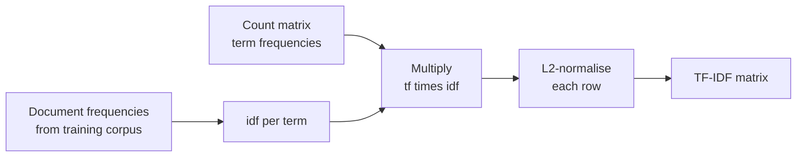

In the bag-of-words lesson, two documents about a cat on a mat and a dog on a log looked 75 percent similar, mainly because both contain `the` twice. Raw counts treat every word as equally informative, but they are not: a word that appears in every document tells you nothing about any particular one, while a word that appears in only a few documents is a strong clue to what those documents are about.

**TF-IDF** (term frequency times inverse document frequency) encodes exactly this intuition. It is one of the most successful ideas in information retrieval, the default text representation for classical classifiers, and the ancestor of BM25, the keyword-ranking function still used in search engines and in the keyword half of hybrid RAG retrieval.

## The idea

A word should get a high weight in a document when it is:

1. **frequent in this document** (the document is about it): the *term frequency*, and
2. **rare across the corpus** (it distinguishes this document from others): the *inverse document frequency*.



## The formula

For a term $t$ and document $d$ in a corpus of $n$ documents:

$$
\text{tfidf}(t, d) = \text{tf}(t, d) \times \text{idf}(t)
$$

where $\text{tf}(t, d)$ is the number of times $t$ occurs in $d$. The textbook inverse document frequency is

$$
\text{idf}(t) = \ln \frac{n}{\text{df}(t)}
$$

where $\text{df}(t)$ is the number of documents containing $t$. A term in every document gets $\ln 1 = 0$; a term in one document out of a thousand gets $\ln 1000 \approx 6.9$.

### The variant scikit-learn uses

There are many TF-IDF variants, and libraries differ. scikit-learn's `TfidfVectorizer` with its defaults (`smooth_idf=True`, `sublinear_tf=False`, `norm="l2"`) computes:

$$
\text{idf}(t) = \ln \frac{1 + n}{1 + \text{df}(t)} + 1
$$

- The **+1 inside the fraction** ("smoothing") acts as if one extra document contained every term, which prevents division by zero.
- The **+1 outside** means a term in every document gets weight 1 rather than 0, so it is down-weighted but not deleted.

Then each document's vector is divided by its Euclidean (L2) norm, $\mathbf{v} / \lVert \mathbf{v} \rVert_2$, so every row has length 1. That makes the dot product of two rows equal to their cosine similarity.

> [!NOTE]
> When you compare TF-IDF numbers between tools (scikit-learn, Spark, Lucene, a textbook), check the variant first. Different log bases, smoothing and normalisation produce different numbers for the same corpus, all legitimately called TF-IDF.

## A worked example by hand

Use the three documents from the bag-of-words lesson ($n = 3$):

| | Document |
| --- | --- |
| $d_1$ | the cat sat on the mat |
| $d_2$ | the dog sat on the log |
| $d_3$ | the cat chased the dog |

**Step 1: document frequencies and idf** with the smoothed formula, $\text{idf}(t) = \ln\frac{4}{1 + \text{df}(t)} + 1$:

| Terms | $\text{df}$ | Calculation | $\text{idf}$ |
| --- | --- | --- | --- |
| `the` | 3 | $\ln(4/4) + 1$ | 1.0000 |
| `cat`, `dog`, `sat`, `on` | 2 | $\ln(4/3) + 1$ | 1.2877 |
| `mat`, `log`, `chased` | 1 | $\ln(4/2) + 1$ | 1.6931 |

**Step 2: multiply by term frequencies** for $d_1$. `the` occurs twice, the others once:

| Term | tf | tf times idf |
| --- | --- | --- |
| `the` | 2 | 2.0000 |
| `cat` | 1 | 1.2877 |
| `sat` | 1 | 1.2877 |
| `on` | 1 | 1.2877 |
| `mat` | 1 | 1.6931 |

**Step 3: L2-normalise.** The norm is

$$
\sqrt{2.0000^2 + 3 \times 1.2877^2 + 1.6931^2} = \sqrt{4 + 4.9745 + 2.8667} = \sqrt{11.8412} \approx 3.4411
$$

Dividing each value by 3.4411 gives `the` 0.5812, `cat`, `sat` and `on` 0.3742 each, and `mat` 0.4920. Even though `the` occurs twice, its weight is now close to the single occurrence of `mat`, the word that actually distinguishes this document.

Now check against scikit-learn:

```python
import numpy as np
import pandas as pd
from sklearn.feature_extraction.text import TfidfVectorizer

docs = ["the cat sat on the mat", "the dog sat on the log", "the cat chased the dog"]

tfidf = TfidfVectorizer()          # defaults: smooth_idf=True, norm="l2"
X = tfidf.fit_transform(docs)

terms = tfidf.get_feature_names_out()
print(pd.Series(tfidf.idf_, index=terms).round(4).to_string())
print(pd.DataFrame(X.toarray(), columns=terms).round(4))
```

```output
cat       1.2877
chased    1.6931
dog       1.2877
log       1.6931
mat       1.6931
on        1.2877
sat       1.2877
the       1.0000
      cat  chased     dog    log    mat      on     sat     the
0  0.3742  0.0000  0.0000  0.000  0.492  0.3742  0.3742  0.5812
1  0.0000  0.0000  0.3742  0.492  0.000  0.3742  0.3742  0.5812
2  0.4035  0.5306  0.4035  0.000  0.000  0.0000  0.0000  0.6267
```

The idf values and the first row match the hand calculation. The fitted `idf_` attribute holds the learned weights: like a vocabulary, they come from the training corpus only and are reused unchanged when you `transform` new documents.

## Similarity improves

Repeat the similarity comparison from the bag-of-words lesson:

```python
from sklearn.feature_extraction.text import CountVectorizer
from sklearn.metrics.pairwise import cosine_similarity

counts = CountVectorizer().fit_transform(docs)
print("counts:\n", cosine_similarity(counts).round(2))
print("tf-idf:\n", cosine_similarity(X).round(2))
```

```output
counts:
 [[1.   0.75 0.67]
 [0.75 1.   0.67]
 [0.67 0.67 1.  ]]
tf-idf:
 [[1.   0.62 0.52]
 [0.62 1.   0.52]
 [0.52 0.52 1.  ]]
```

The similarity between $d_1$ and $d_2$ drops from 0.75 to 0.62, because their shared words (`the`, `sat`, `on`) are common across the corpus and so carry less weight. On real corpora with thousands of documents the effect is much stronger: function words get idf close to 1 while distinctive terms get much larger weights.

## Useful options

| Option | Effect | When |
| --- | --- | --- |
| `sublinear_tf=True` | Replaces tf with $1 + \ln(\text{tf})$ | Long documents where a word repeated 50 times should not count 50 times as much |
| `smooth_idf=False` | Uses $\ln\frac{n}{\text{df}} + 1$ | Matching another tool's variant |
| `use_idf=False` | Term frequency only (then normalised) | Ablation, or very short texts |
| `norm=None` | Skip row normalisation | When a downstream step normalises |
| `min_df`, `max_df`, `ngram_range`, `stop_words` | Same as `CountVectorizer` | Vocabulary control |

`TfidfVectorizer` is equivalent to `CountVectorizer` followed by `TfidfTransformer`, which is handy if you already have count features.

## TF-IDF in practice

TF-IDF features with a linear model are a strong baseline for text classification, and TF-IDF vectors with cosine similarity make a workable small search engine:

```python
corpus = [
    "How to reset your password",
    "Updating billing details and payment card",
    "Password requirements and account security",
    "Exporting reports to CSV",
]
search = TfidfVectorizer(stop_words="english").fit(corpus)
doc_vecs = search.transform(corpus)

query = "forgot my password"
scores = cosine_similarity(search.transform([query]), doc_vecs)[0]
for i in scores.argsort()[::-1][:2]:
    print(round(scores[i], 3), corpus[i])
```

```output
0.619 How to reset your password
0.414 Password requirements and account security
```

`forgot` is not in the vocabulary and `my` is a stop word, so only `password` matches. The shorter first document ranks higher because, after normalisation, `password` makes up a larger share of it. Keyword search cannot know that "forgot" relates to "reset"; that gap is what embedding-based semantic search fills.

### BM25: TF-IDF for search

Search engines usually rank with **BM25**, a refinement of TF-IDF. For a query $q$ and document $d$:

$$
\text{BM25}(q, d) = \sum_{t \in q} \text{idf}(t) \cdot \frac{\text{tf}(t, d)\,(k_1 + 1)}{\text{tf}(t, d) + k_1 \left(1 - b + b \frac{|d|}{\text{avgdl}}\right)}
$$

Here $|d|$ is the document's length in tokens, $\text{avgdl}$ the average document length, $k_1$ (commonly between about 1.2 and 2) controls how quickly repeated terms **saturate**, and $b$ (commonly 0.75) controls **length normalisation**. The two improvements over plain TF-IDF are that the tenth occurrence of a word adds far less than the first, and long documents are not unfairly favoured.

> [!KEY]
> TF-IDF and BM25 are not obsolete. They are cheap, need no training, handle exact matches (product codes, names, error messages) that embedding models often miss, and are a standard component of hybrid retrieval alongside embeddings.

## Exercises

**1.** Compute by hand the scikit-learn TF-IDF vector for $d_3$ = "the cat chased the dog", then verify it against row 3 of `X`.

<details>
<summary>Show solution</summary>

Raw values: `the` $2 \times 1 = 2$, `cat` 1.2877, `chased` 1.6931, `dog` 1.2877. Norm: $\sqrt{4 + 2(1.6582) + 2.8667} = \sqrt{10.1831} \approx 3.1911$. Normalised: `the` 0.6267, `cat` 0.4035, `chased` 0.5306, `dog` 0.4035, matching the third row of the DataFrame above.

</details>

**2.** Refit with `smooth_idf=False` and print `idf_`. Which terms change most, and why does the unsmoothed version give a term in every document exactly 1?

<details>
<summary>Show solution</summary>

```python
raw = TfidfVectorizer(smooth_idf=False).fit(docs)
print(pd.Series(raw.idf_, index=raw.get_feature_names_out()).round(4).to_string())
```

```output
cat       1.4055
chased    2.0986
dog       1.4055
log       2.0986
mat       2.0986
on        1.4055
sat       1.4055
the       1.0000
```

Without smoothing, idf is $\ln(n/\text{df}) + 1$: `the` gets $\ln(3/3) + 1 = 1$, and the rare terms rise most, to $\ln 3 + 1 \approx 2.0986$. Smoothing pulls rare-term weights down slightly.

</details>

**3.** Why must the idf weights be learned on the training set only, and what happens to a term that appears only in the test set?

<details>
<summary>Show solution</summary>

idf values are statistics of the corpus; computing them on test data leaks information about the test distribution into the features. A term that appears only in the test set is not in the fitted vocabulary, so it has no column and is ignored by `transform`, exactly as with `CountVectorizer`.

</details>

```quiz
[
  {
    "q": "With scikit-learn's default smoothed idf, what weight does a term that appears in every document receive?",
    "options": ["0", "1", "It is removed from the vocabulary", "ln(n)"],
    "answer": 1,
    "why": "idf = ln((1+n)/(1+n)) + 1 = 1, so the term is kept but not boosted."
  },
  {
    "q": "Why does `TfidfVectorizer` L2-normalise each row by default?",
    "options": ["So that long documents do not get larger scores, and the dot product of two rows equals their cosine similarity", "To make values integers", "To remove stop words", "To make the matrix dense"],
    "answer": 0,
    "why": "Unit-length rows remove the length effect and make dot products equal cosine similarities."
  },
  {
    "q": "A term appears in 1 of 3 documents. Using scikit-learn's smoothed formula, what is its idf?",
    "options": ["ln(3) + 1", "ln(4/3) + 1", "ln(2) + 1", "1"],
    "answer": 2,
    "why": "idf = ln((1+3)/(1+1)) + 1 = ln(2) + 1, about 1.6931."
  },
  {
    "q": "What does BM25 add on top of basic TF-IDF?",
    "options": ["Word embeddings", "Term-frequency saturation and document-length normalisation", "Stemming", "A neural network"],
    "answer": 1,
    "why": "BM25 makes repeated occurrences of a term saturate (controlled by k1) and normalises for document length relative to the average (controlled by b)."
  }
]
```
