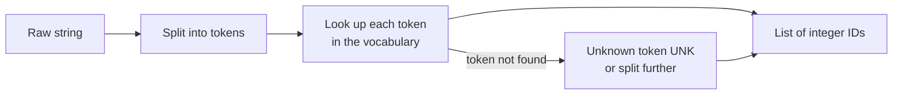

A model cannot read a string. Before any counting, embedding or attention happens, text must be cut into units, and each unit mapped to an integer ID. That cutting is **tokenization**, and the units are **tokens**. The choice of unit decides what a model can and cannot represent: whether it can handle a word it has never seen, how long your sequences are, and, for LLM APIs, how much each request costs.

This lesson covers the three families of tokenizer: word, character and subword, ending with a step-by-step trace of byte-pair encoding (BPE), the algorithm behind most modern LLM tokenizers.

## From text to IDs

Every tokenizer, simple or sophisticated, does the same two jobs.



The **vocabulary** is the fixed set of tokens the tokenizer knows. What happens to a token outside the vocabulary, the **out-of-vocabulary (OOV)** problem, is the main thing that separates the three approaches.

## Word tokenization

The obvious unit is the word. The naive version splits on whitespace:

```python
text = "Don't panic: the U.K. model costs £3.50, isn't it?"
print(text.split())
```

```output
["Don't", 'panic:', 'the', 'U.K.', 'model', 'costs', '£3.50,', "isn't", 'it?']
```

Punctuation sticks to words, so `it?` and `it` would be different tokens. A regular expression does better. scikit-learn's vectorisers use the pattern `(?u)\b\w\w+\b` by default: runs of two or more word characters.

```python
import re

print(re.findall(r"(?u)\b\w\w+\b", text))
print(re.findall(r"\w+|[^\w\s]", text))
```

```output
['Don', 'panic', 'the', 'model', 'costs', '50', 'isn', 'it']
['Don', "'", 't', 'panic', ':', 'the', 'U', '.', 'K', '.', 'model', 'costs', '£', '3', '.', '50', ',', 'isn', "'", 't', 'it', '?']
```

The first pattern silently drops single characters, so `Don't` loses its `t` and `£3.50` keeps only `50`. The second keeps punctuation as tokens but turns `U.K.` into four pieces. Real word tokenizers such as NLTK's `word_tokenize` encode many English-specific rules, for example splitting contractions the way the Penn Treebank does:

```python
from nltk.tokenize import word_tokenize   # needs: nltk.download("punkt_tab")

print(word_tokenize(text))
```

```output
['Do', "n't", 'panic', ':', 'the', 'U.K.', 'model', 'costs', '£3.50', ',', 'is', "n't", 'it', '?']
```

`n't` becomes its own token, which is useful: negation is now a feature a model can learn.

Word tokenization has two fundamental problems:

- **Vocabulary size.** English has hundreds of thousands of word forms, plus names, typos and new coinages. A vocabulary that covers them all is enormous, and most entries are rare.
- **Out-of-vocabulary words.** Any word not seen in training, such as `unfollowable` or a misspelling like `recieve`, collapses to a single `UNK` token, and its meaning is lost.

## Character tokenization

At the other extreme, make every character a token. The vocabulary is tiny (a few hundred symbols for most languages) and there is no OOV problem: any string can be spelled out.

```python
print(list("tokens!"))
```

```output
['t', 'o', 'k', 'e', 'n', 's', '!']
```

The cost is length. A sentence of 10 words becomes 50 or more tokens, and each token carries almost no meaning on its own, so the model must spend capacity learning to assemble characters into words. For attention-based models, whose cost grows with the square of sequence length, that is expensive.

Character **n-grams** are a useful middle ground for classical models: `CountVectorizer(analyzer="char_wb", ngram_range=(3, 5))` represents each word by its overlapping 3 to 5 character pieces, which makes a classifier robust to typos and spelling variants. You will meet this in the [n-grams lesson](/learn/nlp-fundamentals/n-grams).

## Subword tokenization

Subword tokenizers take the best of both: frequent words stay whole, rare words are split into meaningful, reusable pieces.

| Word | Plausible subword split |
| --- | --- |
| `the` | `the` |
| `tokenization` | `token` + `ization` |
| `unfollowable` | `un` + `follow` + `able` |
| `recieve` (typo) | `rec` + `ieve` |

No word is ever unknown, because in the worst case it falls back to single characters (or single bytes). Sequence lengths stay reasonable because common words are one token. The vocabulary size is a hyperparameter, typically tens of thousands to a few hundred thousand entries for modern LLMs.

| Tokenizer | Vocabulary | OOV handling | Sequence length | Used by |
| --- | --- | --- | --- | --- |
| Word | Very large | `UNK` | Short | Classical NLP, BoW, Word2Vec |
| Character | Tiny | None needed | Very long | Some specialised models |
| Subword (BPE, WordPiece, Unigram) | Chosen, moderate | Split into pieces | Moderate | Essentially all transformers |

### Byte-pair encoding (BPE)

BPE learns its vocabulary from a corpus by repeated merging:

1. Start with every word split into characters, plus an end-of-word marker (`_` here).
2. Count every pair of adjacent symbols, weighted by word frequency.
3. Merge the most frequent pair into a new symbol, and record the merge.
4. Repeat until the vocabulary reaches the target size.

Here is a complete, runnable implementation on a classic toy corpus: the word `low` appears 5 times, `lower` 2, `newest` 6 and `widest` 3.

```python
from collections import Counter

def get_pair_counts(vocab):
    pairs = Counter()
    for word, freq in vocab.items():
        symbols = word.split()
        for a, b in zip(symbols, symbols[1:]):
            pairs[(a, b)] += freq
    return pairs

def merge_pair(pair, vocab):
    a, b = pair
    merged = {}
    for word, freq in vocab.items():
        symbols, i, new = word.split(), 0, []
        while i < len(symbols):
            if i < len(symbols) - 1 and symbols[i] == a and symbols[i + 1] == b:
                new.append(a + b)
                i += 2
            else:
                new.append(symbols[i])
                i += 1
        merged[" ".join(new)] = freq
    return merged

vocab = {"l o w _": 5, "l o w e r _": 2, "n e w e s t _": 6, "w i d e s t _": 3}
merges = []
for step in range(5):
    pairs = get_pair_counts(vocab)
    best = max(pairs, key=pairs.get)      # ties go to the pair seen first
    vocab = merge_pair(best, vocab)
    merges.append(best)
    print(step + 1, best, pairs[best], list(vocab))
```

```output
1 ('e', 's') 9 ['l o w _', 'l o w e r _', 'n e w es t _', 'w i d es t _']
2 ('es', 't') 9 ['l o w _', 'l o w e r _', 'n e w est _', 'w i d est _']
3 ('est', '_') 9 ['l o w _', 'l o w e r _', 'n e w est_', 'w i d est_']
4 ('l', 'o') 7 ['lo w _', 'lo w e r _', 'n e w est_', 'w i d est_']
5 ('lo', 'w') 7 ['low _', 'low e r _', 'n e w est_', 'w i d est_']
```

Step through the learning loop to see why each merge wins.

```trace
{
  "title": "learning BPE merges on a toy corpus",
  "code": [
    "vocab = {'l o w _': 5, 'l o w e r _': 2, 'n e w e s t _': 6, 'w i d e s t _': 3}",
    "for step in range(5):",
    "    pairs = get_pair_counts(vocab)",
    "    best = max(pairs, key=pairs.get)",
    "    vocab = merge_pair(best, vocab)",
    "    merges.append(best)"
  ],
  "steps": [
    { "line": 1, "vars": { "vocab": "low_ x5, lower_ x2, newest_ x6, widest_ x3 (all split into characters)" }, "note": "Every word starts as single characters plus an end-of-word marker. The initial vocabulary is just the alphabet." },
    { "line": 3, "vars": { "step": "1", "top pairs": "(e,s)=9, (s,t)=9, (t,_)=9, (w,e)=8" }, "note": "e s occurs in newest (6) and widest (3): 6 + 3 = 9. Pairs are counted once per occurrence, weighted by word frequency." },
    { "line": 5, "vars": { "step": "1", "best": "(e, s)", "vocab": "n e w es t _ | w i d es t _ | ..." }, "note": "Three pairs tie at 9; max returns the first one counted, (e, s). The new symbol es replaces the pair everywhere." },
    { "line": 5, "vars": { "step": "2", "best": "(es, t)", "vocab": "n e w est _ | w i d est _ | ..." }, "note": "Recounting with es as one symbol, (es, t) now has 9. Merges build on earlier merges." },
    { "line": 5, "vars": { "step": "3", "best": "(est, _)", "vocab": "n e w est_ | w i d est_ | ..." }, "note": "est_ is a word-final suffix. The end-of-word marker lets BPE learn that est at the end of a word is different from est inside one." },
    { "line": 5, "vars": { "step": "4", "best": "(l, o)", "vocab": "lo w _ | lo w e r _ | ..." }, "note": "l o appears in low (5) and lower (2): 7, now the highest count." },
    { "line": 6, "vars": { "step": "5", "best": "(lo, w)", "merges": "[es, est, est_, lo, low]" }, "note": "After five merges the vocabulary contains low and est_. The ordered merge list is the tokenizer: encoding new text replays these merges in order." }
  ]
}
```

To **encode** a new word, split it into characters and apply the learned merges in the order they were learned:

```python
def encode(word, merges):
    symbols = " ".join(list(word) + ["_"])
    vocab = {symbols: 1}
    for pair in merges:
        vocab = merge_pair(pair, vocab)
    return next(iter(vocab)).split()

print(encode("lowest", merges))
print(encode("slower", merges))
```

```output
['low', 'est_']
['s', 'low', 'e', 'r', '_']
```

`lowest` never appeared in the corpus, yet it is encoded as two meaningful pieces, `low` and `est_`. In `slower`, the leading `s` and the `er` ending match no learned merge, so they stay as single characters. Production tokenizers learn tens of thousands of merges and usually operate on **bytes** rather than characters (byte-level BPE, used by the GPT family), so even emoji and any script can be represented with no unknown token at all.

### WordPiece and Unigram

Two close relatives are worth recognising:

- **WordPiece** (used by BERT) also merges pairs, but chooses the merge that most increases the likelihood of the training data rather than the raw most frequent pair. Its tokens mark word continuations with `##`, so `tokenization` might appear as `token` + `##ization`.
- **Unigram** (used through the SentencePiece library by models such as T5) works the other way round: it starts with a large candidate vocabulary and prunes the pieces that least reduce the corpus likelihood.

> [!NOTE]
> You will use pretrained subword tokenizers far more often than you train one. The [generative AI tokenization lesson](/learn/generative-ai-fundamentals/tokenization) covers how LLM tokenizers affect context windows, cost and multilingual fairness.

## Practical consequences

> [!KEY]
> A model and its tokenizer are a pair. Always load the tokenizer that was trained with the model. Feeding a model token IDs from a different tokenizer produces garbage without any error.

- **Token counts are not word counts.** For English prose a common rough figure is around three-quarters of a word per token, but code, numbers and non-English text often need many more tokens per word.
- **Spelling and arithmetic quirks.** An LLM sees `strawberry` as one or a few subword IDs, not as letters, which is one reason models can struggle to count characters.
- **For classical NLP**, word tokenization (with the preprocessing from the previous lesson) remains the norm, because features such as bag of words and TF-IDF are meant to be human-readable words.

## Exercises

**1.** Using `get_pair_counts` and `merge_pair`, continue the BPE loop for five more merges (ten in total). What does `newest` look like now, and what is `encode("newer", merges)`?

<details>
<summary>Show solution</summary>

```python
vocab2 = {"l o w _": 5, "l o w e r _": 2, "n e w e s t _": 6, "w i d e s t _": 3}
merges10 = []
for step in range(10):
    pairs = get_pair_counts(vocab2)
    best = max(pairs, key=pairs.get)
    vocab2 = merge_pair(best, vocab2)
    merges10.append(best)
print(list(vocab2))
print(encode("newer", merges10))
```

```output
['low_', 'low e r _', 'newest_', 'wi d est_']
['new', 'e', 'r', '_']
```

After ten merges `newest` has become a single token. `newer` reuses the learned `new` piece and spells out the rest.

</details>

**2.** Why does BPE use an end-of-word marker? Give an example of two tokens it lets the tokenizer distinguish.

<details>
<summary>Show solution</summary>

Without it, a piece at the end of a word and the same letters in the middle of a word would be the same symbol. With the marker, `est_` (a suffix, as in `newest`) differs from `est` (as in `estimate`), so the tokenizer can learn word-final pieces and decoding knows where words end.

</details>

```quiz
[
  {
    "q": "What is the main advantage of subword tokenization over word tokenization?",
    "options": ["It never needs an unknown token because rare words split into known pieces", "It produces the shortest possible sequences", "It does not need a vocabulary", "It ignores punctuation"],
    "answer": 0,
    "why": "Rare and unseen words decompose into subwords (or characters or bytes), so nothing is out of vocabulary while common words stay whole."
  },
  {
    "q": "In BPE training, which pair is merged at each step?",
    "options": ["A random pair", "The longest pair", "The pair of adjacent symbols with the highest frequency-weighted count", "The pair that appears in the most distinct words regardless of frequency"],
    "answer": 2,
    "why": "BPE counts adjacent symbol pairs weighted by word frequency and merges the most frequent one."
  },
  {
    "q": "Why is character-level tokenization rarely used for large transformer models?",
    "options": ["It cannot represent new words", "Sequences become very long, and attention cost grows quickly with length", "It needs a huge vocabulary", "Characters cannot be mapped to integers"],
    "answer": 1,
    "why": "Character tokens produce sequences several times longer than subword tokens, which is expensive for attention."
  },
  {
    "q": "You fine-tune a model but accidentally tokenize the data with a different model's tokenizer. What happens?",
    "options": ["An error is raised immediately", "Only punctuation is affected", "The tokenizers are interchangeable", "The IDs map to the wrong embeddings, so the model sees meaningless input without any error"],
    "answer": 3,
    "why": "Token IDs are only meaningful for the tokenizer the model was trained with; mismatches fail silently."
  }
]
```
