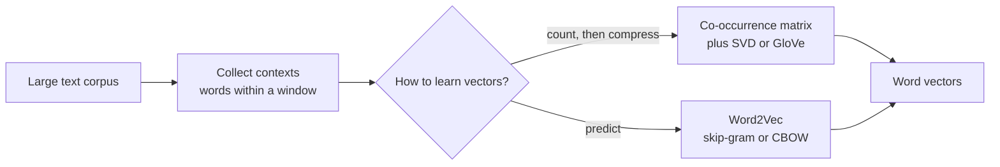

In a bag-of-words vector, `film` and `movie` are two unrelated columns. A classifier that learned "great film" is positive knows nothing about "great movie". Every word is equally different from every other word, so nothing a model learns about one word transfers to its synonyms.

**Word embeddings** fix this by representing each word as a short, dense vector of real numbers, typically 50 to 300 dimensions, arranged so that words with similar meanings have nearby vectors. They were the breakthrough that took NLP from counting to meaning, and the same idea, scaled up and made contextual, is at the heart of every transformer and every embedding model you will use for semantic search and RAG.

## From one-hot to dense vectors

The bag-of-words view of a single word is a **one-hot vector**: a vector the length of the vocabulary with a single 1.

| Representation | `cat` | `dog` | `car` | Similarity of cat and dog |
| --- | --- | --- | --- | --- |
| One-hot ($V = 10{,}000$) | `[0, ..., 1, ..., 0]` | `[0, ..., 1, ..., 0]` | `[0, ..., 1, ..., 0]` | Always 0 |
| Dense embedding ($d = 4$, illustrative) | `[0.8, 0.1, 0.6, -0.2]` | `[0.7, 0.2, 0.5, -0.1]` | `[-0.3, 0.9, 0.0, 0.4]` | High |

One-hot vectors are huge, sparse and mutually [orthogonal](/learn/linear-algebra/dot-product): the dot product of any two different words is zero. Dense embeddings are small, and their geometry carries meaning.

### An embedding is a lookup table

In practice, the embeddings for a vocabulary of $V$ words are the rows of a matrix $E \in \mathbb{R}^{V \times d}$, where $d$ is the embedding dimension. Looking up word $i$ is the same as multiplying its one-hot vector $\mathbf{o}_i$ by $E$:

$$
\mathbf{e}_i = \mathbf{o}_i^\top E
$$

which simply selects row $i$. Libraries skip the multiplication and index the row directly, but the equation explains why an embedding layer in a neural network is just a weight matrix that can be learned by [gradient descent](/learn/calculus/gradient-descent).

```python
import numpy as np

vocab = ["cat", "dog", "car"]
E = np.array([[0.8, 0.1, 0.6, -0.2],
              [0.7, 0.2, 0.5, -0.1],
              [-0.3, 0.9, 0.0, 0.4]])

one_hot_dog = np.array([0, 1, 0])
print(one_hot_dog @ E)        # matrix product
print(E[vocab.index("dog")])  # direct lookup: same row
```

```output
[ 0.7  0.2  0.5 -0.1]
[ 0.7  0.2  0.5 -0.1]
```

## The distributional hypothesis

Where do good embeddings come from? From a simple observation, usually summarised as "you shall know a word by the company it keeps" (J. R. Firth, 1957): **words that occur in similar contexts tend to have similar meanings**. If `cat` and `dog` both appear near `drinks`, `chases` and `sleeps`, they are probably related, even if they never appear together.



Every classical embedding method turns this hypothesis into an algorithm. The next two lessons cover the two most famous, [Word2Vec](/learn/nlp-fundamentals/word2vec) (predict the context) and [GloVe](/learn/nlp-fundamentals/glove) (factorise co-occurrence counts). Here is the simplest version of the counting approach, small enough to run.

## Embeddings from co-occurrence counts

Count how often each word appears within two positions of each other word, then compress the counts with [singular value decomposition](/learn/unsupervised-learning/dimensionality-reduction) (SVD), keeping only the strongest dimensions.

```python
corpus = [
    "cat drinks milk", "dog drinks water", "cat chases mouse", "dog chases ball",
    "cat sleeps on sofa", "dog sleeps on rug", "drive car to work", "drive truck to work",
    "car needs fuel", "truck needs fuel", "park car outside", "park truck outside",
]
sentences = [s.split() for s in corpus]
vocab = sorted({w for s in sentences for w in s})
idx = {w: i for i, w in enumerate(vocab)}

window = 2
C = np.zeros((len(vocab), len(vocab)))
for s in sentences:
    for i, w in enumerate(s):
        for j in range(max(0, i - window), min(len(s), i + window + 1)):
            if j != i:
                C[idx[w], idx[s[j]]] += 1

U, S, Vt = np.linalg.svd(C)
k = 2
emb = U[:, :k] * S[:k]          # 2-dimensional word vectors

def cosine(a, b):
    return a @ b / (np.linalg.norm(a) * np.linalg.norm(b))

for a, b in [("cat", "dog"), ("car", "truck"), ("milk", "water"), ("cat", "car")]:
    raw = cosine(C[idx[a]], C[idx[b]])
    dense = cosine(emb[idx[a]], emb[idx[b]])
    print(f"{a:5} {b:6} counts={raw:.2f}  svd={dense:.2f}")
```

```output
cat   dog    counts=0.67  svd=1.00
car   truck  counts=1.00  svd=1.00
milk  water  counts=0.50  svd=1.00
cat   car    counts=0.00  svd=0.00
```

`cat` and `dog` never occur together, yet they end up with near-identical 2-dimensional vectors, because they share contexts. Compression helps: their raw count rows are only partly similar (0.67), but SVD captures the shared pattern. Animals and vehicles end up orthogonal. This count-then-compress approach is known as latent semantic analysis (LSA) when applied to word-document matrices, and it is a direct ancestor of GloVe.

> [!NOTE]
> Real embeddings are trained on billions of words with hundreds of dimensions, and the dimensions do not correspond to human-readable properties such as "is an animal". Meaning is spread across all of them.

## Measuring similarity

Embedding similarity is almost always **cosine similarity**, the normalised [dot product](/learn/linear-algebra/dot-product):

$$
\cos(\mathbf{u}, \mathbf{v}) = \frac{\mathbf{u}^\top \mathbf{v}}{\lVert \mathbf{u} \rVert \, \lVert \mathbf{v} \rVert} \in [-1, 1]
$$

It compares direction and ignores length. Vector length in embedding spaces often correlates with word frequency rather than meaning, so ignoring it is usually what you want.

## Using pretrained embeddings

You rarely train word vectors yourself. Pretrained sets learned on large corpora are freely available; the `gensim` library can download several, including GloVe vectors trained on Wikipedia and newswire text.

```python
import gensim.downloader as api

glove = api.load("glove-wiki-gigaword-50")   # downloads about 66 MB on first use
print(glove.vector_size, len(glove.key_to_index))
print([(w, round(sim, 3)) for w, sim in glove.most_similar("frog", topn=5)])
print(round(float(glove.similarity("cat", "dog")), 3), round(float(glove.similarity("cat", "car")), 3))
```

```output
50 400000
[('snake', 0.845), ('ape', 0.794), ('toad', 0.791), ('monkey', 0.788), ('spider', 0.772)]
0.922 0.364
```

The neighbours of `frog` are other animals, and `cat` is much closer to `dog` than to `car`. Nobody labelled any of this; it emerged from co-occurrence statistics.

A simple way to turn word vectors into a document vector is to **average** the vectors of its words. It discards word order, like bag of words, but similar documents with different vocabulary ("great film" and "excellent movie") now land close together. Averaged embeddings are a reasonable feature set for a small classifier when you have little labelled data.

## Static versus contextual embeddings

Word2Vec and GloVe give each word **one** vector, regardless of context. That is their main limitation:

| | Static (Word2Vec, GloVe, fastText) | Contextual (BERT, modern embedding models) |
| --- | --- | --- |
| Vectors per word | One | One per occurrence, depending on the sentence |
| `bank` in "river bank" vs "bank loan" | Same vector, a blend of senses | Different vectors |
| Unknown words | No vector (fastText builds one from character n-grams) | Subword tokens always have vectors |
| Cost | Cheap lookup | Run a transformer |
| Typical use today | Lightweight features, teaching, some search | Semantic search, RAG, classification |

> [!KEY]
> Modern sentence and document embedding models, the ones behind semantic search and RAG, are the direct descendants of word embeddings: they still map text to vectors whose cosine similarity reflects meaning, but each vector is computed by a transformer from the whole input. The [generative AI embeddings lesson](/learn/generative-ai-fundamentals/embeddings) picks up the story from here.

## Exercises

**1.** Using the co-occurrence example, print the cosine similarity between `milk` and `fuel` in the 2-dimensional SVD space, and explain the result.

<details>
<summary>Show solution</summary>

```python
print(round(cosine(emb[idx["milk"]], emb[idx["fuel"]]), 2))
```

```output
0.0
```

Both are things that are consumed, but in this corpus `milk` only co-occurs with animal words and `fuel` only with vehicle words, so their contexts do not overlap and they land in different directions. Embeddings reflect the corpus, not the world.

</details>

**2.** Write a function `doc_vector(text, kv)` that averages the GloVe vectors of the words in `text` that exist in the vocabulary, and compare `"a great film"` with `"an excellent movie"` and with `"a slow truck"` by cosine similarity.

<details>
<summary>Show solution</summary>

```python
def doc_vector(text, kv):
    vecs = [kv[w] for w in text.lower().split() if w in kv.key_to_index]
    return np.mean(vecs, axis=0)

a = doc_vector("a great film", glove)
b = doc_vector("an excellent movie", glove)
c = doc_vector("a slow truck", glove)
print(round(float(cosine(a, b)), 3), round(float(cosine(a, c)), 3))
```

```output
0.945 0.725
```

The two film phrases share no words, but their averaged vectors are clearly closer to each other than to the truck phrase. The truck score is still fairly high, partly because the averaged article `a` and generic words pull all short phrases towards a common direction, one weakness of simple averaging. A bag-of-words model would give the first pair a similarity of zero (after removing `a` and `an`).

</details>

```quiz
[
  {
    "q": "What is the cosine similarity between the one-hot vectors of two different words?",
    "options": ["1", "-1", "0", "It depends on the words"],
    "answer": 2,
    "why": "One-hot vectors of different words have their 1 in different positions, so their dot product is 0."
  },
  {
    "q": "What does the distributional hypothesis state?",
    "options": ["Words are distributed uniformly in text", "Words that occur in similar contexts tend to have similar meanings", "Rare words are more important", "Embeddings follow a normal distribution"],
    "answer": 1,
    "why": "It is the basis of all classical embedding methods: meaning is inferred from contexts."
  },
  {
    "q": "Multiplying a one-hot row vector for word i by the embedding matrix E gives:",
    "options": ["The sum of all embeddings", "A one-hot vector", "A scalar similarity", "Row i of E, the embedding of word i"],
    "answer": 3,
    "why": "The single 1 selects row i, which is why embedding layers are implemented as lookups."
  },
  {
    "q": "What is the main limitation of static embeddings such as Word2Vec and GloVe?",
    "options": ["They are too large to store", "They cannot measure similarity", "Each word has one vector, so different senses (river bank, bank loan) are blended", "They require labelled data"],
    "answer": 2,
    "why": "Static embeddings ignore context; contextual models produce a different vector for each occurrence."
  }
]
```
