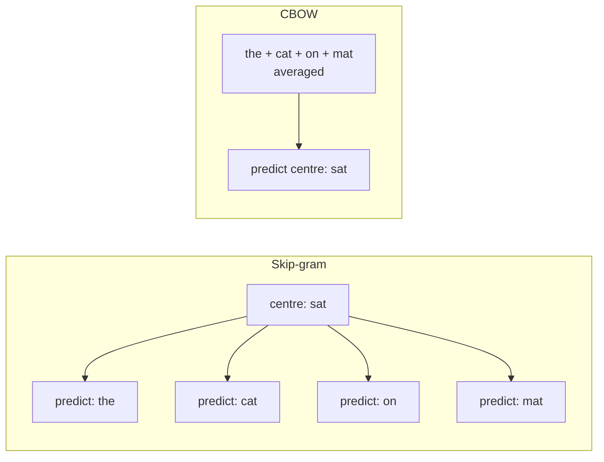

**Word2Vec**, introduced by Tomas Mikolov and colleagues at Google in 2013, turned the distributional hypothesis into a fast, simple neural training task: take a huge pile of text and train a tiny model to predict which words appear near which. The model itself is thrown away afterwards. What you keep is its first weight matrix, which turns out to be an excellent set of word embeddings, with the striking property that vector arithmetic such as `king - man + woman` lands near `queen`.

Word2Vec matters today less as a tool you will deploy and more as an idea you will meet everywhere: self-supervised learning from raw text, embeddings as learned lookup tables, and contrastive training with negative samples all appear again in transformers and modern embedding models.

## The training task

Word2Vec creates a supervised problem from unlabelled text. Slide a window over every sentence; the word in the middle is the **centre** word and the words within $m$ positions on either side are its **context**. There are two ways to set up the prediction:

| Architecture | Predicts | Input | Strengths |
| --- | --- | --- | --- |
| **Skip-gram** | Each context word from the centre word | One word | Better for rare words and smaller corpora |
| **CBOW** (continuous bag of words) | The centre word from its context | Average of context vectors | Faster to train, smooths over frequent words |



Generating skip-gram training pairs is plain Python:

```python
corpus = [
    "cat drinks milk", "dog drinks water", "cat chases mouse", "dog chases ball",
    "cat sleeps on sofa", "dog sleeps on rug", "drive car to work", "drive truck to work",
    "car needs fuel", "truck needs fuel", "park car outside", "park truck outside",
]
sentences = [s.split() for s in corpus]
vocab = sorted({w for s in sentences for w in s})
idx = {w: i for i, w in enumerate(vocab)}

def skipgram_pairs(sentences, window=2):
    pairs = []
    for s in sentences:
        for i, centre in enumerate(s):
            for j in range(max(0, i - window), min(len(s), i + window + 1)):
                if j != i:
                    pairs.append((centre, s[j]))
    return pairs

pairs = skipgram_pairs(sentences)
print(len(pairs), pairs[:6])
```

```output
88 [('cat', 'drinks'), ('cat', 'milk'), ('drinks', 'cat'), ('drinks', 'milk'), ('milk', 'cat'), ('milk', 'drinks')]
```

No labels were needed: the text supervises itself. This is **self-supervised learning**, the same principle LLMs use when they predict the next token.

## The skip-gram model

Each word $w$ has two vectors of dimension $d$: an input (centre) vector $\mathbf{v}_w$ and an output (context) vector $\mathbf{u}_w$. They are the rows of two matrices, $W_{\text{in}}$ and $W_{\text{out}}$, each of size $V \times d$. The model scores a context word $o$ for a centre word $c$ by a dot product and turns scores into probabilities with a softmax over the vocabulary:

$$
P(o \mid c) = \frac{\exp(\mathbf{u}_o^\top \mathbf{v}_c)}{\sum_{w=1}^{V} \exp(\mathbf{u}_w^\top \mathbf{v}_c)}
$$

Training maximises the log-probability of every observed (centre, context) pair, that is, it minimises the [cross-entropy](/learn/essential-mathematics-for-machine-learning/cross-entropy) loss over the corpus:

$$
J = -\sum_{t=1}^{T} \sum_{\substack{-m \le j \le m \\ j \ne 0}} \log P(w_{t+j} \mid w_t)
$$

where $T$ is the number of tokens in the corpus and $m$ the window size. To predict similar contexts, words that occur in similar contexts must end up with similar $\mathbf{v}$ vectors. That is the distributional hypothesis, enforced by gradient descent.

## Negative sampling

The softmax denominator sums over the whole vocabulary, which may be millions of words, for every single training pair. That is far too slow. **Negative sampling** replaces the $V$-way classification with a handful of binary ones: is this (centre, context) pair real, or a fake pair made with a random word?

For each real pair $(c, o)$, draw $k$ "negative" words $n_1, \dots, n_k$ at random and minimise

$$
L = -\log \sigma(\mathbf{u}_o^\top \mathbf{v}_c) - \sum_{i=1}^{k} \log \sigma(-\mathbf{u}_{n_i}^\top \mathbf{v}_c)
$$

where $\sigma(x) = 1/(1 + e^{-x})$ is the [sigmoid](/learn/neural-network-fundamentals/activation-functions). The first term pushes the real pair's score up; the second pushes the fake pairs' scores down. Cost per pair drops from $V$ dot products to $k + 1$, with $k$ typically between 5 and 20 for small datasets and 2 to 5 for large ones, as suggested in the original paper. Negatives are drawn from the unigram distribution raised to the power $3/4$, $P_n(w) \propto \text{count}(w)^{3/4}$, which samples rare words a little more often than their raw frequency.

> [!NOTE]
> Word2Vec also **subsamples** very frequent words: each occurrence of a word like `the` is randomly discarded with a probability that grows with its frequency. This speeds up training and improves vectors for rarer words, a learned-weighting cousin of stop-word removal.

### Training it from scratch

The gradients of $L$ are short. With $s_o = \sigma(\mathbf{u}_o^\top \mathbf{v}_c)$ and $s_i = \sigma(\mathbf{u}_{n_i}^\top \mathbf{v}_c)$:

$$
\frac{\partial L}{\partial \mathbf{v}_c} = (s_o - 1)\,\mathbf{u}_o + \sum_{i=1}^{k} s_i\, \mathbf{u}_{n_i}, \qquad
\frac{\partial L}{\partial \mathbf{u}_o} = (s_o - 1)\,\mathbf{v}_c, \qquad
\frac{\partial L}{\partial \mathbf{u}_{n_i}} = s_i\, \mathbf{v}_c
$$

That is enough to train skip-gram with negative sampling (SGNS) in NumPy. For brevity this version samples negatives uniformly rather than from the $3/4$-power distribution.

```python
import numpy as np

def sigmoid(x):
    return 1 / (1 + np.exp(-x))

rng = np.random.default_rng(0)
V, d, k, lr = len(vocab), 8, 3, 0.05
W_in = rng.normal(0, 0.1, (V, d))     # centre vectors: the embeddings we keep
W_out = rng.normal(0, 0.1, (V, d))    # context vectors
id_pairs = [(idx[c], idx[o]) for c, o in pairs]

for epoch in range(300):
    for c, o in id_pairs:
        negs = rng.integers(0, V, size=k)
        v = W_in[c].copy()
        ctx = np.vstack([W_out[o], W_out[negs]])        # 1 positive + k negatives
        labels = np.array([1.0] + [0.0] * k)
        g = sigmoid(ctx @ v) - labels                    # (s_o - 1, s_1, ..., s_k)
        W_in[c] -= lr * (g @ ctx)
        W_out[o] -= lr * g[0] * v
        np.subtract.at(W_out, negs, lr * g[1:, None] * v)

def similarity(a, b):
    u, w = W_in[idx[a]], W_in[idx[b]]
    return u @ w / (np.linalg.norm(u) * np.linalg.norm(w))

for a, b in [("cat", "dog"), ("car", "truck"), ("milk", "water"), ("cat", "car")]:
    print(f"{a:5} {b:6} {similarity(a, b):.2f}")
```

```output
cat   dog    0.65
car   truck  0.99
milk  water  0.75
cat   car    0.02
```

From 88 training pairs, the model learned that `cat` and `dog` are alike and `car` and `truck` are alike, while animals and vehicles are not. The exact numbers depend on the random seed; the pattern is what matters. Real Word2Vec does exactly this with billions of pairs, 100 to 300 dimensions and optimised C code.

## Word2Vec with gensim

In practice you use `gensim`, whose `Word2Vec` class implements both architectures efficiently:

```python
from gensim.models import Word2Vec

model = Word2Vec(
    sentences=sentences,  # an iterable of token lists
    vector_size=100,      # embedding dimension d
    window=5,             # context window m
    min_count=1,          # ignore words rarer than this (use 5 or more on real data)
    sg=1,                 # 1 = skip-gram, 0 = CBOW (the default)
    negative=5,           # negative samples per positive pair
    epochs=50,
    seed=42,
)
print(model.wv.most_similar("cat", topn=3))
vec = model.wv["dog"]     # a NumPy array of length 100
```

No output is shown because a toy corpus gives unstable neighbours, and gensim's results vary between runs unless you train with a single worker thread and fix Python's hash seed. Train on a large corpus (at least millions of words) to get useful vectors, or use pretrained ones.

## The analogy property

Word2Vec vectors famously encode some relationships as consistent **directions**. If the offset from `man` to `woman` captures a "gender" direction, then adding it to `king` should land near `queen`:

$$
\mathbf{v}_{\text{king}} - \mathbf{v}_{\text{man}} + \mathbf{v}_{\text{woman}} \approx \mathbf{v}_{\text{queen}}
$$

To answer "man is to king as woman is to ?", compute the left-hand side and find the nearest word by cosine similarity, **excluding the three input words** (otherwise `king` itself usually wins). Similar offsets appear for country to capital, verb tense and comparative adjectives. gensim exposes this as `kv.most_similar(positive=["king", "woman"], negative=["man"])`; you will run it on real pretrained vectors in the [GloVe lesson](/learn/nlp-fundamentals/glove).

> [!WARNING]
> Analogies are a striking demonstration, not a reliable reasoning tool. They work for some relation types and fail for many others, published examples are often the successes, and the same arithmetic surfaces social biases learned from the corpus (well-known studies found occupation analogies reflecting gender stereotypes). Embeddings inherit whatever regularities, good or bad, their training text contains.

## Strengths, limits and successors

| Aspect | Word2Vec |
| --- | --- |
| Training data | Raw text only, self-supervised |
| Speed | Very fast; trains on large corpora on a CPU |
| Output | One static vector per word |
| Out-of-vocabulary words | No vector; **fastText** fixed this by summing character n-gram vectors |
| Context sensitivity | None: `bank` has one vector for all senses |

> [!KEY]
> The ideas of Word2Vec live on: predict context from raw text, learn embeddings as a lookup table, and train efficiently by contrasting real pairs against sampled negatives. Contrastive training of modern sentence embedding models is a direct descendant of negative sampling.

## Exercises

**1.** Modify `skipgram_pairs` to produce CBOW examples instead: a list of `(context_words, centre)` tuples. Print the examples for the sentence `"cat drinks milk"` with `window=1`.

<details>
<summary>Show solution</summary>

```python
def cbow_examples(sentences, window=2):
    examples = []
    for s in sentences:
        for i, centre in enumerate(s):
            context = [s[j] for j in range(max(0, i - window), min(len(s), i + window + 1)) if j != i]
            examples.append((context, centre))
    return examples

print(cbow_examples([["cat", "drinks", "milk"]], window=1))
```

```output
[(['drinks'], 'cat'), (['cat', 'milk'], 'drinks'), (['drinks'], 'milk')]
```

CBOW averages the context vectors and predicts the centre word, so each sentence position gives one training example rather than one per context word.

</details>

**2.** In the negative sampling loss, what happens to $L$ when the model scores the real pair very highly and every negative pair very low? Why does sampling only $k$ negatives make training feasible?

<details>
<summary>Show solution</summary>

If $\mathbf{u}_o^\top \mathbf{v}_c$ is large, $\sigma$ of it approaches 1 and $-\log$ of it approaches 0; if every $\mathbf{u}_{n_i}^\top \mathbf{v}_c$ is very negative, $\sigma(-\cdot)$ approaches 1 and those terms also approach 0. So $L \to 0$. Each update touches only $k + 1$ output vectors instead of all $V$, so its cost no longer depends on vocabulary size.

</details>

**3.** Re-run the NumPy training with `rng = np.random.default_rng(1)`. Do the similarities stay the same? What does this tell you about interpreting individual embedding numbers?

<details>
<summary>Show solution</summary>

The exact similarity values change, but the pattern (animals similar to each other, vehicles similar to each other, animal-vehicle pairs less similar) generally remains, though on a corpus this small some seeds give noticeably different values. Individual coordinates and exact scores are artefacts of initialisation and sampling; only relative geometry is meaningful.

</details>

```quiz
[
  {
    "q": "What does the skip-gram architecture predict?",
    "options": ["The centre word from the averaged context", "Each context word from the centre word", "The next sentence", "The part of speech of each word"],
    "answer": 1,
    "why": "Skip-gram uses the centre word to predict each word in its window; CBOW does the reverse."
  },
  {
    "q": "Why is negative sampling used instead of the full softmax?",
    "options": ["It gives more accurate probabilities", "It removes stop words", "Softmax cannot be differentiated", "The softmax normaliser sums over the entire vocabulary for every pair, which is too slow"],
    "answer": 3,
    "why": "Negative sampling turns one V-way classification into k + 1 binary ones, making each update cheap."
  },
  {
    "q": "When solving `king - man + woman` with nearest-neighbour search, why must the input words be excluded?",
    "options": ["They have no vectors", "gensim forbids it", "The result vector is usually still closest to one of the inputs, such as `king`", "To save memory"],
    "answer": 2,
    "why": "The offset is small relative to the vectors, so without excluding inputs the nearest neighbour is often king itself."
  },
  {
    "q": "After training Word2Vec, which weights are usually kept as the word embeddings?",
    "options": ["The input (centre) matrix", "The output (context) matrix only", "The softmax biases", "The negative samples"],
    "answer": 0,
    "why": "The input matrix W_in is the standard choice of embeddings; the rest of the model is discarded."
  }
]
```
