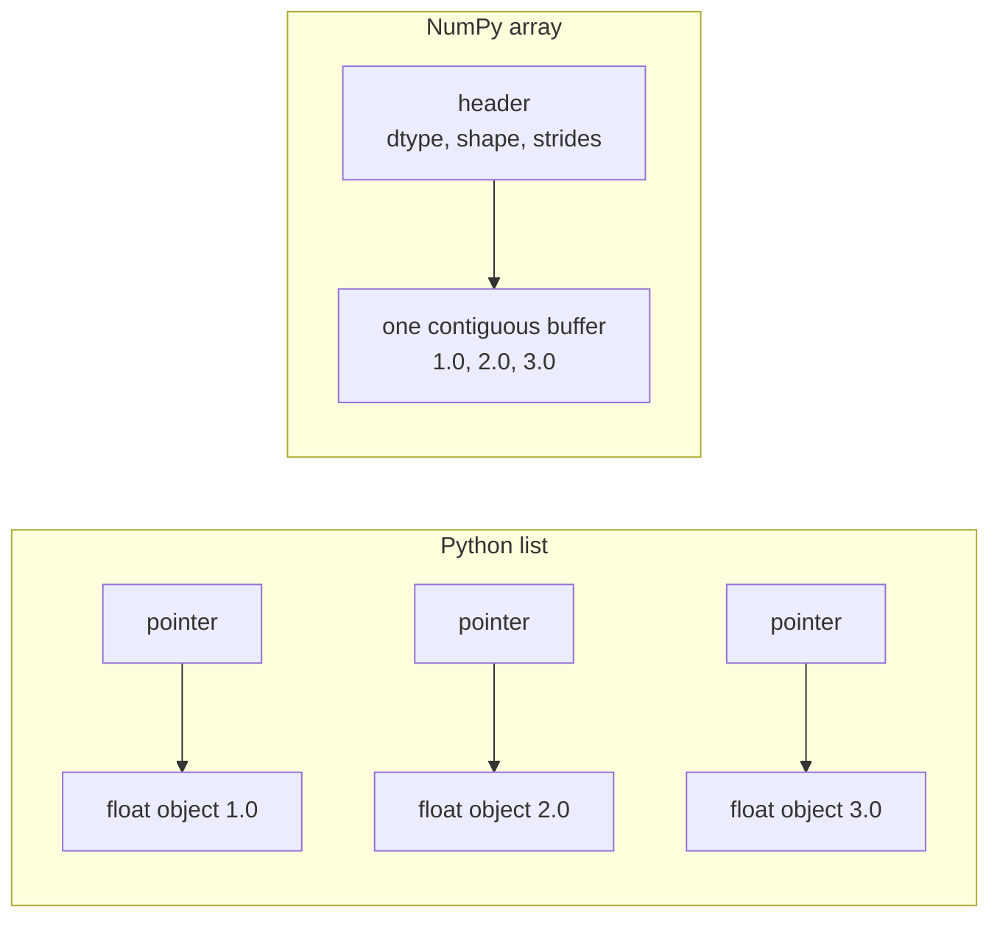
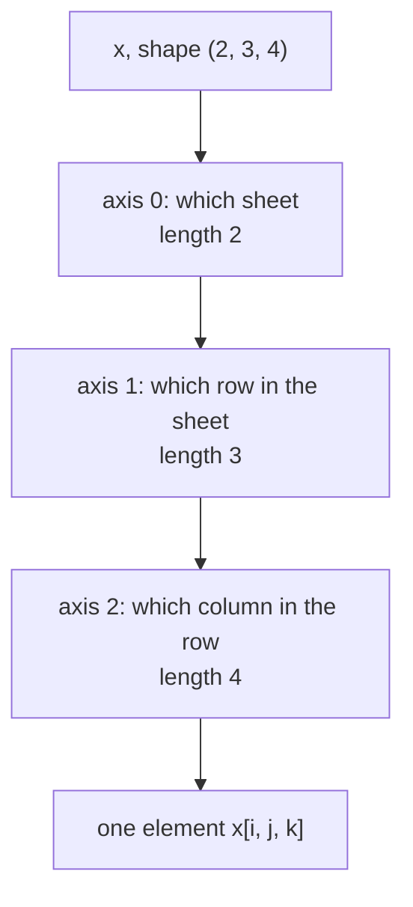

Almost every number in an AI system lives in an array. A greyscale image is a grid of pixel intensities, a batch of colour images is a four-dimensional block of numbers, an embedding table is a matrix with one row per token, and the weights of a neural network are a collection of arrays. NumPy is the Python library that provides this array type, and its design is copied almost exactly by PyTorch, TensorFlow and JAX. Learning NumPy well is learning the data model of the whole field.

This lesson covers what an array is, how its shape and dimensions work, what `axis` means, and how the element type (the dtype) determines memory and precision.

## Why not just use lists

A Python list is a sequence of pointers to separate Python objects scattered across memory. Each `float` in it carries its own type information and reference count. A NumPy array is one contiguous block of raw numbers that all share a single type, plus a small header describing how to interpret the block.



That layout has two consequences you will rely on throughout this module:

- **Speed.** Operations run in compiled C loops over the buffer, with no per-element Python overhead. You will measure this in [Vectorization](/learn/numpy/vectorization).
- **Uniform type.** Every element has the same dtype, so the array knows exactly how many bytes each element takes.

```python
import numpy as np

a = np.array([1.0, 2.0, 3.0])
print(a)
print(type(a), a.dtype)
print(a * 2)            # elementwise, unlike a list
print([1.0, 2.0, 3.0] * 2)
```

```output
[1. 2. 3.]
<class 'numpy.ndarray'> float64
[2. 4. 6.]
[1.0, 2.0, 3.0, 1.0, 2.0, 3.0]
```

Multiplying a list by 2 repeats it; multiplying an array by 2 doubles every element. That difference alone explains why numerical code uses arrays.

## Creating arrays

You will rarely type arrays out by hand. These constructors cover most needs:

```python
print(np.zeros((2, 3)))
print(np.ones(4, dtype=np.int64))
print(np.full((2, 2), 7.5))
print(np.arange(0, 10, 3))          # like range, but returns an array
print(np.linspace(0, 1, 5))         # 5 evenly spaced points, endpoints included
print(np.eye(3))                    # identity matrix
```

```output
[[0. 0. 0.]
 [0. 0. 0.]]
[1 1 1 1]
[[7.5 7.5]
 [7.5 7.5]]
[0 3 6 9]
[0.   0.25 0.5  0.75 1.  ]
[[1. 0. 0.]
 [0. 1. 0.]
 [0. 0. 1.]]
```

| Function | Produces | Typical use |
| --- | --- | --- |
| `np.array(list)` | Array from existing data | Converting loaded values |
| `np.zeros(shape)` / `np.ones(shape)` | Filled with 0 or 1 | Initialising accumulators, masks |
| `np.full(shape, v)` | Filled with `v` | Constant padding values |
| `np.arange(start, stop, step)` | Integer or float range, stop excluded | Indices, positions |
| `np.linspace(a, b, n)` | `n` evenly spaced values, `b` included | Plot axes, schedules |
| `np.eye(n)` | Identity matrix | Linear algebra |
| `np.zeros_like(x)` | Same shape and dtype as `x` | Gradient buffers |

> [!TIP]
> Prefer `np.linspace` over `np.arange` with a float step. `np.arange(0, 1, 0.1)` can include or exclude the endpoint depending on rounding; `linspace` lets you say exactly how many points you want.

## Shape, ndim and size

Three attributes describe the geometry of every array:

- `ndim`: the number of dimensions (also called axes).
- `shape`: a tuple with the length along each axis.
- `size`: the total number of elements, the product of the shape.

```python
scalar = np.array(3.5)
vector = np.array([1, 2, 3])
matrix = np.array([[1, 2, 3],
                   [4, 5, 6]])
batch = np.zeros((32, 28, 28))     # 32 greyscale images, 28x28 pixels

for name, x in [("scalar", scalar), ("vector", vector), ("matrix", matrix), ("batch", batch)]:
    print(f"{name:7} ndim={x.ndim} shape={x.shape} size={x.size}")
```

```output
scalar  ndim=0 shape=() size=1
vector  ndim=1 shape=(3,) size=3
matrix  ndim=2 shape=(2, 3) size=6
batch   ndim=3 shape=(32, 28, 28) size=25088
```

These match the objects from [Scalars, vectors and matrices](/learn/linear-algebra/scalars-vectors-and-matrices): a 0-D array is a scalar, 1-D a vector, 2-D a matrix, and anything with three or more axes is usually called a **tensor**. Note the trailing comma in `(3,)`: a 1-D shape is a one-element tuple.

> [!KEY]
> When code misbehaves, print `.shape` first. Most numerical bugs in AI code are shape bugs: an axis in the wrong order, a missing batch dimension, or a matrix that was silently transposed.

## What an axis means

Axis `k` is the `k`-th entry of the shape tuple. Axis 0 is the outermost: moving along it jumps between the largest blocks. The last axis (`-1`) is the innermost: moving along it steps between neighbouring elements in memory.

The most useful mental rule is: **a reduction along an axis removes that axis from the shape.**

```python
x = np.arange(24).reshape(2, 3, 4)
print(x.shape)
print(x.sum(axis=0).shape)   # collapse the 2 blocks
print(x.sum(axis=1).shape)   # collapse the 3 rows in each block
print(x.sum(axis=2).shape)   # collapse the 4 columns in each row
print(x.sum(axis=-1))        # same as axis=2
```

```output
(2, 3, 4)
(3, 4)
(2, 4)
(2, 3)
[[ 6 22 38]
 [54 70 86]]
```

For a 3-D array of shape `(2, 3, 4)`, think of two stacked sheets, each with three rows and four columns:



`x.sum(axis=0)` adds the two sheets together element by element, giving one `(3, 4)` sheet. `x.sum(axis=2)` adds across each row, giving a `(2, 3)` table of row totals. Use `keepdims=True` if you want the reduced axis kept with length 1, which matters for broadcasting later:

```python
print(x.sum(axis=2, keepdims=True).shape)
```

```output
(2, 3, 1)
```

## Images and batches as 4-D arrays

Deep learning code almost always works on **batches**: many examples processed at once, stacked along a new leading axis. A single colour image is 3-D (height, width, channels). A batch of them is 4-D.

| Data | Typical shape | Axes |
| --- | --- | --- |
| One tabular row | `(features,)` | 1 |
| A table of rows | `(N, features)` | 2 |
| One RGB image | `(H, W, 3)` | 3 |
| Batch of images, channels last | `(N, H, W, C)` | 4 |
| Batch of images, channels first (PyTorch) | `(N, C, H, W)` | 4 |
| Batch of token embeddings | `(N, seq_len, d_model)` | 3 |

```python
batch = np.zeros((16, 64, 64, 3), dtype=np.uint8)   # N, H, W, C
print(batch.shape, batch.ndim)

per_image_mean = batch.mean(axis=(1, 2, 3))          # one number per image
per_channel_mean = batch.mean(axis=(0, 1, 2))        # one number per colour channel
print(per_image_mean.shape, per_channel_mean.shape)

channels_first = batch.transpose(0, 3, 1, 2)          # N, C, H, W
print(channels_first.shape)
```

```output
(16, 64, 64, 3) 4
(16,) (3,)
(16, 3, 64, 64)
```

`axis` accepts a tuple, collapsing several axes at once. Per-channel means over a dataset are exactly what image normalisation uses.

## Reshaping

`reshape` reinterprets the same elements with a new shape. The total size must stay the same. One dimension may be `-1`, meaning "work this out for me".

```python
v = np.arange(12)
print(v.reshape(3, 4))
print(v.reshape(2, -1).shape)        # -1 becomes 6
images = np.zeros((16, 28, 28))
flat = images.reshape(16, -1)        # flatten each image for a dense layer
print(flat.shape)
```

```output
[[ 0  1  2  3]
 [ 4  5  6  7]
 [ 8  9 10 11]]
(2, 6)
(16, 784)
```

Reshape fills the new shape in **row-major (C) order**: the last axis changes fastest. Reshaping is not the same as transposing. `reshape(3, 2)` of a `(2, 3)` array keeps the reading order of the elements, while `.T` actually swaps rows and columns:

```python
m = np.arange(6).reshape(2, 3)
print(m.reshape(3, 2))
print(m.T)
```

```output
[[0 1]
 [2 3]
 [4 5]]
[[0 3]
 [1 4]
 [2 5]]
```

To add or remove length-1 axes, use `np.newaxis` (an alias for `None`), `np.expand_dims` and `squeeze`:

```python
img = np.zeros((28, 28))
print(img[np.newaxis].shape)            # add a batch axis
print(np.expand_dims(img, -1).shape)    # add a channel axis
print(np.zeros((1, 28, 28, 1)).squeeze().shape)
```

```output
(1, 28, 28)
(28, 28, 1)
(28, 28)
```

## Dtypes and memory

The dtype fixes how many bytes each element uses and what values it can hold.

| dtype | Bytes | Holds | Where you meet it |
| --- | --- | --- | --- |
| `bool` | 1 | True / False | Masks |
| `uint8` | 1 | Integers 0 to 255 | Raw image pixels |
| `int32` / `int64` | 4 / 8 | Signed integers | Token ids, labels, indices |
| `float16` | 2 | About 3 significant digits | Mixed-precision models |
| `float32` | 4 | About 7 significant digits | Model weights and activations |
| `float64` | 8 | About 15-16 significant digits | NumPy's default float, statistics |

```python
emb64 = np.zeros((50_000, 768))                    # default float64
emb32 = np.zeros((50_000, 768), dtype=np.float32)
print(emb64.dtype, emb64.itemsize, emb64.nbytes / 1e6, "MB")
print(emb32.dtype, emb32.itemsize, emb32.nbytes / 1e6, "MB")
```

```output
float64 8 307.2 MB
float32 4 153.6 MB
```

An embedding table of 50,000 tokens by 768 dimensions is about 307 MB in float64 and half that in float32. Deep learning frameworks default to float32 for exactly this reason, so when you build arrays in NumPy that will feed a model, convert with `.astype(np.float32)`.

Integer dtypes have a fixed range, and arithmetic **wraps around** when it overflows. This bites people who do arithmetic on raw image pixels:

```python
pixels = np.array([200, 100], dtype=np.uint8)
print(pixels + pixels)                     # wraps modulo 256
print(pixels.astype(np.float32) / 255.0)   # convert first, then scale
```

```output
[144 200]
[0.78431374 0.39215687]
```

> [!WARNING]
> `200 + 200` on `uint8` gives `144`, not `400`, with no error. Convert images to a float dtype before doing any arithmetic on them.

`astype` always returns a new array. Mixing dtypes in one operation promotes to the type that can represent both, so `int64` plus `float32` gives a float, and a `float32` array times a `float64` array gives `float64`.

## Exercises

**1.** Create an array of shape `(4, 5)` containing the numbers 0 to 19. Compute the sum of each row and the mean of each column, and state the shape of each result before you run it.

<details>
<summary>Show solution</summary>

```python
x = np.arange(20).reshape(4, 5)
row_sums = x.sum(axis=1)      # collapses the 5 columns: shape (4,)
col_means = x.mean(axis=0)    # collapses the 4 rows: shape (5,)
print(row_sums, row_sums.shape)
print(col_means, col_means.shape)
```

```output
[10 35 60 85] (4,)
[ 7.5  8.5  9.5 10.5 11.5] (5,)
```

</details>

**2.** A batch of 8 RGB images is stored as `(8, 3, 32, 32)` (channels first). Convert it to channels last, then flatten each image into a single vector. What is the final shape?

<details>
<summary>Show solution</summary>

```python
b = np.zeros((8, 3, 32, 32))
last = b.transpose(0, 2, 3, 1)
flat = last.reshape(8, -1)
print(last.shape, flat.shape)
```

```output
(8, 32, 32, 3) (8, 3072)
```

Each image has 32 × 32 × 3 = 3,072 values.

</details>

**3.** How many megabytes does a float32 array of shape `(128, 3, 224, 224)` take? Compute it by hand, then check with `nbytes`.

<details>
<summary>Show solution</summary>

128 × 3 × 224 × 224 = 19,267,584 elements, at 4 bytes each, is 77,070,336 bytes, roughly 77 MB.

```python
print(np.zeros((128, 3, 224, 224), dtype=np.float32).nbytes)
```

```output
77070336
```

</details>

```quiz
[
  {
    "q": "For `x` with shape `(10, 20, 30)`, what is the shape of `x.mean(axis=1)`?",
    "options": ["`(20,)`", "`(10, 30)`", "`(10, 20)`", "`(10, 1, 30)`"],
    "answer": 1,
    "why": "Reducing along an axis removes it from the shape, so axis 1 (length 20) disappears. With `keepdims=True` it would be `(10, 1, 30)`."
  },
  {
    "q": "What does `np.array([250, 10], dtype=np.uint8) + 10` produce?",
    "options": ["`[260, 20]`", "An `OverflowError`", "`[4, 20]`", "`[255, 20]`"],
    "answer": 2,
    "why": "`uint8` holds 0 to 255 and wraps around on overflow: 260 modulo 256 is 4. NumPy does not clip or raise."
  },
  {
    "q": "Which call turns an array of shape `(64, 28, 28)` into shape `(64, 784)`?",
    "options": ["`x.reshape(64, -1)`", "`x.T`", "`x.squeeze()`", "`x.reshape(-1, -1)`"],
    "answer": 0,
    "why": "`-1` asks NumPy to infer the remaining size, 28 × 28 = 784. Only one dimension may be `-1`."
  },
  {
    "q": "Why do deep learning pipelines usually convert NumPy arrays to float32?",
    "options": [
      "float64 cannot represent negative numbers",
      "float32 is more precise than float64",
      "NumPy cannot do arithmetic on float64",
      "It halves memory use and matches the framework's default precision"
    ],
    "answer": 3,
    "why": "float32 uses 4 bytes per element instead of 8 and is the default dtype for weights in PyTorch and TensorFlow."
  }
]
```
