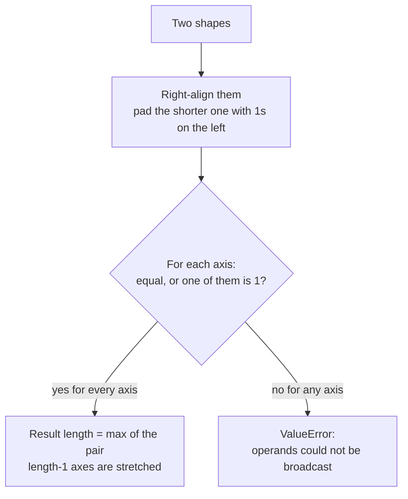

You want to subtract the mean of each feature from a table of 10,000 rows. The table has shape `(10000, 5)` and the means have shape `(5,)`. The shapes differ, yet `X - means` just works. The mechanism that makes this possible is **broadcasting**: a precise set of rules NumPy uses to combine arrays of different shapes without copying data. Broadcasting is everywhere in AI code: adding a bias vector to every row of a layer's output, normalising image channels, computing every pairwise distance between queries and documents. The same rules apply in PyTorch, TensorFlow and JAX, so learning them once pays off for good.

## The idea: stretch length-1 axes

The simplest case is an array combined with a scalar. The scalar behaves as if it were copied to every position:

```python
import numpy as np

x = np.array([1.0, 2.0, 3.0])
print(x + 10)
```

```output
[11. 12. 13.]
```

Broadcasting generalises this. Any axis of length 1 can be stretched to match the other array's length on that axis, and missing leading axes are treated as length 1. The stretching is virtual: NumPy reuses the same values by setting a stride of zero, so no large temporary copy of the smaller array is made.

```python
X = np.array([[1., 2., 3.],
              [4., 5., 6.]])        # shape (2, 3)
b = np.array([10., 20., 30.])       # shape (3,)
print(X + b)                        # b is added to every row
```

```output
[[11. 22. 33.]
 [14. 25. 36.]]
```

## The rules, stated precisely

To combine two arrays elementwise, NumPy compares their shapes **from the right** (trailing axes first):

1. If the arrays have different numbers of dimensions, pad the shorter shape with 1s **on the left** until they match.
2. Going axis by axis, two lengths are compatible if they are **equal**, or if **one of them is 1**.
3. If any pair is incompatible, raise a `ValueError`.
4. The result's length on each axis is the **larger** of the two. An array with length 1 on that axis is repeated along it.



### A step-by-step alignment

Take `A` with shape `(8, 1, 6, 1)` and `B` with shape `(7, 1, 5)`.

| Step | Axis 0 | Axis 1 | Axis 2 | Axis 3 |
| --- | --- | --- | --- | --- |
| `A.shape` | 8 | 1 | 6 | 1 |
| `B.shape`, right-aligned | | 7 | 1 | 5 |
| `B` padded on the left | 1 | 7 | 1 | 5 |
| Compatible? | 8 vs 1: yes | 1 vs 7: yes | 6 vs 1: yes | 1 vs 5: yes |
| Result | 8 | 7 | 6 | 5 |

```python
A = np.zeros((8, 1, 6, 1))
B = np.zeros((7, 1, 5))
print((A + B).shape)
print(np.broadcast_shapes((8, 1, 6, 1), (7, 1, 5)))
```

```output
(8, 7, 6, 5)
(8, 7, 6, 5)
```

`np.broadcast_shapes` applies the rules without creating any arrays, which is handy for checking your reasoning.

Now a failure. `(2, 3)` and `(2,)`: right-aligned, the last axes are 3 and 2, neither is 1, so the operation fails.

```python
X = np.ones((2, 3))
v = np.array([1.0, 2.0])
try:
    X + v
except ValueError as e:
    print(e)
```

```output
operands could not be broadcast together with shapes (2,3) (2,) 
```

To add one value per **row**, give `v` an explicit length-1 column axis so that its shape becomes `(2, 1)`:

```python
print(X + v[:, np.newaxis])
```

```output
[[2. 2. 2.]
 [3. 3. 3.]]
```

> [!KEY]
> Alignment is always from the right. A 1-D array of length `n` lines up with the **last** axis. To make it line up with an earlier axis, add length-1 axes after it with `np.newaxis` or `reshape`.

## Common patterns

### Standardising features

Subtracting the column means and dividing by the column standard deviations works because a reduction over `axis=0` produces shape `(features,)`, which aligns with the last axis of `X`:

```python
X = np.array([[1., 200.],
              [2., 300.],
              [3., 400.]])
Z = (X - X.mean(axis=0)) / X.std(axis=0)
print(Z)
```

```output
[[-1.22474487 -1.22474487]
 [ 0.          0.        ]
 [ 1.22474487  1.22474487]]
```

### Per-row operations need keepdims

Normalising each **row** to sum to 1 needs the row sums as a column. Reducing over `axis=1` gives shape `(rows,)`, which would try to align with the columns. `keepdims=True` keeps the reduced axis as length 1:

```python
counts = np.array([[1., 3.],
                   [2., 2.],
                   [5., 15.]])
row_sums = counts.sum(axis=1, keepdims=True)    # shape (3, 1)
print(row_sums.shape)
print(counts / row_sums)
```

```output
(3, 1)
[[0.25 0.75]
 [0.5  0.5 ]
 [0.25 0.75]]
```

This is exactly the last step of a softmax, which you will implement properly in [Mathematical functions](/learn/numpy/mathematical-functions).

### Normalising image channels

A batch of images in channels-last layout has shape `(N, H, W, 3)`. A per-channel mean and standard deviation of shape `(3,)` lines up with the last axis automatically:

```python
rng = np.random.default_rng(0)
images = rng.integers(0, 256, size=(4, 8, 8, 3)).astype(np.float32) / 255
mean = np.array([0.5, 0.4, 0.3], dtype=np.float32)
std = np.array([0.25, 0.25, 0.25], dtype=np.float32)
normalised = (images - mean) / std
print(normalised.shape, normalised.dtype)
```

```output
(4, 8, 8, 3) float32
```

In channels-first layout, `(N, 3, H, W)`, the same statistics must be reshaped to `(3, 1, 1)` so that the 3 lines up with axis 1.

### Outer operations and pairwise distances

Combining a column with a row produces a full grid. With `a` of shape `(3, 1)` and `b` of shape `(1, 4)`, the result is `(3, 4)`:

```python
a = np.array([1, 2, 3])
b = np.array([10, 20, 30, 40])
print(a[:, None] * b[None, :])
```

```output
[[ 10  20  30  40]
 [ 20  40  60  80]
 [ 30  60  90 120]]
```

The same trick computes every pairwise [Euclidean distance](/learn/linear-algebra/norms-and-distances) between `M` query vectors and `N` stored vectors, the core of nearest-neighbour search:

```python
Q = np.array([[0., 0.], [1., 1.]])                # (M=2, D=2)
P = np.array([[0., 1.], [3., 4.], [1., 1.]])      # (N=3, D=2)
diff = Q[:, None, :] - P[None, :, :]              # (2, 1, 2) - (1, 3, 2) -> (2, 3, 2)
dist = np.sqrt((diff ** 2).sum(axis=-1))          # (2, 3)
print(diff.shape)
print(dist.round(3))
```

```output
(2, 3, 2)
[[1.    5.    1.414]
 [1.    3.606 0.   ]]
```

> [!WARNING]
> The broadcast result is a real array. `(M, 1, D) - (1, N, D)` allocates `M × N × D` numbers. For 10,000 queries against 1,000,000 vectors of dimension 768 that is far beyond any machine's memory. For large problems, use the matrix-product form from [Matrix operations](/learn/numpy/matrix-operations) and process queries in chunks.

## The silent shape bug

Broadcasting never complains when shapes are compatible, even if the result is not what you meant. The classic case is a column of predictions with shape `(N, 1)` compared against labels with shape `(N,)`:

```python
y_true = np.array([1.0, 2.0, 3.0])            # (3,)
y_pred = np.array([[1.1], [1.9], [3.2]])      # (3, 1), e.g. a model's output
err = y_pred - y_true
print(err.shape)
print((err ** 2).mean())                      # wrong "MSE"
print(((y_pred.ravel() - y_true) ** 2).mean())  # correct
```

```output
(3, 3)
1.4200000000000004
0.020000000000000035
```

`(3, 1) - (3,)` became `(3, 3)`: every prediction minus every label. The "loss" is a perfectly ordinary number, so training proceeds and quietly learns the wrong thing. The defence is to check shapes at boundaries, either by printing them or with an assertion such as `assert y_pred.shape == y_true.shape`.

| Shapes | Result | Intended? |
| --- | --- | --- |
| `(N, D)` and `(D,)` | `(N, D)` | Usually: a per-feature operation |
| `(N, D)` and `(N, 1)` | `(N, D)` | Usually: a per-row operation |
| `(N, D)` and `(N,)` | Error unless `N == D` | When `N == D`, silently per-column |
| `(N, 1)` and `(N,)` | `(N, N)` | Almost never |

> [!TIP]
> Square matrices are dangerous in tests. If your toy data has as many rows as columns, a per-row versus per-column mistake broadcasts without error. Use test shapes with distinct sizes, such as `(5, 3)`, so wrong alignments fail loudly.

## Exercises

**1.** Without running code, give the broadcast shape (or say it fails) for: `(4, 3)` and `(3,)`; `(4, 3)` and `(4,)`; `(5, 1, 3)` and `(2, 1)`; `(6, 1)` and `(1, 7)`. Then check with `np.broadcast_shapes`.

<details>
<summary>Show solution</summary>

`(4, 3)`; error (3 vs 4); `(5, 2, 3)`; `(6, 7)`.

```python
for s in [((4, 3), (3,)), ((4, 3), (4,)), ((5, 1, 3), (2, 1)), ((6, 1), (1, 7))]:
    try:
        print(s, "->", np.broadcast_shapes(*s))
    except ValueError:
        print(s, "-> error")
```

```output
((4, 3), (3,)) -> (4, 3)
((4, 3), (4,)) -> error
((5, 1, 3), (2, 1)) -> (5, 2, 3)
((6, 1), (1, 7)) -> (6, 7)
```

</details>

**2.** Scale each row of `M = np.arange(12).reshape(3, 4)` so that its maximum value is 1. Use a single broadcasting expression.

<details>
<summary>Show solution</summary>

```python
M = np.arange(12).reshape(3, 4)
print(M / M.max(axis=1, keepdims=True))
```

```output
[[0.         0.33333333 0.66666667 1.        ]
 [0.57142857 0.71428571 0.85714286 1.        ]
 [0.72727273 0.81818182 0.90909091 1.        ]]
```

</details>

**3.** Given embeddings `E` of shape `(5, 4)`, compute the `(5, 5)` matrix of squared distances between every pair of rows using broadcasting, and confirm the diagonal is zero.

<details>
<summary>Show solution</summary>

```python
E = np.arange(20, dtype=float).reshape(5, 4) % 7
D2 = ((E[:, None, :] - E[None, :, :]) ** 2).sum(axis=-1)
print(D2.shape, np.diag(D2))
```

```output
(5, 5) [0. 0. 0. 0. 0.]
```

</details>

```quiz
[
  {
    "q": "What is the broadcast shape of `(3, 1, 5)` and `(4, 1)`?",
    "options": ["Error", "`(3, 4, 5)`", "`(3, 4, 1)`", "`(4, 3, 5)`"],
    "answer": 1,
    "why": "Pad `(4, 1)` to `(1, 4, 1)`, then take the larger length on each axis: 3, 4 and 5."
  },
  {
    "q": "`X` has shape `(100, 10)`. Which expression subtracts each row's own mean from that row?",
    "options": [
      "`X - X.mean(axis=0)`",
      "`X - X.mean(axis=1)`",
      "`X - X.mean(axis=1, keepdims=True)`",
      "`X - X.mean()`"
    ],
    "answer": 2,
    "why": "Row means have shape `(100,)`, which would align with the last axis (10) and fail. `keepdims=True` gives `(100, 1)`, which broadcasts across columns."
  },
  {
    "q": "Predictions have shape `(64, 1)` and labels have shape `(64,)`. What does `preds - labels` produce?",
    "options": ["A `(64, 64)` array", "A `(64,)` array", "A `(64, 1)` array", "A `ValueError`"],
    "answer": 0,
    "why": "`(64,)` is padded to `(1, 64)`, which broadcasts with `(64, 1)` to give every prediction minus every label. No error is raised."
  },
  {
    "q": "Why is broadcasting memory-efficient for the smaller operand?",
    "options": [
      "It compresses the arrays",
      "It converts both arrays to float16",
      "It only computes the diagonal of the result",
      "The stretched axes reuse the same values with a stride of zero instead of copying them"
    ],
    "answer": 3,
    "why": "The smaller array is never physically tiled. The result array is still allocated at full size, though."
  }
]
```
