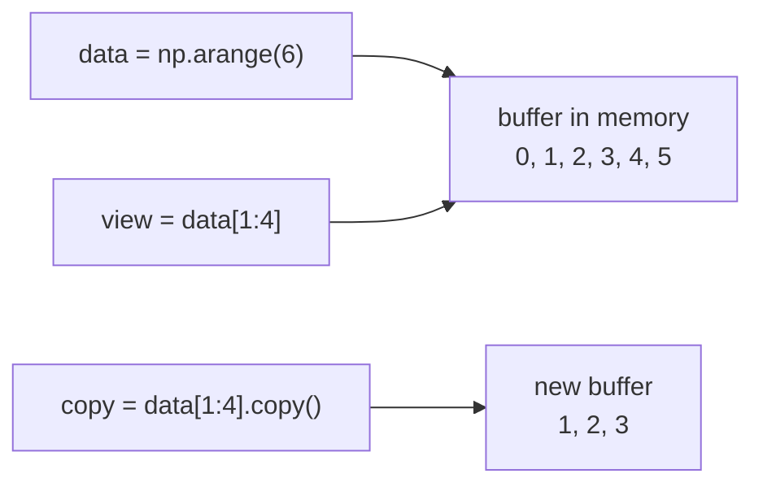

Selecting the right numbers out of an array is something you will do constantly: the first 1,000 rows for training, the red channel of an image, every prediction whose confidence is below 0.5, the embedding vectors for the token ids in a sentence. NumPy gives you four selection tools: integer indexing, slicing, boolean masks and integer-array ("fancy") indexing. They look similar but behave differently in one crucial way: some return a **view** that shares memory with the original array, and some return a **copy**. Getting that wrong is one of the classic NumPy bugs.

## Indexing one element

For a multi-dimensional array, put all the indices inside one pair of brackets, separated by commas, one per axis. Negative indices count from the end, as with lists.

```python
import numpy as np

m = np.arange(12).reshape(3, 4)
print(m)
print(m[1, 2])      # row 1, column 2
print(m[-1, -1])    # last row, last column
print(m[1])         # a whole row: indexing fewer axes than ndim
```

```output
[[ 0  1  2  3]
 [ 4  5  6  7]
 [ 8  9 10 11]]
6
11
[4 5 6 7]
```

`m[1][2]` also works, but it first builds the row `m[1]` and then indexes into it. `m[1, 2]` is clearer and faster, and the comma form is the only one that works for the slicing patterns below.

## Slicing along each axis

Each axis takes its own `start:stop:step` slice, with the same rules as [Python list slicing](/learn/python-programming/lists-tuples-sets-dictionaries): `stop` is excluded and any part can be left out. A bare `:` means "everything along this axis".

```python
print(m[:2, 1:3])     # first two rows, columns 1 and 2
print(m[:, 0])        # first column, as a 1-D array
print(m[:, :1])       # first column, kept 2-D
print(m[::2, ::-1])   # every other row, columns reversed
```

```output
[[1 2]
 [5 6]]
[0 4 8]
[[0]
 [4]
 [8]]
[[ 3  2  1  0]
 [11 10  9  8]]
```

Notice the difference between `m[:, 0]` (shape `(3,)`) and `m[:, :1]` (shape `(3, 1)`). An integer index removes that axis; a slice keeps it, even if it has length 1.

For arrays with many axes, `...` (Ellipsis) stands for "as many `:` as needed". It is common with image batches:

```python
batch = np.arange(2 * 4 * 4 * 3).reshape(2, 4, 4, 3)   # N, H, W, C
red = batch[..., 0]             # same as batch[:, :, :, 0]
crop = batch[:, 1:3, 1:3, :]    # centre 2x2 crop of every image
print(red.shape, crop.shape)
```

```output
(2, 4, 4) (2, 2, 2, 3)
```

## Views versus copies

A basic slice does not copy any data. It returns a **view**: a new array header that points into the same memory buffer, with its own shape and step sizes (called **strides**). This makes slicing nearly free, even on gigabyte arrays. It also means that writing through a view changes the original.



Step through the classic bug: a function that is meant to normalise a slice of the data quietly edits the original dataset.

```trace
{
  "title": "a slice is a view, not a copy",
  "code": [
    "data = np.array([10., 20., 30., 40.])",
    "train = data[:2]",
    "train -= train.mean()",
    "print(train)",
    "print(data)",
    "safe = data[2:].copy()",
    "safe -= safe.mean()",
    "print(data)"
  ],
  "steps": [
    { "line": 1, "vars": { "data": "[10. 20. 30. 40.]" }, "note": "One buffer holding four floats." },
    { "line": 2, "vars": { "data": "[10. 20. 30. 40.]", "train": "[10. 20.] (view)" }, "note": "train is a view of the first two elements. No data was copied." },
    { "line": 3, "vars": { "data": "[-5. 5. 30. 40.]", "train": "[-5. 5.] (view)" }, "note": "The in-place subtraction writes into the shared buffer, so data changes too." },
    { "line": 4, "vars": { "data": "[-5. 5. 30. 40.]", "train": "[-5. 5.] (view)" }, "out": ["[-5.  5.]"], "note": "train looks correct." },
    { "line": 5, "vars": { "data": "[-5. 5. 30. 40.]", "train": "[-5. 5.] (view)" }, "out": ["[-5.  5.]", "[-5.  5. 30. 40.]"], "note": "But the original dataset has been modified. No error, just wrong data." },
    { "line": 7, "vars": { "data": "[-5. 5. 30. 40.]", "safe": "[-5. 5.] (copy)" }, "out": ["[-5.  5.]", "[-5.  5. 30. 40.]"], "note": "safe owns its own buffer, so centring it leaves data alone." },
    { "line": 8, "vars": { "data": "[-5. 5. 30. 40.]", "safe": "[-5. 5.] (copy)" }, "out": ["[-5.  5.]", "[-5.  5. 30. 40.]", "[-5.  5. 30. 40.]"], "note": "data is unchanged by the second operation." }
  ]
}
```

You can check whether two arrays share memory with `np.shares_memory`, and an array's `.base` attribute points to the array it is a view of:

```python
data = np.array([10., 20., 30., 40.])
view = data[:2]
copy = data[:2].copy()
print(np.shares_memory(data, view), np.shares_memory(data, copy))
print(view.base is data, copy.base is None)
```

```output
True False
True True
```

| Operation | Result | Shares memory with the original |
| --- | --- | --- |
| Basic slice `x[1:5]`, `x[:, 0]`, `x[..., ::2]` | View | Yes |
| `x.reshape(...)`, `x.T`, `x.transpose(...)` | View when possible | Usually |
| Boolean mask `x[x > 0]` | Copy | No |
| Integer array `x[[0, 2, 5]]` | Copy | No |
| `x.copy()`, `x.astype(...)`, `np.array(x)` | Copy | No |
| Arithmetic `x + 1`, `x * 2` | New array | No |
| In-place `x += 1`, `x[...] = 0` | Modifies `x` | Writes to the shared buffer |

> [!WARNING]
> If you take a slice and intend to modify it independently, call `.copy()`. If you take a slice of a huge array and keep only the slice, also call `.copy()`: a view keeps the entire original buffer alive in memory.

## Boolean masks

A comparison on an array returns a boolean array of the same shape. Using that array as an index selects the elements where it is `True`. This is how you filter data without a loop.

```python
scores = np.array([0.91, 0.42, 0.77, 0.15, 0.66])
mask = scores > 0.5
print(mask)
print(scores[mask])
print(mask.sum(), mask.mean())   # count and fraction of True
```

```output
[ True False  True False  True]
[0.91 0.77 0.66]
3 0.6
```

Combine conditions with `&` (and), `|` (or) and `~` (not), and **always wrap each condition in parentheses**, because these operators bind more tightly than comparisons. Python's `and` and `or` do not work on arrays and raise an error.

```python
print(scores[(scores > 0.3) & (scores < 0.8)])
print(scores[~(scores > 0.5)])
```

```output
[0.42 0.77 0.66]
[0.42 0.15]
```

A mask can also be the target of an assignment, which modifies the original array in place. Clipping negative values and replacing missing values are typical uses:

```python
x = np.array([3.0, -1.0, np.nan, 5.0, -2.0])
x[x < 0] = 0.0
x[np.isnan(x)] = 0.0
print(x)
```

```output
[3. 0. 0. 5. 0.]
```

For a choice between two values per element, use `np.where(condition, a, b)`, which returns a new array:

```python
logits = np.array([2.0, -0.5, 0.3])
print(np.where(logits > 0, 1, 0))
```

```output
[1 0 1]
```

A mask on a 2-D array that matches its first axis selects whole rows. With a table of features `X` and labels `y`, `X[y == 1]` gives every row of the positive class.

## Integer-array (fancy) indexing

Passing an array or list of integers selects those positions, in that order, and may repeat them. The result always has the shape of the index array.

```python
words = np.array(["the", "cat", "sat", "on", "mat"])
print(words[[4, 1, 1, 0]])
```

```output
['mat' 'cat' 'cat' 'the']
```

This is precisely an **embedding lookup**. An embedding matrix has one row per token in the vocabulary; a sentence is an array of token ids; indexing the matrix with the ids gives one vector per token.

```python
vocab_size, dim = 6, 3
E = np.arange(vocab_size * dim).reshape(vocab_size, dim) / 10   # toy embedding table
token_ids = np.array([[1, 4, 4],
                      [0, 2, 5]])     # batch of 2 sentences, 3 tokens each
vectors = E[token_ids]
print(vectors.shape)
print(vectors[0])
```

```output
(2, 3, 3)
[[0.3 0.4 0.5]
 [1.2 1.3 1.4]
 [1.2 1.3 1.4]]
```

Shape `(2, 3)` of ids became `(2, 3, 3)`: each id was replaced by its 3-dimensional row. Embedding layers in PyTorch do exactly this, plus learning the table.

When you index several axes with integer arrays, they are paired up element by element, not combined as a grid. That is how you pick one entry per row, such as the predicted probability of the correct class:

```python
probs = np.array([[0.7, 0.2, 0.1],
                  [0.1, 0.3, 0.6],
                  [0.2, 0.5, 0.3]])
labels = np.array([0, 2, 1])
picked = probs[np.arange(3), labels]   # (0,0), (1,2), (2,1)
print(picked)
print(-np.log(picked).mean())          # cross-entropy loss
```

```output
[0.7 0.6 0.5]
0.5202159160882228
```

That last line is the [cross-entropy](/learn/essential-mathematics-for-machine-learning/cross-entropy) loss computed in one expression.

> [!KEY]
> Basic slices give views. Boolean masks and integer arrays give copies. Assigning *through* any of them, as in `x[mask] = 0`, writes into the original array.

## Sorting and top-k

`np.argsort` returns the indices that would sort an array, which you then use as a fancy index. Retrieving the most similar documents in a search system is exactly this pattern.

```python
similarity = np.array([0.12, 0.87, 0.45, 0.91, 0.30])
top3 = np.argsort(similarity)[::-1][:3]
print(top3, similarity[top3])
print(np.argmax(similarity))
```

```output
[3 1 2] [0.91 0.87 0.45]
3
```

## Exercises

**1.** From `m = np.arange(20).reshape(4, 5)`, extract: the last two rows; the middle three columns of every row; and the element in row 2, column 3. Give the shape of each.

<details>
<summary>Show solution</summary>

```python
m = np.arange(20).reshape(4, 5)
print(m[-2:].shape, m[:, 1:4].shape, m[2, 3])
```

```output
(2, 5) (4, 3) 13
```

The single element is a scalar, so it has no shape tuple of its own here.

</details>

**2.** Predict the output, then run it.

```python
a = np.arange(5)
b = a[a > 1]
b[0] = 100
c = a[1:3]
c[0] = -1
print(a)
```

<details>
<summary>Show solution</summary>

```output
[ 0 -1  2  3  4]
```

`b` came from a boolean mask, so it is a copy and changing it has no effect on `a`. `c` is a slice, a view, so `c[0] = -1` sets `a[1]`.

</details>

**3.** Given `X` of shape `(6, 2)` and labels `y = np.array([0, 1, 1, 0, 1, 0])`, compute the mean feature vector of each class without a loop.

<details>
<summary>Show solution</summary>

```python
X = np.arange(12).reshape(6, 2).astype(float)
y = np.array([0, 1, 1, 0, 1, 0])
print(X[y == 0].mean(axis=0), X[y == 1].mean(axis=0))
```

```output
[5.33333333 6.33333333] [4.66666667 5.66666667]
```

</details>

```quiz
[
  {
    "q": "For `x` with shape `(5, 4)`, what are the shapes of `x[:, 2]` and `x[:, 2:3]`?",
    "options": ["`(5,)` and `(5, 1)`", "`(5, 1)` and `(5, 1)`", "`(5,)` and `(5,)`", "`(4,)` and `(1, 4)`"],
    "answer": 0,
    "why": "An integer index removes the axis; a slice keeps it, even with length 1."
  },
  {
    "q": "After `a = np.zeros(4)`, `v = a[::2]`, `v[:] = 7`, what is `a`?",
    "options": ["`[0. 0. 0. 0.]`", "`[7. 7. 7. 7.]`", "`[7. 0. 7. 0.]`", "An error is raised"],
    "answer": 2,
    "why": "A basic slice with a step is still a view. Writing through it sets positions 0 and 2 of `a`."
  },
  {
    "q": "Which expression correctly selects values strictly between 0 and 1?",
    "options": ["`x[x > 0 and x < 1]`", "`x[0 < x < 1]`", "`x[x > 0 & x < 1]`", "`x[(x > 0) & (x < 1)]`"],
    "answer": 3,
    "why": "Arrays need the elementwise `&`, and each comparison must be parenthesised because `&` binds more tightly than `>`. `and` and chained comparisons raise a ValueError on arrays."
  },
  {
    "q": "`E` has shape `(10000, 64)` and `ids` has shape `(8, 20)`. What is the shape of `E[ids]`?",
    "options": ["`(8, 20)`", "`(8, 20, 64)`", "`(8, 64)`", "`(160, 64)`"],
    "answer": 1,
    "why": "Fancy indexing on the first axis replaces each id with its row, so the result has the index shape followed by the remaining axis."
  }
]
```
