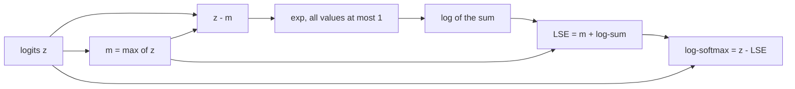

NumPy provides vectorised versions of every mathematical function you need for machine learning: exponentials and logarithms for probabilities and losses, square roots and powers for distances, statistics for normalisation, and the building blocks of activation functions. Knowing the catalogue saves time, but the more important skill is numerical: computers store numbers with finite precision, and some formulas that are correct on paper overflow, underflow or lose all their accuracy in code. This lesson covers the common functions and then the two numerical techniques every AI engineer must know, the **stable softmax** and **log-sum-exp**.

## Elementwise functions

All of these are ufuncs: they apply to every element and keep the shape.

| Function | Computes | AI use |
| --- | --- | --- |
| `np.exp`, `np.log` | $e^x$, $\ln x$ | Softmax, log-likelihoods, losses |
| `np.log1p(x)`, `np.expm1(x)` | $\ln(1+x)$, $e^x - 1$, accurate for tiny `x` | Stable losses, log-scaled features |
| `np.sqrt`, `np.square`, `np.power` | $\sqrt{x}$, $x^2$, $x^p$ | Distances, RMS, normalisation |
| `np.abs`, `np.sign` | $\lvert x \rvert$, sign | L1 loss, gradient clipping |
| `np.tanh`, `np.sin`, `np.cos` | Hyperbolic and trigonometric functions | Activations, positional encodings |
| `np.maximum(a, b)`, `np.minimum(a, b)` | Elementwise max and min | ReLU, clamping |
| `np.clip(x, lo, hi)` | Limits values to a range | Clipping probabilities and gradients |
| `np.round`, `np.floor`, `np.ceil` | Rounding | Quantisation, binning |

```python
import numpy as np

x = np.array([-2.0, -0.5, 0.0, 0.5, 2.0])
relu = np.maximum(x, 0)
sigmoid = 1 / (1 + np.exp(-x))
print(relu)
print(np.tanh(x).round(4))
print(sigmoid.round(4))
```

```output
[0.  0.  0.  0.5 2. ]
[-0.964  -0.4621  0.      0.4621  0.964 ]
[0.1192 0.3775 0.5    0.6225 0.8808]
```

`np.log1p` exists because adding a tiny number to 1 loses its digits before the logarithm is taken:

```python
tiny = 1e-17
print(np.log(1 + tiny), np.log1p(tiny))
```

```output
0.0 1e-17
```

`1 + 1e-17` rounds to exactly `1.0` in float64, so `np.log` returns 0, while `log1p` returns the correct answer.

## Statistics along an axis

Reductions all take `axis` and `keepdims`, as in [Arrays and dimensions](/learn/numpy/arrays-and-dimensions).

```python
scores = np.array([[70., 85., 90.],
                   [60., 75., 95.]])
print(scores.mean(axis=0), scores.std(axis=0))
print(np.median(scores, axis=1), np.percentile(scores, 90))
print(scores.argmax(axis=1))   # index of the best score in each row
```

```output
[65.  80.  92.5] [5.  5.  2.5]
[85. 75.] 92.5
[2 2]
```

`std` divides by $N$ by default (the population formula). For the sample standard deviation from [Variance and standard deviation](/learn/probability-and-statistics/variance-and-standard-deviation), pass `ddof=1`. Pandas uses `ddof=1` by default, so the two libraries disagree unless you are explicit.

### Missing values

One `NaN` contaminates a whole reduction. The `nan`-prefixed functions skip missing values instead:

```python
v = np.array([1.0, np.nan, 3.0])
print(v.mean(), np.nanmean(v), np.nansum(v), np.isnan(v).sum())
```

```output
nan 2.0 4.0 1
```

## Special values: inf and nan

Floating-point arithmetic does not raise errors on overflow or invalid operations. It produces special values and, by default, prints a `RuntimeWarning`.

| Operation | Result |
| --- | --- |
| `np.exp(1000.0)` | `inf` (overflow: float64 tops out near $1.8 \times 10^{308}$) |
| `np.exp(-1000.0)` | `0.0` (underflow) |
| `np.log(0.0)` | `-inf` |
| `np.log(-1.0)`, `0.0 / 0.0`, `inf - inf` | `nan` |
| Anything involving `nan` | `nan` |

```python
with np.errstate(over="ignore", divide="ignore", invalid="ignore"):
    print(np.exp(np.array([1000.0, -1000.0])))
    print(np.log(np.array([0.0, -1.0])))
    print(np.array([np.inf]) - np.array([np.inf]))
```

```output
[inf  0.]
[-inf  nan]
[nan]
```

`np.errstate` controls these warnings inside a `with` block. Use it to silence warnings you have deliberately handled, or set `all="raise"` while debugging to turn the first bad value into an exception with a traceback.

> [!WARNING]
> A loss that becomes `nan` during training often traces back to `exp` overflowing or `log(0)`. The fixes in the rest of this lesson remove both causes at the source, rather than masking the symptom afterwards.

## Softmax, naively

The softmax turns a vector of scores (logits) $z \in \mathbb{R}^K$ into probabilities:

$$
\operatorname{softmax}(z)_i = \frac{e^{z_i}}{\sum_{j=1}^{K} e^{z_j}}
$$

The direct translation works for small logits and fails for large ones:

```python
def softmax_naive(z):
    e = np.exp(z)
    return e / e.sum()

print(softmax_naive(np.array([1.0, 2.0, 3.0])).round(4))
with np.errstate(over="ignore", invalid="ignore"):
    print(softmax_naive(np.array([1000.0, 1001.0, 1002.0])))
```

```output
[0.09   0.2447 0.6652]
[nan nan nan]
```

$e^{1000}$ overflows to `inf`, and `inf / inf` is `nan`. Logits this large are not exotic: unnormalised scores from a model, or attention scores before scaling, can easily reach the hundreds.

## The stable softmax

Subtracting any constant $c$ from every logit does not change the softmax, because the factor $e^{-c}$ cancels:

$$
\frac{e^{z_i - c}}{\sum_j e^{z_j - c}} = \frac{e^{-c}\, e^{z_i}}{e^{-c} \sum_j e^{z_j}} = \frac{e^{z_i}}{\sum_j e^{z_j}}
$$

Choose $c = \max_j z_j$. The largest shifted logit is then 0, so every exponential is at most $e^0 = 1$ and cannot overflow, and at least one term in the denominator equals 1, so it cannot be zero.

```trace
{
  "title": "stable softmax on large logits",
  "code": [
    "z = np.array([1000., 1001., 1002.])",
    "shifted = z - z.max()",
    "e = np.exp(shifted)",
    "total = e.sum()",
    "p = e / total",
    "print(p.round(4))"
  ],
  "steps": [
    { "line": 1, "vars": { "z": "[1000. 1001. 1002.]" }, "note": "Naively, exp(1000) would overflow to inf." },
    { "line": 2, "vars": { "z": "[1000. 1001. 1002.]", "shifted": "[-2. -1.  0.]" }, "note": "Subtract the maximum. The largest value becomes 0." },
    { "line": 3, "vars": { "shifted": "[-2. -1.  0.]", "e": "[0.1353 0.3679 1.    ]" }, "note": "Every exponential is now between 0 and 1. No overflow is possible." },
    { "line": 4, "vars": { "e": "[0.1353 0.3679 1.    ]", "total": "1.5032" }, "note": "The denominator is at least 1, so division is safe." },
    { "line": 6, "vars": { "p": "[0.09 0.2447 0.6652]" }, "out": ["[0.09   0.2447 0.6652]"], "note": "Same answer as softmax([1, 2, 3]): only differences between logits matter." }
  ]
}
```

For a batch, apply it along the class axis with `keepdims=True` so that the maximum and sum broadcast back over each row:

```python
def softmax(z, axis=-1):
    shifted = z - z.max(axis=axis, keepdims=True)
    e = np.exp(shifted)
    return e / e.sum(axis=axis, keepdims=True)

logits = np.array([[1000.0, 1001.0, 1002.0],
                   [-5.0, 0.0, 5.0]])
p = softmax(logits)
print(p.round(4))
print(p.sum(axis=1))
```

```output
[[0.09   0.2447 0.6652]
 [0.     0.0067 0.9933]]
[1. 1.]
```

## Log-sum-exp and log-softmax

Losses work with **log**-probabilities, because multiplying many small probabilities underflows while adding their logs does not. Taking `np.log(softmax(z))` reintroduces the problem: a probability that underflows to 0 becomes `-inf`. Instead, use the identity

$$
\log \operatorname{softmax}(z)_i = z_i - \operatorname{LSE}(z), \qquad \operatorname{LSE}(z) = \log \sum_{j} e^{z_j}
$$

and compute the log-sum-exp with the same max trick, writing $m = \max_j z_j$:

$$
\operatorname{LSE}(z) = m + \log \sum_{j} e^{z_j - m}
$$



```python
def logsumexp(z, axis=-1):
    m = z.max(axis=axis, keepdims=True)
    return (m + np.log(np.exp(z - m).sum(axis=axis, keepdims=True))).squeeze(axis)

def log_softmax(z, axis=-1):
    return z - np.expand_dims(logsumexp(z, axis), axis)

z = np.array([0.0, 50.0, 1000.0])
with np.errstate(divide="ignore", over="ignore", invalid="ignore"):
    print(np.log(softmax_naive(z)))      # naive: nan
    print(np.log(softmax(z)))            # stable softmax, then log: -inf
print(log_softmax(z))                    # log-softmax: finite
```

```output
[-inf -inf  nan]
[-inf -inf   0.]
[-1000.  -950.     0.]
```

Only the last version keeps finite, correct log-probabilities for the unlikely classes. SciPy provides a tested implementation as `scipy.special.logsumexp`, and deep learning frameworks provide `log_softmax` functions built the same way.

### Cross-entropy from logits

Putting it together, the [cross-entropy](/learn/essential-mathematics-for-machine-learning/cross-entropy) loss for a batch, computed directly from logits and integer labels:

```python
def cross_entropy(logits, labels):
    logp = log_softmax(logits, axis=1)
    return -logp[np.arange(len(labels)), labels].mean()

logits = np.array([[2.0, 0.5, -1.0],
                   [0.1, 0.2, 3.0],
                   [500.0, 0.0, -500.0]])
labels = np.array([0, 2, 1])
print(cross_entropy(logits, labels))
```

```output
166.78363758705953
```

The third example is confidently wrong: the correct class has a logit 500 below the winner, so its loss is about 500, which dominates the batch mean of about 167. A naive implementation would have computed `log(0)` and returned `inf`. This is why frameworks ask you to pass raw logits to their cross-entropy functions rather than probabilities.

> [!KEY]
> Never exponentiate raw logits directly. Subtract the maximum first, and stay in log space for as long as possible: compute log-probabilities with log-softmax, not `log(softmax(...))`.

> [!TIP]
> The same reasoning gives a stable sigmoid: for large negative `x`, `np.exp(-x)` overflows. `scipy.special.expit` implements the sigmoid safely, and the binary cross-entropy can be written with `np.logaddexp(0, -x)`, which computes $\log(e^0 + e^{-x})$ without overflow.

## Exercises

**1.** Compute the root-mean-square error between `pred = np.array([2.5, 0.0, 2.1, 7.8])` and `true = np.array([3.0, -0.5, 2.0, 7.0])`.

<details>
<summary>Show solution</summary>

```python
pred = np.array([2.5, 0.0, 2.1, 7.8])
true = np.array([3.0, -0.5, 2.0, 7.0])
print(np.sqrt(np.mean((pred - true) ** 2)))
```

```output
0.5361902647381803
```

</details>

**2.** Show that `softmax(z)` and `softmax(z + 100)` give the same result for `z = np.array([0.5, -1.0, 2.0])`, and explain why.

<details>
<summary>Show solution</summary>

```python
z = np.array([0.5, -1.0, 2.0])
print(np.allclose(softmax(z), softmax(z + 100)))
```

```output
True
```

Adding a constant multiplies every numerator and the denominator by the same factor $e^{100}$, which cancels. This shift invariance is exactly what the stable softmax relies on.

</details>

**3.** Check your `logsumexp` against `scipy.special.logsumexp` on a random `(4, 6)` array of logits scaled by 300, along `axis=1`.

<details>
<summary>Show solution</summary>

```python
from scipy.special import logsumexp as lse_scipy

Z = np.random.default_rng(0).normal(size=(4, 6)) * 300
print(np.allclose(logsumexp(Z, axis=1), lse_scipy(Z, axis=1)))
```

```output
True
```

</details>

```quiz
[
  {
    "q": "Why does the stable softmax subtract the maximum logit before exponentiating?",
    "options": [
      "To make the probabilities sum to 1",
      "To prevent overflow, since the largest exponent becomes 0, without changing the result",
      "To make all probabilities equal",
      "To convert logits into log-probabilities"
    ],
    "answer": 1,
    "why": "Softmax is unchanged by adding a constant to every logit. Shifting by the maximum keeps every exponential at most 1."
  },
  {
    "q": "What does `np.log(np.array([0.0]))` return?",
    "options": ["`0.0`", "A `ValueError`", "`nan`", "`-inf`, with a `RuntimeWarning`"],
    "answer": 3,
    "why": "Floating-point arithmetic returns special values instead of raising. The log of zero is negative infinity."
  },
  {
    "q": "Which expression gives the most accurate log-probabilities from logits `z`?",
    "options": [
      "`z - logsumexp(z)`",
      "`np.log(softmax(z))`",
      "`np.log(np.exp(z) / np.exp(z).sum())`",
      "`np.exp(z) - np.log(z.sum())`"
    ],
    "answer": 0,
    "why": "Log-softmax via log-sum-exp never forms probabilities that could underflow to zero. Taking the log of a softmax can produce `-inf`."
  },
  {
    "q": "`v = np.array([1.0, np.nan, 5.0])`. What is `np.nanmean(v)`?",
    "options": ["`nan`", "`2.0`", "`3.0`", "`6.0`"],
    "answer": 2,
    "why": "`nanmean` ignores missing values, averaging 1 and 5."
  }
]
```
