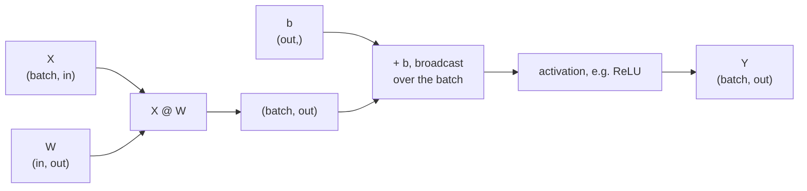

A neural network layer is a matrix multiplication followed by a simple function. Attention in a transformer is mostly matrix multiplications. Similarity search over embeddings is a matrix multiplication. The mathematics was covered in the [Linear Algebra module](/learn/linear-algebra/matrix-multiplication); this lesson is about doing it correctly and efficiently in NumPy: the difference between `*` and `@`, how shapes must line up, how batches of matrices are multiplied, and the `np.linalg` toolbox for norms, solving systems and decompositions.

## `*` is elementwise, `@` is matrix multiplication

This is the single most common confusion for newcomers. `*` multiplies matching elements (the Hadamard product), following the broadcasting rules. `@` is the matrix product from linear algebra: each output entry is a dot product of a row of the left operand with a column of the right.

```python
import numpy as np

A = np.array([[1, 2],
              [3, 4]])
B = np.array([[10, 20],
              [30, 40]])

print(A * B)    # elementwise
print(A @ B)    # matrix product
```

```output
[[ 10  40]
 [ 90 160]]
[[ 70 100]
 [150 220]]
```

`A @ B` at position `(0, 0)` is $1 \cdot 10 + 2 \cdot 30 = 70$. With square matrices both expressions run without error, which is exactly why the mix-up survives into real code. With non-square shapes, at least one of them usually fails loudly.

| Operator or function | Meaning | Shape rule |
| --- | --- | --- |
| `A * B` | Elementwise product | Shapes must broadcast |
| `A @ B`, `np.matmul(A, B)` | Matrix product, batched over leading axes | `(..., m, k) @ (..., k, n)` gives `(..., m, n)` |
| `np.dot(a, b)` | Dot product for 1-D, matrix product for 2-D | Unusual rules for 3-D and above |
| `a @ b` with 1-D `a`, `b` | Inner (dot) product, a scalar | Lengths must match |
| `np.outer(a, b)` | Outer product | `(m,)` and `(n,)` give `(m, n)` |

> [!TIP]
> Prefer `@` in new code. It reads like the maths, and its behaviour for stacked (batched) arrays is the same as `torch.matmul`. `np.dot` predates it and treats arrays with more than two dimensions differently.

## Shapes must agree on the inner dimension

For $C = AB$ with $A$ of shape $(m, k)$ and $B$ of shape $(k, n)$, the inner dimensions $k$ must match and the result has the outer dimensions $(m, n)$:

$$
C_{ij} = \sum_{p=1}^{k} A_{ip} B_{pj}
$$

```python
X = np.ones((4, 3))
W = np.ones((3, 2))
print((X @ W).shape)
try:
    W @ X
except ValueError as e:
    print(e)
```

```output
(4, 2)
matmul: Input operand 1 has a mismatch in its core dimension 0, with gufunc signature (n?,k),(k,m?)->(n?,m?) (size 4 is different from 2)
```

When an error like this appears, write the shapes side by side: `(3, 2) @ (4, 3)`. The inner pair is 2 and 4, which do not match. Often the fix is a transpose (`.T`), but make sure the transposed version actually means what you want rather than just making the error go away.

### 1-D arrays

A 1-D array has no row or column orientation. `@` treats it as a row when it is on the left and as a column when it is on the right, then removes that temporary axis from the result:

```python
M = np.arange(6).reshape(2, 3)
v = np.array([1, 0, 2])
u = np.array([1, 1])
print(M @ v, (M @ v).shape)    # (2, 3) @ (3,) -> (2,)
print(u @ M, (u @ M).shape)    # (2,) @ (2, 3) -> (3,)
print(v @ v)                   # dot product
```

```output
[ 4 13] (2,)
[3 5 7] (3,)
5
```

## A dense layer in one line

A fully connected layer maps a batch of inputs `X` of shape `(batch, in_features)` to outputs of shape `(batch, out_features)` using a weight matrix and a bias vector. The bias is added by broadcasting.



```python
rng = np.random.default_rng(0)
X = rng.normal(size=(32, 784))            # 32 flattened 28x28 images
W1 = rng.normal(scale=0.01, size=(784, 128))
b1 = np.zeros(128)
W2 = rng.normal(scale=0.01, size=(128, 10))
b2 = np.zeros(10)

H = np.maximum(X @ W1 + b1, 0)            # hidden layer with ReLU
logits = H @ W2 + b2
print(H.shape, logits.shape)
```

```output
(32, 128) (32, 10)
```

That is the forward pass of a two-layer network for a batch of 32 digit images. Frameworks such as PyTorch store `W` as `(out, in)` and compute `X @ W.T`; the maths is identical.

## Batched matrix multiplication

`@` treats all but the last two axes as **batch** axes and multiplies matrix by matrix, broadcasting the batch axes. This is how attention computes a score between every pair of tokens for every sequence in a batch at once:

```python
B, T, d = 2, 5, 8                     # batch, tokens, head dimension
Q = rng.normal(size=(B, T, d))
K = rng.normal(size=(B, T, d))
scores = Q @ K.transpose(0, 2, 1) / np.sqrt(d)   # (B, T, d) @ (B, d, T)
print(scores.shape)
```

```output
(2, 5, 5)
```

Note that `.T` on a 3-D array reverses **all** axes, giving `(d, T, B)`, which is not what you want here. Use `transpose(0, 2, 1)` or `np.swapaxes(K, -1, -2)` to swap only the last two.

For more complex contractions, `np.einsum` names each axis with a letter and states the output explicitly. The line above becomes `np.einsum("btd,bsd->bts", Q, K) / np.sqrt(d)`. It is worth learning to read, because many papers' reference code uses it.

```python
print(np.allclose(scores, np.einsum("btd,bsd->bts", Q, K) / np.sqrt(d)))
```

```output
True
```

## Similarity between embeddings

[Cosine similarity](/learn/linear-algebra/dot-product) between two vectors is their dot product divided by the product of their lengths. For a whole matrix of embeddings, normalise each row to unit length once, and then a single matrix product gives every pairwise similarity:

```python
E = np.array([[1.0, 0.0, 1.0],
              [2.0, 0.1, 2.0],
              [0.0, 1.0, 0.0],
              [-1.0, 0.0, -1.0]])
E_unit = E / np.linalg.norm(E, axis=1, keepdims=True)
sim = E_unit @ E_unit.T
print(sim.round(3))
```

```output
[[ 1.     0.999  0.    -1.   ]
 [ 0.999  1.     0.035 -0.999]
 [ 0.     0.035  1.     0.   ]
 [-1.    -0.999  0.     1.   ]]
```

Rows 0 and 1 point in almost the same direction (similarity near 1), row 2 is orthogonal to row 0 and nearly orthogonal to row 1, and row 3 points the opposite way (-1). Searching a vector database is, at heart, `query_unit @ E_unit.T` followed by a top-k.

The squared Euclidean distance can be computed the same way, via $\lVert a - b \rVert^2 = \lVert a \rVert^2 + \lVert b \rVert^2 - 2\, a^\top b$. It needs only an `(M, N)` result instead of the `(M, N, D)` intermediate that the broadcasting version in [Broadcasting](/learn/numpy/broadcasting) creates, which is why large-scale code prefers it.

```python
sq = (E ** 2).sum(axis=1)
D2 = sq[:, None] + sq[None, :] - 2 * E @ E.T
print(np.round(D2, 3))
```

```output
[[ 0.    2.01  3.    8.  ]
 [ 2.01  0.    8.81 18.01]
 [ 3.    8.81  0.    3.  ]
 [ 8.   18.01  3.    0.  ]]
```

## The `np.linalg` toolbox

| Function | Returns | Typical use |
| --- | --- | --- |
| `np.linalg.norm(x, axis=...)` | Vector or matrix norm | Normalising embeddings, gradient clipping |
| `np.linalg.solve(A, b)` | `x` with `A @ x = b` | Solving linear systems |
| `np.linalg.inv(A)` | Matrix inverse | Rarely needed directly |
| `np.linalg.det(A)` | Determinant | Theory, small checks |
| `np.linalg.eigh(S)` | Eigenvalues and eigenvectors of a symmetric matrix | PCA from a covariance matrix |
| `np.linalg.svd(A)` | Singular value decomposition | PCA, low-rank approximation |
| `np.linalg.lstsq(A, b)` | Least-squares solution | Fitting linear regression |
| `np.linalg.matrix_rank(A)` | Rank | Detecting redundant features |

### Solve, do not invert

To solve $Ax = b$, it is tempting to write `np.linalg.inv(A) @ b`. `np.linalg.solve(A, b)` is faster and more accurate, because it factorises $A$ once instead of forming the full inverse.

```python
A = np.array([[3.0, 1.0],
              [1.0, 2.0]])
b = np.array([9.0, 8.0])
x = np.linalg.solve(A, b)
print(x, np.allclose(A @ x, b))
```

```output
[2. 3.] True
```

### Least squares and eigen-decomposition

`lstsq` fits linear regression directly. Adding a column of ones to `X` gives an intercept:

```python
X = rng.normal(size=(100, 2))
y = 3 * X[:, 0] - 2 * X[:, 1] + 1 + rng.normal(scale=0.05, size=100)
X1 = np.column_stack([X, np.ones(len(X))])
coef, *_ = np.linalg.lstsq(X1, y, rcond=None)
print(coef.round(2))
```

```output
[ 3. -2.  1.]
```

For a symmetric matrix such as a covariance matrix, use `eigh` rather than `eig`: it is faster, guarantees real results and returns eigenvalues in ascending order. These are the [eigenvalues and eigenvectors](/learn/linear-algebra/eigenvalues-and-eigenvectors) behind PCA.

```python
C = np.cov(X, rowvar=False)              # 2x2 covariance of the features
vals, vecs = np.linalg.eigh(C)
print(vals.round(3))
print(np.allclose(C @ vecs, vecs * vals))   # each column satisfies C v = lambda v
```

```output
[0.896 1.102]
True
```

`vecs * vals` scales column `i` of `vecs` by `vals[i]`, by broadcasting: a neat check of the definition $Cv = \lambda v$ for all eigenpairs at once.

> [!WARNING]
> A matrix that is nearly singular (its columns are almost linearly dependent) makes `inv` and `solve` return huge, unstable numbers without raising an error. Check `np.linalg.cond(A)`: a very large condition number means small changes in the input cause large changes in the answer.

## Exercises

**1.** With `x` of shape `(5,)`, `W` of shape `(3, 5)` and `b` of shape `(3,)`, write the expression for a layer output `W x + b`, then do the same for a batch `X` of shape `(10, 5)`. What are the output shapes?

<details>
<summary>Show solution</summary>

```python
x, W, b = np.ones(5), np.ones((3, 5)), np.zeros(3)
X = np.ones((10, 5))
print((W @ x + b).shape, (X @ W.T + b).shape)
```

```output
(3,) (10, 3)
```

For the batch, each row of `X` is one example, so you multiply by `W.T` to get `(10, 5) @ (5, 3)`.

</details>

**2.** Given three query vectors and five document vectors (rows), return the index of the most cosine-similar document for each query.

<details>
<summary>Show solution</summary>

```python
rng2 = np.random.default_rng(3)
queries, docs = rng2.normal(size=(3, 4)), rng2.normal(size=(5, 4))
qn = queries / np.linalg.norm(queries, axis=1, keepdims=True)
dn = docs / np.linalg.norm(docs, axis=1, keepdims=True)
print((qn @ dn.T).argmax(axis=1))
```

```output
[1 0 2]
```

</details>

**3.** Explain why `A * B` and `A @ B` both run for two `(3, 3)` matrices but only one of them runs for shapes `(3, 4)` and `(4, 2)`.

<details>
<summary>Show solution</summary>

`*` needs shapes that broadcast: `(3, 4)` and `(4, 2)` fail because the trailing lengths 4 and 2 differ and neither is 1. `@` needs the inner dimensions to agree: 4 and 4 do, giving `(3, 2)`. For two `(3, 3)` matrices both conditions hold, so both run, with different results.

</details>

```quiz
[
  {
    "q": "What is the shape of `A @ B` for `A` of shape `(16, 4, 7)` and `B` of shape `(7, 3)`?",
    "options": ["`(16, 4, 3)`", "`(4, 3)`", "Error", "`(16, 7, 3)`"],
    "answer": 0,
    "why": "The last two axes are multiplied as `(4, 7) @ (7, 3)`; the leading batch axis 16 broadcasts against the missing batch axis of `B`."
  },
  {
    "q": "Which is the recommended way to solve `A x = b`?",
    "options": ["`np.linalg.inv(A) @ b`", "`b / A`", "`np.linalg.solve(A, b)`", "`A.T @ b`"],
    "answer": 2,
    "why": "`solve` factorises `A` once and is faster and more numerically accurate than forming the inverse."
  },
  {
    "q": "`K` has shape `(batch, tokens, d)`. Which expression gives shape `(batch, d, tokens)`?",
    "options": ["`K.T`", "`K.transpose(0, 2, 1)`", "`K.reshape(batch, d, tokens)`", "`K.squeeze()`"],
    "answer": 1,
    "why": "`.T` reverses all axes, giving `(d, tokens, batch)`. `reshape` produces the right shape but scrambles which numbers go where."
  },
  {
    "q": "For two arrays `a` and `b` of shape `(3, 3)`, what does `a * b` compute?",
    "options": [
      "The matrix product",
      "The dot product of the flattened arrays",
      "The outer product",
      "The elementwise product"
    ],
    "answer": 3,
    "why": "`*` is always elementwise in NumPy. The matrix product is `@`."
  }
]
```
