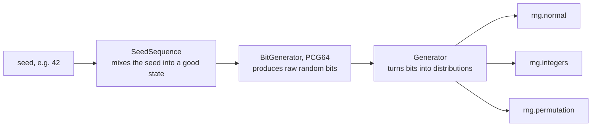
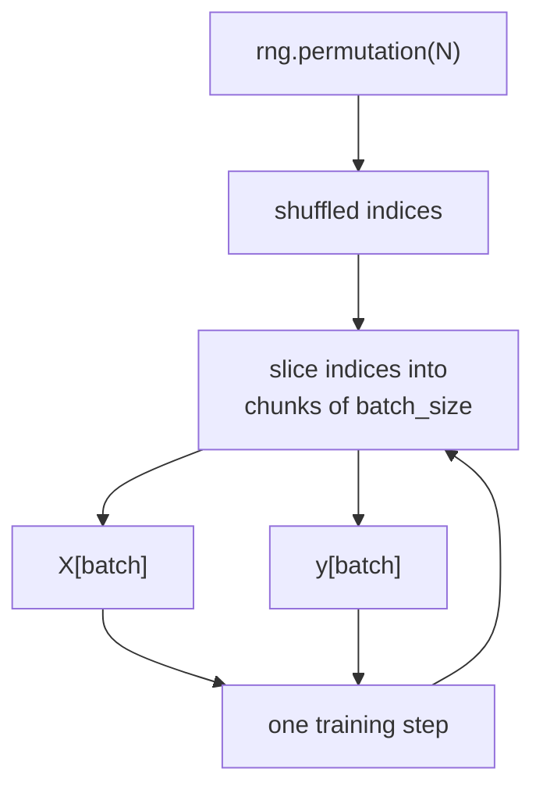

Randomness runs through machine learning. Weights are initialised randomly, training data is shuffled every epoch, mini-batches are sampled, dropout switches off random units, data augmentation applies random crops and flips, and language models sample their next token from a probability distribution. Yet you also need **reproducibility**: the same code with the same seed must give the same result, or you cannot debug a failing run or compare two experiments fairly. NumPy's random module gives you both, provided you use its modern interface, the `Generator` created by `np.random.default_rng(seed)`.

## Pseudo-random numbers and seeds

Computers generate **pseudo-random** numbers: a deterministic algorithm, a **bit generator**, produces a sequence that looks random and passes statistical tests, but is completely determined by its starting state. The **seed** sets that state. Same seed, same sequence.



`np.random.default_rng(seed)` builds this whole chain for you and returns the `Generator`, the object whose methods you call.

```python
import numpy as np

rng = np.random.default_rng(42)
print(rng.random(3))            # uniform on [0, 1)

rng_again = np.random.default_rng(42)
print(rng_again.random(3))      # identical: same seed, same sequence
print(rng_again.random(3))      # the stream continues, so different numbers
```

```output
[0.77395605 0.43887844 0.85859792]
[0.77395605 0.43887844 0.85859792]
[0.69736803 0.09417735 0.97562235]
```

Without a seed, `default_rng()` takes fresh entropy from the operating system, so every run differs. That is fine for production sampling, but for experiments, always seed.

## The Generator API, not the legacy functions

Older tutorials use `np.random.seed(0)` followed by functions such as `np.random.rand` and `np.random.randn`. That legacy API stores its state in one hidden global object. Any library you import can draw from or reseed that global state, which breaks reproducibility in ways that are hard to track down, and it uses an older bit generator. The NumPy documentation recommends the `Generator` API for all new code.

| Legacy (avoid in new code) | Modern `Generator` equivalent |
| --- | --- |
| `np.random.seed(0)` | `rng = np.random.default_rng(0)` |
| `np.random.rand(3, 2)` | `rng.random((3, 2))` |
| `np.random.randn(3, 2)` | `rng.standard_normal((3, 2))` |
| `np.random.randint(0, 10, size=5)` | `rng.integers(0, 10, size=5)` |
| `np.random.normal(0, 1, size=5)` | `rng.normal(0, 1, size=5)` |
| `np.random.shuffle(x)` | `rng.shuffle(x)` |

> [!KEY]
> Create one `Generator` near the top of your program with `rng = np.random.default_rng(seed)` and pass `rng` explicitly to every function that needs randomness. Explicit beats global: you can see exactly where randomness enters.

## Common distributions

```python
rng = np.random.default_rng(0)
print(rng.integers(0, 10, size=8))              # high is excluded
print(rng.integers(1, 6, size=8, endpoint=True)) # dice: 1..6 inclusive
print(rng.uniform(-1, 1, size=3).round(3))
print(rng.normal(loc=170, scale=10, size=3).round(1))
print(rng.choice(["cat", "dog", "bird"], size=5, p=[0.6, 0.3, 0.1]))
```

```output
[8 6 5 2 3 0 0 0]
[2 5 4 6 4 4 6 5]
[0.087 0.87  0.632]
[170.4 146.7 167.8]
['dog' 'cat' 'dog' 'cat' 'cat']
```

| Method | Draws from | Note |
| --- | --- | --- |
| `rng.random(size)` | Uniform on [0, 1) | Floats |
| `rng.uniform(low, high, size)` | Uniform on [low, high) | |
| `rng.integers(low, high, size)` | Integers in [low, high) | `endpoint=True` includes `high` |
| `rng.normal(loc, scale, size)` | [Normal distribution](/learn/probability-and-statistics/normal-distribution) | `scale` is the standard deviation, not the variance |
| `rng.standard_normal(size, dtype=...)` | Normal with mean 0, sd 1 | Accepts `dtype=np.float32` |
| `rng.binomial(n, p, size)` | Binomial | `n=1` gives Bernoulli trials |
| `rng.choice(a, size, replace, p)` | Elements of `a` | Weighted with `p`, without replacement with `replace=False` |
| `rng.permutation(x)` | A shuffled copy | An integer `n` gives a permutation of `range(n)` |
| `rng.shuffle(x)` | Shuffles `x` in place | Returns `None` |

A quick sanity check that the samples match the distribution:

```python
samples = rng.normal(loc=0.0, scale=2.0, size=100_000)
print(round(samples.mean(), 3), round(samples.std(), 3))
```

```output
-0.002 2.0
```

With 100,000 samples the estimates land close to the true mean 0 and standard deviation 2, as the [sampling](/learn/probability-and-statistics/sampling) lesson would predict.

## Shuffling and mini-batches

Training with mini-batch gradient descent visits the data in a new random order every epoch. The key detail: features `X` and labels `y` must be shuffled **with the same permutation**, or every example is paired with the wrong label. The safe pattern is to shuffle **indices** once and use them to index both arrays.

```python
X = np.arange(20).reshape(10, 2)
y = np.arange(10) * 10           # label i*10 belongs to row i

def iterate_minibatches(X, y, batch_size, rng):
    idx = rng.permutation(len(X))
    for start in range(0, len(X), batch_size):
        batch = idx[start:start + batch_size]
        yield X[batch], y[batch]

rng = np.random.default_rng(7)
for epoch in range(2):
    print("epoch", epoch)
    for Xb, yb in iterate_minibatches(X, y, batch_size=4, rng=rng):
        print("  ", Xb[:, 0] // 2, yb // 10)   # recover the row numbers
```

```output
epoch 0
   [8 0 7 1] [8 0 7 1]
   [3 6 2 4] [3 6 2 4]
   [5 9] [5 9]
epoch 1
   [4 2 8 3] [4 2 8 3]
   [9 1 5 6] [9 1 5 6]
   [0 7] [0 7]
```

Each epoch uses a different order because the generator's stream has moved on, yet rerunning the whole script reproduces both epochs exactly. The last batch is smaller when the dataset size is not a multiple of the batch size; frameworks let you keep it or drop it. The two printed rows always match, which confirms features and labels stayed paired.



> [!WARNING]
> Calling `rng.shuffle(X)` and then `rng.shuffle(y)` uses two different random orders and silently destroys the pairing between examples and labels. The model then learns from noise. Shuffle an index array once and apply it to both.

A random train/test split is the same idea with a single cut:

```python
rng = np.random.default_rng(0)
idx = rng.permutation(len(X))
cut = int(0.8 * len(X))
train_idx, test_idx = idx[:cut], idx[cut:]
print(np.sort(train_idx), np.sort(test_idx))
print(np.intersect1d(train_idx, test_idx).size)   # no overlap
```

```output
[0 2 3 4 5 6 7 9] [1 8]
0
```

## Randomness inside models

### Weight initialisation

Layer weights are drawn from a distribution scaled to the layer's size, so that activations neither explode nor vanish as they pass through many layers. One widely used scheme for ReLU networks, He initialisation, draws from a normal distribution with standard deviation $\sqrt{2 / n_{\text{in}}}$, where $n_{\text{in}}$ is the number of inputs to the layer:

```python
rng = np.random.default_rng(0)
n_in, n_out = 784, 256
W = rng.standard_normal((n_in, n_out), dtype=np.float32) * (2 / n_in) ** 0.5
print(W.dtype, W.shape, round(float(W.std()), 4), round((2 / n_in) ** 0.5, 4))
```

```output
float32 (784, 256) 0.0504 0.0505
```

The scale is a plain Python float, so the result stays float32. Multiplying by a NumPy float64 scalar such as `np.sqrt(2 / n_in)` would promote the whole matrix to float64, doubling its memory: one of the dtype surprises from [Arrays and dimensions](/learn/numpy/arrays-and-dimensions).

### Dropout masks

Dropout zeroes each activation with probability $p$ during training and scales the survivors by $1 / (1 - p)$ so that the expected value is unchanged:

```python
rng = np.random.default_rng(1)
h = np.ones((2, 6))
p = 0.25
mask = rng.random(h.shape) >= p
print(mask.astype(int))
print(h * mask / (1 - p))
```

```output
[[1 1 0 1 1 1]
 [1 1 1 0 1 1]]
[[1.33333333 1.33333333 0.         1.33333333 1.33333333 1.33333333]
 [1.33333333 1.33333333 1.33333333 0.         1.33333333 1.33333333]]
```

### Sampling the next token

A language model outputs a probability for every token in its vocabulary, and generation samples from it. **Temperature** $T$ divides the logits before the softmax: $T < 1$ sharpens the distribution, $T > 1$ flattens it.

```python
vocab = np.array(["the", "a", "cat", "dog", "sat"])
logits = np.array([2.0, 1.5, 0.5, 0.3, -1.0])

def sample(logits, temperature, rng, n):
    z = logits / temperature
    p = np.exp(z - z.max())
    p /= p.sum()
    return rng.choice(vocab, size=n, p=p)

rng = np.random.default_rng(3)
print(sample(logits, 0.3, rng, 10))
print(sample(logits, 2.0, rng, 10))
```

```output
['the' 'the' 'the' 'the' 'the' 'the' 'the' 'the' 'the' 'the']
['a' 'a' 'a' 'a' 'cat' 'sat' 'the' 'cat' 'cat' 'the']
```

At low temperature almost every sample is the most likely token; at high temperature the rarer tokens appear often. The softmax here uses the stable form from [Mathematical functions](/learn/numpy/mathematical-functions).

## Independent streams for parallel work

When several processes (data-loading workers, parallel simulations) each need randomness, giving them all the same seed makes them produce **identical** "random" numbers, and seeding them with `seed + 1`, `seed + 2` and so on is not guaranteed to give independent streams. `Generator.spawn` derives statistically independent child generators from a parent:

```python
parent = np.random.default_rng(123)
children = parent.spawn(3)
for i, child in enumerate(children):
    print(i, child.integers(0, 100, size=4))
```

```output
0 [95 19  2 75]
1 [73 55  4 22]
2 [ 0 77 86 88]
```

> [!NOTE]
> NumPy's seed controls only NumPy. Python's `random` module, PyTorch and GPU libraries have their own generators and need their own seeds. Some GPU operations are non-deterministic even with a seed, so bit-for-bit reproducibility in deep learning takes extra settings in the framework.

## Exercises

**1.** Using a generator seeded with 10, simulate 10,000 rolls of a fair six-sided die and print the fraction of each face.

<details>
<summary>Show solution</summary>

```python
rng = np.random.default_rng(10)
rolls = rng.integers(1, 6, size=10_000, endpoint=True)
faces, counts = np.unique(rolls, return_counts=True)
print(faces, (counts / len(rolls)).round(3))
```

```output
[1 2 3 4 5 6] [0.163 0.17  0.169 0.162 0.169 0.167]
```

Each fraction is close to 1/6, about 0.167.

</details>

**2.** Find the bug in this code and fix it.

```python
rng = np.random.default_rng(0)
X = np.arange(12).reshape(6, 2)
y = np.array([0, 0, 0, 1, 1, 1])
rng.shuffle(X)
rng.shuffle(y)
```

<details>
<summary>Show solution</summary>

The two shuffles use different random orders, so rows of `X` no longer line up with their labels. Shuffle indices once:

```python
rng = np.random.default_rng(0)
X = np.arange(12).reshape(6, 2)
y = np.array([0, 0, 0, 1, 1, 1])
perm = rng.permutation(len(X))
X, y = X[perm], y[perm]
print(X[:, 0] // 2, y)
```

```output
[3 2 5 4 0 1] [1 0 1 1 0 0]
```

Rows 0, 1 and 2 still carry label 0, and rows 3, 4 and 5 label 1.

</details>

**3.** Draw a bootstrap sample (sampling with replacement, same size as the data) of `data = np.arange(10)` and count how many distinct values it contains.

<details>
<summary>Show solution</summary>

```python
rng = np.random.default_rng(5)
data = np.arange(10)
boot = rng.choice(data, size=len(data), replace=True)
print(boot, len(np.unique(boot)))
```

```output
[6 8 0 8 4 5 6 2 9 0] 7
```

On average a bootstrap sample contains about 63 percent of the distinct original values, because some are drawn more than once.

</details>

```quiz
[
  {
    "q": "What is the recommended way to get reproducible random numbers in modern NumPy?",
    "options": [
      "`np.random.seed(0)` followed by `np.random.rand(...)`",
      "`rng = np.random.default_rng(0)` and calls such as `rng.random(...)`",
      "`import random; random.seed(0)`",
      "Setting the environment variable `PYTHONHASHSEED`"
    ],
    "answer": 1,
    "why": "The `Generator` API keeps its state in an explicit object you pass around, instead of a hidden global that other code can disturb."
  },
  {
    "q": "What can `rng.integers(0, 10)` return?",
    "options": ["Any integer from 0 to 10 inclusive", "Any integer from 1 to 10", "Any integer from 0 to 9", "A float between 0 and 10"],
    "answer": 2,
    "why": "The upper bound is excluded by default, as with `range`. Pass `endpoint=True` to include it."
  },
  {
    "q": "Why shuffle an index array instead of shuffling `X` and `y` separately?",
    "options": [
      "Shuffling indices is the only way to shuffle 2-D arrays",
      "Separate shuffles would change the dtype",
      "It uses less randomness",
      "Two separate shuffles apply different orders and break the pairing of examples with labels"
    ],
    "answer": 3,
    "why": "One permutation applied to both arrays keeps row i of `X` with element i of `y`."
  },
  {
    "q": "Four data-loading workers each call `np.random.default_rng(42)`. What happens?",
    "options": [
      "All four produce the same sequence of random numbers",
      "NumPy detects the clash and raises an error",
      "Each worker automatically gets an independent stream",
      "The seed is ignored in worker processes"
    ],
    "answer": 0,
    "why": "Same seed, same sequence. Use `parent.spawn(n)` or `SeedSequence.spawn` to derive independent streams."
  }
]
```
