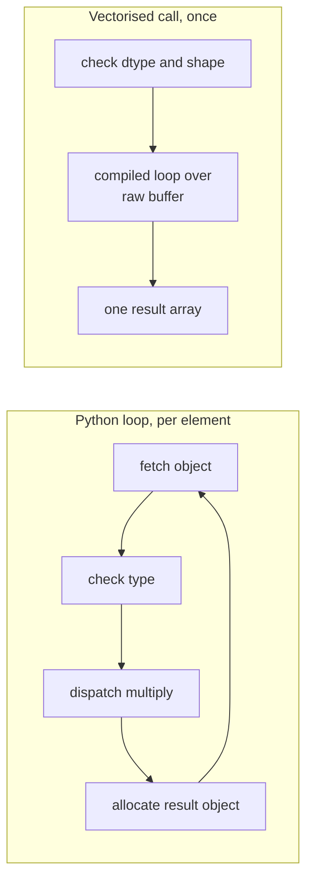

**Vectorisation** means expressing a computation as operations on whole arrays instead of as a Python loop over their elements. `y = 2 * x + 1` on an array of a million numbers is vectorised; a `for` loop that computes each `y[i]` one by one is not. Both give the same answer, but the vectorised version is typically tens to hundreds of times faster, and it is usually shorter and closer to the maths. Every serious numerical library, from scikit-learn to PyTorch, is built on this idea, and GPUs take it further by running the same operation on thousands of elements at once. Learning to "think in arrays" is the main skill this module builds.

## Why loops are slow in Python

A Python loop does a lot of work per element: it fetches the next object, checks its type, looks up how to multiply that type, allocates a new Python float for the result, and updates reference counts. A vectorised NumPy call does that bookkeeping **once**, then hands the whole buffer to a tight compiled loop that runs over raw numbers of a single known dtype. Modern CPUs can additionally process several numbers per instruction (SIMD) in such loops.



## Measuring the difference honestly

Here is the same computation, the sum of squares of a million numbers, written three ways. The timing uses `timeit`, which repeats the call and reduces noise.

```python
import timeit
import numpy as np

x = np.arange(1_000_000, dtype=np.float64)
xs = x.tolist()

def loop_sum_squares(values):
    total = 0.0
    for v in values:
        total += v * v
    return total

t_loop = min(timeit.repeat(lambda: loop_sum_squares(xs), number=3, repeat=3)) / 3
t_vec = min(timeit.repeat(lambda: (x * x).sum(), number=30, repeat=3)) / 30
t_dot = min(timeit.repeat(lambda: x @ x, number=30, repeat=3)) / 30

print(f"python loop : {t_loop * 1e3:8.2f} ms")
print(f"x * x .sum(): {t_vec * 1e3:8.2f} ms")
print(f"x @ x       : {t_dot * 1e3:8.2f} ms")
print(f"speed-up of the vectorised sum over the loop: about {t_loop / t_vec:.0f}x")
```

```output
python loop :     8.55 ms
x * x .sum():     0.24 ms
x @ x       :     0.03 ms
speed-up of the vectorised sum over the loop: about 36x
```

These numbers come from the machine this lesson was written on. **Yours will differ**, sometimes a lot, depending on the CPU, the NumPy build and what else is running. The durable lesson is the order of magnitude: the vectorised versions are far faster, and `x @ x` (a dot product handed to an optimised linear-algebra library) is often faster still because it does not create the temporary array `x * x`.

> [!NOTE]
> Benchmarks are easy to get wrong. Always time more than one run, take the best or median, and make sure the two versions compute the same thing. In a notebook, `%timeit expression` does the repetition for you.

Also check the answers agree. Floating-point addition is not associative, so different summation orders give slightly different results:

```python
a, b = loop_sum_squares(xs), (x * x).sum()
print(a, b, np.isclose(a, b))
```

```output
3.3333283333312755e+17 3.333328333335e+17 True
```

NumPy's `sum` uses pairwise summation, which is generally more accurate than a running total. Compare floats with `np.isclose` or `np.allclose`, never `==`.

## Universal functions and reductions

The building blocks of vectorised code are **ufuncs** (universal functions), which apply elementwise, and **reductions**, which collapse an axis.

| Kind | Examples | Shape effect |
| --- | --- | --- |
| Arithmetic ufuncs | `+ - * / ** //`, `np.abs`, `np.sqrt` | Same as the (broadcast) inputs |
| Mathematical ufuncs | `np.exp`, `np.log`, `np.sin`, `np.tanh` | Same as the input |
| Comparisons | `> < == !=`, `np.isnan`, `np.isfinite` | Same shape, boolean dtype |
| Reductions | `sum`, `mean`, `std`, `min`, `max`, `argmax`, `any`, `all` | Removes the reduced axis |
| Scans | `np.cumsum`, `np.cumprod` | Same shape, running result |

Together with [broadcasting](/learn/numpy/broadcasting) and [indexing](/learn/numpy/indexing-and-slicing), these replace almost every loop you would otherwise write.

## Translating loops into array expressions

The general recipe: identify what the loop computes **for one element**, write that as an expression on whole arrays, and replace any accumulation with a reduction.

### Conditionals become masks

```python
temps = np.array([12.0, 25.5, 31.2, 8.4, 19.9])

# loop version
labels_loop = []
for t in temps:
    labels_loop.append("hot" if t > 20 else "mild")

# vectorised version
labels_vec = np.where(temps > 20, "hot", "mild")
print(labels_loop)
print(labels_vec)
```

```output
['mild', 'hot', 'hot', 'mild', 'mild']
['mild' 'hot' 'hot' 'mild' 'mild']
```

### Running totals become scans

```python
daily = np.array([3, 1, 4, 1, 5, 9, 2, 6])
print(np.cumsum(daily))
window = 3
c = np.cumsum(np.insert(daily, 0, 0))
print((c[window:] - c[:-window]) / window)   # moving average without a loop
```

```output
[ 3  4  8  9 14 23 25 31]
[2.66666667 2.         3.33333333 5.         5.33333333 5.66666667]
```

### Nested loops become matrix products

A linear model's predictions for a batch are a dot product per row. Two nested loops collapse into one matrix-vector product:

```python
rng = np.random.default_rng(0)
X = rng.normal(size=(1000, 20))     # 1000 examples, 20 features
w = rng.normal(size=20)
b = 0.5

def predict_loop(X, w, b):
    out = np.empty(len(X))
    for i in range(X.shape[0]):
        s = 0.0
        for j in range(X.shape[1]):
            s += X[i, j] * w[j]
        out[i] = s + b
    return out

pred_vec = X @ w + b
print(np.allclose(predict_loop(X, w, b), pred_vec))
t1 = min(timeit.repeat(lambda: predict_loop(X, w, b), number=1, repeat=3))
t2 = min(timeit.repeat(lambda: X @ w + b, number=100, repeat=3)) / 100
print(f"loop {t1 * 1e3:.2f} ms, vectorised {t2 * 1e3:.4f} ms")
```

```output
True
loop 1.83 ms, vectorised 0.0030 ms
```

Again, the absolute timings depend on your machine; a gap of two or three orders of magnitude is typical.

## A vectorised training step

Vectorisation is what makes training on batches practical. For linear regression with mean squared error, the [gradient](/learn/calculus/gradients) over a batch of $N$ examples is

$$
\nabla_w L = \frac{2}{N} X^\top (Xw - y)
$$

where $X$ is the $N \times d$ matrix of inputs, $w$ the $d$ weights and $y$ the $N$ targets. Written in NumPy, the formula is the code. A few steps of [gradient descent](/learn/calculus/gradient-descent):

```python
true_w = np.arange(1, 21) / 10
y = X @ true_w + rng.normal(scale=0.1, size=1000)

w = np.zeros(20)
lr = 0.1
for step in range(200):                       # loop over steps, not over examples
    grad = 2 / len(X) * X.T @ (X @ w - y)
    w -= lr * grad

print(np.round(w[:5], 3))
print(np.round(true_w[:5], 3))
```

```output
[0.099 0.202 0.298 0.398 0.501]
[0.1 0.2 0.3 0.4 0.5]
```

The loop over **training steps** remains, because each step depends on the previous one. The loops over **examples and features**, which are independent, have disappeared into array operations. That is the right division: loop over things that are genuinely sequential, vectorise everything else.

> [!KEY]
> Ask of each loop: does iteration `i` depend on the result of iteration `i - 1`? If not, it can almost certainly be vectorised. If it does (training steps, recurrent updates, sampling one token after another), keep the loop and vectorise its body.

## Pitfalls

**`np.vectorize` is not vectorisation.** It wraps a Python function so that it accepts arrays, but it still calls that function once per element in Python. It is a convenience for readability, not a speed-up.

**Memory can be the new bottleneck.** Every intermediate expression allocates a full array. `np.sqrt(((a - b) ** 2).sum())` on huge arrays creates two temporaries the size of `a`. Where memory is tight, use in-place operators (`a -= b`) or the `out=` argument that ufuncs accept:

```python
a = np.ones(5)
np.multiply(a, 3, out=a)    # writes into a, no new array
np.add(a, 1, out=a)
print(a)
```

```output
[4. 4. 4. 4. 4.]
```

**Python scalars in a hot loop.** Indexing one element at a time, `x[i]`, inside a loop is slower than iterating over a list, because each access creates a NumPy scalar object. If you truly need an element-wise loop, either rethink it or convert with `.tolist()` first.

> [!TIP]
> Write the clearest correct version first, check its output, then vectorise and assert the two agree with `np.allclose`. The loop version becomes a free test.

## Exercises

**1.** Vectorise this function, then confirm both versions agree on a random array.

```python
def relu_loop(x):
    out = []
    for v in x:
        out.append(v if v > 0 else 0.0)
    return np.array(out)
```

<details>
<summary>Show solution</summary>

```python
def relu(x):
    return np.maximum(x, 0.0)

z = np.random.default_rng(1).normal(size=10_000)
print(np.allclose(relu_loop(z), relu(z)))
```

```output
True
```

`np.maximum` is the elementwise maximum of two arrays (here broadcasting the scalar 0). Do not confuse it with `np.max`, which is a reduction.

</details>

**2.** Compute the accuracy of predictions `pred = np.array([1, 0, 2, 2, 1])` against `true = np.array([1, 0, 1, 2, 0])` in one expression.

<details>
<summary>Show solution</summary>

```python
pred = np.array([1, 0, 2, 2, 1])
true = np.array([1, 0, 1, 2, 0])
print((pred == true).mean())
```

```output
0.6
```

The comparison gives a boolean array, and the mean of booleans is the fraction of `True` values.

</details>

**3.** Count how many values in each row of `M = np.random.default_rng(2).normal(size=(4, 1000))` lie more than 2 standard deviations from zero, without a loop.

<details>
<summary>Show solution</summary>

```python
M = np.random.default_rng(2).normal(size=(4, 1000))
print((np.abs(M) > 2).sum(axis=1))
```

```output
[44 44 49 48]
```

For a standard normal distribution you expect roughly 4.6 percent of values, about 46 per row.

</details>

```quiz
[
  {
    "q": "Why is a vectorised NumPy expression usually much faster than an equivalent Python loop?",
    "options": [
      "NumPy runs Python code on the GPU",
      "The per-element type checks and object handling happen once, then a compiled loop runs over raw numbers",
      "NumPy skips elements that are zero",
      "Python loops are limited to one million iterations"
    ],
    "answer": 1,
    "why": "NumPy pays the interpreter overhead once per call, not once per element, and its inner loops work on a contiguous buffer of a single dtype."
  },
  {
    "q": "Which of these loops cannot be fully vectorised over its iterations?",
    "options": [
      "Squaring each element of an array",
      "Computing predictions for each row of a batch",
      "Running 100 steps of gradient descent",
      "Checking each label against each prediction"
    ],
    "answer": 2,
    "why": "Each gradient descent step needs the weights produced by the previous step, so the steps are sequential. The work inside each step can be vectorised."
  },
  {
    "q": "What does `np.vectorize(f)(x)` do?",
    "options": [
      "Calls the Python function `f` once per element, for convenience rather than speed",
      "Compiles `f` to C for speed",
      "Runs `f` on the GPU",
      "Applies `f` to the whole array once"
    ],
    "answer": 0,
    "why": "The NumPy documentation describes `np.vectorize` as essentially a for loop, provided for convenience."
  },
  {
    "q": "How should you compare a loop result with a vectorised result for floats?",
    "options": ["`a == b`", "`a is b`", "`np.allclose(a, b)`", "`str(a) == str(b)`"],
    "answer": 2,
    "why": "Different summation orders give results that differ in the last few bits, so compare within a tolerance."
  }
]
```
