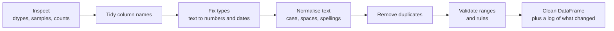

Real data is messy in boring, predictable ways: column names with spaces and capitals, numbers stored as text with units attached, the same category spelled four ways, duplicate rows from a retried export, dates in two formats, an age of 999. None of it raises an error. A model trained on it will run perfectly well and learn the mess. Data cleaning is the unglamorous work of turning what you received into what you think you have, and on most real projects it takes longer than the modelling.

This lesson works through one deliberately messy dataset, fixing a different class of problem in each section. Missing values get [their own lesson](/learn/pandas/handling-missing-values).

## A cleaning workflow

Clean in a fixed order, because later steps depend on earlier ones: you cannot find duplicates reliably until text is normalised, and you cannot check numeric ranges until the column is numeric.



Here is the raw data, a small export of customer orders:

```python
import io
import pandas as pd
import numpy as np

raw_csv = """Order ID, Customer Name ,Country,Order Date,Amount,Rating
1001,  alice smith,UK,2024-03-01,"1,250.00",5
1002,Bob Jones,united kingdom,2024-03-02,80.5,4
1003,CARLOS DIAZ,Spain,03/04/2024,45,3
1004,Dana Lee,uk ,2024-03-05,unknown,4
1002,Bob Jones,united kingdom,2024-03-02,80.5,4
1005,Eve Martin,ES,2024-03-06,12.99,99
1006,Femi Ade,U.K.,2024-03-07,300,2
"""

raw = pd.read_csv(io.StringIO(raw_csv))
print(raw)
print(raw.dtypes)
```

```output
   Order ID  Customer Name          Country  Order Date    Amount  Rating
0      1001     alice smith              UK  2024-03-01  1,250.00       5
1      1002       Bob Jones  united kingdom  2024-03-02      80.5       4
2      1003     CARLOS DIAZ           Spain  03/04/2024        45       3
3      1004        Dana Lee             uk   2024-03-05   unknown       4
4      1002       Bob Jones  united kingdom  2024-03-02      80.5       4
5      1005      Eve Martin              ES  2024-03-06     12.99      99
6      1006        Femi Ade            U.K.  2024-03-07       300       2
Order ID           int64
 Customer Name       str
Country              str
Order Date           str
Amount               str
Rating             int64
dtype: object
```

Count the problems: column names with stray spaces, inconsistent name casing, four spellings of the United Kingdom, two date formats, an amount with a thousands separator and one that says `unknown`, an exact duplicate row, and a rating of 99 on what is presumably a 1-to-5 scale. `Amount` and `Order Date` loaded as text.

## Tidy the column names

Code is easier to write when column names are lowercase `snake_case` with no spaces. Column names are an `Index` of strings, so the `.str` methods work on them:

```python
df = raw.copy()
df.columns = (
    df.columns.str.strip()
    .str.lower()
    .str.replace(" ", "_")
)
print(df.columns.tolist())
```

```output
['order_id', 'customer_name', 'country', 'order_date', 'amount', 'rating']
```

For one-off renames use `df.rename(columns={"old": "new"})`.

## Fix types: text to numbers

`pd.to_numeric` converts a column to numbers. With `errors="coerce"`, anything that cannot be parsed becomes `NaN` instead of raising an error. That is convenient and dangerous in equal measure, so always look at what got coerced.

```python
amount_text = df["amount"].str.replace(",", "", regex=False)   # drop thousands separators
amount = pd.to_numeric(amount_text, errors="coerce")

failed = df.loc[amount.isna() & df["amount"].notna(), "amount"]
print("could not parse:", failed.tolist())

df["amount"] = amount
print(df["amount"])
```

```output
could not parse: ['unknown']
0    1250.00
1      80.50
2      45.00
3        NaN
4      80.50
5      12.99
6     300.00
Name: amount, dtype: float64
```

Only `unknown` failed, which is a genuine missing value. If the list of failures had contained values like `"80.5 GBP"`, the right fix would be to strip the unit, not to let them become missing.

> [!WARNING]
> `errors="coerce"` hides problems by turning them into `NaN`. Before you coerce, or right after, print the original values that failed to parse. A column that is 30% unparseable usually means a format you have not handled, not 30% missing data.

## Fix types: dates

Dates are worse than numbers because the same string can mean different things: `03/04/2024` is the 3rd of April in the UK and the 4th of March in the US. Parse each known format explicitly rather than letting pandas guess:

```python
iso = pd.to_datetime(df["order_date"], format="%Y-%m-%d", errors="coerce")
day_first = pd.to_datetime(df["order_date"], format="%d/%m/%Y", errors="coerce")

df["order_date"] = iso.fillna(day_first)
print(df["order_date"])
```

```output
0   2024-03-01
1   2024-03-02
2   2024-04-03
3   2024-03-05
4   2024-03-02
5   2024-03-06
6   2024-03-07
Name: order_date, dtype: datetime64[us]
```

Each `to_datetime` call parses the rows that match its format and leaves the rest as `NaT` (not a time, the datetime version of `NaN`). `fillna` then fills the gaps from the second attempt. Any row still `NaT` after all known formats needs a human look.

## Normalise text

Text columns need consistent whitespace and case before you can count or compare them. The `.str` accessor applies string methods to every value at once:

```python
df["customer_name"] = df["customer_name"].str.strip().str.title()
df["country"] = df["country"].str.strip().str.lower()

print(df["customer_name"].tolist())
print(df["country"].value_counts())
```

```output
['Alice Smith', 'Bob Jones', 'Carlos Diaz', 'Dana Lee', 'Bob Jones', 'Eve Martin', 'Femi Ade']
country
uk                2
united kingdom    2
spain             1
es                1
u.k.              1
Name: count, dtype: int64
```

`value_counts` is the fastest way to see every spelling a category column contains. Now map them onto canonical codes:

```python
country_map = {
    "uk": "GB", "u.k.": "GB", "united kingdom": "GB",
    "spain": "ES", "es": "ES",
}
df["country"] = df["country"].map(country_map)

print(df["country"].value_counts(dropna=False))
```

```output
country
GB    5
ES    2
Name: count, dtype: int64
```

`map` with a dictionary returns `NaN` for any value not in the dictionary. Here every value was covered; in real data, checking `value_counts(dropna=False)` afterwards shows you which spellings you missed. If you want unmapped values to pass through unchanged, use `replace` instead of `map`.

| Method | Unmatched values become | Use when |
| --- | --- | --- |
| `s.map(mapping)` | `NaN` | You want to catch every spelling you have not seen |
| `s.replace(mapping)` | Themselves (unchanged) | You only want to fix a few known values |

## Remove duplicates

`duplicated()` marks every row that is an exact copy of an earlier one, and `drop_duplicates()` removes them:

```python
print(df.duplicated().sum(), "exact duplicate row(s)")
df = df.drop_duplicates()
print(len(df), "rows remain")
```

```output
1 exact duplicate row(s)
6 rows remain
```

Exact duplicates are the easy case. More often you have rows that share a **key** but differ elsewhere, for example the same order exported twice with a corrected amount. Decide which column identifies a row, then which copy to keep:

```python
updates = pd.DataFrame({
    "order_id": [2001, 2001, 2002],
    "amount": [50.0, 55.0, 20.0],
    "updated_at": pd.to_datetime(["2024-03-01", "2024-03-04", "2024-03-02"]),
})

latest = (
    updates
    .sort_values("updated_at")
    .drop_duplicates(subset="order_id", keep="last")
)
print(latest)
```

```output
   order_id  amount updated_at
2      2002    20.0 2024-03-02
1      2001    55.0 2024-03-04
```

Sorting first and then keeping the last copy keeps the most recent version of each order. This sort-then-deduplicate pattern appears in almost every data pipeline.

> [!KEY]
> Before you remove duplicates, decide what a row represents (an order, a user, a user on a given day). That decision defines the key columns for `subset=`, and it matters more than the code.

## Validate ranges and rules

Now that the columns have the right types, check that the values make sense. Write the rules down as code:

```python
print(df[["order_id", "amount", "rating"]].describe().loc[["min", "max"]])

bad_rating = ~df["rating"].between(1, 5)
print(df.loc[bad_rating, ["order_id", "rating"]])
```

```output
     order_id   amount  rating
min    1001.0    12.99     2.0
max    1006.0  1250.00    99.0
   order_id  rating
5      1005      99
```

A rating of 99 is impossible on a 1-to-5 scale. It is probably a data-entry error, but you cannot know what was meant, so replace it with a missing value rather than guessing:

```python
df["rating"] = df["rating"].where(df["rating"].between(1, 5))   # keep valid, else NaN
print(df[["order_id", "rating"]])
```

```output
   order_id  rating
0      1001     5.0
1      1002     4.0
2      1003     3.0
3      1004     4.0
5      1005     NaN
6      1006     2.0
```

`where(condition)` keeps values where the condition is true and replaces the rest with `NaN`. Its mirror image, `mask(condition)`, replaces values where the condition is true.

### Impossible versus unusual

Impossible values (negative ages, ratings outside the scale, dates in the future) are errors and should be fixed or removed. **Outliers** are values that are possible but unusual, like one order a hundred times larger than the rest. Those may be your most interesting data, so flag them rather than deleting them. A common rule of thumb flags anything more than 1.5 interquartile ranges beyond the quartiles, where the interquartile range is

$$
\text{IQR} = Q_3 - Q_1
$$

with $Q_1$ and $Q_3$ the 25th and 75th percentiles:

```python
q1, q3 = df["amount"].quantile([0.25, 0.75])
iqr = q3 - q1
df["amount_outlier"] = ~df["amount"].between(q1 - 1.5 * iqr, q3 + 1.5 * iqr) & df["amount"].notna()
print(df[["order_id", "amount", "amount_outlier"]])
```

```output
   order_id   amount  amount_outlier
0      1001  1250.00            True
1      1002    80.50           False
2      1003    45.00           False
3      1004      NaN           False
5      1005    12.99           False
6      1006   300.00           False
```

If you need to limit extreme values for a model, `clip(lower, upper)` caps them at a bound instead of removing the row.

## Packaging the cleaning as a function

Once the steps work, put them in one function so the same cleaning runs on next month's export and on the data your model sees in production:

```python
def clean_orders(raw: pd.DataFrame) -> pd.DataFrame:
    df = raw.copy()
    df.columns = df.columns.str.strip().str.lower().str.replace(" ", "_")
    iso = pd.to_datetime(df["order_date"], format="%Y-%m-%d", errors="coerce")
    dmy = pd.to_datetime(df["order_date"], format="%d/%m/%Y", errors="coerce")
    return (
        df.assign(
            customer_name=lambda d: d["customer_name"].str.strip().str.title(),
            country=lambda d: d["country"].str.strip().str.lower().map(country_map),
            order_date=iso.fillna(dmy),
            amount=lambda d: pd.to_numeric(d["amount"].str.replace(",", ""), errors="coerce"),
            rating=lambda d: d["rating"].where(d["rating"].between(1, 5)),
        )
        .drop_duplicates()
        .reset_index(drop=True)
    )

clean = clean_orders(raw)
print(clean)
```

```output
   order_id customer_name country order_date   amount  rating
0      1001   Alice Smith      GB 2024-03-01  1250.00     5.0
1      1002     Bob Jones      GB 2024-03-02    80.50     4.0
2      1003   Carlos Diaz      ES 2024-04-03    45.00     3.0
3      1004      Dana Lee      GB 2024-03-05      NaN     4.0
4      1005    Eve Martin      ES 2024-03-06    12.99     NaN
5      1006      Femi Ade      GB 2024-03-07   300.00     2.0
```

Note that `.copy()` at the top: a cleaning function should never modify the DataFrame it was given.

## Exercises

**1.** Clean this Series of prices into floats, and print the original strings that could not be parsed: `pd.Series(["12.50", " 7", "3,400.00", "free", "9.99 GBP", None])`. Treat `"free"` as `0` and strip the `"GBP"` suffix.

<details>
<summary>Show solution</summary>

```python
prices = pd.Series(["12.50", " 7", "3,400.00", "free", "9.99 GBP", None])
cleaned = (
    prices.str.strip()
    .replace("free", "0")
    .str.replace(",", "", regex=False)
    .str.removesuffix(" GBP")
)
as_num = pd.to_numeric(cleaned, errors="coerce")
print(as_num.tolist())
print(prices[as_num.isna() & prices.notna()].tolist())   # empty: everything parsed
```

</details>

**2.** A sign-up table has one row per sign-up event, with columns `email`, `signed_up_at` and `plan`. Some users signed up several times. Keep only each user's **first** sign-up, treating `Ana@x.com` and `ana@x.com ` as the same user.

<details>
<summary>Show solution</summary>

```python
signups = pd.DataFrame({
    "email": ["Ana@x.com", "ben@y.org", "ana@x.com ", "ben@y.org"],
    "signed_up_at": pd.to_datetime(["2024-02-01", "2024-01-15", "2024-01-20", "2024-03-01"]),
    "plan": ["pro", "free", "free", "pro"],
})
first = (
    signups
    .assign(email=lambda d: d["email"].str.strip().str.lower())
    .sort_values("signed_up_at")
    .drop_duplicates(subset="email", keep="first")
)
print(first)
```

Normalise the key before deduplicating; otherwise the two spellings count as different users.

</details>

**3.** Why is `drop_duplicates()` with no `subset` usually not enough on real data?

<details>
<summary>Show solution</summary>

It only removes rows that are identical in every column. Real duplicates usually differ somewhere: a timestamp, a corrected value, trailing whitespace. You need to normalise the data first and deduplicate on the columns that identify the entity, choosing which copy to keep with a sort and `keep=`.

</details>

```quiz
[
  {
    "q": "What does `pd.to_numeric(s, errors=\"coerce\")` do with the value `\"N/A\"`?",
    "options": ["Raises a `ValueError`", "Converts it to `0`", "Converts it to `NaN`", "Leaves it as the string `\"N/A\"`"],
    "answer": 2,
    "why": "With `errors=\"coerce\"`, unparseable values become `NaN`. That is why you should inspect what was coerced."
  },
  {
    "q": "A `country` column is mapped with `s.map({\"uk\": \"GB\", \"spain\": \"ES\"})`. What happens to the value `\"france\"`?",
    "options": ["It becomes `NaN`", "It stays `\"france\"`", "It raises a `KeyError`", "It becomes `\"FR\"`"],
    "answer": 0,
    "why": "`map` with a dictionary returns `NaN` for keys that are not in it. `replace` would leave it unchanged."
  },
  {
    "q": "You want to keep only the most recent version of each order. Which approach is correct?",
    "options": ["`df.drop_duplicates()`", "`df.drop_duplicates(subset=\"order_id\", keep=\"first\")` without sorting", "`df.sort_values(\"updated_at\").drop_duplicates(subset=\"order_id\", keep=\"last\")`", "`df.groupby(\"order_id\").first()`"],
    "answer": 2,
    "why": "Sorting by time puts the newest version last within each order, and `keep=\"last\"` keeps it. Without the sort, which copy you keep depends on file order."
  },
  {
    "q": "Why parse dates with an explicit `format=` instead of letting pandas infer it?",
    "options": ["Inference is not supported in pandas 2 and later", "Strings like `03/04/2024` are ambiguous, and an explicit format makes the interpretation deliberate", "Explicit formats convert dates to UTC", "Without `format`, pandas returns strings"],
    "answer": 1,
    "why": "Day-first and month-first formats look identical for many dates. Stating the format avoids silently swapping days and months."
  }
]
```
