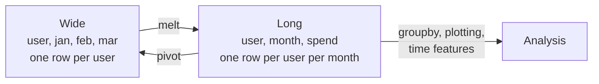

Clean data is rarely in the shape you need. You want a price band instead of a raw price, the hour of day instead of a full timestamp, last week's value next to this week's, one row per measurement instead of one column per month, one row per tag instead of a list of tags in a cell. **Transformation** is the general name for deriving new columns and reshaping tables. It is where analysis questions get answered and where most model features are born.

This lesson covers transforming values (column by column), reshaping tables (wide and long), and working along time (shifts and rolling windows), with one theme throughout: prefer vectorised operations to Python loops.

## The speed ladder

Before the techniques, the rule that decides between them. The same transformation can be written several ways, and they differ greatly in speed on large tables:

| Approach | Example | Runs in | Speed |
| --- | --- | --- | --- |
| Vectorised arithmetic and methods | `df["a"] * 2`, `.str.lower()`, `.dt.hour` | Compiled code, whole column at once | Fastest |
| NumPy helpers | `np.where`, `np.select`, `pd.cut` | Compiled code | Fastest |
| `map` with a dict or Series | `s.map({"a": 1})` | Hash lookups | Fast |
| `apply` with a Python function | `s.apply(my_func)` | Python, once per value | Slow |
| `apply(axis=1)`, `iterrows` | Row-by-row Python | Python, once per row, building objects | Slowest |

This is the same lesson as [vectorization in NumPy](/learn/numpy/vectorization): push the loop into compiled code. Use `apply` only when no vectorised form exists.

The running example is a table of e-commerce sessions:

```python
import pandas as pd
import numpy as np

sessions = pd.DataFrame({
    "user": ["u1", "u2", "u3", "u4", "u5", "u6"],
    "started": pd.to_datetime(["2024-05-03 08:15", "2024-05-03 13:40", "2024-05-04 22:05",
                               "2024-05-05 09:30", "2024-05-06 18:45", "2024-05-06 23:55"]),
    "pages": [3, 12, 1, 7, 25, 2],
    "basket": [0.0, 54.0, 0.0, 18.5, 230.0, 9.99],
    "device": ["mobile", "desktop", "mobile", "tablet", "desktop", "mobile"],
    "tags": [["new"], ["returning", "promo"], [], ["promo"], ["returning"], ["new", "promo"]],
})
print(sessions)
```

```output
  user             started  pages  basket   device                tags
0   u1 2024-05-03 08:15:00      3    0.00   mobile               [new]
1   u2 2024-05-03 13:40:00     12   54.00  desktop  [returning, promo]
2   u3 2024-05-04 22:05:00      1    0.00   mobile                  []
3   u4 2024-05-05 09:30:00      7   18.50   tablet             [promo]
4   u5 2024-05-06 18:45:00     25  230.00  desktop         [returning]
5   u6 2024-05-06 23:55:00      2    9.99   mobile        [new, promo]
```

## Transforming values

### Arithmetic and conditions

Arithmetic on columns is vectorised, and a comparison gives a boolean column you can store directly:

```python
out = sessions.assign(
    value_per_page=sessions["basket"] / sessions["pages"],
    converted=sessions["basket"] > 0,
)
print(out[["user", "pages", "basket", "value_per_page", "converted"]].round(2))
```

```output
  user  pages  basket  value_per_page  converted
0   u1      3    0.00            0.00      False
1   u2     12   54.00            4.50       True
2   u3      1    0.00            0.00      False
3   u4      7   18.50            2.64       True
4   u5     25  230.00            9.20       True
5   u6      2    9.99            5.00       True
```

For an if/else on every row, use `np.where(condition, value_if_true, value_if_false)`. For several conditions, `np.select` takes a list of conditions and a list of choices, and picks the first condition that is true:

```python
conditions = [
    sessions["basket"] == 0,
    sessions["basket"] < 50,
    sessions["basket"] >= 50,
]
choices = ["browse", "small", "large"]

out = sessions.assign(
    is_mobile=np.where(sessions["device"] == "mobile", 1, 0),
    basket_type=np.select(conditions, choices, default="unknown"),
)
print(out[["user", "device", "is_mobile", "basket", "basket_type"]])
```

```output
  user   device  is_mobile  basket basket_type
0   u1   mobile          1    0.00      browse
1   u2  desktop          0   54.00       large
2   u3   mobile          1    0.00      browse
3   u4   tablet          0   18.50       small
4   u5  desktop          0  230.00       large
5   u6   mobile          1    9.99       small
```

### Binning numbers with `cut` and `qcut`

`pd.cut` assigns numbers to bins with edges you choose; `pd.qcut` makes bins with (roughly) equal numbers of rows, using quantiles:

```python
out = sessions.assign(
    engagement=pd.cut(sessions["pages"], bins=[0, 2, 10, np.inf], labels=["low", "medium", "high"]),
    pages_tercile=pd.qcut(sessions["pages"], q=3, labels=["T1", "T2", "T3"]),
)
print(out[["user", "pages", "engagement", "pages_tercile"]])
```

```output
  user  pages engagement pages_tercile
0   u1      3     medium            T2
1   u2     12       high            T3
2   u3      1        low            T1
3   u4      7     medium            T2
4   u5     25       high            T3
5   u6      2        low            T1
```

Bins are right-inclusive by default: `(0, 2]` contains 2 but not 0. The result has the `category` dtype, which remembers the order of the labels.

### Mapping values

`map` with a dictionary translates values; with a Series it looks values up by index, which is handy for attaching per-key numbers:

```python
device_weight = {"mobile": 1.0, "tablet": 1.2, "desktop": 1.5}
print(sessions["device"].map(device_weight).tolist())
```

```output
[1.0, 1.5, 1.0, 1.2, 1.5, 1.0]
```

### Text and dates

The `.str` accessor (seen in [data cleaning](/learn/pandas/data-cleaning)) and the `.dt` accessor expose vectorised string and datetime methods:

```python
out = sessions.assign(
    day=sessions["started"].dt.day_name(),
    hour=sessions["started"].dt.hour,
    is_weekend=sessions["started"].dt.day_of_week >= 5,   # Monday=0 ... Sunday=6
    date=sessions["started"].dt.date,
    device_code=sessions["device"].str[0].str.upper(),
)
print(out[["started", "day", "hour", "is_weekend", "device_code"]])
```

```output
              started       day  hour  is_weekend device_code
0 2024-05-03 08:15:00    Friday     8       False           M
1 2024-05-03 13:40:00    Friday    13       False           D
2 2024-05-04 22:05:00  Saturday    22        True           M
3 2024-05-05 09:30:00    Sunday     9        True           T
4 2024-05-06 18:45:00    Monday    18       False           D
5 2024-05-06 23:55:00    Monday    23       False           M
```

Other useful `.dt` attributes are `.month`, `.year`, `.quarter`, `.day_of_year`, `.floor("h")` for rounding down to the hour, and subtraction of two datetime columns, which gives a `Timedelta` you can convert with `.dt.total_seconds()`.

### When you do need `apply`

Some logic has no vectorised form, such as calling a function from another library on each value. `apply` runs a Python function on each element (for a Series) or each row (`axis=1` on a DataFrame):

```python
def tag_summary(tags):
    return "+".join(sorted(tags)) if tags else "none"

print(sessions["tags"].apply(tag_summary).tolist())
```

```output
['new', 'promo+returning', 'none', 'promo', 'returning', 'new+promo']
```

That is fine for a few thousand rows. On millions of rows, look for a vectorised route first; often there is one, as the next section shows for lists.

> [!WARNING]
> `df.apply(f, axis=1)` builds a Series object for every row before calling `f`. Code like `df.apply(lambda r: r["a"] * r["b"], axis=1)` is a common way to make a one-second job take minutes. Write `df["a"] * df["b"]` instead.

## Reshaping: wide and long

The same information can be laid out in two shapes. **Wide** format has one row per entity and one column per measurement; **long** (or "tidy") format has one row per measurement:



Spreadsheets and reports favour wide; grouping, plotting libraries and most feature pipelines favour long. `melt` goes from wide to long, and `pivot` goes back:

```python
wide = pd.DataFrame({
    "user": ["u1", "u2"],
    "jan": [20, 0],
    "feb": [35, 12],
    "mar": [0, 40],
})

long = wide.melt(id_vars="user", var_name="month", value_name="spend")
print(long)

back = long.pivot(index="user", columns="month", values="spend")
print(back)
```

```output
  user month  spend
0   u1   jan     20
1   u2   jan      0
2   u1   feb     35
3   u2   feb     12
4   u1   mar      0
5   u2   mar     40
month  feb  jan  mar
user                
u1      35   20    0
u2      12    0   40
```

`pivot` raises an error if an index and column pair appears more than once, because it cannot place two values in one cell. When duplicates are possible, use `pivot_table` with an `aggfunc`, as in [grouping and aggregation](/learn/pandas/grouping-and-aggregation). Note also that `pivot` sorted the columns alphabetically; reorder with `back[["jan", "feb", "mar"]]`.

### Lists in cells: `explode`

JSON data often puts lists in a cell, like our `tags` column. `explode` gives each list element its own row, repeating the other columns, after which ordinary vectorised tools work again:

```python
tag_rows = sessions[["user", "tags"]].explode("tags")
print(tag_rows)
print(tag_rows["tags"].value_counts())
```

```output
  user       tags
0   u1        new
1   u2  returning
1   u2      promo
2   u3        NaN
3   u4      promo
4   u5  returning
5   u6        new
5   u6      promo
tags
promo        3
new          2
returning    2
Name: count, dtype: int64
```

User `u3` had an empty list, which becomes one row with `NaN`. The reverse step, collecting values back into lists, is `groupby("user")["tags"].agg(list)`.

## Working along time: shift, diff and rolling

For ordered data, many useful transformations compare a row with its neighbours. Sort by time first, and group by entity so that one user's history never leaks into another's:

```python
daily = pd.DataFrame({
    "store": ["A"] * 5 + ["B"] * 5,
    "day": list(pd.date_range("2024-05-01", periods=5)) * 2,
    "sales": [100, 120, 90, 130, 150, 40, 42, 39, 60, 55],
}).sort_values(["store", "day"])

g = daily.groupby("store")["sales"]
daily = daily.assign(
    prev_day=g.shift(1),
    change=g.diff(),
    pct_change=g.pct_change().round(3),
    rolling_3=g.transform(lambda s: s.rolling(3).mean()).round(1),
    running_total=g.cumsum(),
)
print(daily)
```

```output
  store        day  sales  prev_day  change  pct_change  rolling_3  running_total
0     A 2024-05-01    100       NaN     NaN         NaN        NaN            100
1     A 2024-05-02    120     100.0    20.0       0.200        NaN            220
2     A 2024-05-03     90     120.0   -30.0      -0.250      103.3            310
3     A 2024-05-04    130      90.0    40.0       0.444      113.3            440
4     A 2024-05-05    150     130.0    20.0       0.154      123.3            590
5     B 2024-05-01     40       NaN     NaN         NaN        NaN             40
6     B 2024-05-02     42      40.0     2.0       0.050        NaN             82
7     B 2024-05-03     39      42.0    -3.0      -0.071       40.3            121
8     B 2024-05-04     60      39.0    21.0       0.538       47.0            181
9     B 2024-05-05     55      60.0    -5.0      -0.083       51.3            236
```

| Method | Computes | First rows of each group |
| --- | --- | --- |
| `shift(k)` | The value `k` rows earlier (a **lag**) | `NaN` |
| `diff()` | Value minus the previous value | `NaN` |
| `pct_change()` | Relative change from the previous value | `NaN` |
| `rolling(w).mean()` | Mean of the last `w` rows, including this one | `NaN` until `w` rows exist |
| `cumsum()`, `cummax()` | Running total, running maximum | Defined from the first row |
| `expanding().mean()` | Mean of all rows so far | Defined from the first row |

> [!KEY]
> Lags and rolling windows must only look **backwards**. A feature like `rolling_3` includes the current day's sales, so if you are predicting today's sales, shift it first (`shift(1)` before `rolling`) so the model only sees what was known yesterday. Never use `shift(-1)` to build a feature: it pulls tomorrow's value into today's row.

## Composing transformations with `pipe`

When a transformation is a function of the whole DataFrame, `pipe` lets you keep it in a method chain. It calls `func(df, *args)`:

```python
def add_time_features(df, col):
    return df.assign(
        hour=df[col].dt.hour,
        is_weekend=df[col].dt.day_of_week >= 5,
    )

def add_basket_band(df, edges):
    return df.assign(basket_band=pd.cut(df["basket"], bins=edges, include_lowest=True))

result = (
    sessions
    .pipe(add_time_features, "started")
    .pipe(add_basket_band, [0, 10, 100, np.inf])
    .loc[:, ["user", "hour", "is_weekend", "basket", "basket_band"]]
)
print(result)
```

```output
  user  hour  is_weekend  basket     basket_band
0   u1     8       False    0.00  (-0.001, 10.0]
1   u2    13       False   54.00   (10.0, 100.0]
2   u3    22        True    0.00  (-0.001, 10.0]
3   u4     9        True   18.50   (10.0, 100.0]
4   u5    18       False  230.00    (100.0, inf]
5   u6    23       False    9.99  (-0.001, 10.0]
```

Each step is a small, testable function, and the chain reads as a description of the pipeline. This is the form you want when the same transformations must run identically in a training notebook and in production code.

## Exercises

**1.** Add a column `time_of_day` to `sessions` with the values `"night"` (hour 0 to 5), `"morning"` (6 to 11), `"afternoon"` (12 to 17) and `"evening"` (18 to 23), using `pd.cut` on the hour.

<details>
<summary>Show solution</summary>

```python
hours = sessions["started"].dt.hour
tod = pd.cut(hours, bins=[-1, 5, 11, 17, 23], labels=["night", "morning", "afternoon", "evening"])
print(sessions.assign(time_of_day=tod)[["started", "time_of_day"]])
```

The first edge is `-1` because bins exclude their left edge, and hour 0 must fall in the first bin.

</details>

**2.** Turn this wide table of model scores into long format with columns `model`, `benchmark` and `score`, then find each model's best benchmark: `pd.DataFrame({"model": ["a", "b"], "mmlu": [0.7, 0.8], "gsm8k": [0.6, 0.9], "humaneval": [0.5, 0.4]})`.

<details>
<summary>Show solution</summary>

```python
scores = pd.DataFrame({"model": ["a", "b"], "mmlu": [0.7, 0.8], "gsm8k": [0.6, 0.9], "humaneval": [0.5, 0.4]})
long = scores.melt(id_vars="model", var_name="benchmark", value_name="score")
best = long.sort_values("score", ascending=False).groupby("model").head(1)
print(best)
```

</details>

**3.** Using the `daily` table, add a feature `avg_prev_3` holding the mean of each store's **previous** three days of sales, not including the current day, so it is safe to use when predicting the current day.

<details>
<summary>Show solution</summary>

```python
daily_feat = daily.assign(
    avg_prev_3=daily.groupby("store")["sales"].transform(lambda s: s.shift(1).rolling(3).mean())
)
print(daily_feat[["store", "day", "sales", "avg_prev_3"]])
```

Shifting by one first means the window for each day covers the three days before it.

</details>

```quiz
[
  {
    "q": "Which is the fastest way to compute a column `c` equal to `a` times `b` on a large DataFrame?",
    "options": ["`df.apply(lambda r: r[\"a\"] * r[\"b\"], axis=1)`", "A `for` loop over `df.iterrows()`", "`df[\"a\"] * df[\"b\"]`", "`df[\"a\"].apply(lambda x: x) * df[\"b\"]`"],
    "answer": 2,
    "why": "Column arithmetic is vectorised and runs in compiled code. `apply(axis=1)` and `iterrows` run Python once per row."
  },
  {
    "q": "A table has one row per user and columns `jan`, `feb`, `mar`. Which call produces one row per user per month?",
    "options": ["`df.pivot(index=\"user\")`", "`df.melt(id_vars=\"user\", var_name=\"month\", value_name=\"spend\")`", "`df.explode(\"user\")`", "`df.stack(\"month\")`"],
    "answer": 1,
    "why": "`melt` converts wide columns into long rows, keeping `id_vars` as identifiers."
  },
  {
    "q": "What does `df.groupby(\"store\")[\"sales\"].shift(1)` give for the first row of each store?",
    "options": ["`NaN`", "The previous store's last value", "Zero", "The same row's value"],
    "answer": 0,
    "why": "Within a group there is no earlier row, so the lag is missing. Grouping prevents values from one store leaking into the next."
  },
  {
    "q": "With `pd.cut(x, bins=[0, 10, 20])`, which bin does the value 10 fall in?",
    "options": ["`(10, 20]`", "Neither: it becomes `NaN`", "Both bins", "`(0, 10]`"],
    "answer": 3,
    "why": "By default bins are closed on the right, so `(0, 10]` contains 10."
  }
]
```
