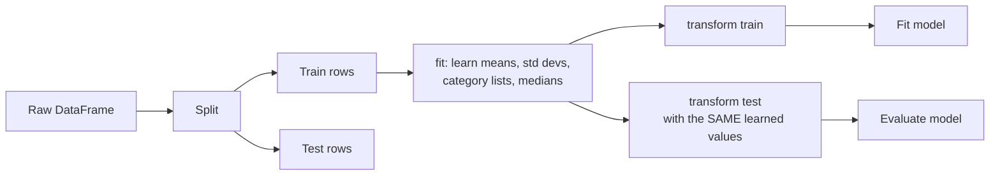

A machine learning model does not understand a DataFrame. It understands a matrix of numbers $X$, with one row per example and one column per feature, and a vector of targets $y$. Feature preparation is the bridge: turning dates, categories and raw quantities into numeric columns a model can learn from, and doing it in a way that gives an honest estimate of how the model will perform on data it has never seen. That second part is where most mistakes are made, so this lesson treats it as seriously as the encoding itself.

You will see these ideas again from the modelling side in [feature engineering](/learn/machine-learning-fundamentals/feature-engineering) and [data preprocessing](/learn/machine-learning-fundamentals/data-preprocessing). Here the focus is the pandas mechanics and the order of operations.

## The data and the goal

A subscription service wants to predict which customers will cancel (`churned`):

```python
import pandas as pd
import numpy as np
from sklearn.model_selection import train_test_split

customers = pd.DataFrame({
    "signup": pd.to_datetime([
        "2023-01-14 09:12", "2023-03-02 22:40", "2023-03-19 13:05", "2023-05-27 08:30",
        "2023-06-11 19:45", "2023-07-04 07:55", "2023-08-21 23:10", "2023-09-09 12:00",
        "2023-10-30 17:25", "2023-11-15 10:40", "2023-12-02 21:15", "2023-12-24 15:50",
    ]),
    "plan": ["basic", "pro", "basic", "team", "pro", "basic", "basic", "pro", "team", "basic", "pro", "basic"],
    "monthly_spend": [9.0, 29.0, 9.0, 99.0, 29.0, 9.0, 12.0, 35.0, 120.0, 9.0, 29.0, 10.0],
    "support_tickets": [0, 3, 5, 1, 0, 2, 6, 0, 1, 4, 2, 7],
    "churned": [0, 0, 1, 0, 0, 0, 1, 0, 0, 1, 0, 1],
})
print(customers)
```

```output
                signup   plan  monthly_spend  support_tickets  churned
0  2023-01-14 09:12:00  basic            9.0                0        0
1  2023-03-02 22:40:00    pro           29.0                3        0
2  2023-03-19 13:05:00  basic            9.0                5        1
3  2023-05-27 08:30:00   team           99.0                1        0
4  2023-06-11 19:45:00    pro           29.0                0        0
5  2023-07-04 07:55:00  basic            9.0                2        0
6  2023-08-21 23:10:00  basic           12.0                6        1
7  2023-09-09 12:00:00    pro           35.0                0        0
8  2023-10-30 17:25:00   team          120.0                1        0
9  2023-11-15 10:40:00  basic            9.0                4        1
10 2023-12-02 21:15:00    pro           29.0                2        0
11 2023-12-24 15:50:00  basic           10.0                7        1
```

`signup` is a timestamp, `plan` is a category, `monthly_spend` and `support_tickets` are numbers on very different scales, and `churned` is the target.

## Split first, then fit transformations

Every transformation that **learns something from data** (a mean for scaling, the list of categories for encoding, a median for filling gaps) must learn it from the training set only. The test set stands in for the future; if its statistics influence the features, your evaluation quietly includes information you will not have in production. This is called **data leakage**, and it makes models look better in testing than they turn out to be.



So the first real step is the split. `train_test_split` shuffles and splits rows; a fixed `random_state` makes it reproducible, and `stratify=y` keeps the proportion of churners similar in both parts:

```python
X = customers.drop(columns="churned")
y = customers["churned"]

X_train, X_test, y_train, y_test = train_test_split(
    X, y, test_size=0.25, random_state=42, stratify=y
)
print(X_train.shape, X_test.shape)
print("churn rate train:", y_train.mean(), " test:", y_test.mean())
```

```output
(9, 4) (3, 4)
churn rate train: 0.3333333333333333  test: 0.3333333333333333
```

> [!WARNING]
> If rows are ordered in time and the model will predict the future, do not shuffle. Train on the earlier period and test on the later one, for example `train = df[df["signup"] < "2023-10-01"]`. A random split lets the model learn from the future, which also counts as leakage.

## Datetime features

A raw timestamp is useless to most models. Break it into parts that might plausibly matter, and compute durations relative to a fixed reference date:

```python
def add_date_features(df, reference=pd.Timestamp("2024-01-01")):
    s = df["signup"]
    return df.assign(
        signup_month=s.dt.month,
        signup_dow=s.dt.day_of_week,          # Monday=0 ... Sunday=6
        signup_hour=s.dt.hour,
        signup_weekend=(s.dt.day_of_week >= 5).astype(int),
        tenure_days=(reference - s).dt.days,
    ).drop(columns="signup")

print(add_date_features(X_train).head())
```

```output
     plan  monthly_spend  support_tickets  signup_month  signup_dow  signup_hour  signup_weekend  tenure_days
1     pro           29.0                3             3           3           22               0          304
7     pro           35.0                0             9           5           12               1          113
6   basic           12.0                6             8           0           23               0          132
5   basic            9.0                2             7           1            7               0          180
10    pro           29.0                2            12           5           21               1           29
```

These features are computed row by row from the row's own values, so they learn nothing from other rows and are safe to compute before or after the split. Using a fixed `reference` rather than "today" matters: the feature must mean the same thing when you retrain next month.

### Cyclical features

Hour 23 and hour 0 are one hour apart, but as numbers they are 23 apart. For cyclical quantities, encode the position on a circle with a sine and a cosine:

$$
x_{\sin} = \sin\left(\frac{2\pi h}{P}\right), \qquad x_{\cos} = \cos\left(\frac{2\pi h}{P}\right)
$$

where $h$ is the value (such as the hour) and $P$ is the period (24 for hours, 7 for days of the week, 12 for months).

```python
hours = pd.Series([0, 6, 12, 18, 23])
cyc = pd.DataFrame({
    "hour": hours,
    "hour_sin": np.sin(2 * np.pi * hours / 24).round(3),
    "hour_cos": np.cos(2 * np.pi * hours / 24).round(3),
})
print(cyc)
```

```output
   hour  hour_sin  hour_cos
0     0     0.000     1.000
1     6     1.000     0.000
2    12     0.000    -1.000
3    18    -1.000    -0.000
4    23    -0.259     0.966
```

Hours 23 and 0 now have nearly identical coordinates. Tree-based models cope fine with plain integers, but distance-based and linear models benefit from this encoding.

## One-hot encoding categories

A model cannot multiply a weight by `"pro"`. **One-hot encoding** replaces a categorical column with one 0/1 column per category. Mapping categories to `0, 1, 2` instead would invent an order and spacing (is `team` twice `pro`?) that does not exist.

```python
print(pd.get_dummies(X_train["plan"], prefix="plan", dtype=int).head())
```

```output
    plan_basic  plan_pro  plan_team
1            0         1          0
7            0         1          0
6            1         0          0
5            1         0          0
10           0         1          0
```

`get_dummies` is convenient for exploration, but it has a trap for modelling: it creates columns for whatever categories happen to appear **in the data you give it**. If the test set lacks a category, or production data contains a new one, the columns no longer line up:

```python
train_part = pd.DataFrame({"plan": ["basic", "pro", "team"]})
new_part = pd.DataFrame({"plan": ["basic", "enterprise"]})

print(pd.get_dummies(train_part, dtype=int).columns.tolist())
print(pd.get_dummies(new_part, dtype=int).columns.tolist())
```

```output
['plan_basic', 'plan_pro', 'plan_team']
['plan_basic', 'plan_enterprise']
```

A model trained on three plan columns cannot accept the second table. The fix is to treat the set of categories as something learned from the training data. One way in pandas is to reindex to the training columns:

```python
train_cols = pd.get_dummies(train_part, dtype=int).columns
aligned = pd.get_dummies(new_part, dtype=int).reindex(columns=train_cols, fill_value=0)
print(aligned)
```

```output
   plan_basic  plan_pro  plan_team
0           1         0          0
1           0         0          0
```

The unseen `enterprise` customer gets zeros in every plan column, and the columns match training. scikit-learn's `OneHotEncoder(handle_unknown="ignore")` does the same thing more robustly, as you will see below.

> [!TIP]
> Categories with hundreds of values (cities, product IDs) produce hundreds of mostly-zero columns. Group rare categories into `"other"` using counts from the training set, or look at other encodings in the [feature engineering](/learn/machine-learning-fundamentals/feature-engineering) lesson.

## Scaling numeric features

`monthly_spend` ranges up to 120, while `support_tickets` ranges up to 7. Models trained with gradient descent, and any model based on distances (k-nearest neighbours, SVMs, k-means), are sensitive to these scale differences. **Standardisation** rescales each feature to mean 0 and standard deviation 1:

$$
z = \frac{x - \mu_{\text{train}}}{\sigma_{\text{train}}}
$$

where $x$ is a feature value, and $\mu_{\text{train}}$ and $\sigma_{\text{train}}$ are that feature's mean and standard deviation **computed on the training set**. The subscripts are the whole point:

```python
num_cols = ["monthly_spend", "support_tickets"]

mu = X_train[num_cols].mean()          # learned from training rows only
sigma = X_train[num_cols].std()

train_scaled = (X_train[num_cols] - mu) / sigma
test_scaled = (X_test[num_cols] - mu) / sigma    # reuse the training statistics

print(train_scaled.mean().round(3).tolist(), train_scaled.std().round(3).tolist())
print(test_scaled.round(2))
```

```output
[-0.0, 0.0] [1.0, 1.0]
   monthly_spend  support_tickets
9          -0.61             0.43
8           3.21            -0.73
4           0.08            -1.12
```

The training columns have mean 0 and standard deviation 1 exactly. The test columns do not, and that is correct: they are new data measured on the training scale. If you computed `mu` and `sigma` on the full dataset, or separately on the test set, the test rows would be shifted using information the model should not have.

**Min-max scaling**, $x' = (x - x_{\min}) / (x_{\max} - x_{\min})$, maps the training range to $[0, 1]$ instead. It is sensitive to outliers because a single extreme value sets the range. Tree-based models (decision trees, random forests, gradient boosting) split on thresholds and do not need scaling at all.

> [!KEY]
> Fit on train, transform both. Anything computed from data (means, standard deviations, category lists, fill values, rare-category thresholds) is a learned parameter of your pipeline and must come from the training rows only.

## Putting it together with scikit-learn

Doing all of this by hand is error-prone. scikit-learn's `ColumnTransformer` applies a different transformer to each group of columns, and it enforces "fit on train, transform both" because `fit` only ever sees what you pass it. With `set_output(transform="pandas")` the result stays a DataFrame with readable column names:

```python
from sklearn.compose import ColumnTransformer
from sklearn.preprocessing import OneHotEncoder, StandardScaler

prep = ColumnTransformer([
    ("num", StandardScaler(), ["monthly_spend", "support_tickets", "tenure_days"]),
    ("cat", OneHotEncoder(handle_unknown="ignore", sparse_output=False), ["plan"]),
], remainder="passthrough", verbose_feature_names_out=False).set_output(transform="pandas")

train_feat = add_date_features(X_train)
test_feat = add_date_features(X_test)

Xtr = prep.fit_transform(train_feat)     # learns means, std devs and categories
Xte = prep.transform(test_feat)          # applies them, learns nothing

print(Xtr.columns.tolist())
print(Xte.round(2))
```

```output
['monthly_spend', 'support_tickets', 'tenure_days', 'plan_basic', 'plan_pro', 'plan_team', 'signup_month', 'signup_dow', 'signup_hour', 'signup_weekend']
   monthly_spend  support_tickets  tenure_days  plan_basic  plan_pro  plan_team  signup_month  signup_dow  signup_hour  signup_weekend
9          -0.65             0.46        -1.18         1.0       0.0        0.0            11           2           10               0
8           3.41            -0.78        -1.04         0.0       0.0        1.0            10           0           17               0
4           0.08            -1.19         0.20         0.0       1.0        0.0             6           6           19               1
```

`remainder="passthrough"` keeps the remaining date features unchanged, and `verbose_feature_names_out=False` stops scikit-learn prefixing every name with its transformer (`num__`, `cat__`). The scaled values differ slightly from the hand-computed ones above because `StandardScaler` divides by the population standard deviation, while pandas `.std()` uses the sample standard deviation (dividing by $n - 1$); either is fine as long as train and test use the same one. `Xtr` and `Xte` now have identical columns in identical order, all numeric, ready for a model. In the [supervised learning modules](/learn/supervised-learning-algorithms) you will wrap this `prep` and a model together in a `Pipeline`, so that cross-validation refits the preprocessing inside every fold automatically.

## A leakage checklist

| Step | Leaky version | Safe version |
| --- | --- | --- |
| Scaling | Fit scaler on all rows | Fit on train, transform test |
| Filling missing values | Median of the full column | Median of the training column |
| Encoding categories | `get_dummies` on train and test separately | Learn categories on train; ignore unseen ones |
| Time series features | `shift(-1)`, `bfill`, centred rolling windows | Only past values: `shift(1)`, trailing windows |
| Splitting | Random split of time-ordered data | Split by time |
| Target-derived features | Per-category mean of the target over all rows | Compute on training folds only |
| Duplicates | Same entity in train and test | Split by entity ID (users, patients) |

The last row is easy to miss: if one user has twenty rows and they land in both train and test, the model can memorise the user rather than learn the pattern.

## Exercises

**1.** Add `signup_month_sin` and `signup_month_cos` features to `add_date_features`, treating months as a 12-step cycle. Why use `month - 1` rather than `month`?

<details>
<summary>Show solution</summary>

```python
def add_month_cycle(df):
    m = df["signup"].dt.month - 1          # 0..11 so January sits at angle 0
    return df.assign(
        signup_month_sin=np.sin(2 * np.pi * m / 12),
        signup_month_cos=np.cos(2 * np.pi * m / 12),
    )

print(add_month_cycle(X_train)[["signup", "signup_month_sin", "signup_month_cos"]].round(2).head(3))
```

Months run 1 to 12. Subtracting 1 gives 0 to 11, so December (11) lands one step before January (0) on the circle. Using 1 to 12 would also work (12 and 0 coincide), but starting at 0 keeps the step sizes and the mapping obvious.

</details>

**2.** A colleague writes `X_scaled = (X - X.mean()) / X.std()` and then splits `X_scaled` into train and test. Explain the problem and rewrite it correctly.

<details>
<summary>Show solution</summary>

The mean and standard deviation include the test rows, so test-set information shapes the training features: leakage. Split first, then use the training statistics for both:

```python
Xtr, Xte = train_test_split(customers[["monthly_spend", "support_tickets"]], test_size=0.25, random_state=0)
mu, sd = Xtr.mean(), Xtr.std()
Xtr_s, Xte_s = (Xtr - mu) / sd, (Xte - mu) / sd
```

</details>

**3.** Production data arrives with a plan called `"student"` that never appeared in training. What does the fitted `prep` from this lesson produce for that row's plan columns, and why is that better than `get_dummies`?

<details>
<summary>Show solution</summary>

```python
new = add_date_features(pd.DataFrame({
    "signup": pd.to_datetime(["2023-12-30 10:00"]), "plan": ["student"],
    "monthly_spend": [5.0], "support_tickets": [0],
}))
print(prep.transform(new).filter(like="plan"))   # all zeros
```

With `handle_unknown="ignore"` the unseen category becomes all zeros in the plan columns, and the output keeps exactly the training columns. `get_dummies` would add a new `plan_student` column and drop the others that are absent, breaking the model's input shape.

</details>

```quiz
[
  {
    "q": "When standardising features for a model, where should the mean and standard deviation come from?",
    "options": ["The full dataset, so the statistics are more accurate", "The training set only, then reused for validation and test data", "Each split separately, so every split has mean 0", "The test set, because it represents future data"],
    "answer": 1,
    "why": "Statistics are learned parameters. Computing them on anything but the training rows leaks information from the evaluation data."
  },
  {
    "q": "Why is mapping `basic`, `pro`, `team` to 0, 1, 2 usually a poor encoding for a linear model?",
    "options": ["It creates too many columns", "It cannot represent unseen categories", "It imposes an order and equal spacing that the categories do not have", "Linear models require text input"],
    "answer": 2,
    "why": "The model would treat `team` as twice `pro`. One-hot encoding gives each category its own independent weight."
  },
  {
    "q": "Why encode hour of day with sine and cosine?",
    "options": ["So that hour 23 and hour 0 end up close together", "To scale hours into the range 0 to 1", "Because models cannot use integers", "To remove the need for a train/test split"],
    "answer": 0,
    "why": "Placing hours on a circle makes the encoding respect the wrap-around from 23 to 0."
  },
  {
    "q": "You call `pd.get_dummies` separately on the training and test sets. What can go wrong?",
    "options": ["Nothing, as long as both use `dtype=int`", "The test values are scaled differently", "Rows are reordered", "The two results can have different columns if a category is missing from one set"],
    "answer": 3,
    "why": "`get_dummies` only creates columns for categories present in its input. Align to the training columns, or use `OneHotEncoder(handle_unknown=\"ignore\")` fitted on the training data."
  }
]
```
