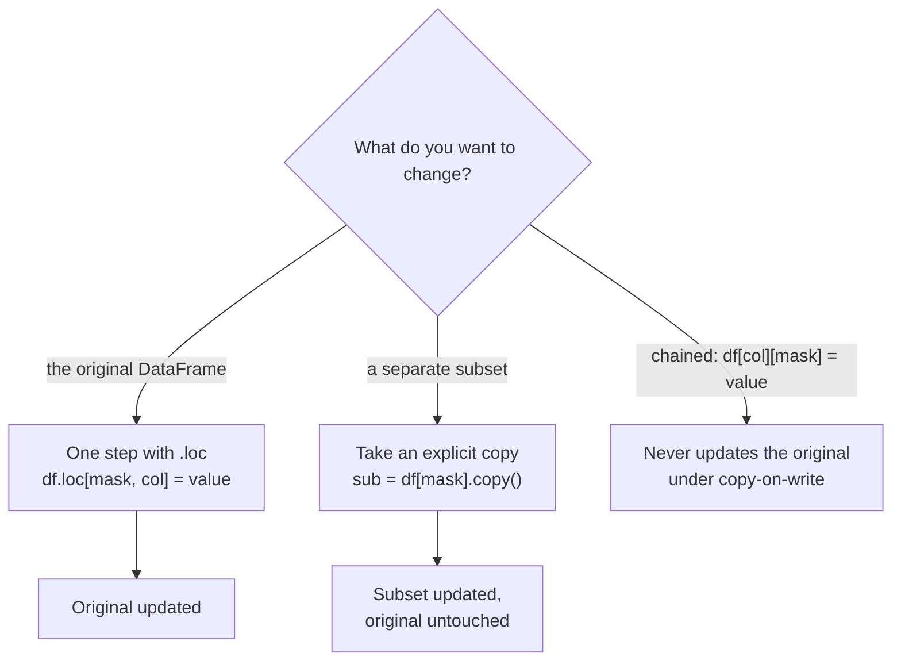

Most questions you ask of a dataset start with "which rows?": which transactions were flagged as fraud, which prompts made the model fail, which users signed up last week, which ten products sold best. Filtering selects rows that meet a condition; sorting puts them in a useful order. Both are simple to write and both have one classic trap each, which this lesson makes sure you avoid.

We will use a small table of LLM evaluation results throughout:

```python
import pandas as pd
import numpy as np

evals = pd.DataFrame({
    "model": ["gpt", "claude", "local", "claude", "gpt", "local", "claude"],
    "task": ["code", "code", "code", "math", "math", "math", "summary"],
    "score": [0.82, 0.88, 0.61, 0.91, 0.77, 0.45, 0.86],
    "latency_ms": [420, 610, 150, 580, 390, 140, 300],
    "notes": ["ok", "timeout once", None, "ok", "format error", None, "ok"],
})
print(evals)
```

```output
    model     task  score  latency_ms         notes
0     gpt     code   0.82         420            ok
1  claude     code   0.88         610  timeout once
2   local     code   0.61         150           NaN
3  claude     math   0.91         580            ok
4     gpt     math   0.77         390  format error
5   local     math   0.45         140           NaN
6  claude  summary   0.86         300            ok
```

## Boolean masks

A comparison on a column returns a Series of `True`/`False` values, one per row. This is called a **boolean mask**:

```python
fast = evals["latency_ms"] < 400
print(fast)
```

```output
0    False
1    False
2     True
3    False
4     True
5     True
6     True
Name: latency_ms, dtype: bool
```

Passing a mask inside square brackets keeps the rows where it is `True`:

```python
print(evals[fast])
```

```output
    model     task  score  latency_ms         notes
2   local     code   0.61         150           NaN
4     gpt     math   0.77         390  format error
5   local     math   0.45         140           NaN
6  claude  summary   0.86         300            ok
```

This is the same idea as [boolean indexing in NumPy](/learn/numpy/indexing-and-slicing), with one difference: the result keeps the original index labels (0, 2, 4, 5, 6 above). That is useful, because you can always trace a row back to where it came from, and it is why `.iloc` and `.loc` disagree after filtering.

### Combining conditions

Combine masks with `&` (and), `|` (or) and `~` (not). Python's `and`, `or` and `not` do **not** work on Series, and every condition needs its own parentheses because `&` and `|` bind more tightly than `<` and `==`:

```python
good_and_fast = evals[(evals["score"] > 0.8) & (evals["latency_ms"] < 500)]
print(good_and_fast)

not_claude = evals[~(evals["model"] == "claude")]
print(not_claude["model"].unique().tolist())
```

```output
    model     task  score  latency_ms notes
0     gpt     code   0.82         420    ok
6  claude  summary   0.86         300    ok
['gpt', 'local']
```

Step through how the mask is built and applied:

```trace
{
  "title": "building and applying a boolean mask",
  "code": [
    "scores = pd.Series([0.82, 0.61, 0.91, 0.45])",
    "latency = pd.Series([420, 150, 580, 140])",
    "good = scores > 0.6",
    "quick = latency < 500",
    "mask = good & quick",
    "print(scores[mask])"
  ],
  "steps": [
    { "line": 1, "vars": { "scores": "[0.82, 0.61, 0.91, 0.45]" }, "note": "Four rows, index labels 0 to 3." },
    { "line": 2, "vars": { "scores": "[0.82, 0.61, 0.91, 0.45]", "latency": "[420, 150, 580, 140]" }, "note": "A second column with the same index." },
    { "line": 3, "vars": { "scores": "[0.82, 0.61, 0.91, 0.45]", "latency": "[420, 150, 580, 140]", "good": "[True, True, True, False]" }, "note": "The comparison runs on every element at once and returns a boolean Series." },
    { "line": 4, "vars": { "scores": "[0.82, 0.61, 0.91, 0.45]", "latency": "[420, 150, 580, 140]", "good": "[True, True, True, False]", "quick": "[True, True, False, True]" }, "note": "A second mask, aligned on the same labels." },
    { "line": 5, "vars": { "scores": "[0.82, 0.61, 0.91, 0.45]", "latency": "[420, 150, 580, 140]", "good": "[True, True, True, False]", "quick": "[True, True, False, True]", "mask": "[True, True, False, False]" }, "note": "& combines the masks element by element: a row survives only if both are True." },
    { "line": 6, "vars": { "scores": "[0.82, 0.61, 0.91, 0.45]", "latency": "[420, 150, 580, 140]", "mask": "[True, True, False, False]" }, "out": ["0    0.82", "1    0.61", "dtype: float64"], "note": "Indexing with the mask keeps rows 0 and 1, with their original labels." }
  ]
}
```

> [!WARNING]
> `evals[evals["score"] > 0.8 & evals["latency_ms"] < 500]` without the inner parentheses does not mean what it looks like. Python evaluates `0.8 & evals["latency_ms"]` first, which raises an error or, worse, produces a meaningless mask. Always wrap each comparison in parentheses.

## Filtering helpers

Long chains of `|` get unreadable. pandas has helpers for the common patterns:

| Need | Method | Example |
| --- | --- | --- |
| Value in a set | `isin` | `evals["task"].isin(["code", "math"])` |
| Value in a range (inclusive) | `between` | `evals["score"].between(0.6, 0.9)` |
| Text contains a pattern | `str.contains` | `evals["notes"].str.contains("error", na=False)` |
| Missing or present | `isna`, `notna` | `evals["notes"].isna()` |
| Expression as a string | `query` | `evals.query("score > 0.8 and task == 'math'")` |

```python
print(evals[evals["task"].isin(["math", "summary"]) & evals["score"].between(0.8, 1.0)])
print(evals[evals["notes"].str.contains("error|timeout", na=False)])
```

```output
    model     task  score  latency_ms notes
3  claude     math   0.91         580    ok
6  claude  summary   0.86         300    ok
    model  task  score  latency_ms         notes
1  claude  code   0.88         610  timeout once
4     gpt  math   0.77         390  format error
```

The `na=False` in `str.contains` matters: missing text produces a missing result, and a mask containing missing values cannot be used to filter. `na=False` treats missing text as "does not contain".

`query` lets you write the condition as a string, which reads well in method chains. Prefix Python variables with `@`:

```python
threshold = 0.8
print(evals.query("score > @threshold and latency_ms < 500"))
```

```output
    model     task  score  latency_ms notes
0     gpt     code   0.82         420    ok
6  claude  summary   0.86         300    ok
```

## Selecting rows and columns together with `.loc`

`.loc[mask, columns]` filters rows and picks columns in one step:

```python
print(evals.loc[evals["model"] == "claude", ["task", "score"]])
```

```output
      task  score
1     code   0.88
3     math   0.91
6  summary   0.86
```

This form is not just tidier. It is the correct way to **change** values in the filtered rows, which brings us to the trap.

## The trap: changing a filtered subset

Suppose you want to cap the latency of the slow runs at 500. A natural first attempt:

```python
slow = evals[evals["latency_ms"] > 500]
slow["latency_ms"] = 500
print(evals["latency_ms"].tolist())
```

```output
[420, 610, 150, 580, 390, 140, 300]
```

`evals` is unchanged. Filtering returns a **new** object; changing it does not change the original. In pandas 2.x this code also prints a `SettingWithCopyWarning`:

```output
SettingWithCopyWarning:
A value is trying to be set on a copy of a slice from a DataFrame.
Try using .loc[row_indexer,col_indexer] = value instead
```

The warning existed because in pandas 2 the answer to "does this modify the original?" depended on internal details (whether the filter returned a view or a copy), and was hard to predict. pandas 3 makes **copy-on-write** the only behaviour: every filtered or selected object acts as an independent copy, so changing it never touches the original, and the warning is gone. (In pandas 2.2 and later you can opt in with `pd.set_option("mode.copy_on_write", True)`.)



To change the original, do it in **one** indexing operation with `.loc`:

```python
evals.loc[evals["latency_ms"] > 500, "latency_ms"] = 500
print(evals["latency_ms"].tolist())
```

```output
[420, 500, 150, 500, 390, 140, 300]
```

If you actually want a separate subset that you will modify, say so with `.copy()`. The code then means the same thing in every pandas version, and readers can see your intent:

```python
claude_runs = evals[evals["model"] == "claude"].copy()
claude_runs["score"] = claude_runs["score"].round(1)
```

### Chained assignment

The other form of the same mistake is **chained assignment**: two indexing operations in a row, with an assignment at the end:

```python
evals["score"][evals["task"] == "math"] = 0
print(evals["score"].tolist())
```

```output
ChainedAssignmentError: A value is being set on a copy of a DataFrame or Series through chained assignment.
Such chained assignment never works to update the original DataFrame or Series, because the intermediate object on which we are setting values always behaves as a copy (due to Copy-on-Write).

Try using '.loc[row_indexer, col_indexer] = value' instead, to perform the assignment in a single step.

See the documentation for a more detailed explanation: https://pandas.pydata.org/docs/dev/user_guide/migration.html#chained-assignment
[0.82, 0.88, 0.61, 0.91, 0.77, 0.45, 0.86]
```

`evals["score"]` produces a Series, and the assignment changes that intermediate Series, not `evals`. pandas 3 warns that this never works; in pandas 2 it sometimes worked and sometimes did not. The fix is again a single `.loc` call: `evals.loc[evals["task"] == "math", "score"] = 0`.

> [!KEY]
> One rule covers every case: to modify a DataFrame, use a single `df.loc[rows, columns] = value`. To build a modified version without touching the original, use `assign` or an explicit `.copy()`.

## Sorting

`sort_values` sorts by one or more columns and returns a new DataFrame:

```python
print(evals.sort_values("score", ascending=False).head(3))
```

```output
    model     task  score  latency_ms         notes
3  claude     math   0.91         500            ok
1  claude     code   0.88         500  timeout once
6  claude  summary   0.86         300            ok
```

Sort by several columns with a list. `ascending` can be a matching list, so you can sort tasks alphabetically and, within each task, scores from best to worst:

```python
print(evals.sort_values(["task", "score"], ascending=[True, False])[["task", "model", "score"]])
```

```output
      task   model  score
1     code  claude   0.88
0     code     gpt   0.82
2     code   local   0.61
3     math  claude   0.91
4     math     gpt   0.77
5     math   local   0.45
6  summary  claude   0.86
```

Other sorting tools you will use:

| Method | Does |
| --- | --- |
| `sort_values(col, na_position="first")` | Put missing values first instead of last |
| `sort_values(col, key=lambda s: s.str.lower())` | Sort by a transformed version of the column, here case-insensitively |
| `sort_index()` | Sort by the row labels, for example to restore the original order |
| `nlargest(n, col)`, `nsmallest(n, col)` | Top or bottom `n` rows, faster than a full sort |
| `rank()` | Give each row its rank instead of reordering |
| `reset_index(drop=True)` | Renumber rows 0, 1, 2 after sorting or filtering |

```python
print(evals.nsmallest(2, "latency_ms")[["model", "task", "latency_ms"]])
print(evals.assign(rank=evals["score"].rank(ascending=False)).loc[:, ["model", "task", "score", "rank"]].head(3))
```

```output
   model  task  latency_ms
5  local  math         140
2  local  code         150
    model  task  score  rank
0     gpt  code   0.82   4.0
1  claude  code   0.88   2.0
2   local  code   0.61   6.0
```

> [!TIP]
> When you sort by a column with ties and need the order to be reproducible, add a tie-breaking column such as an ID: `sort_values(["score", "id"])`. The default sort algorithm does not promise to keep tied rows in any particular order, so without a tie-breaker (or `kind="stable"`) a "top 10" list can change when the input order changes.

## Putting it together

A typical analysis question, written as one chain: "Which non-local runs scored at least 0.8, fastest first?"

```python
answer = (
    evals
    .query("model != 'local'")
    .loc[lambda d: d["score"] >= 0.8, ["model", "task", "score", "latency_ms"]]
    .sort_values("latency_ms")
    .reset_index(drop=True)
)
print(answer)
```

```output
    model     task  score  latency_ms
0  claude  summary   0.86         300
1     gpt     code   0.82         420
2  claude     code   0.88         500
3  claude     math   0.91         500
```

`.loc` accepts a function, which receives the DataFrame at that point in the chain. That lets you filter on the intermediate result without naming it.

## Exercises

**1.** Using `evals`, select the rows where the task is `code` or `math`, the score is below 0.8, and `notes` is not missing. Show only `model`, `task` and `score`.

<details>
<summary>Show solution</summary>

```python
out = evals.loc[
    evals["task"].isin(["code", "math"]) & (evals["score"] < 0.8) & evals["notes"].notna(),
    ["model", "task", "score"],
]
print(out)
```

</details>

**2.** This code is meant to flag low scores in `evals`, but the column never appears in `evals`. Explain why and fix it.

```python
low = evals[evals["score"] < 0.6]
low["flag"] = True
```

<details>
<summary>Show solution</summary>

`low` is a separate object; adding a column to it does not affect `evals`. Use a single `.loc` assignment on the original:

```python
evals["flag"] = False
evals.loc[evals["score"] < 0.6, "flag"] = True
# or, without mutating: evals = evals.assign(flag=evals["score"] < 0.6)
```

</details>

**3.** For each task, list the models in order of score, best first, and break ties by lower latency.

<details>
<summary>Show solution</summary>

```python
print(evals.sort_values(["task", "score", "latency_ms"], ascending=[True, False, True]))
```

</details>

```quiz
[
  {
    "q": "Which expression correctly keeps rows where `score > 0.8` and `task` is `\"math\"`?",
    "options": ["`df[df[\"score\"] > 0.8 and df[\"task\"] == \"math\"]`", "`df[df[\"score\"] > 0.8 & df[\"task\"] == \"math\"]`", "`df[(df[\"score\"] > 0.8) & (df[\"task\"] == \"math\")]`", "`df[(df[\"score\"] > 0.8), (df[\"task\"] == \"math\")]`"],
    "answer": 2,
    "why": "Use `&` for element-wise and, with parentheses around each comparison because `&` binds more tightly than `>` and `==`."
  },
  {
    "q": "Under copy-on-write (the default in pandas 3), what does `sub = df[df[\"x\"] > 0]; sub[\"y\"] = 1` do to `df`?",
    "options": ["Nothing: `sub` behaves as an independent copy", "Sets `y` to 1 in the matching rows of `df`", "Sets `y` to 1 in every row of `df`", "Raises an error"],
    "answer": 0,
    "why": "A filtered DataFrame behaves as a copy. To modify `df`, use `df.loc[df[\"x\"] > 0, \"y\"] = 1`."
  },
  {
    "q": "Why pass `na=False` to `s.str.contains(\"error\")` when filtering?",
    "options": ["To make the match case-insensitive", "So missing text counts as not matching, giving a mask with no missing values", "To disable regular expressions", "To drop rows with missing values from the DataFrame"],
    "answer": 1,
    "why": "Missing text gives a missing result, and a boolean mask with missing values cannot be used for indexing. `na=False` fills those positions with `False`."
  },
  {
    "q": "After `df.sort_values(\"score\")`, the index labels are out of order. Which call renumbers the rows 0, 1, 2, ... and discards the old labels?",
    "options": ["`sort_index()`", "`reset_index()`", "`reindex()`", "`reset_index(drop=True)`"],
    "answer": 3,
    "why": "`reset_index(drop=True)` creates a fresh RangeIndex. Without `drop=True` the old labels become a new column; `sort_index()` would undo the sort."
  }
]
```
