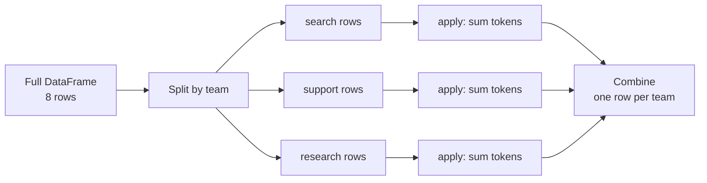

"What is the average latency per model?" "How many tokens did each team use last month?" "Which customer segment has the highest churn?" Each of these questions has the same shape: split the rows into groups, compute something for each group, and collect the answers into a table. In SQL this is `GROUP BY`; in pandas it is `groupby`, and it is probably the single most useful method in the library. It also does far more than averages: it can fill missing values per group, rank within groups and compute group-level features for a model.

The examples use a log of LLM API requests:

```python
import pandas as pd
import numpy as np

log = pd.DataFrame({
    "team": ["search", "search", "support", "support", "support", "search", "research", "research"],
    "model": ["small", "large", "small", "small", "large", "small", "large", "large"],
    "tokens": [800, 4200, 650, 900, 3900, 700, 12000, 9500],
    "latency_ms": [210, 1450, 190, 260, 1300, 220, 3900, 3100],
    "ok": [True, True, True, False, True, True, True, False],
})
print(log)
```

```output
       team  model  tokens  latency_ms     ok
0    search  small     800         210   True
1    search  large    4200        1450   True
2   support  small     650         190   True
3   support  small     900         260  False
4   support  large    3900        1300   True
5    search  small     700         220   True
6  research  large   12000        3900   True
7  research  large    9500        3100  False
```

## Split, apply, combine

Every `groupby` operation follows the same three steps:



In code, you name the grouping column, select the column to compute on, and call an aggregation:

```python
print(log.groupby("team")["tokens"].sum())
```

```output
team
research    21500
search       5700
support      5450
Name: tokens, dtype: int64
```

The result is a Series indexed by the group keys, sorted alphabetically. Step through what happens internally:

```trace
{
  "title": "split-apply-combine for groupby(\"team\")[\"tokens\"].sum()",
  "code": [
    "groups = {}",
    "for team, tokens in zip(log[\"team\"], log[\"tokens\"]):",
    "    groups.setdefault(team, []).append(tokens)",
    "result = {team: sum(vals) for team, vals in groups.items()}",
    "print(dict(sorted(result.items())))"
  ],
  "steps": [
    { "line": 1, "vars": { "groups": "{}" }, "note": "This is a plain-Python sketch of what groupby does. pandas does the same thing in fast compiled code." },
    { "line": 3, "vars": { "team": "'search'", "tokens": "800", "groups": "{search: [800]}" }, "note": "Split: each row is routed to the bucket for its key." },
    { "line": 3, "vars": { "team": "'support'", "tokens": "650", "groups": "{search: [800, 4200], support: [650]}" }, "note": "After a few rows, two buckets exist." },
    { "line": 3, "vars": { "team": "'research'", "tokens": "9500", "groups": "{search: [800, 4200, 700], support: [650, 900, 3900], research: [12000, 9500]}" }, "note": "Every row has been placed in exactly one group." },
    { "line": 4, "vars": { "result": "{search: 5700, support: 5450, research: 21500}" }, "note": "Apply: the aggregation runs independently on each bucket." },
    { "line": 5, "vars": { "result": "{search: 5700, support: 5450, research: 21500}" }, "out": ["{'research': 21500, 'search': 5700, 'support': 5450}"], "note": "Combine: one result per key, sorted by key, just as groupby returns them." }
  ]
}
```

## Several statistics at once with `agg`

`agg` computes several aggregations in one pass. **Named aggregation** lets you choose the output column names, which keeps the result tidy:

```python
summary = log.groupby("team").agg(
    requests=("tokens", "size"),
    total_tokens=("tokens", "sum"),
    mean_latency=("latency_ms", "mean"),
    max_latency=("latency_ms", "max"),
    success_rate=("ok", "mean"),
)
print(summary)
```

```output
          requests  total_tokens  mean_latency  max_latency  success_rate
team                                                                     
research         2         21500   3500.000000         3900      0.500000
search           3          5700    626.666667         1450      1.000000
support          3          5450    583.333333         1300      0.666667
```

Each argument is `new_name=(column, function)`. The function can be a string name (`"sum"`, `"mean"`, `"median"`, `"min"`, `"max"`, `"std"`, `"count"`, `"size"`, `"nunique"`, `"first"`, `"last"`) or any function that reduces a Series to one value. The mean of a boolean column is the fraction of `True` values, a handy way to compute rates.

> [!NOTE]
> `count` counts non-missing values in a column; `size` counts rows, missing or not. If they differ for a group, that group has missing data.

### Grouping by several columns

Pass a list of keys to group by combinations. The result has a **MultiIndex**, one level per key. `as_index=False` (or `.reset_index()`) turns the keys back into ordinary columns, which is usually easier to work with:

```python
by_team_model = log.groupby(["team", "model"], as_index=False).agg(
    requests=("tokens", "size"),
    mean_tokens=("tokens", "mean"),
)
print(by_team_model)
```

```output
       team  model  requests  mean_tokens
0  research  large         2      10750.0
1    search  large         1       4200.0
2    search  small         2        750.0
3   support  large         1       3900.0
4   support  small         2        775.0
```

## Reshaping results: `unstack`, `pivot_table` and `crosstab`

A two-key result is often clearer as a grid, with one key down the side and the other across the top:

```python
grid = log.pivot_table(index="team", columns="model", values="latency_ms", aggfunc="mean")
print(grid)
```

```output
model      large  small
team                   
research  3500.0    NaN
search    1450.0  215.0
support   1300.0  225.0
```

`pivot_table` is `groupby` plus `unstack` in one call. Combinations with no rows (`research` never used `small`) show as `NaN`; pass `fill_value=0` when zero is the right answer, such as for counts.

For counting how often combinations occur, `pd.crosstab` is shortest, and `normalize="index"` converts counts into proportions per row:

```python
print(pd.crosstab(log["team"], log["ok"]))
print(pd.crosstab(log["team"], log["model"], normalize="index").round(2))
```

```output
ok        False  True 
team                  
research      1      1
search        0      3
support       1      2
model     large  small
team                  
research   1.00   0.00
search     0.33   0.67
support    0.33   0.67
```

## `transform`: group results on every row

Aggregations shrink each group to one row. Often you want the group's statistic **next to each original row** instead, for example to compare each request with its team's average. `transform` does that: it returns a result with the same index as the input.

```python
enriched = log.assign(
    team_mean_latency=log.groupby("team")["latency_ms"].transform("mean"),
    latency_vs_team=lambda d: d["latency_ms"] / d["team_mean_latency"],
    share_of_team_tokens=log["tokens"] / log.groupby("team")["tokens"].transform("sum"),
)
print(enriched[["team", "latency_ms", "team_mean_latency", "latency_vs_team", "share_of_team_tokens"]].round(2))
```

```output
       team  latency_ms  team_mean_latency  latency_vs_team  share_of_team_tokens
0    search         210             626.67             0.34                  0.14
1    search        1450             626.67             2.31                  0.74
2   support         190             583.33             0.33                  0.12
3   support         260             583.33             0.45                  0.17
4   support        1300             583.33             2.23                  0.72
5    search         220             626.67             0.35                  0.12
6  research        3900            3500.00             1.11                  0.56
7  research        3100            3500.00             0.89                  0.44
```

This pattern produces some of the most useful features in tabular machine learning: "this customer's spend relative to their segment's average", "this transaction's amount relative to the user's usual amount". It is also how you fill missing values per group, as in the [missing values lesson](/learn/pandas/handling-missing-values).

### Ranking and numbering within groups

Some group operations return one value per row without being a `transform` in name:

```python
ranked = log.assign(
    rank_in_team=log.groupby("team")["tokens"].rank(ascending=False),
    request_no=log.groupby("team").cumcount() + 1,
)
print(ranked[["team", "tokens", "rank_in_team", "request_no"]])

# the largest request in each team
print(log.sort_values("tokens", ascending=False).groupby("team").head(1))
```

```output
       team  tokens  rank_in_team  request_no
0    search     800           2.0           1
1    search    4200           1.0           2
2   support     650           3.0           1
3   support     900           2.0           2
4   support    3900           1.0           3
5    search     700           3.0           3
6  research   12000           1.0           1
7  research    9500           2.0           2
       team  model  tokens  latency_ms    ok
6  research  large   12000        3900  True
1    search  large    4200        1450  True
4   support  large    3900        1300  True
```

`groupby(...).head(n)` after a sort is the standard way to get the top `n` rows per group.

## Choosing the right group operation

| Method | Output shape | Use for |
| --- | --- | --- |
| `agg` / `sum`, `mean`, ... | One row per group | Summary tables, reports |
| `transform` | Same rows as input | Group statistics as features, per-group filling and scaling |
| `filter` | Subset of input rows (whole groups kept or dropped) | "Keep only teams with at least 3 requests" |
| `apply` | Whatever your function returns | Anything the others cannot express; slowest, use last |
| `size`, `value_counts` | One row per group or value | Counting |

`filter` keeps or drops **entire groups** based on a group-level condition:

```python
busy = log.groupby("team").filter(lambda g: len(g) >= 3)
print(busy["team"].unique().tolist())
```

```output
['search', 'support']
```

> [!TIP]
> Reach for built-in string aggregations (`"mean"`, `"sum"`) before custom functions. They run in optimised compiled code; a Python `lambda` passed to `agg` or `apply` runs once per group in the interpreter and can be dramatically slower on many groups.

## Pitfalls

**The mean of means is not the overall mean.** If you average per-team averages, a team with two requests counts as much as a team with two million. Compute weighted results from sums and counts instead:

```python
team_means = log.groupby("team")["latency_ms"].mean()
print("mean of team means:", round(team_means.mean(), 1))
print("true overall mean: ", log["latency_ms"].mean())
```

```output
mean of team means: 1570.0
true overall mean:  1328.75
```

**Missing keys are dropped.** By default, rows whose group key is `NaN` vanish from the result. Pass `dropna=False` to keep them as their own group.

**Categorical keys.** If the key column has the `category` dtype, pass `observed=True` so you only get groups that actually occur. (This became the default in pandas 3; in pandas 2, unobserved categories appear as empty groups unless you pass it.)

> [!KEY]
> Decide the output shape first. One row per group means `agg`; one row per original row means `transform`; a subset of rows means `filter` or `head` after a sort.

## Exercises

**1.** Using `log`, compute for each model: the number of requests, the median latency, and the failure rate (fraction of rows where `ok` is `False`).

<details>
<summary>Show solution</summary>

```python
out = log.assign(failed=~log["ok"]).groupby("model").agg(
    requests=("ok", "size"),
    median_latency=("latency_ms", "median"),
    failure_rate=("failed", "mean"),
)
print(out)
```

</details>

**2.** Add a column `tokens_z` to `log` that standardises `tokens` **within each model**: subtract the model's mean and divide by the model's standard deviation.

<details>
<summary>Show solution</summary>

```python
g = log.groupby("model")["tokens"]
log_z = log.assign(tokens_z=(log["tokens"] - g.transform("mean")) / g.transform("std"))
print(log_z[["model", "tokens", "tokens_z"]].round(2))
```

`transform` keeps the result aligned with the original rows, so the arithmetic lines up.

</details>

**3.** Return the two slowest requests for each team, as a DataFrame sorted by team.

<details>
<summary>Show solution</summary>

```python
top2 = (
    log.sort_values("latency_ms", ascending=False)
    .groupby("team")
    .head(2)
    .sort_values(["team", "latency_ms"], ascending=[True, False])
)
print(top2)
```

</details>

```quiz
[
  {
    "q": "What does `df.groupby(\"team\")[\"tokens\"].transform(\"sum\")` return?",
    "options": ["A Series with one value per team", "A DataFrame with a column per team", "A Series with one value per original row, holding that row's team total", "The overall token total"],
    "answer": 2,
    "why": "`transform` broadcasts each group's result back onto the rows of that group, keeping the original index."
  },
  {
    "q": "Which call keeps only the teams that made at least 100 requests, returning their original rows?",
    "options": ["`df.groupby(\"team\").filter(lambda g: len(g) >= 100)`", "`df.groupby(\"team\").agg(lambda g: len(g) >= 100)`", "`df[df.groupby(\"team\").size() >= 100]`", "`df.groupby(\"team\").head(100)`"],
    "answer": 0,
    "why": "`filter` evaluates a condition per group and keeps or drops whole groups. `head(100)` would take the first 100 rows of every team."
  },
  {
    "q": "Team A has 2 requests averaging 100 ms; team B has 98 requests averaging 300 ms. What is the overall mean latency?",
    "options": ["200 ms", "296 ms", "300 ms", "100 ms"],
    "answer": 1,
    "why": "Weight by count: (2 x 100 + 98 x 300) / 100 = 296 ms. Averaging the two team means (200 ms) ignores group sizes."
  },
  {
    "q": "In named aggregation, what does `requests=(\"tokens\", \"size\")` produce?",
    "options": ["The number of distinct token values", "The sum of the `tokens` column", "The number of non-missing `tokens` values", "A column called `requests` with the number of rows in each group"],
    "answer": 3,
    "why": "`size` counts rows in the group, including any with missing values; `count` would count only non-missing values."
  }
]
```
