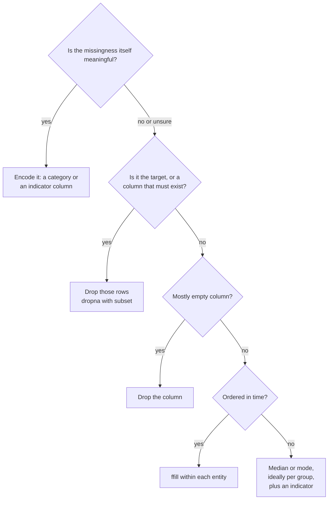

Almost every real dataset has holes: a sensor that dropped out, a survey question someone skipped, a field that did not exist when older records were created, a join that found no match. Most machine learning models cannot accept missing values at all, and the ones that can still behave differently depending on how the gaps were handled. Worse, *why* a value is missing is often informative in itself. This lesson covers how pandas represents missing data, how to find it, and how to decide between dropping, filling and flagging.

## How pandas represents "missing"

pandas has several missing-value markers, for historical reasons. You will meet all of them:

| Marker | Where it appears | Notes |
| --- | --- | --- |
| `np.nan` (shown `NaN`) | `float64` columns, and text columns in pandas 3 | A special float. Forces integer columns to become float |
| `None` | `object` columns | Python's null; pandas treats it as missing |
| `pd.NaT` | `datetime64` columns | "Not a Time" |
| `pd.NA` (shown `<NA>`) | Nullable dtypes: `Int64`, `Float64`, `boolean`, `string` | One consistent marker that works for every type |

The functions `isna()` and `notna()` recognise all of them, so you rarely need to care which one you have when *detecting* missing values. Where it matters is in **dtypes**:

```python
import pandas as pd
import numpy as np

ages = pd.Series([34, None, 51])
print(ages.dtype, ages.tolist())

ages_nullable = pd.Series([34, None, 51], dtype="Int64")
print(ages_nullable.dtype, ages_nullable.tolist())
```

```output
float64 [34.0, nan, 51.0]
Int64 [34, <NA>, 51]
```

With NumPy dtypes, a single missing value turns an integer column into floats. The nullable `Int64` dtype keeps the integers and marks the gap with `pd.NA`. You can convert a whole DataFrame to nullable dtypes with `df.convert_dtypes()`, or at read time with `pd.read_csv(..., dtype_backend="numpy_nullable")`.

### `NaN` is not equal to anything

A missing value is not equal to itself, so you can never find missing values with `==`:

```python
print(np.nan == np.nan)
print(pd.Series([1.0, np.nan]) == np.nan)
print(pd.NA == 1)
```

```output
False
0    False
1    False
dtype: bool
<NA>
```

`pd.NA` goes further: comparisons with it return `<NA>` ("unknown") rather than `False`. Always use `isna()`.

## Finding missing values

Start every analysis with a missing-value report:

```python
patients = pd.DataFrame({
    "patient_id": [1, 2, 3, 4, 5, 6, 7, 8],
    "ward": ["A", "A", "B", "B", "B", "C", "C", None],
    "age": [34, 51, np.nan, 47, 62, np.nan, 29, 40],
    "blood_pressure": [120, np.nan, 135, np.nan, 150, 118, np.nan, 125],
    "discharged": pd.to_datetime(["2024-01-03", None, "2024-01-05", "2024-01-06",
                                  None, "2024-01-09", "2024-01-09", "2024-01-10"]),
})

report = pd.DataFrame({
    "missing": patients.isna().sum(),
    "percent": patients.isna().mean().mul(100).round(1),
})
print(report)
```

```output
                missing  percent
patient_id            0      0.0
ward                  1     12.5
age                   2     25.0
blood_pressure        3     37.5
discharged            2     25.0
```

`isna()` returns a DataFrame of booleans. Summing booleans counts the `True` values, and taking the mean gives the fraction missing. To see the incomplete rows themselves, use `patients[patients.isna().any(axis=1)]`.

## Why is it missing?

Before choosing a strategy, think about the mechanism. Statisticians name three cases:

| Mechanism | Meaning | Example | Consequence |
| --- | --- | --- | --- |
| Missing completely at random (MCAR) | Unrelated to anything | A random packet loss | Dropping rows loses data but does not bias it |
| Missing at random (MAR) | Explained by other observed columns | Older patients skip an online form more often | Filling using related columns works well |
| Missing not at random (MNAR) | Related to the missing value itself | People with high incomes decline to state income | Any fill is biased; the fact of missingness is a signal |

In the patient data, `discharged` is missing for patients still in hospital. That is not noise; it means "not yet discharged". Filling it with the average discharge date would be nonsense. Knowing the domain matters more than any function.

## Option 1: drop

`dropna` removes rows (or columns) that contain missing values:

```python
print(len(patients.dropna()), "rows with no missing values at all")
print(len(patients.dropna(subset=["age"])), "rows with a known age")
print(len(patients.dropna(thresh=4)), "rows with at least 4 non-missing values")
```

```output
1 rows with no missing values at all
6 rows with a known age
7 rows with at least 4 non-missing values
```

Dropping every incomplete row kept only one of eight patients. Missing values in different columns compound quickly, so `dropna()` with no arguments can quietly discard most of a dataset. Prefer `subset=` with the columns that genuinely must be present (often the target you want to predict).

Dropping a **column** makes sense when it is mostly empty and you do not expect it to be filled in future data: `df.dropna(axis=1, thresh=int(0.5 * len(df)))` keeps columns that are at least half full.

## Option 2: fill (impute)

**Imputation** means replacing missing values with an estimate. The right estimate depends on the column:

```python
filled = patients.assign(
    ward=patients["ward"].fillna("unknown"),                     # categorical: explicit label
    age=patients["age"].fillna(patients["age"].median()),        # numeric: median
)
print(filled[["patient_id", "ward", "age"]])
```

```output
   patient_id     ward   age
0           1        A  34.0
1           2        A  51.0
2           3        B  43.5
3           4        B  47.0
4           5        B  62.0
5           6        C  43.5
6           7        C  29.0
7           8  unknown  40.0
```

The median is usually safer than the mean for numeric columns because outliers do not drag it around. For categorical columns, a separate `"unknown"` category is honest: it lets the model learn whether "unknown" behaves differently from the known categories.

### Filling within groups

A global median ignores structure. If blood pressure differs by ward, fill each patient with their own ward's median. `groupby(...).transform` computes a value per group and broadcasts it back to every row, keeping the original shape:

```python
ward_median = patients.groupby("ward")["blood_pressure"].transform("median")
print(ward_median.tolist())

patients_bp = patients.assign(blood_pressure=patients["blood_pressure"].fillna(ward_median))
print(patients_bp[["ward", "blood_pressure"]])
```

```output
[120.0, 120.0, 142.5, 142.5, 142.5, 118.0, 118.0, nan]
  ward  blood_pressure
0    A           120.0
1    A           120.0
2    B           135.0
3    B           142.5
4    B           150.0
5    C           118.0
6    C           118.0
7  NaN           125.0
```

Patient 2 in ward A got ward A's median (120), and patient 4 in ward B got ward B's median (142.5). Patient 7 in ward C got C's median. The [grouping lesson](/learn/pandas/grouping-and-aggregation) explains `transform` in detail.

### Time series: carry forward or interpolate

For readings over time, the previous value is often the best guess. `ffill` (forward fill) carries the last known value forward, and `interpolate` draws a straight line between known neighbours:

```python
temps = pd.Series([20.0, np.nan, np.nan, 23.0, np.nan, 25.0],
                  index=pd.date_range("2024-06-01 09:00", periods=6, freq="h"))
print(pd.DataFrame({"raw": temps, "ffill": temps.ffill(), "interpolated": temps.interpolate()}))
```

```output
                      raw  ffill  interpolated
2024-06-01 09:00:00  20.0   20.0          20.0
2024-06-01 10:00:00   NaN   20.0          21.0
2024-06-01 11:00:00   NaN   20.0          22.0
2024-06-01 12:00:00  23.0   23.0          23.0
2024-06-01 13:00:00   NaN   23.0          24.0
2024-06-01 14:00:00  25.0   25.0          25.0
```

Never forward-fill across different entities (one sensor's last reading into the next sensor's rows). Group first: `df.groupby("sensor_id")["reading"].ffill()`.

> [!WARNING]
> Never use `bfill` (backward fill) or `interpolate` on data a model will be trained on to predict the future. Both use values from later in time to fill earlier gaps, which leaks information the model will not have when it runs for real.

## Option 3: flag, then fill

Because missingness can carry information, the most robust approach for modelling is often to record **that** a value was missing in its own column, then fill it:

```python
flagged = patients.assign(
    bp_missing=patients["blood_pressure"].isna().astype(int),
    blood_pressure=patients["blood_pressure"].fillna(patients["blood_pressure"].median()),
)
print(flagged[["patient_id", "blood_pressure", "bp_missing"]])
```

```output
   patient_id  blood_pressure  bp_missing
0           1           120.0           0
1           2           125.0           1
2           3           135.0           0
3           4           125.0           1
4           5           150.0           0
5           6           118.0           0
6           7           125.0           1
7           8           125.0           0
```

If blood pressure was not measured because a patient seemed healthy, the `bp_missing` column lets a model pick that up.

## Choosing a strategy



> [!KEY]
> Fill values are learned from data, so they are part of your model. Compute medians and means on the **training set only** and reuse those exact numbers on validation, test and production data. Computing them on the full dataset leaks information from the test set into training. [Feature preparation](/learn/pandas/feature-preparation) shows how to structure this.

## Missing values in calculations

Most pandas aggregations skip missing values by default, which is convenient but can mislead:

```python
s = pd.Series([10, np.nan, 30])
print(s.sum(), s.mean(), s.count(), len(s))
print(s.sum(skipna=False))
```

```output
40.0 20.0 2 3
nan
```

The mean is 20, the average of the two values that exist, not of three. `count()` counts non-missing values and `len()` counts rows; comparing them is a quick sanity check.

Boolean logic with `pd.NA` follows "three-valued" logic: `True | pd.NA` is `True` (the answer is true whatever the unknown is), while `False | pd.NA` is `<NA>` (it depends on the unknown):

```python
flags = pd.Series([True, False, pd.NA], dtype="boolean")
print((flags | pd.NA).tolist())
print((flags & False).tolist())
```

```output
[True, <NA>, <NA>]
[False, False, False]
```

## Exercises

**1.** Given `df = pd.DataFrame({"a": [1, None, 3, None], "b": [None, None, 6, 8], "c": [1, 2, 3, 4]})`, print the number of missing values per column, then the rows where both `a` and `b` are missing.

<details>
<summary>Show solution</summary>

```python
df = pd.DataFrame({"a": [1, None, 3, None], "b": [None, None, 6, 8], "c": [1, 2, 3, 4]})
print(df.isna().sum())
print(df[df["a"].isna() & df["b"].isna()])   # only row 1
```

</details>

**2.** Fill missing `age` values in the `patients` DataFrame with the median age of each ward, and add an `age_missing` indicator. What happens to the patient whose ward is also missing?

<details>
<summary>Show solution</summary>

```python
out = patients.assign(
    age_missing=patients["age"].isna().astype(int),
    age=patients["age"].fillna(patients.groupby("ward")["age"].transform("median")),
)
print(out[["ward", "age", "age_missing"]])
```

By default `groupby` drops rows whose key is missing, so `transform` returns `NaN` for that patient. In this data the patient with no ward has a known age, so nothing changes. In general, follow a group fill with a global fill as a fallback: `.fillna(patients["age"].median())`.

</details>

**3.** A colleague fills missing values in a house-price dataset with the overall mean of each column, computed before splitting into train and test sets. What is wrong, and how would you fix it?

<details>
<summary>Show solution</summary>

The means include test-set rows, so information from the test set has leaked into the training data, and the test score will be slightly optimistic. Split first, compute the fill values on the training set only, then apply those same values to the test set (and later to production data).

</details>

```quiz
[
  {
    "q": "Why does `df[df[\"age\"] == np.nan]` return no rows even when `age` has missing values?",
    "options": ["`np.nan` is never equal to anything, including itself", "`==` is not supported on float columns", "Missing values are stored as `None`, not `NaN`", "The filter needs `.loc`"],
    "answer": 0,
    "why": "By definition `NaN != NaN`. Use `df[df[\"age\"].isna()]`."
  },
  {
    "q": "A column of integer counts has one missing value. Which dtype keeps the values as integers?",
    "options": ["`int64`", "`float64`", "`Int64`", "`object`"],
    "answer": 2,
    "why": "The capitalised nullable `Int64` dtype supports `pd.NA`. NumPy `int64` cannot represent a missing value, so pandas would upcast to `float64`."
  },
  {
    "q": "What does `df.groupby(\"ward\")[\"bp\"].transform(\"median\")` return?",
    "options": ["One median per ward, indexed by ward", "A Series the same length as `df`, where each row holds its ward's median", "The overall median repeated for every row", "A DataFrame with one column per ward"],
    "answer": 1,
    "why": "`transform` broadcasts each group's result back to the original rows, which makes it ideal for `fillna`."
  },
  {
    "q": "For a model that forecasts tomorrow's demand, which fill method risks leaking future information?",
    "options": ["`ffill()`", "Filling with a constant", "Adding a missing-value indicator", "`bfill()`"],
    "answer": 3,
    "why": "Backward fill copies a later value into an earlier gap, so the model would see data from the future during training."
  }
]
```
