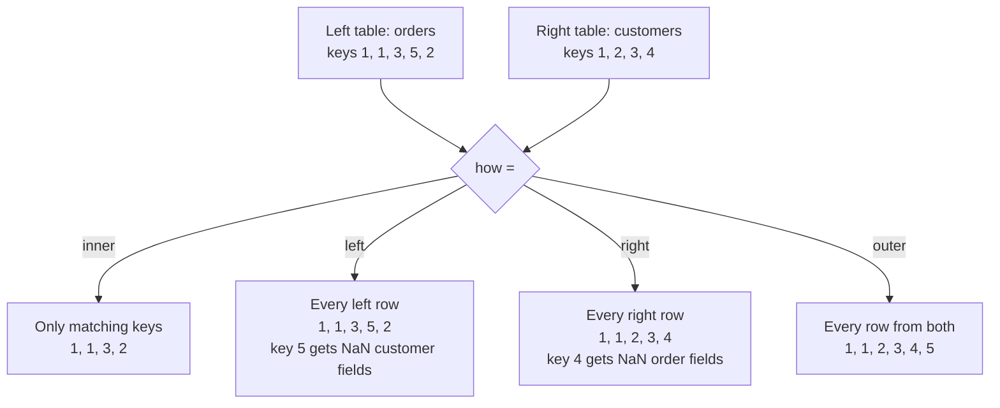
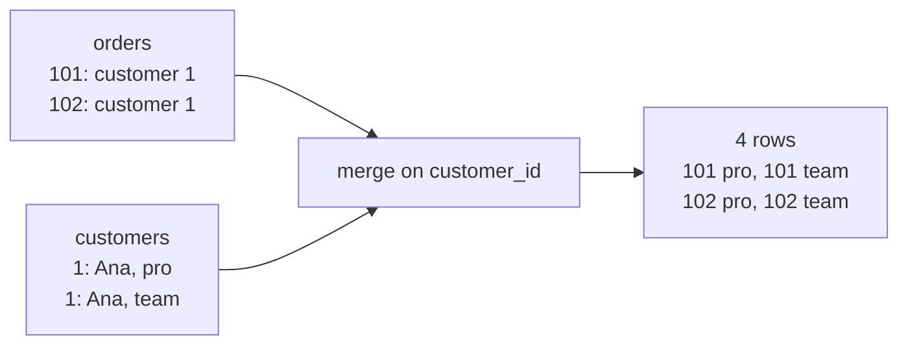

Useful data is spread across tables. Orders live in one table, customers in another, product details in a third; model predictions sit in one file and the ground-truth labels in another. To answer almost any real question, or to build a training set, you combine them on a shared **key**. pandas does this with `merge`, which works like a SQL join. Merging is also where some of the most expensive silent bugs in data work happen: a duplicate key that doubles your revenue, or a failed match that quietly drops a third of your training data. This lesson teaches both the mechanics and the checks that catch those bugs.

## Two tables and a key

```python
import pandas as pd

customers = pd.DataFrame({
    "customer_id": [1, 2, 3, 4],
    "name": ["Ana", "Ben", "Chen", "Dara"],
    "segment": ["pro", "free", "pro", "team"],
})

orders = pd.DataFrame({
    "order_id": [101, 102, 103, 104, 105],
    "customer_id": [1, 1, 3, 5, 2],
    "amount": [30.0, 45.0, 12.5, 99.0, 20.0],
})
print(customers)
print(orders)
```

```output
   customer_id  name segment
0            1   Ana     pro
1            2   Ben    free
2            3  Chen     pro
3            4  Dara    team
   order_id  customer_id  amount
0       101            1    30.0
1       102            1    45.0
2       103            3    12.5
3       104            5    99.0
4       105            2    20.0
```

Note the awkward cases, which are typical: customer 4 (Dara) has no orders, and order 104 belongs to customer 5, who is not in the customer table.

```python
merged = pd.merge(orders, customers, on="customer_id", how="inner")
print(merged)
```

```output
   order_id  customer_id  amount  name segment
0       101            1    30.0   Ana     pro
1       102            1    45.0   Ana     pro
2       103            3    12.5  Chen     pro
3       105            2    20.0   Ben    free
```

`on` names the key column, and `how` chooses what happens to rows without a match. The inner join kept only orders whose customer exists: order 104 vanished, and so did Dara.

## Join types

The `how` argument decides which unmatched rows survive:



| `how` | Keeps | Unmatched columns filled with | Typical use |
| --- | --- | --- | --- |
| `"inner"` (default) | Rows whose key is in both tables | (none kept) | Analysis where only complete pairs matter |
| `"left"` | All rows of the left table | `NaN` | Enriching a main table with extra attributes |
| `"right"` | All rows of the right table | `NaN` | Same as left with arguments swapped; rarely needed |
| `"outer"` | All rows of both | `NaN` | Reconciling two sources to find mismatches |
| `"cross"` | Every left row paired with every right row | (no key) | Building all combinations, such as every model with every prompt |

The left join is the workhorse. You have a main table (one row per thing you care about) and want to bolt on columns from elsewhere without losing any main rows:

```python
print(pd.merge(orders, customers, on="customer_id", how="left"))
```

```output
   order_id  customer_id  amount  name segment
0       101            1    30.0   Ana     pro
1       102            1    45.0   Ana     pro
2       103            3    12.5  Chen     pro
3       104            5    99.0   NaN     NaN
4       105            2    20.0   Ben    free
```

Order 104 survived with `NaN` in the customer columns, which is exactly the signal you want: an order with no known customer is a data problem worth investigating.

```python
print(pd.merge(orders, customers, on="customer_id", how="outer"))
```

```output
   order_id  customer_id  amount  name segment
0     101.0            1    30.0   Ana     pro
1     102.0            1    45.0   Ana     pro
2     105.0            2    20.0   Ben    free
3     103.0            3    12.5  Chen     pro
4       NaN            4     NaN  Dara    team
5     104.0            5    99.0   NaN     NaN
```

The outer join keeps both orphans: order 104 without a customer, and Dara without an order. Because Dara has no order, her `order_id` is missing and the column became `float64`.

## Finding unmatched rows with `indicator=`

`indicator=True` adds a `_merge` column that records where each row came from. It turns "did everything match?" into a one-line check:

```python
check = pd.merge(orders, customers, on="customer_id", how="outer", indicator=True)
print(check["_merge"].value_counts())
print(check.loc[check["_merge"] != "both", ["order_id", "customer_id", "name", "_merge"]])
```

```output
_merge
both          4
left_only     1
right_only    1
Name: count, dtype: int64
   order_id  customer_id  name      _merge
4       NaN            4  Dara  right_only
5     104.0            5   NaN   left_only
```

`left_only` rows had no partner on the right, and `right_only` rows had no partner on the left. Run this check whenever you join data from two different systems; the size of the mismatch is often the most important number in the whole analysis.

An **anti-join** (rows in one table with no match in the other) uses the same column:

```python
customers_without_orders = (
    pd.merge(customers, orders[["customer_id"]], on="customer_id", how="left", indicator=True)
    .query("_merge == 'left_only'")
    .drop(columns="_merge")
)
print(customers_without_orders)
```

```output
   customer_id  name segment
4            4  Dara    team
```

## Duplicate keys and row explosion

Here is the bug that catches everyone. Suppose the customer table accidentally contains customer 1 twice, perhaps because the export included an old and a new record:

```python
customers_dup = pd.concat([
    customers,
    pd.DataFrame({"customer_id": [1], "name": ["Ana"], "segment": ["team"]}),
], ignore_index=True)

bad = pd.merge(orders, customers_dup, on="customer_id", how="left")
print(len(orders), "orders in,", len(bad), "rows out")
print("revenue before:", orders["amount"].sum(), " after:", bad["amount"].sum())
```

```output
5 orders in, 7 rows out
revenue before: 206.5  after: 281.5
```

When a key appears `m` times on the left and `n` times on the right, the merge produces `m × n` rows for that key. Customer 1 has two orders and now two customer records, so those two orders became four rows, and total revenue went up by 75 without anyone selling anything. No error, no warning.



### `validate=` makes the assumption explicit

You almost always know the relationship you expect. Each order has one customer, but a customer can have many orders: that is **many-to-one** from orders to customers. Tell pandas, and it raises an error if the data disagrees:

```python
try:
    pd.merge(orders, customers_dup, on="customer_id", how="left", validate="many_to_one")
except pd.errors.MergeError as e:
    print("MergeError:", str(e).splitlines()[0])
```

```output
MergeError: Merge keys are not unique in right dataset; not a many-to-one merge
```

| `validate=` | Asserts | Fails when |
| --- | --- | --- |
| `"one_to_one"` / `"1:1"` | Keys unique in both tables | Either side has a duplicate key |
| `"one_to_many"` / `"1:m"` | Keys unique in the left table | The left side has a duplicate key |
| `"many_to_one"` / `"m:1"` | Keys unique in the right table | The right side has a duplicate key (the common lookup case) |
| `"many_to_many"` / `"m:m"` | Nothing | Never; documents that you expect explosion |

> [!KEY]
> Every production merge should state its expected relationship with `validate=` and, when joining across systems, check `indicator=True` counts or assert the output row count. These two arguments turn the most common silent data bugs into loud errors.

A cheap extra guard for left joins is a row-count assertion:

```python
enriched = pd.merge(orders, customers, on="customer_id", how="left", validate="many_to_one")
assert len(enriched) == len(orders), "left join changed the number of rows"
```

## Keys with different names, types or several columns

Real tables rarely agree on names. `left_on` and `right_on` handle different column names, and `suffixes` resolves columns that exist in both tables:

```python
products = pd.DataFrame({"sku": ["A", "B"], "price": [10.0, 4.0]})
lines = pd.DataFrame({"product_code": ["A", "A", "B"], "qty": [1, 3, 2], "price": [9.0, 9.0, 4.0]})

joined = pd.merge(lines, products, left_on="product_code", right_on="sku",
                  how="left", suffixes=("_paid", "_list"), validate="many_to_one")
print(joined)
```

```output
  product_code  qty  price_paid sku  price_list
0            A    1         9.0   A        10.0
1            A    3         9.0   A        10.0
2            B    2         4.0   B         4.0
```

Joining on several columns works by passing a list: `on=["store_id", "date"]` matches rows only when both agree.

Key **types** must match. An ID stored as integers in one table and as text in the other will not join:

```python
ids_as_text = customers.assign(customer_id=customers["customer_id"].astype(str))
try:
    pd.merge(orders, ids_as_text, on="customer_id")
except ValueError as e:
    print("ValueError:", e)
```

```output
ValueError: You are trying to merge on int64 and str columns for key 'customer_id'. If you wish to proceed you should use pd.concat
```

pandas refuses rather than silently matching nothing, but other mismatches, such as `"001"` versus `"1"` or trailing spaces, do produce silent non-matches. Clean keys (see [data cleaning](/learn/pandas/data-cleaning)) before you join, and check `indicator=True` afterwards.

## Joining on the index and stacking with `concat`

When the key is the index, `DataFrame.join` is a short form of a left merge on the index:

```python
segment_budget = pd.DataFrame({"budget": [500, 0, 2000]}, index=["pro", "free", "team"])
print(customers.join(segment_budget, on="segment"))
```

```output
   customer_id  name segment  budget
0            1   Ana     pro     500
1            2   Ben    free       0
2            3  Chen     pro     500
3            4  Dara    team    2000
```

`merge` and `join` combine tables **side by side** on a key. To stack tables with the same columns **on top of each other**, such as monthly files, use `pd.concat`:

```python
jan = pd.DataFrame({"order_id": [1, 2], "amount": [10.0, 20.0]})
feb = pd.DataFrame({"order_id": [3], "amount": [15.0]})
print(pd.concat([jan, feb], ignore_index=True))
```

```output
   order_id  amount
0         1    10.0
1         2    20.0
2         3    15.0
```

`ignore_index=True` renumbers the rows; without it you get duplicate index labels (0, 1, 0). To catch accidental duplicates across the pieces, add `verify_integrity=True` together with a meaningful index.

> [!TIP]
> If you know SQL joins, `merge` maps directly: `how="left"` is `LEFT JOIN`, `on=` is the `ON` clause. The [SQL joins lesson](/learn/sql-and-databases/joins) covers the same ideas in the database, where large joins usually belong.

## Exercises

**1.** Using `orders` and `customers`, compute total order amount per segment. Make sure orders without a known customer appear in a segment called `"unknown"` rather than disappearing.

<details>
<summary>Show solution</summary>

```python
per_segment = (
    pd.merge(orders, customers, on="customer_id", how="left", validate="many_to_one")
    .assign(segment=lambda d: d["segment"].fillna("unknown"))
    .groupby("segment")["amount"].sum()
)
print(per_segment)
```

A left join keeps order 104; an inner join would have silently dropped its 99.0.

</details>

**2.** You merge a predictions table (one row per `example_id`) with a labels table and get more rows than predictions. Write the code that finds out why.

<details>
<summary>Show solution</summary>

```python
preds = pd.DataFrame({"example_id": [1, 2, 3], "pred": [0, 1, 1]})
labels = pd.DataFrame({"example_id": [1, 2, 2, 3], "label": [0, 1, 1, 0]})

print(labels[labels["example_id"].duplicated(keep=False)])   # the duplicated keys
# then make the expectation explicit so it can never happen silently:
# pd.merge(preds, labels, on="example_id", validate="one_to_one")   -> MergeError
```

Duplicate keys in the labels table multiply rows. Deduplicate the labels (deciding which copy is right), then merge with `validate="one_to_one"`.

</details>

**3.** Find the product codes that appear in `lines` but not in `products`, using `indicator=`.

<details>
<summary>Show solution</summary>

```python
missing = (
    pd.merge(lines, products, left_on="product_code", right_on="sku", how="left", indicator=True)
    .loc[lambda d: d["_merge"] == "left_only", "product_code"]
    .unique()
)
print(missing)   # empty here: every code matched
```

</details>

```quiz
[
  {
    "q": "A left table has key `7` twice and the right table has key `7` three times. How many rows does an inner merge produce for key `7`?",
    "options": ["2", "3", "5", "6"],
    "answer": 3,
    "why": "Each left row pairs with every matching right row: 2 x 3 = 6."
  },
  {
    "q": "You enrich `orders` with customer attributes and want the merge to fail if any customer appears twice in the customer table. Which argument do you pass?",
    "options": ["`validate=\"many_to_one\"`", "`validate=\"one_to_many\"`", "`indicator=True`", "`how=\"inner\"`"],
    "answer": 0,
    "why": "Many orders to one customer: the right table's keys must be unique, which `many_to_one` checks."
  },
  {
    "q": "After `pd.merge(a, b, on=\"id\", how=\"outer\", indicator=True)`, what does a `_merge` value of `right_only` mean?",
    "options": ["The row's key appears in both tables", "The row's key appears only in `a`", "The row's key appears only in `b`", "The row has missing values in `b`'s columns"],
    "answer": 2,
    "why": "`right_only` marks rows that came from the right table (`b`) with no matching key in the left table."
  },
  {
    "q": "Which operation stacks January and February tables with identical columns into one table?",
    "options": ["`pd.merge(jan, feb, how=\"outer\")`", "`pd.concat([jan, feb], ignore_index=True)`", "`jan.join(feb)`", "`pd.merge(jan, feb, how=\"cross\")`"],
    "answer": 1,
    "why": "`concat` stacks along rows. `merge` and `join` combine side by side on keys."
  }
]
```
