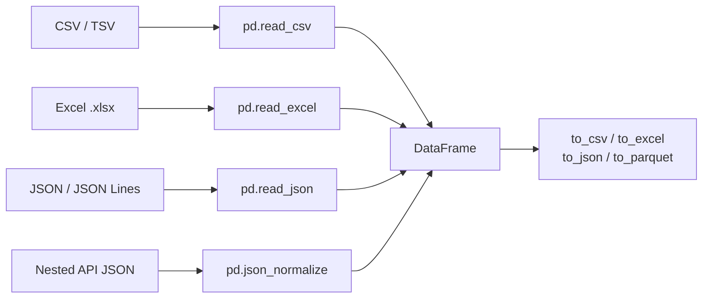

Data rarely starts life inside Python. It arrives as a CSV export from a database, an Excel workbook from the finance team, a JSON response from an API, or a JSON Lines file of prompts and completions for fine-tuning. Loading it correctly is the first step of every analysis, and most "the model is behaving strangely" bugs can be traced back to a column that was read as text instead of numbers, or dates that were never parsed.

In [JSON and CSV](/learn/python-programming/json-and-csv) you read these formats with the standard library, one record at a time. pandas reads a whole file straight into a DataFrame and gives you control over types, missing values and size.

## The read and write functions



Every reader accepts a file path, a URL, or a file-like object. In this lesson the examples wrap text in `io.StringIO`, which behaves like an open file, so you can run them without downloading anything. With a real file you would simply write `pd.read_csv("data/events.csv")`.

## Reading CSV

```python
import io
import pandas as pd

csv_text = """user_id,signup_date,plan,monthly_spend
101,2024-01-15,pro,49.0
102,2024-02-03,free,0
103,2024-02-20,team,199.5
104,2024-03-11,free,0
"""

users = pd.read_csv(io.StringIO(csv_text))
print(users)
print(users.dtypes)
```

```output
   user_id signup_date  plan  monthly_spend
0      101  2024-01-15   pro           49.0
1      102  2024-02-03  free            0.0
2      103  2024-02-20  team          199.5
3      104  2024-03-11  free            0.0
user_id            int64
signup_date          str
plan                 str
monthly_spend    float64
dtype: object
```

pandas inferred `int64` and `float64` for the numbers, but `signup_date` is still text. pandas does not guess dates unless you ask. Fix it at read time:

```python
users = pd.read_csv(io.StringIO(csv_text), parse_dates=["signup_date"])
print(users.dtypes)
print(users["signup_date"].dt.month_name().tolist())
```

```output
user_id                   int64
signup_date      datetime64[us]
plan                        str
monthly_spend           float64
dtype: object
['January', 'February', 'February', 'March']
```

### The parameters you will actually use

| Parameter | Purpose | Example |
| --- | --- | --- |
| `sep` | Field separator | `sep=";"`, `sep="\t"` |
| `usecols` | Load only some columns (saves memory) | `usecols=["user_id", "plan"]` |
| `dtype` | Force column types instead of guessing | `dtype={"user_id": "string"}` |
| `parse_dates` | Convert columns to datetimes | `parse_dates=["created_at"]` |
| `na_values` | Extra strings to treat as missing | `na_values=["N/A", "-", "unknown"]` |
| `index_col` | Use a column as the row index | `index_col="user_id"` |
| `nrows` | Read only the first N rows (quick peek) | `nrows=1000` |
| `skiprows`, `comment` | Skip junk lines at the top or commented lines | `skiprows=2`, `comment="#"` |
| `decimal`, `thousands` | European or formatted numbers | `decimal=","`, `thousands="."` |
| `encoding` | Non-UTF-8 files | `encoding="latin-1"` |
| `chunksize` | Stream a huge file in pieces | `chunksize=100_000` |

### A messy, realistic CSV

Here is the kind of file you actually receive: a title line, semicolon separators, European decimal commas, and several spellings of "missing".

```python
messy = """Exported from billing system
id;country;amount;status
1;DE;1.234,50;paid
2;FR;N/A;pending
3;DE;87,00;-
4;ES;12,75;paid
"""

bills = pd.read_csv(
    io.StringIO(messy),
    skiprows=1,              # drop the title line
    sep=";",
    decimal=",",
    thousands=".",
    na_values=["N/A", "-"],
)
print(bills)
print(bills.dtypes)
```

```output
   id country   amount   status
0   1      DE  1234.50     paid
1   2      FR      NaN  pending
2   3      DE    87.00      NaN
3   4      ES    12.75     paid
id           int64
country        str
amount     float64
status         str
dtype: object
```

Without `decimal`, `thousands` and `na_values`, the `amount` column would have loaded as text, and every numeric operation on it would fail or, worse, silently do the wrong thing.

> [!TIP]
> After every read, run `df.dtypes` (or `df.info()`). A numeric column showing `object` or `str` means something in the file is not a number: a stray unit, a comma, a placeholder like `"N/A"`. Find it before you go any further.

### Identifiers are not numbers

Columns such as postcodes, phone numbers and product codes look numeric but are labels. Reading them as integers strips leading zeros:

```python
codes = "sku,qty\n00731,4\n01200,2\n"
print(pd.read_csv(io.StringIO(codes)))
print(pd.read_csv(io.StringIO(codes), dtype={"sku": "string"}))
```

```output
    sku  qty
0   731    4
1  1200    2
     sku  qty
0  00731    4
1  01200    2
```

### Files bigger than memory

For a file of many gigabytes, read only the columns you need and stream it in chunks, aggregating as you go:

```python
big = "plan,monthly_spend\n" + "pro,49\nfree,0\nteam,199\n" * 4   # pretend this is huge

total = 0.0
for chunk in pd.read_csv(io.StringIO(big), usecols=["monthly_spend"], chunksize=5):
    total += chunk["monthly_spend"].sum()
print(total)
```

```output
992.0
```

Each `chunk` is an ordinary DataFrame of at most `chunksize` rows, so memory use stays flat however large the file is. Declaring low-cardinality text columns as `dtype={"plan": "category"}` also shrinks memory considerably.

## Reading Excel

Excel files need an extra engine package. For modern `.xlsx` files that is `openpyxl`:

```bash
pip install openpyxl
```

```python
# Read the first sheet
sales = pd.read_excel("reports/q3_sales.xlsx")

# Read a named sheet, skipping a two-line banner, and only columns A to D
sales = pd.read_excel(
    "reports/q3_sales.xlsx",
    sheet_name="By region",
    skiprows=2,
    usecols="A:D",
)

# Read every sheet at once: returns a dict of {sheet name: DataFrame}
all_sheets = pd.read_excel("reports/q3_sales.xlsx", sheet_name=None)

# Write back out
sales.to_excel("reports/q3_clean.xlsx", sheet_name="clean", index=False)
```

`read_excel` returns an ordinary DataFrame, and it takes most of the same arguments as `read_csv` (`dtype`, `na_values`, `parse_dates`, `nrows`, `index_col`). The quirks are Excel-specific: merged header cells become `NaN` or `Unnamed: 1` style column names, dates may already arrive as datetimes (Excel stores them as numbers with date formatting), and formulas are read as their last saved values, not recalculated. If a workbook has a banner or notes above the table, `skiprows` and `header` are how you find the real header row.

> [!NOTE]
> Excel is fine as an input format, but avoid it as a storage format inside a pipeline. It is slow to read, limited to about a million rows per sheet, and invites manual edits. Convert to CSV or Parquet once and work from that.

## Reading JSON

JSON comes in a few layouts. The most common for tabular data is a list of records, one object per row:

```python
records = """[
  {"id": 1, "model": "gpt", "latency_ms": 120},
  {"id": 2, "model": "claude", "latency_ms": 340},
  {"id": 3, "model": "local", "latency_ms": 95}
]"""

print(pd.read_json(io.StringIO(records)))
```

```output
   id   model  latency_ms
0   1     gpt         120
1   2  claude         340
2   3   local          95
```

### JSON Lines

**JSON Lines** (`.jsonl`) puts one complete JSON object on each line. It is the standard format for fine-tuning datasets, evaluation results and application logs, because a file can be appended to and streamed line by line. Pass `lines=True`:

```python
jsonl = """{"prompt": "Translate: hello", "completion": "bonjour", "tokens": 7}
{"prompt": "Translate: cat", "completion": "chat", "tokens": 6}
{"prompt": "Translate: thank you", "completion": "merci", "tokens": 9}
"""

pairs = pd.read_json(io.StringIO(jsonl), lines=True)
print(pairs)
```

```output
                 prompt completion  tokens
0      Translate: hello    bonjour       7
1        Translate: cat       chat       6
2  Translate: thank you      merci       9
```

### Nested JSON from APIs

API responses are usually nested: objects inside objects, lists inside objects. `read_json` leaves nested parts as Python dicts inside cells, which is awkward to work with. `pd.json_normalize` flattens them into dotted column names:

```python
response = [
    {"id": "a1", "user": {"name": "Ana", "country": "PT"},
     "usage": {"input_tokens": 120, "output_tokens": 45}},
    {"id": "a2", "user": {"name": "Ben", "country": "UK"},
     "usage": {"input_tokens": 300, "output_tokens": 80}},
]

flat = pd.json_normalize(response)
print(flat)
```

```output
   id user.name user.country  usage.input_tokens  usage.output_tokens
0  a1       Ana           PT                 120                   45
1  a2       Ben           UK                 300                   80
```

When each record contains a list of child records (an order with several line items), use `record_path` to make one row per child, and `meta` to copy parent fields onto each row:

```python
orders = [
    {"order_id": 7, "customer": "Ana",
     "items": [{"sku": "A", "qty": 2}, {"sku": "B", "qty": 1}]},
    {"order_id": 8, "customer": "Ben",
     "items": [{"sku": "A", "qty": 5}]},
]

print(pd.json_normalize(orders, record_path="items", meta=["order_id", "customer"]))
```

```output
  sku  qty order_id customer
0   A    2        7      Ana
1   B    1        7      Ana
2   A    5        8      Ben
```

## Writing data back out

```python
out = io.StringIO()
users.to_csv(out, index=False)
print(out.getvalue())

print(pairs.to_json(orient="records", lines=True))
```

```output
user_id,signup_date,plan,monthly_spend
101,2024-01-15,pro,49.0
102,2024-02-03,free,0.0
103,2024-02-20,team,199.5
104,2024-03-11,free,0.0

{"prompt":"Translate: hello","completion":"bonjour","tokens":7}
{"prompt":"Translate: cat","completion":"chat","tokens":6}
{"prompt":"Translate: thank you","completion":"merci","tokens":9}
```

Pass `index=False` to `to_csv` unless the index carries real information; otherwise you get an extra unnamed column when you read the file back.

### Choosing a format

| Format | Keeps dtypes | Speed and size | Human-readable | Typical use |
| --- | --- | --- | --- | --- |
| CSV | No (everything is text) | Slow, large | Yes | Exchange with other tools and people |
| Excel | Partly | Slow | Yes, in a spreadsheet app | Business users |
| JSON / JSONL | Partly | Moderate | Yes | APIs, logs, LLM datasets |
| Parquet | Yes | Fast, compressed, columnar | No | Storage inside data pipelines |

Parquet (via `df.to_parquet("file.parquet")` and `pd.read_parquet`, which need the `pyarrow` package) stores the schema alongside the data, so dates stay dates and categories stay categories. The [Data Engineering Fundamentals](/learn/data-engineering-fundamentals) module returns to it.

> [!WARNING]
> CSV loses type information on every round trip. A datetime column written with `to_csv` comes back as text unless you pass `parse_dates` again. If you save intermediate results between pipeline steps, prefer Parquet.

## Exercises

**1.** Read this text into a DataFrame so that `price` is numeric, `added` is a datetime, and both `"?"` and an empty field count as missing: `"name|price|added\nlamp|19.99|2024-05-01\ndesk|?|2024-05-03\nchair||2024-05-07\n"`.

<details>
<summary>Show solution</summary>

```python
text = "name|price|added\nlamp|19.99|2024-05-01\ndesk|?|2024-05-03\nchair||2024-05-07\n"
df = pd.read_csv(io.StringIO(text), sep="|", na_values=["?"], parse_dates=["added"])
print(df.dtypes)   # price float64, added datetime64
```

Empty fields are already treated as missing by default; `na_values` adds `"?"` to that list.

</details>

**2.** Flatten this API response so you get one row per message with columns `role`, `content` and `conversation_id`: `[{"conversation_id": 1, "messages": [{"role": "user", "content": "Hi"}, {"role": "assistant", "content": "Hello"}]}]`.

<details>
<summary>Show solution</summary>

```python
data = [{"conversation_id": 1, "messages": [
    {"role": "user", "content": "Hi"},
    {"role": "assistant", "content": "Hello"}]}]
print(pd.json_normalize(data, record_path="messages", meta=["conversation_id"]))
```

</details>

**3.** You receive a 20 GB CSV of web events with 40 columns, and you only need the average of `duration_ms` per `country`. Sketch how you would compute it without loading the whole file.

<details>
<summary>Show solution</summary>

Read only the two columns, in chunks, and keep running sums and counts per country (an average of chunk averages would be wrong when chunks differ in size):

```python
sums, counts = None, None
for chunk in pd.read_csv("events.csv", usecols=["country", "duration_ms"], chunksize=1_000_000):
    g = chunk.groupby("country")["duration_ms"]
    sums = g.sum() if sums is None else sums.add(g.sum(), fill_value=0)
    counts = g.count() if counts is None else counts.add(g.count(), fill_value=0)

mean_per_country = sums / counts
```

Grouping is covered in [grouping and aggregation](/learn/pandas/grouping-and-aggregation).

</details>

```quiz
[
  {
    "q": "You read a CSV and `df.dtypes` shows the `revenue` column as text rather than `float64`. What is the most likely cause?",
    "options": ["The file is too large for pandas to infer types", "Some values in the column are not plain numbers, such as `\"N/A\"`, units or thousands separators", "CSV files cannot store floats", "You forgot to pass `index_col`"],
    "answer": 1,
    "why": "pandas falls back to text when any value cannot be parsed as a number. Use `na_values`, `thousands`, `decimal` or clean the column afterwards."
  },
  {
    "q": "Which call reads a JSON Lines fine-tuning file with one object per line?",
    "options": ["`pd.read_json(path, orient=\"lines\")`", "`pd.read_csv(path, sep=\"\\n\")`", "`pd.read_json(path, lines=True)`", "`pd.json_normalize(path)`"],
    "answer": 2,
    "why": "`lines=True` tells `read_json` that each line is a separate JSON record."
  },
  {
    "q": "Why should product codes like `00731` usually be read with `dtype=\"string\"`?",
    "options": ["Reading them as integers drops the leading zeros, changing the identifier", "Strings use less memory than integers", "pandas cannot sort integer columns", "It makes `read_csv` faster"],
    "answer": 0,
    "why": "Identifiers are labels, not quantities. As integers, `00731` becomes `731` and no longer matches other systems."
  },
  {
    "q": "What does `pd.read_csv(path, chunksize=100_000)` return?",
    "options": ["The first 100,000 rows as a DataFrame", "A DataFrame with the file split into 100,000-row partitions", "A list of every chunk, loaded into memory at once", "An iterator that yields DataFrames of up to 100,000 rows"],
    "answer": 3,
    "why": "With `chunksize`, `read_csv` returns a reader you loop over, so only one chunk is in memory at a time. `nrows` is what reads just the first N rows."
  }
]
```
