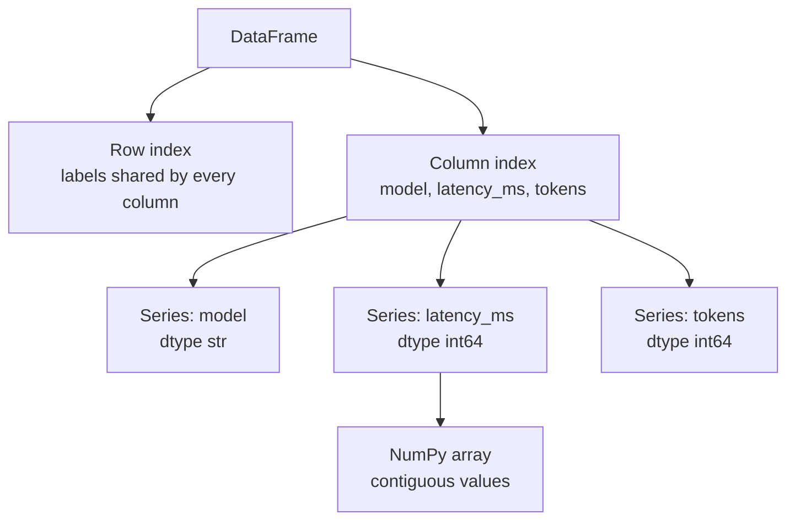

Almost every dataset an AI engineer touches arrives as a table: user events, product catalogues, survey responses, model evaluation results, logs of LLM calls with their latency and cost. NumPy gives you fast arrays of numbers, but a real table has named columns, mixed types and rows that mean something ("customer 1042", "the 3rd of March"). **pandas** adds exactly that layer on top of NumPy. It is the library you will use to load, inspect, clean and reshape data before any model sees it.

This lesson introduces the two objects everything else in pandas is built on: the **Series** and the **DataFrame**.

> [!NOTE]
> The outputs in this module come from pandas 3. Almost everything works identically in pandas 2.x; where behaviour differs (string columns and copy-on-write), the lesson says so. Check your version with `pd.__version__`.

## A Series: values with labels

A **Series** is a one-dimensional array of values plus an **index**: a label for each position.

```python
import pandas as pd
import numpy as np

latency = pd.Series([120, 340, 95], index=["gpt", "claude", "local"], name="latency_ms")
print(latency)
```

```output
gpt       120
claude    340
local      95
Name: latency_ms, dtype: int64
```

Underneath, the values live in a NumPy array, so everything you learned in [vectorization](/learn/numpy/vectorization) applies: arithmetic works on the whole Series at once, with no loop.

```python
print(latency.to_numpy())
print(latency / 1000)          # vectorised, returns a new Series
print(latency["claude"])       # look up by label
print(latency.mean())
```

```output
[120 340  95]
gpt       0.120
claude    0.340
local     0.095
Name: latency_ms, dtype: float64
340
185.0
```

If you do not supply an index, pandas uses `0, 1, 2, ...`, which is called a `RangeIndex`.

### Alignment by label

The index is not decoration. When you combine two Series, pandas matches values **by label, not by position**. This is the single biggest difference from NumPy.

```python
jan = pd.Series({"apples": 10, "pears": 4, "plums": 7})
feb = pd.Series({"pears": 6, "apples": 12, "figs": 3})

print(jan + feb)
```

```output
apples    22.0
figs       NaN
pears     10.0
plums      NaN
dtype: float64
```

`apples` was added to `apples` even though the two Series list them in different orders. `figs` and `plums` exist in only one of the two, so their sum is `NaN` (not a number), pandas' marker for a missing value. In NumPy, adding two arrays of different shapes either broadcasts or fails; in pandas, it aligns. That is usually what you want, and occasionally a source of surprising `NaN`s.

> [!KEY]
> pandas operations align on the index. When a result is unexpectedly full of `NaN`, check whether the two objects you combined have the same index labels.

## A DataFrame: a table of aligned columns

A **DataFrame** is a two-dimensional table. The cleanest mental model is a dictionary of Series that all share one row index.



The most common way to build one by hand is from a dictionary of columns:

```python
runs = pd.DataFrame({
    "model": ["gpt", "claude", "local", "claude", "gpt"],
    "latency_ms": [120, 340, 95, 310, 150],
    "tokens": [512, 2048, 256, 1900, 640],
    "passed": [True, True, False, True, False],
})
print(runs)
```

```output
    model  latency_ms  tokens  passed
0     gpt         120     512    True
1  claude         340    2048    True
2   local          95     256   False
3  claude         310    1900    True
4     gpt         150     640   False
```

You can also build one from a list of row dictionaries, the shape JSON records usually have:

```python
rows = [{"model": "gpt", "score": 0.81}, {"model": "local", "score": 0.64}]
print(pd.DataFrame(rows))
```

```output
   model  score
0    gpt   0.81
1  local   0.64
```

Each column has one **dtype** (data type). Different columns can have different dtypes, which is exactly what a 2-D NumPy array cannot do.

## Inspecting a DataFrame

When you load a dataset, the first five minutes should always be spent looking at it. These are the tools:

```python
print(runs.shape)        # (rows, columns)
print(runs.columns.tolist())
print(runs.dtypes)
```

```output
(5, 4)
['model', 'latency_ms', 'tokens', 'passed']
model           str
latency_ms    int64
tokens        int64
passed         bool
dtype: object
```

```python
runs.info()
```

```output
<class 'pandas.DataFrame'>
RangeIndex: 5 entries, 0 to 4
Data columns (total 4 columns):
 #   Column      Non-Null Count  Dtype
---  ------      --------------  -----
 0   model       5 non-null      str  
 1   latency_ms  5 non-null      int64
 2   tokens      5 non-null      int64
 3   passed      5 non-null      bool 
dtypes: bool(1), int64(2), str(1)
memory usage: 257.0 bytes
```

`info()` shows the row count, each column's non-null count and dtype, and memory use. A non-null count lower than the row count tells you a column has missing values.

```python
print(runs.describe())
```

```output
       latency_ms      tokens
count    5.000000     5.00000
mean   203.000000  1071.20000
std    113.556154   837.29278
min     95.000000   256.00000
25%    120.000000   512.00000
50%    150.000000   640.00000
75%    310.000000  1900.00000
max    340.000000  2048.00000
```

`describe()` summarises the numeric columns. For a large table, also use `runs.head()` and `runs.tail()` (first and last five rows) and `runs.sample(5, random_state=0)` (five random rows, which often reveal problems the first rows hide).

| Method | Answers |
| --- | --- |
| `df.shape` | How big is it? |
| `df.head()`, `df.sample(n)` | What do the rows look like? |
| `df.dtypes`, `df.info()` | Did each column load as the right type? Any missing values? |
| `df.describe()` | What ranges, means and spreads do the numbers have? |
| `df["col"].value_counts()` | Which values does a categorical column take, and how often? |

## Selecting data: `[]`, `.loc` and `.iloc`

There are three ways in, and mixing them up is the most common beginner bug.

| Syntax | Selects by | Example | Returns |
| --- | --- | --- | --- |
| `df["col"]` | Column name | `runs["tokens"]` | Series |
| `df[["a", "b"]]` | List of column names | `runs[["model", "tokens"]]` | DataFrame |
| `df.loc[rows, cols]` | **Labels** (index labels, column names) | `runs.loc[2, "model"]` | Scalar, Series or DataFrame |
| `df.iloc[rows, cols]` | **Integer positions** | `runs.iloc[0, 1]` | Scalar, Series or DataFrame |

```python
print(runs.loc[1:3, ["model", "latency_ms"]])   # label slice: 3 IS included
print(runs.iloc[1:3, 0:2])                      # position slice: 3 is excluded
```

```output
    model  latency_ms
1  claude         340
2   local          95
3  claude         310
    model  latency_ms
1  claude         340
2   local          95
```

The two look similar here because the index happens to be `0, 1, 2, ...`. They diverge as soon as the index is anything else, for example after sorting or filtering:

```python
by_latency = runs.sort_values("latency_ms")
print(by_latency)
print("loc[0]  ->", by_latency.loc[0, "model"])    # the row LABELLED 0
print("iloc[0] ->", by_latency.iloc[0]["model"])   # the FIRST row
```

```output
    model  latency_ms  tokens  passed
2   local          95     256   False
0     gpt         120     512    True
4     gpt         150     640   False
3  claude         310    1900    True
1  claude         340    2048    True
loc[0]  -> gpt
iloc[0] -> local
```

> [!WARNING]
> `.loc` slices include the end label; `.iloc` slices exclude the end position, like Python lists. Use `.loc` when you mean "the row called X" and `.iloc` when you mean "the row in position N". Never rely on the default integer index lining up with positions after you have sorted or filtered.

### Setting an index

Any column can become the row index, which turns lookups into label lookups:

```python
models = pd.DataFrame({
    "model": ["gpt", "claude", "local"],
    "context_k": [128, 200, 8],
}).set_index("model")

print(models)
print(models.loc["claude", "context_k"])
```

```output
        context_k
model            
gpt           128
claude        200
local           8
200
```

`reset_index()` does the reverse, turning the index back into an ordinary column.

## Adding and changing columns

Assigning to a new column name adds a column. The right-hand side is computed for every row at once:

```python
runs["ms_per_token"] = runs["latency_ms"] / runs["tokens"]
print(runs.head(3))
```

```output
    model  latency_ms  tokens  passed  ms_per_token
0     gpt         120     512    True      0.234375
1  claude         340    2048    True      0.166016
2   local          95     256   False      0.371094
```

The modern alternative is `assign`, which returns a **new** DataFrame instead of modifying the old one. Because it returns a DataFrame, you can chain several steps together, each on its own line:

```python
summary = (
    runs
    .assign(seconds=lambda d: d["latency_ms"] / 1000,
            long_prompt=lambda d: d["tokens"] > 1000)
    .loc[:, ["model", "seconds", "long_prompt"]]
)
print(summary)
```

```output
    model  seconds  long_prompt
0     gpt    0.120        False
1  claude    0.340         True
2   local    0.095        False
3  claude    0.310         True
4     gpt    0.150        False
```

The `lambda d:` receives the DataFrame at that point in the chain, so later steps can use columns created by earlier ones. This style, called **method chaining**, reads top to bottom like a recipe and leaves the original `runs` untouched. You will see it throughout this module.

To delete columns, use `drop(columns=[...])`; to rename them, `rename(columns={"old": "new"})`. Both return a new DataFrame.

## Dtypes worth knowing

| Dtype | Holds | Notes |
| --- | --- | --- |
| `int64`, `float64` | Numbers | NumPy-backed, fast. `int64` cannot hold missing values |
| `bool` | `True`/`False` | Used for filter masks |
| `str` (pandas 3) / `object` (pandas 2) | Text | pandas 2 stores text as generic Python objects |
| `datetime64[ns]`, `datetime64[us]` | Timestamps | Unlocks the `.dt` accessor |
| `category` | Repeated labels | Saves memory, useful for grouping |
| `Int64`, `Float64`, `boolean`, `string` | Nullable versions | Capitalised names; missing values shown as `<NA>` |

Convert with `astype`:

```python
counts = pd.Series([3, 1, None])
print(counts.dtype)                 # the None forced float
print(counts.astype("Int64"))       # nullable integer keeps whole numbers
```

```output
float64
0       3
1       1
2    <NA>
dtype: Int64
```

A plain integer column that gains a missing value silently becomes `float64`. The capitalised **nullable** dtypes avoid that. The lesson on [handling missing values](/learn/pandas/handling-missing-values) covers them properly.

When you need the raw numbers for a model or for NumPy, `df.to_numpy()` returns a NumPy array. With mixed column types it becomes an `object` array, so select the numeric columns first.

## Exercises

**1.** Build a DataFrame of four (invented) towns with columns `city`, `population_m` and `area_km2` (make up the numbers). Add a `density` column (people per square kilometre) using `assign`, then print only the `city` and `density` columns.

<details>
<summary>Show solution</summary>

```python
cities = pd.DataFrame({
    "city": ["Ashby", "Brook", "Calder", "Dunmore"],
    "population_m": [15.4, 10.7, 0.7, 7.2],
    "area_km2": [1171, 2672, 454, 516],
})
out = (
    cities
    .assign(density=lambda d: d["population_m"] * 1_000_000 / d["area_km2"])
    [["city", "density"]]
)
print(out)
```

</details>

**2.** Predict the output, then run it: `pd.Series([1, 2, 3], index=["a", "b", "c"]) + pd.Series([10, 20, 30], index=["b", "c", "d"])`.

<details>
<summary>Show solution</summary>

Labels are aligned: `a` and `d` appear in only one Series, so they become `NaN`. `b` is `2 + 10 = 12` and `c` is `3 + 20 = 23`. The result has dtype `float64` because `NaN` is a float.

```python
s = pd.Series([1, 2, 3], index=["a", "b", "c"]) + pd.Series([10, 20, 30], index=["b", "c", "d"])
print(s)
```

</details>

**3.** Using the `runs` DataFrame from this lesson, sort it by `tokens` descending, then retrieve the model of the row in first position and the model of the row with index label `0`. Why do they differ?

<details>
<summary>Show solution</summary>

```python
s = runs.sort_values("tokens", ascending=False)
print(s.iloc[0]["model"], s.loc[0, "model"])
```

Sorting reorders the rows but keeps their labels. `.iloc[0]` is the first row after sorting (`claude`, 2048 tokens); `.loc[0]` is the row that was labelled `0` originally (`gpt`).

</details>

```quiz
[
  {
    "q": "What happens when you add two Series whose indexes contain different labels?",
    "options": ["pandas raises an error because the shapes differ", "Values are added by position and extra values are dropped", "Values are matched by label, and labels present in only one Series give `NaN`", "pandas broadcasts the shorter Series like NumPy"],
    "answer": 2,
    "why": "pandas aligns on the index. Labels that appear in only one operand have nothing to add to, so the result is missing (`NaN`)."
  },
  {
    "q": "With the default integer index, which rows does `df.loc[1:3]` return?",
    "options": ["Rows labelled 1, 2 and 3", "Rows labelled 1 and 2", "Rows in positions 1 and 2", "Rows in positions 0 to 3"],
    "answer": 0,
    "why": "`.loc` slices by label and includes the end label. `.iloc[1:3]` would give positions 1 and 2."
  },
  {
    "q": "Why is `df.assign(...)` preferred over `df[\"new\"] = ...` inside a method chain?",
    "options": ["It is always faster", "It returns a new DataFrame, so it can be chained and leaves the original unchanged", "It is the only way to create columns from other columns", "It converts the column to a nullable dtype"],
    "answer": 1,
    "why": "`assign` returns a new DataFrame, which lets you write a pipeline of steps top to bottom without mutating the input."
  },
  {
    "q": "An integer column of user ages gains one missing value. What dtype does pandas give it by default?",
    "options": ["`int64`", "`object`", "`Int64`", "`float64`"],
    "answer": 3,
    "why": "NumPy integers cannot represent missing values, so pandas upcasts to `float64` and uses `NaN`. Converting to the nullable `Int64` keeps whole numbers with `<NA>`."
  }
]
```
